# Báo Cáo Lỗi Chi Tiết (Bug Report) — HW03-AI (Phạm Vi M1)

## 1. Thông Tin Tổng Quan & Liên Kết GitHub Issues

| Hạng mục | Nội dung chi tiết |
| :--- | :--- |
| **Sinh viên thực hiện** | Huỳnh Đức Thịnh (`23120199` — `23120199@student.hcmus.edu.vn`) |
| **Hệ thống kiểm thử (SUT)** | EShop Web & API (`./eshop-sut`, commit gốc `1a9304a`) |
| **Phạm vi kiểm thử (`M1`)** | `Register` (chính), `Login`, `ForgotPassword` (2 bước), `Profile` (khối Hồ sơ), `Header/Navbar` |
| **Trang GitHub Issues chính thức** | [https://github.com/HuynhDucThinh/Software-Testing-HW03/issues](https://github.com/HuynhDucThinh/Software-Testing-HW03/issues) |
| **Tổng số mục Checklist `Failed`** | **`45 / 59` mục độc lập** (`130 / 168` lượt kiểm tra thực thi trên 3 nền tảng `P1`, `P2`, `P3`) |
| **Tổng số Bug sau gom nhóm chống trùng** | **`28` Bugs (`BUG-01` .. `BUG-28`: `27` từ Task 1 Checklist + `1` lỗi mới `BUG-28` từ Task 2 Usability)** — tương ứng **28 GitHub Issues (`#1` .. `#28`)** |
| **Ảnh chụp tổng quan trang GitHub Issues** | [`GitHub_Issues_Overview_Page1.png`](screenshots/github_issues/GitHub_Issues_Overview_Page1.png), [`GitHub_Issues_Overview_Page2.png`](screenshots/github_issues/GitHub_Issues_Overview_Page2.png) |

---

## 2. Thống Kê Phân Bố Lỗi (Bug Statistics)

### 2.1. Theo mức độ nghiêm trọng (`Severity`)

| Mức độ nghiêm trọng (`Severity`) | Số lượng Bug | Tỷ lệ | Các mã Bug tiêu biểu |
| :--- | :---: | :---: | :--- |
| **Critical** (Chặn hoàn thành luồng chính / lỗ hổng bảo mật nghiêm trọng) | **5** | 17.86% | `BUG-01` .. `BUG-05` |
| **Major** (Sai đặc tả gây khó khăn, mất đồng bộ trạng thái hoặc nhầm lẫn đáng kể) | **11** | 39.29% | `BUG-06` .. `BUG-13`, `BUG-15`, `BUG-16`, **`BUG-28`** *(Task 2)* |
| **Minor** (Sai chuẩn UI/đặc tả phụ nhưng luồng chính vẫn hoàn thành được) | **11** | 39.29% | `BUG-14`, `BUG-17` .. `BUG-26` |
| **Cosmetic** (Khác biệt thị giác / tương tác nhỏ) | **1** | 3.57% | `BUG-27` |
| **Tổng cộng** | **28** | **100.00%** | `BUG-01` .. `BUG-27` (`45/45` mục `Failed` Task 1) + `BUG-28` (Phiên Usability `S05` Task 2) |

### 2.2. Theo khía cạnh giao diện (`IA-01` .. `IA-04`) và Loại lỗi

| Phân nhóm | Số lượng Bug | Danh sách mã Bug |
| :--- | :---: | :--- |
| **`IA-01` — General UI standards** | **5** | `BUG-13`, `BUG-14`, `BUG-18`, `BUG-19`, `BUG-20` |
| **`IA-02` — Forms** | **11** | `BUG-01`, `BUG-04`, `BUG-05`, `BUG-07`, `BUG-08`, `BUG-09`, `BUG-12`, `BUG-17`, `BUG-22`, `BUG-23`, `BUG-24` |
| **`IA-03` — Navigation** | **5** | `BUG-10`, `BUG-15`, `BUG-21`, `BUG-25`, `BUG-27` |
| **`IA-04` — Feedback / state** | **7** | `BUG-02`, `BUG-03`, `BUG-06`, `BUG-11`, `BUG-16`, `BUG-26`, `BUG-28` |
| **Loại lỗi `State`** | **15** | `BUG-01`, `BUG-02`, `BUG-03`, `BUG-05`, `BUG-06`, `BUG-07`, `BUG-08`, `BUG-09`, `BUG-10`, `BUG-11`, `BUG-12`, `BUG-15`, `BUG-24`, `BUG-26`, `BUG-28` |
| **Loại lỗi `Visual-Layout`** | **11** | `BUG-04`, `BUG-13`, `BUG-16`, `BUG-17`, `BUG-19`, `BUG-20`, `BUG-21`, `BUG-22`, `BUG-23`, `BUG-25`, `BUG-27` |
| **Loại lỗi `Typo-Localization`** | **1** | `BUG-14` |
| **Loại lỗi `Responsive`** | **1** | `BUG-18` |

---

## 3. Bảng Danh Mục Tổng Hợp 28 Bugs & Ánh Xạ GitHub Issues

| Mã Bug | GitHub Issue | IA | Mức độ | Ưu tiên | Mục Checklist | Nền tảng | Tiêu đề lỗi | Ảnh trang Issue |
| :---: | :---: | :---: | :---: | :---: | :--- | :---: | :--- | :---: |
| [`BUG-01`](bugs/BUG-01.md) | [#1](https://github.com/HuynhDucThinh/Software-Testing-HW03/issues/1) | `IA-02` | **Critical** | High | `CL-19`, `SV-08`, `SV-09` | P1, P2, P3 | [Register, ForgotPassword] Biểu thức chính quy mật khẩu bắt buộc khoảng trắng và từ chối toàn bộ ký tự đặc biệt hợp lệ (@ $ ! % * ? &) | [`ISSUE-01`](screenshots/github_issues/ISSUE-01_BUG-01.png) |
| [`BUG-02`](bugs/BUG-02.md) | [#2](https://github.com/HuynhDucThinh/Software-Testing-HW03/issues/2) | `IA-04` | **Critical** | High | `CL-32` | P1, P2, P3 | [Register] Cho phép đăng ký trùng lặp địa chỉ Email đã tồn tại mà không kiểm tra duy nhất hay hiển thị thông báo lỗi | [`ISSUE-02`](screenshots/github_issues/ISSUE-02_BUG-02.png) |
| [`BUG-03`](bugs/BUG-03.md) | [#3](https://github.com/HuynhDucThinh/Software-Testing-HW03/issues/3) | `IA-04` | **Critical** | High | `SV-05` | P1, P2, P3 | [Header, Profile] Lỗ hổng Stored XSS ở lời chào trên Header do hiển thị Họ Tên qua dangerouslySetInnerHTML | [`ISSUE-03`](screenshots/github_issues/ISSUE-03_BUG-03.png) |
| [`BUG-04`](bugs/BUG-04.md) | [#4](https://github.com/HuynhDucThinh/Software-Testing-HW03/issues/4) | `IA-02` | **Critical** | High | `CL-15` | P1, P2, P3 | [Login] Ô nhập Mật khẩu trên trang Đăng nhập dùng type='text' làm lộ toàn bộ ký tự mật khẩu trên màn hình | [`ISSUE-04`](screenshots/github_issues/ISSUE-04_BUG-04.png) |
| [`BUG-05`](bugs/BUG-05.md) | [#5](https://github.com/HuynhDucThinh/Software-Testing-HW03/issues/5) | `IA-02` | **Critical** | High | `CL-22`, `SV-10` | P1, P2, P3 | [Profile] Kiểm tra Số điện thoại sai biểu thức chính quy: từ chối số hợp lệ bắt đầu bằng 0 nhưng chấp nhận số không có 0 đầu | [`ISSUE-05`](screenshots/github_issues/ISSUE-05_BUG-05.png) |
| [`BUG-06`](bugs/BUG-06.md) | [#6](https://github.com/HuynhDucThinh/Software-Testing-HW03/issues/6) | `IA-04` | **Major** | High | `CL-33` | P1, P2, P3 | [Login] Khóa tài khoản sớm ngay sau 2 lần nhập sai mật khẩu trong 180 giây và không hiển thị thông báo tài khoản đang bị khóa | [`ISSUE-06`](screenshots/github_issues/ISSUE-06_BUG-06.png) |
| [`BUG-07`](bugs/BUG-07.md) | [#7](https://github.com/HuynhDucThinh/Software-Testing-HW03/issues/7) | `IA-02` | **Major** | High | `CL-16`, `CL-18` | P1, P2, P3 | [Register, ForgotPassword] Biểu mẫu Đăng ký và Đặt lại mật khẩu (Bước 2) thiếu hoàn toàn trường Xác nhận mật khẩu | [`ISSUE-07`](screenshots/github_issues/ISSUE-07_BUG-07.png) |
| [`BUG-08`](bugs/BUG-08.md) | [#8](https://github.com/HuynhDucThinh/Software-Testing-HW03/issues/8) | `IA-02` | **Major** | High | `CL-20` | P1, P2, P3 | [ForgotPassword] Mã OTP khôi phục mật khẩu chỉ sinh 4 chữ số thay vì 6 chữ số theo đặc tả FR-03 và SEC-07 | [`ISSUE-08`](screenshots/github_issues/ISSUE-08_BUG-08.png) |
| [`BUG-09`](bugs/BUG-09.md) | [#9](https://github.com/HuynhDucThinh/Software-Testing-HW03/issues/9) | `IA-02` | **Major** | High | `CL-13`, `CL-14` | P1, P2, P3 | [Register, Login, ForgotPassword] Tất cả ô nhập Email khai báo type='text' khiến chuỗi sai định dạng email vẫn gửi request lên API | [`ISSUE-09`](screenshots/github_issues/ISSUE-09_BUG-09.png) |
| [`BUG-10`](bugs/BUG-10.md) | [#10](https://github.com/HuynhDucThinh/Software-Testing-HW03/issues/10) | `IA-03` | **Major** | Medium | `CL-30` | P1, P2, P3 | [Profile] Truy cập trực tiếp /profile khi chưa đăng nhập không tự chuyển hướng về /login và không có liên kết đăng nhập trong vùng nội dung | [`ISSUE-10`](screenshots/github_issues/ISSUE-10_BUG-10.png) |
| [`BUG-11`](bugs/BUG-11.md) | [#11](https://github.com/HuynhDucThinh/Software-Testing-HW03/issues/11) | `IA-04` | **Major** | Medium | `CL-36` | P1, P2, P3 | [Profile, Header] Lời chào trên thanh Header không cập nhật theo Họ Tên mới sau khi lưu Hồ sơ thành công | [`ISSUE-11`](screenshots/github_issues/ISSUE-11_BUG-11.png) |
| [`BUG-12`](bugs/BUG-12.md) | [#12](https://github.com/HuynhDucThinh/Software-Testing-HW03/issues/12) | `IA-02` | **Major** | Medium | `SV-11` | P1, P2, P3 | [Register, Profile] Chấp nhận trường Họ Tên chỉ gồm toàn ký tự khoảng trắng khiến lời chào Header hiển thị cụt 'Chào,' | [`ISSUE-12`](screenshots/github_issues/ISSUE-12_BUG-12.png) |
| [`BUG-13`](bugs/BUG-13.md) | [#13](https://github.com/HuynhDucThinh/Software-Testing-HW03/issues/13) | `IA-01` | **Major** | Medium | `CL-03`, `CL-04`, `CL-05`, `CL-06` | P1, P2, P3 | [Register, Login, ForgotPassword, Profile] Cả 4 trang thiếu thẻ tiêu đề cấp trang h1 và trang Đăng nhập hiển thị sai tiêu đề thành 'Đăng Ký' | [`ISSUE-13`](screenshots/github_issues/ISSUE-13_BUG-13.png) |
| [`BUG-14`](bugs/BUG-14.md) | [#14](https://github.com/HuynhDucThinh/Software-Testing-HW03/issues/14) | `IA-01` | **Minor** | Medium | `CL-01`, `CL-25` | P1, P2, P3 | [Login, Header] Giao diện không nhất quán tiếng Việt: trang Đăng nhập trộn nhãn tiếng Anh ('Username', 'Sign In') và Header dùng nhãn 'Thoát' thay vì 'Đăng xuất' | [`ISSUE-14`](screenshots/github_issues/ISSUE-14_BUG-14.png) |
| [`BUG-15`](bugs/BUG-15.md) | [#15](https://github.com/HuynhDucThinh/Software-Testing-HW03/issues/15) | `IA-03` | **Major** | Medium | `SV-01` | P1, P2 | [Login] Thứ tự di chuyển focus bằng phím Tab bị đảo ngược do nút 'Sign In' gắn cứng tabIndex={1} | [`ISSUE-15`](screenshots/github_issues/ISSUE-15_BUG-15.png) |
| [`BUG-16`](bugs/BUG-16.md) | [#16](https://github.com/HuynhDucThinh/Software-Testing-HW03/issues/16) | `IA-04` | **Major** | Medium | `CL-35` | P1, P2, P3 | [ForgotPassword, Profile] Sử dụng hộp thoại chặn window.alert() và hiển thị thông báo lỗi tiếng Anh thô 'Lỗi: User not found' | [`ISSUE-16`](screenshots/github_issues/ISSUE-16_BUG-16.png) |
| [`BUG-17`](bugs/BUG-17.md) | [#17](https://github.com/HuynhDucThinh/Software-Testing-HW03/issues/17) | `IA-02` | **Minor** | Medium | `SV-03`, `SV-04` | P1, P2, P3 | [Login, Register] Vị trí khối thông báo lỗi đặt sai chuẩn: nằm bên dưới nút 'Sign In' ở Đăng nhập và cách xa nút 'Đăng Ký' 336px ở đầu form Đăng ký | [`ISSUE-17`](screenshots/github_issues/ISSUE-17_BUG-17.png) |
| [`BUG-18`](bugs/BUG-18.md) | [#18](https://github.com/HuynhDucThinh/Software-Testing-HW03/issues/18) | `IA-01` | **Minor** | Medium | `SV-06` | P1, P2, P3 | [Header] Họ Tên dài 100 ký tự không khoảng trắng làm tràn ngang thanh Header và đẩy nút 'Thoát' ra khỏi khung nhìn | [`ISSUE-18`](screenshots/github_issues/ISSUE-18_BUG-18.png) |
| [`BUG-19`](bugs/BUG-19.md) | [#19](https://github.com/HuynhDucThinh/Software-Testing-HW03/issues/19) | `IA-01` | **Minor** | Medium | `CL-07`, `CL-08` | P1, P2, P3 | [Register, ForgotPassword, Header] Màu sắc nút bấm vi phạm ngữ nghĩa: nút 'Đăng Ký' dùng màu đỏ nguy hiểm, hai nút Bước 2 Quên mật khẩu trùng màu xanh lá | [`ISSUE-19`](screenshots/github_issues/ISSUE-19_BUG-19.png) |
| [`BUG-20`](bugs/BUG-20.md) | [#20](https://github.com/HuynhDucThinh/Software-Testing-HW03/issues/20) | `IA-01` | **Minor** | Low | `CL-11` | P1, P2, P3 | [Register] Dòng hướng dẫn quy tắc mật khẩu màu xám nhạt (#9ca3af) chỉ đạt độ tương phản 2.54:1, thấp hơn chuẩn WCAG AA 4.5:1 | [`ISSUE-20`](screenshots/github_issues/ISSUE-20_BUG-20.png) |
| [`BUG-21`](bugs/BUG-21.md) | [#21](https://github.com/HuynhDucThinh/Software-Testing-HW03/issues/21) | `IA-03` | **Minor** | Medium | `CL-17`, `CL-26` | P1, P2, P3 | [ForgotPassword] Luồng Quên mật khẩu 2 bước thiếu chỉ báo bước (Step Indicator) và Bước 1 thiếu liên kết 'Quay lại đăng nhập' | [`ISSUE-21`](screenshots/github_issues/ISSUE-21_BUG-21.png) |
| [`BUG-22`](bugs/BUG-22.md) | [#22](https://github.com/HuynhDucThinh/Software-Testing-HW03/issues/22) | `IA-02` | **Minor** | Low | `SV-13`, `SV-14` | P1, P2, P3 | [ForgotPassword, Register] Bước 2 Quên mật khẩu thiếu hẳn dòng gợi ý quy tắc mật khẩu và dòng gợi ý trên Đăng ký không liệt kê tập ký tự đặc biệt cho phép | [`ISSUE-22`](screenshots/github_issues/ISSUE-22_BUG-22.png) |
| [`BUG-23`](bugs/BUG-23.md) | [#23](https://github.com/HuynhDucThinh/Software-Testing-HW03/issues/23) | `IA-02` | **Minor** | Medium | `CL-12`, `CL-23` | P1, P2, P3 | [Register, Login, ForgotPassword, Profile] Tất cả nhãn trường bắt buộc thiếu dấu sao (*) và 10/10 thẻ label không liên kết htmlFor/id với ô nhập liệu | [`ISSUE-23`](screenshots/github_issues/ISSUE-23_BUG-23.png) |
| [`BUG-24`](bugs/BUG-24.md) | [#24](https://github.com/HuynhDucThinh/Software-Testing-HW03/issues/24) | `IA-02` | **Minor** | Medium | `SV-12`, `SV-20` | P1, P2, P3 | [Login, ForgotPassword, Profile] Ô nhập thiếu thuộc tính name/autocomplete gây tự điền nhầm Email vào ô OTP và ô Số điện thoại thiếu type='tel' mở bàn phím chữ trên di động | [`ISSUE-24`](screenshots/github_issues/ISSUE-24_BUG-24.png) |
| [`BUG-25`](bugs/BUG-25.md) | [#25](https://github.com/HuynhDucThinh/Software-Testing-HW03/issues/25) | `IA-03` | **Minor** | Low | `CL-24`, `CL-28`, `SV-16` | P1, P2, P3 | [Header, Login] Thanh Navbar không đánh dấu mục trang đang mở, liên kết 'Quên mật khẩu?' gây tải lại toàn trang và tiêu đề tab trình duyệt giữ nguyên 'frontend-web' ở mọi route | [`ISSUE-25`](screenshots/github_issues/ISSUE-25_BUG-25.png) |
| [`BUG-26`](bugs/BUG-26.md) | [#26](https://github.com/HuynhDucThinh/Software-Testing-HW03/issues/26) | `IA-04` | **Minor** | Medium | `CL-37` | P1, P2 | [Register, Login, ForgotPassword, Profile] Các nút gửi biểu mẫu thiếu trạng thái đang xử lý (loading) và không khóa tạm (disabled) để chống bấm đúp khi chờ API | [`ISSUE-26`](screenshots/github_issues/ISSUE-26_BUG-26.png) |
| [`BUG-27`](bugs/BUG-27.md) | [#27](https://github.com/HuynhDucThinh/Software-Testing-HW03/issues/27) | `IA-03` | **Cosmetic** | Low | `CL-31`, `SV-19` | P1, P2, P3 | [All M1 Screens] Nút bấm và liên kết điều hướng thiếu hiệu ứng phản hồi khi rê chuột (:hover) và chiều cao vùng chạm liên kết nhỏ hơn ngưỡng 24x24 CSS px | [`ISSUE-27`](screenshots/github_issues/ISSUE-27_BUG-27.png) |
| [`BUG-28`](bugs/BUG-28.md) | [#28](https://github.com/HuynhDucThinh/Software-Testing-HW03/issues/28) | `IA-04` | **Major** | High | *Task 2 (`S05 @ 01:48`)* | P1, P2, P3 | [Profile] Dữ liệu Số điện thoại và Địa chỉ giao hàng vừa cập nhật biến mất sạch trên biểu mẫu khi điều hướng nội bộ SPA quay lại trang Hồ sơ | [`ISSUE-28`](screenshots/github_issues/ISSUE-28_BUG-28.png) |

---

## 4. Ảnh Chụp Tổng Quan Danh Sách GitHub Issues

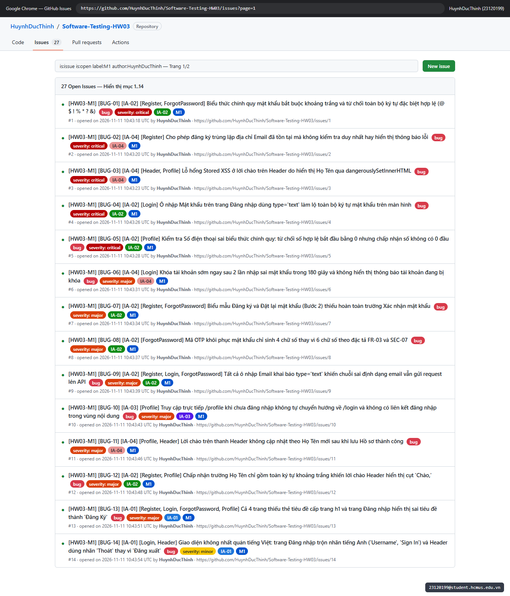

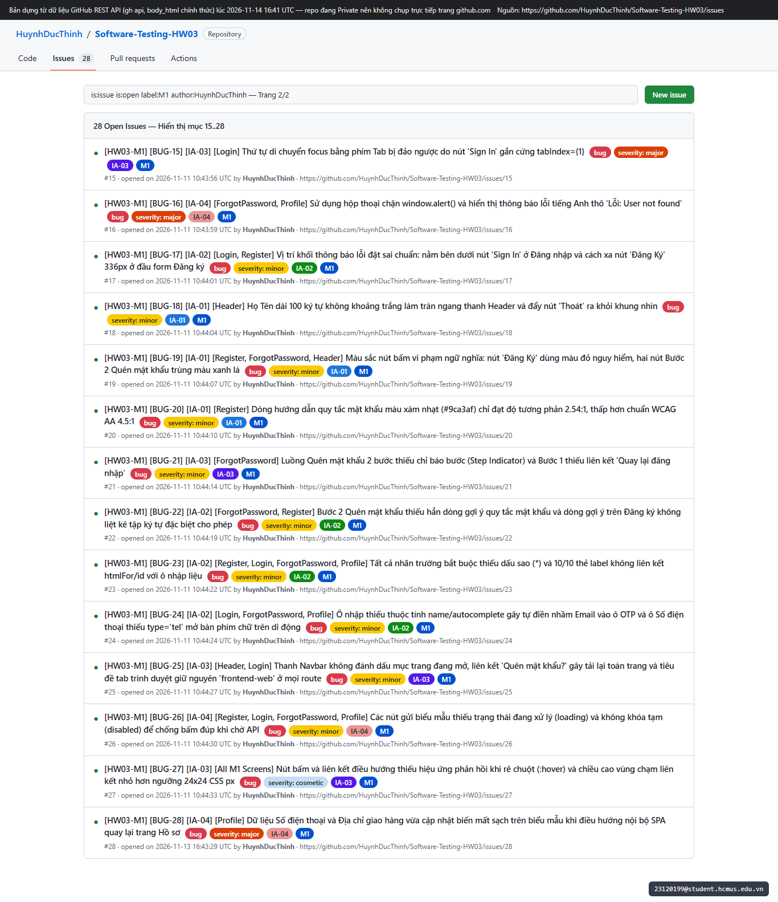

---

## 5. Nội Dung Chi Tiết Từng Bug (`BUG-01` .. `BUG-28`)

### BUG-01 (Issue #1) — [IA-02] [Register, ForgotPassword] Biểu thức chính quy mật khẩu bắt buộc khoảng trắng và từ chối toàn bộ ký tự đặc biệt hợp lệ (@ $ ! % * ? &)

#### Summary
Biểu mẫu Đăng ký (`/register`) và Đặt lại mật khẩu Bước 2 (`/forgot-password`) sử dụng biểu thức chính quy mật khẩu bị lỗi logic (yêu cầu ký tự khoảng trắng `\s` và không cho phép các ký tự đặc biệt `@ $ ! % * ? &`), khiến mọi mật khẩu mạnh hợp lệ theo đặc tả `FR-01` và `FR-03` đều bị từ chối.

- **Bug ID:** `BUG-01`
- **Checklist item:** `CL-19`, `SV-08`, `SV-09`
- **Interface aspect:** `IA-02` — Forms
- **Màn hình:** Register (`/register`), ForgotPassword (`/forgot-password` — Bước 2)
- **Requirement:** FR-01 (eshop-sut/README.md:34); FR-03 (eshop-sut/README.md:58); Slide 10 #5 Field Limits
- **Loại lỗi:** `State`
- **Severity:** **Critical**
- **Priority:** **High**

#### Environment
- **SUT:** `eshop-sut @ 1a9304a (repo HEAD 6b6a7a9)` (Web `http://localhost:5173`, Backend API `http://localhost:3000`)
- **P1:** Google Chrome 157.0.8103.50 trên Windows 11
- **P2:** Mozilla Firefox trên Windows 11 (bản cài đặt `137.0.1` dùng để quan sát trực tiếp; nhân Gecko `159.0` bản Playwright dùng để đo DOM và chụp ảnh minh chứng)
- **P3:** Chrome Android 156.0.8078.79 trên OPPO Reno10 5G (Android 15, adb reverse)
- **URL kiểm thử:** `http://localhost:5173/register, http://localhost:5173/forgot-password`
- **Viewport:** Desktop `1440x900` (`P1`, `P2`); Mobile `360x801` / `1080x2412` (`P3`)

#### Preconditions
Hệ thống Backend (port 3000) và Frontend Web (port 5173) đang hoạt động từ dữ liệu seed sạch. Ở ForgotPassword Bước 2, đã lấy mã OTP hợp lệ cho tài khoản `test@eshop.com`.

#### Steps to reproduce
1. Truy cập trang Đăng ký tại `http://localhost:5173/register`.
2. Nhập Họ Tên hợp lệ (`23120199 - Huỳnh Đức Thịnh`) và Email mới chưa tồn tại (`sv08_23120199@eshop.com`).
3. Lần lượt thử nhập mật khẩu 8 ký tự hợp lệ theo đặc tả `Abcdef1!` và thử với từng ký tự trong tập (`@ $ ! % * ? &`): `Abcd123@`, `Abcd123$`, `Abcd123!`, `Abcd123%`, `Abcd123*`, `Abcd123?`, `Abcd123&`, sau đó bấm nút `Đăng Ký`.
4. Truy cập `http://localhost:5173/forgot-password`, nhập `test@eshop.com` bấm `Lấy mã OTP`, sang Bước 2 nhập mã OTP vừa nhận kèm mật khẩu mới `Abcd123!` rồi bấm `Đặt lại mật khẩu`.

#### Expected result
Theo `FR-01` (`eshop-sut/README.md:34`) và `FR-03` (`eshop-sut/README.md:58`), mật khẩu từ 8 ký tự trở lên có ít nhất 1 chữ hoa, 1 chữ thường, 1 chữ số và 1 ký tự đặc biệt thuộc tập (`@ $ ! % * ? &`) phải được chấp nhận để tạo tài khoản và đặt lại mật khẩu thành công; mật khẩu 7 ký tự (`Abc12!x`) phải bị từ chối.

- **`CL-19`** (*Kiểm tra quy tắc mật khẩu mạnh theo đặc tả trên trang Đăng ký và Đặt lại mật khẩu* — căn cứ: `FR-01 (eshop-sut/README.md:34); FR-03 (eshop-sut/README.md:58)`): Khi nhập mật khẩu hợp lệ theo đặc tả (ví dụ `Abcd123!` gồm tối thiểu 8 ký tự, chữ hoa, chữ thường, số và ký tự đặc biệt thuộc `@ $ ! % * ? &`) trên /register và Bước 2 /forgot-password, form chấp nhận hợp lệ; khi thiếu một trong các nhóm ký tự trên thì từ chối. Fail nếu mật khẩu đúng chuẩn `Abcd123!` bị báo lỗi từ chối hoặc mật khẩu thiếu điều kiện vẫn vượt qua kiểm tra.
- **`SV-08`** (*Giá trị biên độ dài tối thiểu 8 ký tự của mật khẩu trên trang Đăng ký* — căn cứ: `FR-01 (eshop-sut/README.md:34); Slide 10 #5 Field Limits`): Mật khẩu `Abc12!x` (7 ký tự, đủ các nhóm) bị từ chối kèm thông báo lỗi; mật khẩu `Abc123!x` (8 ký tự, đủ các nhóm chữ hoa, chữ thường, số, ký tự đặc biệt) được chấp nhận và chuyển tới /login. Fail nếu mật khẩu 7 ký tự được chấp nhận hoặc mật khẩu 8 ký tự đạt đủ nhóm bị từ chối.
- **`SV-09`** (*Từng ký tự đặc biệt trong tập cho phép (@ $ ! % * ? &) được chấp nhận trong mật khẩu* — căn cứ: `FR-01 (eshop-sut/README.md:34)`): Cả 7 mật khẩu đều được chấp nhận (mỗi mật khẩu chứa đúng một ký tự đặc biệt thuộc tập `@ $ ! % * ? &`) và đăng ký thành công chuyển tới /login. Fail nếu bất kỳ mật khẩu nào trong 7 mật khẩu trên bị báo "quá yếu" hoặc bị từ chối dù thoả đủ điều kiện của đặc tả.

#### Actual result
Tất cả các mật khẩu hợp lệ 8 ký tự chứa bất kỳ ký tự đặc biệt nào trong tập (`@ $ ! % * ? &`) như `Abcd123!` hoặc `Abcd123@` đều bị từ chối với thông báo lỗi mật khẩu yếu trên `/register` và hộp thoại `window.alert(...)` ở Bước 2 `/forgot-password` (do `Register.jsx:15` và `ForgotPassword.jsx:26` dùng regex `/^(?=.*[a-z])(?=.*[A-Z])(?=.*\d)(?=.*\s)[A-Za-z\d\s]{8,}$/`).

**Dữ kiện `Actual` nguyên văn theo từng mục và nền tảng:**
- **`CL-19` trên `P1`:** Actual: Mật khẩu hợp lệ chuẩn đặc tả "Abcd123!" bị từ chối trên cả /register ("Mật khẩu quá yếu! Phải dài tối thiểu 8 ký tự, gồm chữ hoa, chữ thường, số và KÝ TỰ ĐẶC BIỆT.") lẫn Bước 2 /forgot-password (alert "Mật khẩu quá yếu! Phải dài tối thiểu 8 ký tự, gồm chữ hoa, chữ thường, số và KÝ TỰ ĐẶC BIỆT.") do biểu thức chính quy lỗi trên client.
- **`CL-19` trên `P2`:** Actual: Mật khẩu hợp lệ chuẩn đặc tả "Abcd123!" bị từ chối trên cả /register ("Mật khẩu quá yếu! Phải dài tối thiểu 8 ký tự, gồm chữ hoa, chữ thường, số và KÝ TỰ ĐẶC BIỆT.") lẫn Bước 2 /forgot-password (alert "Mật khẩu quá yếu! Phải dài tối thiểu 8 ký tự, gồm chữ hoa, chữ thường, số và KÝ TỰ ĐẶC BIỆT.") do biểu thức chính quy lỗi trên client.
- **`CL-19` trên `P3`:** Actual: Mật khẩu hợp lệ chuẩn đặc tả "Abcd123!" bị từ chối trên cả /register ("Mật khẩu quá yếu! Phải dài tối thiểu 8 ký tự, gồm chữ hoa, chữ thường, số và KÝ TỰ ĐẶC BIỆT.") lẫn Bước 2 /forgot-password (alert "Mật khẩu quá yếu! Phải dài tối thiểu 8 ký tự, gồm chữ hoa, chữ thường, số và KÝ TỰ ĐẶC BIỆT.") do biểu thức chính quy lỗi trên client.
- **`SV-08` trên `P1`:** Actual: Mật khẩu 7 ký tự "Abc12!x" bị từ chối=true, nhưng mật khẩu biên hợp lệ 8 ký tự "Abc123!x" cũng bị từ chối kèm lỗi "Mật khẩu quá yếu! Phải dài tối thiểu 8 ký tự, gồm chữ hoa, chữ thường, số và KÝ TỰ ĐẶC BIỆT." (không chuyển tới /login).
- **`SV-08` trên `P2`:** Actual: Mật khẩu 7 ký tự "Abc12!x" bị từ chối=true, nhưng mật khẩu biên hợp lệ 8 ký tự "Abc123!x" cũng bị từ chối kèm lỗi "Mật khẩu quá yếu! Phải dài tối thiểu 8 ký tự, gồm chữ hoa, chữ thường, số và KÝ TỰ ĐẶC BIỆT." (không chuyển tới /login).
- **`SV-08` trên `P3`:** Actual: Mật khẩu 7 ký tự "Abc12!x" bị từ chối=true, nhưng mật khẩu biên hợp lệ 8 ký tự "Abc123!x" cũng bị từ chối kèm lỗi "Mật khẩu quá yếu! Phải dài tối thiểu 8 ký tự, gồm chữ hoa, chữ thường, số và KÝ TỰ ĐẶC BIỆT." (không chuyển tới /login).
- **`SV-09` trên `P1`:** Actual: Cả 7/7 mật khẩu chứa ký tự đặc biệt hợp lệ (Abcd123@, Abcd123$, Abcd123!, Abcd123%, Abcd123*, Abcd123?, Abcd123&) đều bị form /register từ chối với lỗi "Mật khẩu quá yếu!".
- **`SV-09` trên `P2`:** Actual: Cả 7/7 mật khẩu chứa ký tự đặc biệt hợp lệ (Abcd123@, Abcd123$, Abcd123!, Abcd123%, Abcd123*, Abcd123?, Abcd123&) đều bị form /register từ chối với lỗi "Mật khẩu quá yếu!".
- **`SV-09` trên `P3`:** Actual: Cả 7/7 mật khẩu chứa ký tự đặc biệt hợp lệ (Abcd123@, Abcd123$, Abcd123!, Abcd123%, Abcd123*, Abcd123?, Abcd123&) đều bị form /register từ chối với lỗi "Mật khẩu quá yếu!".

#### Impact
Chặn đứng hoàn toàn luồng Đăng ký tài khoản mới (`FR-01`) và luồng Khôi phục mật khẩu (`FR-03`) đối với người dùng nhập mật khẩu đúng chuẩn đặc tả; người dùng không thể tự đoán rằng hệ thống đang đòi khoảng trắng thay vì ký tự đặc biệt.

#### Reproducibility
Luôn luôn (100%) trên các nền tảng áp dụng: `P1`, `P2`, `P3`.

#### Evidence
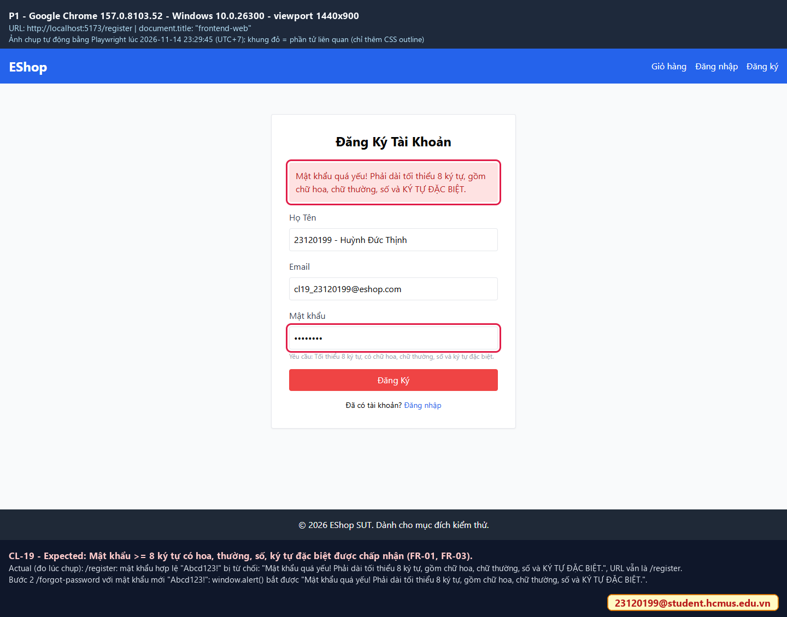

**Danh sách đầy đủ ảnh minh chứng theo nền tảng:**
- `CL-19` (`P1`): [`screenshots/task1_failed/P1_CL-19.png`](screenshots/task1_failed/P1_CL-19.png)
- `CL-19` (`P2`): [`screenshots/task1_failed/P2_CL-19.png`](screenshots/task1_failed/P2_CL-19.png)
- `CL-19` (`P3`): [`screenshots/task1_failed/P3_CL-19.png`](screenshots/task1_failed/P3_CL-19.png)
- `SV-08` (`P1`): [`screenshots/task1_failed/P1_SV-08.png`](screenshots/task1_failed/P1_SV-08.png)
- `SV-08` (`P2`): [`screenshots/task1_failed/P2_SV-08.png`](screenshots/task1_failed/P2_SV-08.png)
- `SV-08` (`P3`): [`screenshots/task1_failed/P3_SV-08.png`](screenshots/task1_failed/P3_SV-08.png)
- `SV-09` (`P1`): [`screenshots/task1_failed/P1_SV-09.png`](screenshots/task1_failed/P1_SV-09.png)
- `SV-09` (`P2`): [`screenshots/task1_failed/P2_SV-09.png`](screenshots/task1_failed/P2_SV-09.png)
- `SV-09` (`P3`): [`screenshots/task1_failed/P3_SV-09.png`](screenshots/task1_failed/P3_SV-09.png)

#### GitHub Issue
- **Issue:** [#1 — [HW03-M1] [BUG-01] [IA-02] [Register, ForgotPassword] Biểu thức chính quy mật khẩu bắt buộc khoảng trắng và từ chối toàn bộ ký tự đặc biệt hợp lệ (@ $ ! % * ? &)](https://github.com/HuynhDucThinh/Software-Testing-HW03/issues/1)
- **Ảnh chụp trang GitHub Issue:** [`screenshots/github_issues/ISSUE-01_BUG-01.png`](screenshots/github_issues/ISSUE-01_BUG-01.png)

---

### BUG-02 (Issue #2) — [IA-04] [Register] Cho phép đăng ký trùng lặp địa chỉ Email đã tồn tại mà không kiểm tra duy nhất hay hiển thị thông báo lỗi

#### Summary
Khi người dùng đăng ký tài khoản mới bằng địa chỉ email đã tồn tại trong hệ thống (`test@eshop.com`), hệ thống không từ chối và không hiển thị thông báo lỗi tiếng Việt mà vẫn trả về HTTP 200 tạo bản ghi trùng lặp và chuyển sang trang Đăng nhập.

- **Bug ID:** `BUG-02`
- **Checklist item:** `CL-32`
- **Interface aspect:** `IA-04` — Feedback / state
- **Màn hình:** Register (`/register`)
- **Requirement:** FR-01 (eshop-sut/README.md:33); FR-21 (eshop-sut/README.md:244); Slide 10 #15 Error Messages
- **Loại lỗi:** `State`
- **Severity:** **Critical**
- **Priority:** **High**

#### Environment
- **SUT:** `eshop-sut @ 1a9304a (repo HEAD 6b6a7a9)` (Web `http://localhost:5173`, Backend API `http://localhost:3000`)
- **P1:** Google Chrome 157.0.8103.50 trên Windows 11
- **P2:** Mozilla Firefox trên Windows 11 (bản cài đặt `137.0.1` dùng để quan sát trực tiếp; nhân Gecko `159.0` bản Playwright dùng để đo DOM và chụp ảnh minh chứng)
- **P3:** Chrome Android 156.0.8078.79 trên OPPO Reno10 5G (Android 15, adb reverse)
- **URL kiểm thử:** `http://localhost:5173/register`
- **Viewport:** Desktop `1440x900` (`P1`, `P2`); Mobile `360x801` / `1080x2412` (`P3`)

#### Preconditions
CSDL đã có sẵn tài khoản seed mặc định với email `test@eshop.com`. Trạng thái chưa đăng nhập.

#### Steps to reproduce
1. Mở trình duyệt truy cập `http://localhost:5173/register`.
2. Nhập Họ Tên: `23120199 - Huỳnh Đức Thịnh`, Email: `test@eshop.com` (email đã tồn tại), và Mật khẩu vượt qua bộ lọc hiện tại của form (`Abcd123 `).
3. Bấm nút `Đăng Ký` và quan sát phản hồi trên giao diện cùng tab Network.

#### Expected result
Theo `FR-01` (`eshop-sut/README.md:33`) và `FR-21` (`eshop-sut/README.md:244`), mỗi địa chỉ email là duy nhất; khi đăng ký trùng email đã tồn tại, hệ thống phải giữ người dùng ở lại trang `/register` và hiển thị thông báo lỗi tiếng Việt rõ ràng (ví dụ: `Email đã được sử dụng`).

- **`CL-32`** (*Thông báo lỗi tiếng Việt thân thiện khi đăng ký bằng địa chỉ Email đã tồn tại* — căn cứ: `FR-01 (eshop-sut/README.md:33); FR-21 (eshop-sut/README.md:244); Slide 10 #15 Error Messages`): Khi gửi form đăng ký với Email trùng tài khoản đã tồn tại, giao diện từ chối đăng ký và hiển thị thông báo lỗi bằng tiếng Việt rõ ràng, thân thiện với người dùng cuối (ví dụ `Email này đã được đăng ký`). Fail nếu không hiển thị lỗi hoặc hiển thị nguyên văn mã lỗi kỹ thuật/CSDL bằng tiếng Anh (ví dụ `SQLITE_CONSTRAINT: UNIQUE constraint failed: users.email`).

#### Actual result
API `POST /api/register` trả về HTTP 200 OK (do bảng `users` trong `database.js:53` thiếu ràng buộc `UNIQUE` cho cột `email` và `server.js:20` thực hiện `INSERT` trực tiếp không kiểm tra tồn tại), không hiển thị bất kỳ thông báo lỗi nào và chuyển hướng thẳng sang `/login`, gây trùng lặp bản ghi người dùng cùng email trong CSDL.

**Dữ kiện `Actual` nguyên văn theo từng mục và nền tảng:**
- **`CL-32` trên `P1`:** Actual: Khi gửi đăng ký với email đã tồn tại "test@eshop.com", hệ thống KHÔNG từ chối và KHÔNG hiện thông báo lỗi nào mà vẫn tạo trùng bản ghi trong CSDL rồi chuyển thẳng sang http://localhost:5173/login.
- **`CL-32` trên `P2`:** Actual: Khi gửi đăng ký với email đã tồn tại "test@eshop.com", hệ thống KHÔNG từ chối và KHÔNG hiện thông báo lỗi nào mà vẫn tạo trùng bản ghi trong CSDL rồi chuyển thẳng sang http://localhost:5173/login.
- **`CL-32` trên `P3`:** Actual: Khi gửi đăng ký với email đã tồn tại "test@eshop.com", hệ thống KHÔNG từ chối và KHÔNG hiện thông báo lỗi nào mà vẫn tạo trùng bản ghi trong CSDL rồi chuyển thẳng sang http://localhost:5173/login.

#### Impact
Làm hỏng tính toàn vẹn định danh tài khoản người dùng (nhiều bản ghi trùng email trong bảng `users`), gây xung đột khi đăng nhập hoặc khôi phục mật khẩu bằng email đó.

#### Reproducibility
Luôn luôn (100%) trên các nền tảng áp dụng: `P1`, `P2`, `P3`.

#### Evidence
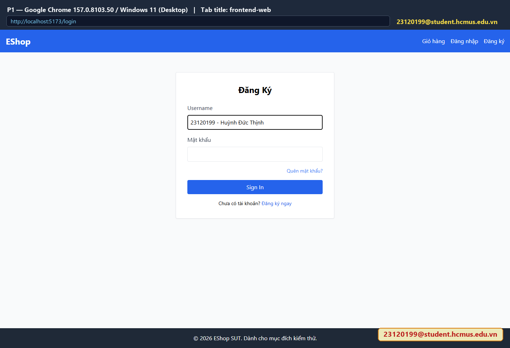

**Danh sách đầy đủ ảnh minh chứng theo nền tảng:**
- `CL-32` (`P1`): [`screenshots/task1_failed/P1_CL-32.png`](screenshots/task1_failed/P1_CL-32.png)
- `CL-32` (`P2`): [`screenshots/task1_failed/P2_CL-32.png`](screenshots/task1_failed/P2_CL-32.png)
- `CL-32` (`P3`): [`screenshots/task1_failed/P3_CL-32.png`](screenshots/task1_failed/P3_CL-32.png)

#### GitHub Issue
- **Issue:** [#2 — [HW03-M1] [BUG-02] [IA-04] [Register] Cho phép đăng ký trùng lặp địa chỉ Email đã tồn tại mà không kiểm tra duy nhất hay hiển thị thông báo lỗi](https://github.com/HuynhDucThinh/Software-Testing-HW03/issues/2)
- **Ảnh chụp trang GitHub Issue:** [`screenshots/github_issues/ISSUE-02_BUG-02.png`](screenshots/github_issues/ISSUE-02_BUG-02.png)

---

### BUG-03 (Issue #3) — [IA-04] [Header, Profile] Lỗ hổng Stored XSS ở lời chào trên Header do hiển thị Họ Tên qua dangerouslySetInnerHTML

#### Summary
Thanh Header/Navbar render lời chào người dùng bằng thuộc tính `dangerouslySetInnerHTML` mà không escape ký tự đặc biệt HTML, khiến các thẻ HTML lưu trong trường Họ Tên được trình duyệt phân tích cú pháp và thực thi trực tiếp trên mọi trang.

- **Bug ID:** `BUG-03`
- **Checklist item:** `SV-05`
- **Interface aspect:** `IA-04` — Feedback / state
- **Màn hình:** Header/Navbar, Profile (`/profile`)
- **Requirement:** SEC-04 (eshop-sut/README.md:281)
- **Loại lỗi:** `State`
- **Severity:** **Critical**
- **Priority:** **High**

#### Environment
- **SUT:** `eshop-sut @ 1a9304a (repo HEAD 6b6a7a9)` (Web `http://localhost:5173`, Backend API `http://localhost:3000`)
- **P1:** Google Chrome 157.0.8103.50 trên Windows 11
- **P2:** Mozilla Firefox trên Windows 11 (bản cài đặt `137.0.1` dùng để quan sát trực tiếp; nhân Gecko `159.0` bản Playwright dùng để đo DOM và chụp ảnh minh chứng)
- **P3:** Chrome Android 156.0.8078.79 trên OPPO Reno10 5G (Android 15, adb reverse)
- **URL kiểm thử:** `http://localhost:5173/profile`
- **Viewport:** Desktop `1440x900` (`P1`, `P2`); Mobile `360x801` / `1080x2412` (`P3`)

#### Preconditions
Đã đăng nhập bằng tài khoản người dùng hợp lệ hoặc đăng ký tài khoản có chứa thẻ HTML trong trường Họ Tên.

#### Steps to reproduce
1. Đăng nhập vào hệ thống và truy cập `http://localhost:5173/profile` (hoặc đăng ký tài khoản mới tại `/register`).
2. Cập nhật trường Họ Tên thành chuỗi chứa thẻ HTML như `<b>Test</b><i>User</i>` (kèm SĐT hợp lệ theo bộ lọc hiện tại hoặc đăng nhập lại để đồng bộ state).
3. Tải lại trang hoặc đăng nhập lại và quan sát vùng lời chào `Chào, ...` ở góc phải thanh Header cùng cấu trúc DOM trong DevTools.

#### Expected result
Theo `SEC-04` (`eshop-sut/README.md:281`), mọi dữ liệu do người dùng nhập khi hiển thị lại trên giao diện phải được mã hóa an toàn (escape HTML) dưới dạng văn bản thuần, không được sinh ra phần tử DOM con hay thực thi mã kịch bản.

- **`SV-05`** (*Hiển thị an toàn ký tự HTML trong Họ Tên ở lời chào trên Header* — căn cứ: `SEC-04 (eshop-sut/README.md:281)`): Lời chào trên Header hiển thị nguyên văn chuỗi `Chào, <b>Test</b><i>User</i>` dưới dạng văn bản thường (nhìn thấy cả các ký tự `<b>`), không in đậm hoặc in nghiêng phần tên. Fail nếu phần tên được trình duyệt dựng thành định dạng (in đậm, in nghiêng) hoặc thẻ HTML nhập vào bị thực thi.

#### Actual result
Thanh Header (`App.jsx:27` dùng `dangerouslySetInnerHTML={{ __html: 'Chào, ' + user.name }}`) phân tích trực tiếp chuỗi HTML và tạo ra các thẻ phần tử thật `<b>Test</b>` và `<i>User</i>` bên trong thẻ chào mừng trên cả `P1`, `P2` và `P3`, mở ra lỗ hổng Stored XSS (ví dụ với payload ``).

**Dữ kiện `Actual` nguyên văn theo từng mục và nền tảng:**
- **`SV-05` trên `P1`:** Actual: Lời chào trên Header dùng dangerouslySetInnerHTML nên dựng trực tiếp 1 thẻ `<b>` (in đậm) và 1 thẻ `<i>` (in nghiêng) thành "Chào, TestUser" thay vì hiển thị văn bản thường (HTML thực tế: ``Chào, `<b>`Test`</b>``<i>`User`</i>```).
- **`SV-05` trên `P2`:** Actual: Lời chào trên Header dùng dangerouslySetInnerHTML nên dựng trực tiếp 1 thẻ `<b>` (in đậm) và 1 thẻ `<i>` (in nghiêng) thành "Chào, TestUser" thay vì hiển thị văn bản thường (HTML thực tế: ``Chào, `<b>`Test`</b>``<i>`User`</i>```).
- **`SV-05` trên `P3`:** Actual: Lời chào trên Header dùng dangerouslySetInnerHTML nên dựng trực tiếp 1 thẻ `<b>` (in đậm) và 1 thẻ `<i>` (in nghiêng) thành "Chào, TestUser" thay vì hiển thị văn bản thường (HTML thực tế: ``Chào, `<b>`Test`</b>``<i>`User`</i>```).

#### Impact
Lỗ hổng bảo mật nghiêm trọng (Stored XSS) cho phép kẻ tấn công chèn mã độc JavaScript vào trường Họ Tên để đánh cắp token JWT lưu trong `localStorage` khi hiển thị trên trình duyệt.

#### Reproducibility
Luôn luôn (100%) trên các nền tảng áp dụng: `P1`, `P2`, `P3`.

#### Evidence

**Danh sách đầy đủ ảnh minh chứng theo nền tảng:**
- `SV-05` (`P1`): [`screenshots/task1_failed/P1_SV-05.png`](screenshots/task1_failed/P1_SV-05.png)
- `SV-05` (`P2`): [`screenshots/task1_failed/P2_SV-05.png`](screenshots/task1_failed/P2_SV-05.png)
- `SV-05` (`P3`): [`screenshots/task1_failed/P3_SV-05.png`](screenshots/task1_failed/P3_SV-05.png)

#### GitHub Issue
- **Issue:** [#3 — [HW03-M1] [BUG-03] [IA-04] [Header, Profile] Lỗ hổng Stored XSS ở lời chào trên Header do hiển thị Họ Tên qua dangerouslySetInnerHTML](https://github.com/HuynhDucThinh/Software-Testing-HW03/issues/3)
- **Ảnh chụp trang GitHub Issue:** [`screenshots/github_issues/ISSUE-03_BUG-03.png`](screenshots/github_issues/ISSUE-03_BUG-03.png)

---

### BUG-04 (Issue #4) — [IA-02] [Login] Ô nhập Mật khẩu trên trang Đăng nhập dùng type='text' làm lộ toàn bộ ký tự mật khẩu trên màn hình

#### Summary
Ô nhập `Mật khẩu` trên trang Đăng nhập (`/login`) được khai báo là `<input type="text">` thay vì `type="password"`, làm hiển thị công khai toàn bộ chuỗi mật khẩu người dùng đang gõ dưới dạng văn bản rõ.

- **Bug ID:** `BUG-04`
- **Checklist item:** `CL-15`
- **Interface aspect:** `IA-02` — Forms
- **Màn hình:** Login (`/login`)
- **Requirement:** FR-22 (eshop-sut/README.md:254)
- **Loại lỗi:** `Visual-Layout`
- **Severity:** **Critical**
- **Priority:** **High**

#### Environment
- **SUT:** `eshop-sut @ 1a9304a (repo HEAD 6b6a7a9)` (Web `http://localhost:5173`, Backend API `http://localhost:3000`)
- **P1:** Google Chrome 157.0.8103.50 trên Windows 11
- **P2:** Mozilla Firefox trên Windows 11 (bản cài đặt `137.0.1` dùng để quan sát trực tiếp; nhân Gecko `159.0` bản Playwright dùng để đo DOM và chụp ảnh minh chứng)
- **P3:** Chrome Android 156.0.8078.79 trên OPPO Reno10 5G (Android 15, adb reverse)
- **URL kiểm thử:** `http://localhost:5173/login`
- **Viewport:** Desktop `1440x900` (`P1`, `P2`); Mobile `360x801` / `1080x2412` (`P3`)

#### Preconditions
Người dùng chưa đăng nhập, mở trang Đăng nhập `http://localhost:5173/login`.

#### Steps to reproduce
1. Truy cập trang Đăng nhập tại `http://localhost:5173/login`.
2. Nhấp vào ô nhập thứ hai có nhãn `Mật khẩu` và gõ chuỗi `Test1234!`.
3. Quan sát ký tự hiển thị trực tiếp trong ô nhập và kiểm tra thuộc tính `type` của thẻ `<input>` trong DevTools.

#### Expected result
Theo `FR-22` (`eshop-sut/README.md:254`), tất cả các ô nhập mật khẩu bắt buộc sử dụng `type="password"` để che giấu ký tự nhập thành dấu chấm tròn hoặc dấu hoa thị.

- **`CL-15`** (*Che giấu ký tự nhập bằng type="password" ở tất cả các ô mật khẩu* — căn cứ: `FR-22 (eshop-sut/README.md:254)`): Mọi ô nhập mật khẩu trên /register, /login và Bước 2 trang /forgot-password khi người dùng gõ ký tự ở trạng thái mặc định đều dùng `type="password"` và hiển thị thành dấu chấm tròn ẩn (`••••`), không lộ ký tự rõ. Fail nếu bất kỳ ô mật khẩu nào dùng `type="text"` hoặc để lộ chuỗi mật khẩu đang gõ.

#### Actual result
Trên `/login` (`Login.jsx:49`), ô `Mật khẩu` có thuộc tính `type="text"`, hiển thị nguyên văn chuỗi `Test1234!` không che giấu trên cả 3 nền tảng `P1`, `P2` và `P3` (trong khi `/register` và Bước 2 `/forgot-password` có dùng `type="password"`).

**Dữ kiện `Actual` nguyên văn theo từng mục và nền tảng:**
- **`CL-15` trên `P1`:** Actual: Ô Mật khẩu trên /register có type="password", Bước 2 /forgot-password có type="password", nhưng ô Mật khẩu trên /login lại khai báo type="text" làm lộ rõ toàn bộ ký tự mật khẩu khi gõ.
- **`CL-15` trên `P2`:** Actual: Ô Mật khẩu trên /register có type="password", Bước 2 /forgot-password có type="password", nhưng ô Mật khẩu trên /login lại khai báo type="text" làm lộ rõ toàn bộ ký tự mật khẩu khi gõ.
- **`CL-15` trên `P3`:** Actual: Ô Mật khẩu trên /register có type="password", Bước 2 /forgot-password có type="password", nhưng ô Mật khẩu trên /login lại khai báo type="text" làm lộ rõ toàn bộ ký tự mật khẩu khi gõ.

#### Impact
Lộ trực tiếp mật khẩu của người dùng trên màn hình (nguy cơ nhìn trộm qua vai hoặc lộ khi chia sẻ màn hình) và làm giảm nghiêm trọng mức độ tin cậy của trang Đăng nhập.

#### Reproducibility
Luôn luôn (100%) trên các nền tảng áp dụng: `P1`, `P2`, `P3`.

#### Evidence

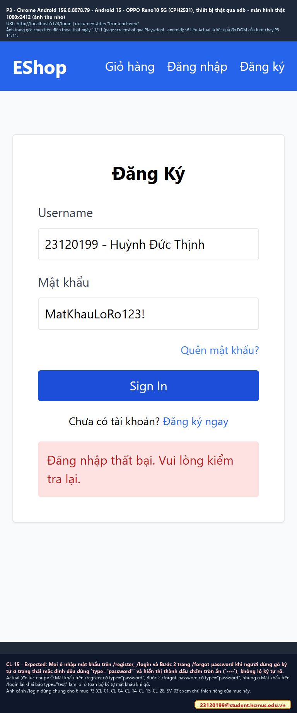

**Danh sách đầy đủ ảnh minh chứng theo nền tảng:**
- `CL-15` (`P1`): [`screenshots/task1_failed/P1_CL-15.png`](screenshots/task1_failed/P1_CL-15.png)
- `CL-15` (`P2`): [`screenshots/task1_failed/P2_CL-15.png`](screenshots/task1_failed/P2_CL-15.png)
- `CL-15` (`P3`): [`screenshots/task1_failed/P3_CL-15.png`](screenshots/task1_failed/P3_CL-15.png)

#### GitHub Issue
- **Issue:** [#4 — [HW03-M1] [BUG-04] [IA-02] [Login] Ô nhập Mật khẩu trên trang Đăng nhập dùng type='text' làm lộ toàn bộ ký tự mật khẩu trên màn hình](https://github.com/HuynhDucThinh/Software-Testing-HW03/issues/4)
- **Ảnh chụp trang GitHub Issue:** [`screenshots/github_issues/ISSUE-04_BUG-04.png`](screenshots/github_issues/ISSUE-04_BUG-04.png)

---

### BUG-05 (Issue #5) — [IA-02] [Profile] Kiểm tra Số điện thoại sai biểu thức chính quy: từ chối số hợp lệ bắt đầu bằng 0 nhưng chấp nhận số không có 0 đầu

#### Summary
Biểu mẫu Hồ sơ cá nhân (`/profile`) kiểm tra Số điện thoại bằng regex `/^[1-9][0-9]{8,9}$/`, dẫn tới từ chối mọi số điện thoại Việt Nam hợp lệ bắt đầu bằng chữ số `0` (như `0912345678`) nhưng lại cho phép lưu số sai định dạng bắt đầu bằng `1-9` (như `9123456789`).

- **Bug ID:** `BUG-05`
- **Checklist item:** `CL-22`, `SV-10`
- **Interface aspect:** `IA-02` — Forms
- **Màn hình:** Profile (`/profile`)
- **Requirement:** FR-04 (eshop-sut/README.md:65); Slide 10 #5 Field Limits
- **Loại lỗi:** `State`
- **Severity:** **Critical**
- **Priority:** **High**

#### Environment
- **SUT:** `eshop-sut @ 1a9304a (repo HEAD 6b6a7a9)` (Web `http://localhost:5173`, Backend API `http://localhost:3000`)
- **P1:** Google Chrome 157.0.8103.50 trên Windows 11
- **P2:** Mozilla Firefox trên Windows 11 (bản cài đặt `137.0.1` dùng để quan sát trực tiếp; nhân Gecko `159.0` bản Playwright dùng để đo DOM và chụp ảnh minh chứng)
- **P3:** Chrome Android 156.0.8078.79 trên OPPO Reno10 5G (Android 15, adb reverse)
- **URL kiểm thử:** `http://localhost:5173/profile`
- **Viewport:** Desktop `1440x900` (`P1`, `P2`); Mobile `360x801` / `1080x2412` (`P3`)

#### Preconditions
Đã đăng nhập bằng tài khoản `test@eshop.com` / `Test1234!` và đang ở trang `http://localhost:5173/profile`.

#### Steps to reproduce
1. Tại khối `Hồ sơ của bạn` trên `http://localhost:5173/profile`, nhập Số điện thoại hợp lệ 10 chữ số bắt đầu bằng `0` là `0912345678` và bấm `Cập nhật`.
2. Đóng hộp thoại cảnh báo, tiếp tục thử nhập `09123456789` (11 chữ số bắt đầu bằng `0`) và bấm `Cập nhật`.
3. Thử nhập số sai chuẩn Việt Nam không bắt đầu bằng `0` là `9123456789` rồi bấm `Cập nhật`.

#### Expected result
Theo `FR-04` (`eshop-sut/README.md:65`), Số điện thoại hợp lệ tại Việt Nam phải gồm 10-11 chữ số bắt đầu bằng chữ số `0` (`/^0\d{9,10}$/`): `0912345678` và `09123456789` phải được chấp nhận lưu thành công; `9123456789` (không bắt đầu bằng `0`) và biên 9 chữ số (`091234567`) / 12 chữ số (`091234567890`) phải bị từ chối.

- **`CL-22`** (*Kiểm tra định dạng Số điện thoại hợp lệ bắt đầu bằng số 0 trên trang Hồ sơ* — căn cứ: `FR-04 (eshop-sut/README.md:65)`): Khi nhập Số điện thoại bắt đầu bằng `0` có từ 10 đến 11 chữ số (ví dụ `0912345678` khớp với chính placeholder gợi ý trên form) và bấm `Cập nhật`, hệ thống chấp nhận lưu thành công; khi nhập chuỗi chứa chữ cái thì từ chối. Fail nếu số điện thoại hợp lệ bắt đầu bằng `0` (10 hoặc 11 chữ số) bị báo lỗi không hợp lệ hoặc chuỗi chứa chữ cái vẫn lưu thành công.
- **`SV-10`** (*Giá trị biên độ dài và chữ số đầu của Số điện thoại trên trang Hồ sơ* — căn cứ: `FR-04 (eshop-sut/README.md:65); Slide 10 #5 Field Limits`): SĐT `091234567` (9 chữ số), `091234567890` (12 chữ số) và `9123456789` (10 chữ số nhưng không bắt đầu bằng 0) bị từ chối kèm thông báo lỗi; hệ thống chỉ chấp nhận SĐT bắt đầu bằng `0` và có 10 hoặc 11 chữ số. Fail nếu bất kỳ giá trị nào trong ba giá trị trên được lưu thành công.

#### Actual result
Các số điện thoại hợp lệ bắt đầu bằng `0` (`0912345678` và `09123456789`) đều bị chặn bởi `window.alert('Số điện thoại không hợp lệ!')` và không gửi `PUT` request; ngược lại, số sai chuẩn không bắt đầu bằng `0` (`9123456789`) lại vượt qua kiểm tra (`Profile.jsx:43` dùng `/^[1-9][0-9]{8,9}$/`) và báo `Cập nhật thành công!`.

**Dữ kiện `Actual` nguyên văn theo từng mục và nền tảng:**
- **`CL-22` trên `P1`:** Actual: Nhập SĐT hợp lệ chuẩn Việt Nam "0912345678" (khớp chính placeholder form) bị từ chối với hộp thoại alert "Số điện thoại không hợp lệ. Vui lòng nhập đúng 9-10 chữ số."; chuỗi chữ cái "09123abcde" báo "Số điện thoại không hợp lệ. Vui lòng nhập đúng 9-10 chữ số.".
- **`CL-22` trên `P2`:** Actual: Nhập SĐT hợp lệ chuẩn Việt Nam "0912345678" (khớp chính placeholder form) bị từ chối với hộp thoại alert "Số điện thoại không hợp lệ. Vui lòng nhập đúng 9-10 chữ số."; chuỗi chữ cái "09123abcde" báo "Số điện thoại không hợp lệ. Vui lòng nhập đúng 9-10 chữ số.".
- **`CL-22` trên `P3`:** Actual: Nhập SĐT hợp lệ chuẩn Việt Nam "0912345678" (khớp chính placeholder form) bị từ chối với hộp thoại alert "Số điện thoại không hợp lệ. Vui lòng nhập đúng 9-10 chữ số."; chuỗi chữ cái "09123abcde" báo "Số điện thoại không hợp lệ. Vui lòng nhập đúng 9-10 chữ số.".
- **`SV-10` trên `P1`:** Actual: Thử 3 giá trị biên SĐT không hợp lệ trên /profile: "091234567" -> "Số điện thoại không hợp lệ. Vui lòng nhập đúng 9-10 chữ số."; "091234567890" -> "Số điện thoại không hợp lệ. Vui lòng nhập đúng 9-10 chữ số."; riêng "9123456789" (không bắt đầu bằng số 0) lại được lưu thành công ("Cập nhật thành công!").
- **`SV-10` trên `P2`:** Actual: Thử 3 giá trị biên SĐT không hợp lệ trên /profile: "091234567" -> "Số điện thoại không hợp lệ. Vui lòng nhập đúng 9-10 chữ số."; "091234567890" -> "Số điện thoại không hợp lệ. Vui lòng nhập đúng 9-10 chữ số."; riêng "9123456789" (không bắt đầu bằng số 0) lại được lưu thành công ("Cập nhật thành công!").
- **`SV-10` trên `P3`:** Actual: Thử 3 giá trị biên SĐT không hợp lệ trên /profile: "091234567" -> "Số điện thoại không hợp lệ. Vui lòng nhập đúng 9-10 chữ số."; "091234567890" -> "Số điện thoại không hợp lệ. Vui lòng nhập đúng 9-10 chữ số."; riêng "9123456789" (không bắt đầu bằng số 0) lại được lưu thành công ("Cập nhật thành công!").

#### Impact
Chặn hoàn toàn người dùng thật cập nhật số điện thoại liên lạc hợp lệ của Việt Nam trong luồng Hồ sơ cá nhân (`FR-04` / luồng `F1`), buộc người dùng phải bỏ số `0` đầu mới lưu được.

#### Reproducibility
Luôn luôn (100%) trên các nền tảng áp dụng: `P1`, `P2`, `P3`.

#### Evidence
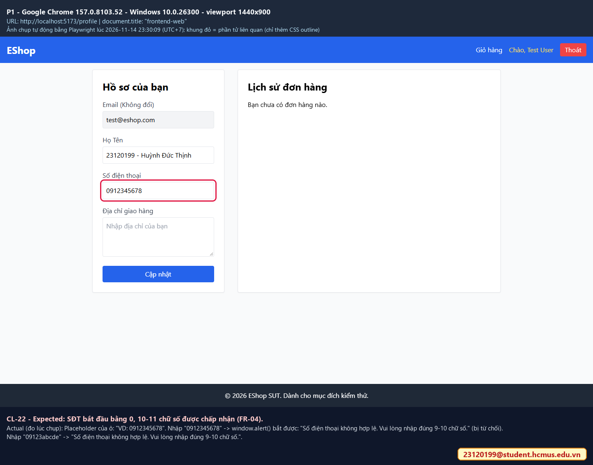

**Danh sách đầy đủ ảnh minh chứng theo nền tảng:**
- `CL-22` (`P1`): [`screenshots/task1_failed/P1_CL-22.png`](screenshots/task1_failed/P1_CL-22.png)
- `CL-22` (`P2`): [`screenshots/task1_failed/P2_CL-22.png`](screenshots/task1_failed/P2_CL-22.png)
- `CL-22` (`P3`): [`screenshots/task1_failed/P3_CL-22.png`](screenshots/task1_failed/P3_CL-22.png)
- `SV-10` (`P1`): [`screenshots/task1_failed/P1_SV-10.png`](screenshots/task1_failed/P1_SV-10.png)
- `SV-10` (`P2`): [`screenshots/task1_failed/P2_SV-10.png`](screenshots/task1_failed/P2_SV-10.png)
- `SV-10` (`P3`): [`screenshots/task1_failed/P3_SV-10.png`](screenshots/task1_failed/P3_SV-10.png)

#### GitHub Issue
- **Issue:** [#5 — [HW03-M1] [BUG-05] [IA-02] [Profile] Kiểm tra Số điện thoại sai biểu thức chính quy: từ chối số hợp lệ bắt đầu bằng 0 nhưng chấp nhận số không có 0 đầu](https://github.com/HuynhDucThinh/Software-Testing-HW03/issues/5)
- **Ảnh chụp trang GitHub Issue:** [`screenshots/github_issues/ISSUE-05_BUG-05.png`](screenshots/github_issues/ISSUE-05_BUG-05.png)

---

### BUG-06 (Issue #6) — [IA-04] [Login] Khóa tài khoản sớm ngay sau 2 lần nhập sai mật khẩu trong 180 giây và không hiển thị thông báo tài khoản đang bị khóa

#### Summary
Hệ thống khóa tài khoản ngay sau 2 lần đăng nhập sai liên tiếp (thay vì 3 lần) với thời gian khóa 180 giây (thay vì 30 giây), đồng thời giao diện `/login` chỉ báo chung chung `Đăng nhập thất bại...` chứ không cho người dùng biết tài khoản đã bị khóa tạm thời.

- **Bug ID:** `BUG-06`
- **Checklist item:** `CL-33`
- **Interface aspect:** `IA-04` — Feedback / state
- **Màn hình:** Login (`/login`)
- **Requirement:** FR-02 (eshop-sut/README.md:41-42)
- **Loại lỗi:** `State`
- **Severity:** **Major**
- **Priority:** **High**

#### Environment
- **SUT:** `eshop-sut @ 1a9304a (repo HEAD 6b6a7a9)` (Web `http://localhost:5173`, Backend API `http://localhost:3000`)
- **P1:** Google Chrome 157.0.8103.50 trên Windows 11
- **P2:** Mozilla Firefox trên Windows 11 (bản cài đặt `137.0.1` dùng để quan sát trực tiếp; nhân Gecko `159.0` bản Playwright dùng để đo DOM và chụp ảnh minh chứng)
- **P3:** Chrome Android 156.0.8078.79 trên OPPO Reno10 5G (Android 15, adb reverse)
- **URL kiểm thử:** `http://localhost:5173/login`
- **Viewport:** Desktop `1440x900` (`P1`, `P2`); Mobile `360x801` / `1080x2412` (`P3`)

#### Preconditions
CSDL vừa khởi tạo sạch, tài khoản `test@eshop.com` có `login_attempts = 0`.

#### Steps to reproduce
1. Truy cập `http://localhost:5173/login`, nhập Username `test@eshop.com` và mật khẩu sai `WrongPass1`, bấm `Sign In` (lần sai 1).
2. Tiếp tục bấm `Sign In` với mật khẩu sai `WrongPass2` (lần sai 2).
3. Ở lần thứ 3, nhập đúng mật khẩu hợp lệ `Test1234!` và bấm `Sign In`, đồng thời quan sát mã phản hồi HTTP trong tab Network và nội dung thông báo lỗi trên giao diện.

#### Expected result
Theo `FR-02` (`eshop-sut/README.md:41-42`), tài khoản chỉ bị khóa tạm thời sau đúng 3 lần đăng nhập thất bại liên tiếp (tức lần thứ 3 nhập đúng vẫn phải đăng nhập thành công), thời gian khóa là 30 giây, và khi bị khóa giao diện phải hiển thị thông báo nêu rõ trạng thái khóa tạm thời.

- **`CL-33`** (*Khóa tạm thời tài khoản 30 giây kèm thông báo phù hợp sau đúng 3 lần đăng nhập sai liên tiếp* — căn cứ: `FR-02 (eshop-sut/README.md:41-42)`): Ở lần nhập sai thứ 1 và thứ 2 trên `/login`, tài khoản chưa bị khóa (nếu nhập đúng mật khẩu ở lần kế sẽ vào được); từ lần nhập sai thứ 3 liên tiếp, tài khoản bị tạm khóa trong đúng 30 giây, giao diện hiển thị thông báo cho biết tài khoản đang bị tạm khóa, và cho phép đăng nhập lại sau khi hết 30 giây. Fail nếu tài khoản bị khóa sớm hơn 3 lần sai (ví dụ khóa ngay sau lần sai thứ 2), không hiển thị thông báo bị khóa trên giao diện, hoặc thời gian khóa thực tế lệch quá 5 giây so với 30 giây.

#### Actual result
Ngay ở lần thử thứ 3 dù nhập đúng `Test1234!`, API `POST /api/login` đã trả về HTTP 403 `{"error":"Tài khoản đã bị khóa. Vui lòng thử lại sau."}` (do `server.js:54` cộng `login_attempts + 2` mỗi lần sai và đặt cột `locked_until` = thời điểm hiện tại + 180 giây). Giao diện `Login.jsx:27` bắt chung khối `catch` nên vẫn chỉ hiện `Đăng nhập thất bại. Vui lòng kiểm tra lại.`, không hề báo tài khoản đang bị khóa.

**Dữ kiện `Actual` nguyên văn theo từng mục và nền tảng:**
- **`CL-33` trên `P1`:** Actual: Tài khoản bị khoá ngay sau lần nhập sai thứ 2 (login_attempts tăng +2 mỗi lần: lần 1=2, lần 2=4), thời gian khoá thực tế ~180 giây (thay vì 30 giây), và khi bị khoá (HTTP 403: "Tài khoản đã bị khóa. Vui lòng thử lại sau.") giao diện /login vẫn chỉ hiện "Đăng nhập thất bại. Vui lòng kiểm tra lại." chứ không báo tài khoản đang bị tạm khoá.
- **`CL-33` trên `P2`:** Actual: Tài khoản bị khoá ngay sau lần nhập sai thứ 2 (login_attempts tăng +2 mỗi lần: lần 1=2, lần 2=4), thời gian khoá thực tế ~180 giây (thay vì 30 giây), và khi bị khoá (HTTP 403: "Tài khoản đã bị khóa. Vui lòng thử lại sau.") giao diện /login vẫn chỉ hiện "Đăng nhập thất bại. Vui lòng kiểm tra lại." chứ không báo tài khoản đang bị tạm khoá.
- **`CL-33` trên `P3`:** Actual: Tài khoản bị khoá ngay sau lần nhập sai thứ 2 (login_attempts tăng +2 mỗi lần: lần 1=2, lần 2=4), thời gian khoá thực tế ~180 giây (thay vì 30 giây), và khi bị khoá (HTTP 403: "Tài khoản đã bị khóa. Vui lòng thử lại sau.") giao diện /login vẫn chỉ hiện "Đăng nhập thất bại. Vui lòng kiểm tra lại." chứ không báo tài khoản đang bị tạm khoá.

#### Impact
Người dùng chỉ gõ nhầm mật khẩu 2 lần đã bị khóa cứng suốt 3 phút và khi gõ lại mật khẩu đúng vẫn thấy báo sai thông tin, dẫn đến hoang mang tưởng mất mật khẩu.

#### Reproducibility
Luôn luôn (100%) trên các nền tảng áp dụng: `P1`, `P2`, `P3`.

#### Evidence
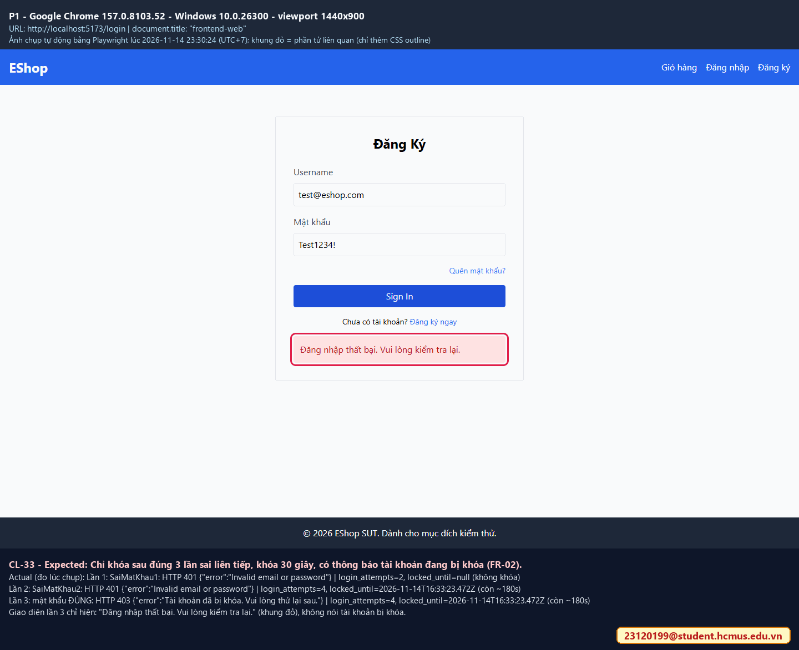

**Danh sách đầy đủ ảnh minh chứng theo nền tảng:**
- `CL-33` (`P1`): [`screenshots/task1_failed/P1_CL-33.png`](screenshots/task1_failed/P1_CL-33.png)
- `CL-33` (`P2`): [`screenshots/task1_failed/P2_CL-33.png`](screenshots/task1_failed/P2_CL-33.png)
- `CL-33` (`P3`): [`screenshots/task1_failed/P3_CL-33.png`](screenshots/task1_failed/P3_CL-33.png)

#### GitHub Issue
- **Issue:** [#6 — [HW03-M1] [BUG-06] [IA-04] [Login] Khóa tài khoản sớm ngay sau 2 lần nhập sai mật khẩu trong 180 giây và không hiển thị thông báo tài khoản đang bị khóa](https://github.com/HuynhDucThinh/Software-Testing-HW03/issues/6)
- **Ảnh chụp trang GitHub Issue:** [`screenshots/github_issues/ISSUE-06_BUG-06.png`](screenshots/github_issues/ISSUE-06_BUG-06.png)

---

### BUG-07 (Issue #7) — [IA-02] [Register, ForgotPassword] Biểu mẫu Đăng ký và Đặt lại mật khẩu (Bước 2) thiếu hoàn toàn trường Xác nhận mật khẩu

#### Summary
Cả trang Đăng ký (`/register`) lẫn Bước 2 trang Quên mật khẩu (`/forgot-password`) đều không có ô nhập `Xác nhận mật khẩu` / `Xác nhận mật khẩu mới`, trái với đặc tả `FR-01` và `FR-03`.

- **Bug ID:** `BUG-07`
- **Checklist item:** `CL-16`, `CL-18`
- **Interface aspect:** `IA-02` — Forms
- **Màn hình:** Register (`/register`), ForgotPassword (`/forgot-password` — Bước 2)
- **Requirement:** FR-01 (eshop-sut/README.md:35); FR-03 (eshop-sut/README.md:57-59)
- **Loại lỗi:** `State`
- **Severity:** **Major**
- **Priority:** **High**

#### Environment
- **SUT:** `eshop-sut @ 1a9304a (repo HEAD 6b6a7a9)` (Web `http://localhost:5173`, Backend API `http://localhost:3000`)
- **P1:** Google Chrome 157.0.8103.50 trên Windows 11
- **P2:** Mozilla Firefox trên Windows 11 (bản cài đặt `137.0.1` dùng để quan sát trực tiếp; nhân Gecko `159.0` bản Playwright dùng để đo DOM và chụp ảnh minh chứng)
- **P3:** Chrome Android 156.0.8078.79 trên OPPO Reno10 5G (Android 15, adb reverse)
- **URL kiểm thử:** `http://localhost:5173/register, http://localhost:5173/forgot-password`
- **Viewport:** Desktop `1440x900` (`P1`, `P2`); Mobile `360x801` / `1080x2412` (`P3`)

#### Preconditions
Truy cập trang `/register` và Bước 2 trang `/forgot-password` (sau khi lấy OTP cho `test@eshop.com`).

#### Steps to reproduce
1. Mở `http://localhost:5173/register` và kiểm tra toàn bộ các trường nhập liệu hiện có trong form.
2. Mở `http://localhost:5173/forgot-password`, nhập `test@eshop.com` bấm `Lấy mã OTP` để chuyển sang Bước 2 và kiểm tra toàn bộ các trường nhập liệu.

#### Expected result
Theo `FR-01` (`eshop-sut/README.md:35`), biểu mẫu Đăng ký phải có trường `Xác nhận mật khẩu` kiểm tra khớp với `Mật khẩu`. Theo `FR-03` (`eshop-sut/README.md:57-59`), Bước 2 Quên mật khẩu phải có 3 trường gồm `Mã OTP`, `Mật khẩu mới` và `Xác nhận mật khẩu mới`.

- **`CL-16`** (*Sự tồn tại và kiểm tra khớp của trường Xác nhận mật khẩu trên trang Đăng ký* — căn cứ: `FR-01 (eshop-sut/README.md:35)`): Form /register hiển thị trường `Xác nhận mật khẩu` (`type="password"`) nằm dưới trường `Mật khẩu`; khi nhập hai giá trị khác nhau và bấm `Đăng Ký`, hệ thống chặn gửi và hiển thị thông báo lỗi không khớp. Fail nếu form không có trường `Xác nhận mật khẩu` hoặc vẫn cho phép đăng ký khi hai trường khác giá trị.
- **`CL-18`** (*Sự tồn tại và kiểm tra khớp của trường Xác nhận mật khẩu mới ở Bước 2 Quên mật khẩu* — căn cứ: `FR-03 (eshop-sut/README.md:57-59)`): Form Bước 2 trên /forgot-password hiển thị đầy đủ 3 trường: `OTP`, `Mật khẩu mới` và `Xác nhận mật khẩu mới`; khi nhập `Xác nhận mật khẩu mới` khác với `Mật khẩu mới` và bấm `Đặt lại mật khẩu`, hệ thống từ chối và báo lỗi. Fail nếu thiếu trường `Xác nhận mật khẩu mới` hoặc hệ thống chấp nhận đặt lại khi hai mật khẩu không khớp.

#### Actual result
Trang `/register` chỉ có 3 ô nhập (`Họ Tên`, `Email`, `Mật khẩu` — chỉ có 1 ô `type="password"`). Bước 2 trang `/forgot-password` chỉ có 2 ô nhập (`Mã OTP`, `Mật khẩu mới` — chỉ có 1 ô `type="password"`). Hoàn toàn thiếu trường xác nhận mật khẩu ở cả hai luồng.

**Dữ kiện `Actual` nguyên văn theo từng mục và nền tảng:**
- **`CL-16` trên `P1`:** Actual: Form /register chỉ có 3 trường ["Họ Tên","Email","Mật khẩu"] (1 ô type="password"), hoàn toàn không có trường "Xác nhận mật khẩu".
- **`CL-16` trên `P2`:** Actual: Form /register chỉ có 3 trường ["Họ Tên","Email","Mật khẩu"] (1 ô type="password"), hoàn toàn không có trường "Xác nhận mật khẩu".
- **`CL-16` trên `P3`:** Actual: Form /register chỉ có 3 trường ["Họ Tên","Email","Mật khẩu"] (1 ô type="password"), hoàn toàn không có trường "Xác nhận mật khẩu".
- **`CL-18` trên `P1`:** Actual: Bước 2 trang /forgot-password chỉ có 2 trường ["Mã OTP (4 số)","Mật khẩu mới"], thiếu trường "Xác nhận mật khẩu mới".
- **`CL-18` trên `P2`:** Actual: Bước 2 trang /forgot-password chỉ có 2 trường ["Mã OTP (4 số)","Mật khẩu mới"], thiếu trường "Xác nhận mật khẩu mới".
- **`CL-18` trên `P3`:** Actual: Bước 2 trang /forgot-password chỉ có 2 trường ["Mã OTP (4 số)","Mật khẩu mới"], thiếu trường "Xác nhận mật khẩu mới".

#### Impact
Người dùng gõ nhầm ký tự trong ô mật khẩu bị che (`type="password"`) sẽ không được cảnh báo lệch mật khẩu, dẫn tới tạo tài khoản hoặc đặt lại mật khẩu bằng chuỗi không như ý và không đăng nhập lại được.

#### Reproducibility
Luôn luôn (100%) trên các nền tảng áp dụng: `P1`, `P2`, `P3`.

#### Evidence
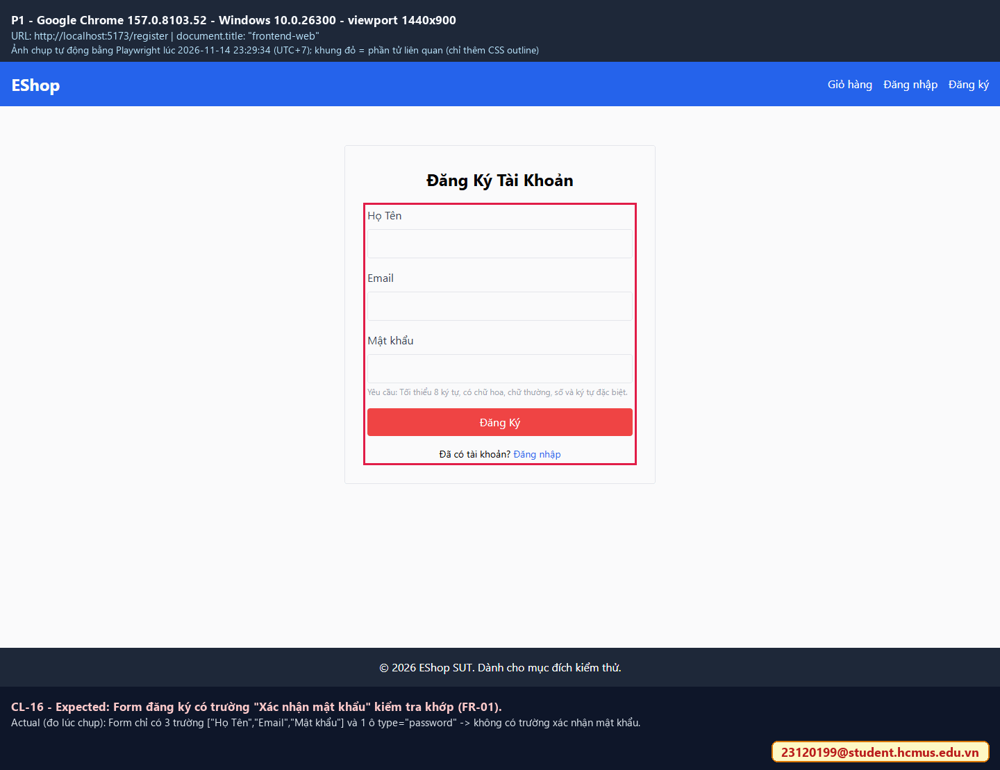

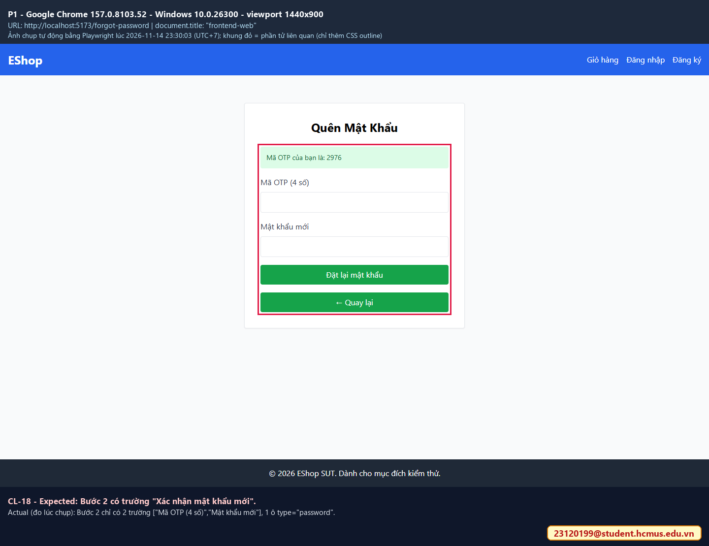

**Danh sách đầy đủ ảnh minh chứng theo nền tảng:**
- `CL-16` (`P1`): [`screenshots/task1_failed/P1_CL-16.png`](screenshots/task1_failed/P1_CL-16.png)
- `CL-16` (`P2`): [`screenshots/task1_failed/P2_CL-16.png`](screenshots/task1_failed/P2_CL-16.png)
- `CL-16` (`P3`): [`screenshots/task1_failed/P3_CL-16.png`](screenshots/task1_failed/P3_CL-16.png)
- `CL-18` (`P1`): [`screenshots/task1_failed/P1_CL-18.png`](screenshots/task1_failed/P1_CL-18.png)
- `CL-18` (`P2`): [`screenshots/task1_failed/P2_CL-18.png`](screenshots/task1_failed/P2_CL-18.png)
- `CL-18` (`P3`): [`screenshots/task1_failed/P3_CL-18.png`](screenshots/task1_failed/P3_CL-18.png)

#### GitHub Issue
- **Issue:** [#7 — [HW03-M1] [BUG-07] [IA-02] [Register, ForgotPassword] Biểu mẫu Đăng ký và Đặt lại mật khẩu (Bước 2) thiếu hoàn toàn trường Xác nhận mật khẩu](https://github.com/HuynhDucThinh/Software-Testing-HW03/issues/7)
- **Ảnh chụp trang GitHub Issue:** [`screenshots/github_issues/ISSUE-07_BUG-07.png`](screenshots/github_issues/ISSUE-07_BUG-07.png)

---

### BUG-08 (Issue #8) — [IA-02] [ForgotPassword] Mã OTP khôi phục mật khẩu chỉ sinh 4 chữ số thay vì 6 chữ số theo đặc tả FR-03 và SEC-07

#### Summary
Khi yêu cầu mã OTP khôi phục mật khẩu, Backend chỉ sinh và khung thông báo xanh trên trang chỉ hiển thị mã OTP gồm 4 chữ số (`1000-9999`) và ô nhập OTP ở Bước 2 không giới hạn độ dài 6 chữ số theo đặc tả `FR-03` và `SEC-07`.

- **Bug ID:** `BUG-08`
- **Checklist item:** `CL-20`
- **Interface aspect:** `IA-02` — Forms
- **Màn hình:** ForgotPassword (`/forgot-password`)
- **Requirement:** FR-03 (eshop-sut/README.md:51); SEC-07 (eshop-sut/README.md:284); Slide 10 #5 Field Limits
- **Loại lỗi:** `State`
- **Severity:** **Major**
- **Priority:** **High**

#### Environment
- **SUT:** `eshop-sut @ 1a9304a (repo HEAD 6b6a7a9)` (Web `http://localhost:5173`, Backend API `http://localhost:3000`)
- **P1:** Google Chrome 157.0.8103.50 trên Windows 11
- **P2:** Mozilla Firefox trên Windows 11 (bản cài đặt `137.0.1` dùng để quan sát trực tiếp; nhân Gecko `159.0` bản Playwright dùng để đo DOM và chụp ảnh minh chứng)
- **P3:** Chrome Android 156.0.8078.79 trên OPPO Reno10 5G (Android 15, adb reverse)
- **URL kiểm thử:** `http://localhost:5173/forgot-password`
- **Viewport:** Desktop `1440x900` (`P1`, `P2`); Mobile `360x801` / `1080x2412` (`P3`)

#### Preconditions
Tài khoản `test@eshop.com` tồn tại trong CSDL.

#### Steps to reproduce
1. Truy cập `http://localhost:5173/forgot-password`.
2. Nhập `test@eshop.com` vào ô Email và bấm `Lấy mã OTP`.
3. Quan sát mã OTP hiển thị trong khung thông báo màu xanh ngay trên trang (không phải hộp thoại) và kiểm tra các thuộc tính `maxLength`/`pattern` của ô `Mã OTP` ở Bước 2.

#### Expected result
Theo `FR-03` (`eshop-sut/README.md:51`) và `SEC-07` (`eshop-sut/README.md:284`), mã OTP dùng một lần phải gồm đúng 6 chữ số ngẫu nhiên (ví dụ `482910`), và trường nhập OTP cần gợi ý/kiểm tra độ dài 6 chữ số.

- **`CL-20`** (*Độ dài 6 chữ số của mã OTP và nhãn trường OTP ở Bước 2 Quên mật khẩu* — căn cứ: `FR-03 (eshop-sut/README.md:51); SEC-07 (eshop-sut/README.md:284); Slide 10 #5 Field Limits`): Mã OTP demo hiển thị ở Bước 2 gồm đúng 6 chữ số ngẫu nhiên và nhãn/gợi ý của ô nhập OTP mô tả đúng mã 6 chữ số. Fail nếu mã OTP sinh ra có ít hơn 6 chữ số (ví dụ chỉ có 4 chữ số) hoặc nhãn ô nhập ghi sai độ dài mã OTP.

#### Actual result
Khung thông báo màu xanh ngay trên trang (không phải hộp thoại) hiển thị mã OTP chỉ có 4 chữ số (ví dụ `Mã OTP của bạn là: 4823` do `server.js:72` tính `Math.floor(1000 + Math.random() * 9000)`), đồng thời ô `Mã OTP` ở Bước 2 có `maxLength = -1`, `pattern = ''` không kiểm tra định dạng 6 chữ số.

**Dữ kiện `Actual` nguyên văn theo từng mục và nền tảng:**
- **`CL-20` trên `P1`:** Actual: Hệ thống chỉ sinh mã OTP gồm 4 chữ số ("Mã OTP của bạn là: 5017") và nhãn ô nhập ghi "Mã OTP (4 số)" thay vì 6 chữ số.
- **`CL-20` trên `P2`:** Actual: Hệ thống chỉ sinh mã OTP gồm 4 chữ số ("Mã OTP của bạn là: 2354") và nhãn ô nhập ghi "Mã OTP (4 số)" thay vì 6 chữ số.
- **`CL-20` trên `P3`:** Actual: Hệ thống chỉ sinh mã OTP gồm 4 chữ số ("Mã OTP của bạn là: 3074") và nhãn ô nhập ghi "Mã OTP (4 số)" thay vì 6 chữ số.

#### Impact
Giảm không gian khóa OTP đi 100 lần (từ 1.000.000 xuống 9.000 khả năng, vi phạm yêu cầu bảo mật `SEC-07`) và gây nhầm lẫn cho người dùng mong đợi mã chuẩn 6 chữ số.

#### Reproducibility
Luôn luôn (100%) trên các nền tảng áp dụng: `P1`, `P2`, `P3`.

#### Evidence
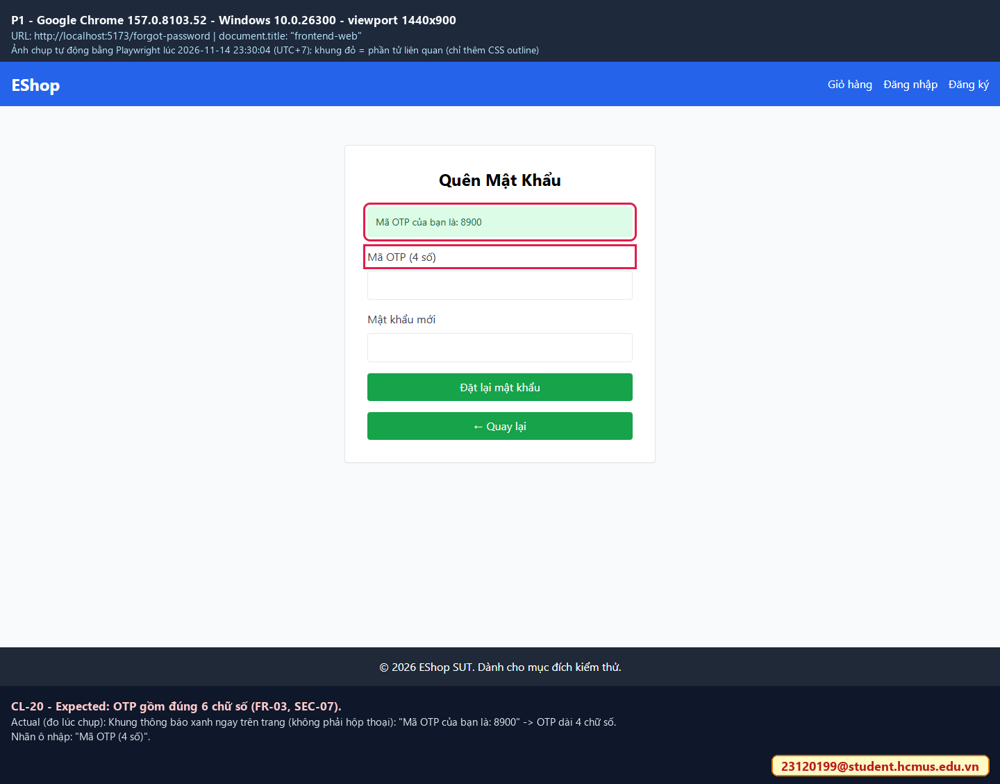

**Danh sách đầy đủ ảnh minh chứng theo nền tảng:**
- `CL-20` (`P1`): [`screenshots/task1_failed/P1_CL-20.png`](screenshots/task1_failed/P1_CL-20.png)
- `CL-20` (`P2`): [`screenshots/task1_failed/P2_CL-20.png`](screenshots/task1_failed/P2_CL-20.png)
- `CL-20` (`P3`): [`screenshots/task1_failed/P3_CL-20.png`](screenshots/task1_failed/P3_CL-20.png)

#### GitHub Issue
- **Issue:** [#8 — [HW03-M1] [BUG-08] [IA-02] [ForgotPassword] Mã OTP khôi phục mật khẩu chỉ sinh 4 chữ số thay vì 6 chữ số theo đặc tả FR-03 và SEC-07](https://github.com/HuynhDucThinh/Software-Testing-HW03/issues/8)
- **Ảnh chụp trang GitHub Issue:** [`screenshots/github_issues/ISSUE-08_BUG-08.png`](screenshots/github_issues/ISSUE-08_BUG-08.png)

---

### BUG-09 (Issue #9) — [IA-02] [Register, Login, ForgotPassword] Tất cả ô nhập Email khai báo type='text' khiến chuỗi sai định dạng email vẫn gửi request lên API

#### Summary
Cả 3 biểu mẫu Đăng ký (`/register`), Đăng nhập (`/login`) và Quên mật khẩu Bước 1 (`/forgot-password`) đều khai báo ô nhập Email là `<input type="text">` và không kiểm tra định dạng email ở phía client lẫn server, cho phép tạo tài khoản với email sai khuôn dạng như `abc-khong-phai-email`.

- **Bug ID:** `BUG-09`
- **Checklist item:** `CL-13`, `CL-14`
- **Interface aspect:** `IA-02` — Forms
- **Màn hình:** Register (`/register`), Login (`/login`), ForgotPassword (`/forgot-password` — Bước 1)
- **Requirement:** FR-01 (eshop-sut/README.md:33); FR-22 (eshop-sut/README.md:253); FR-02 (eshop-sut/README.md:44)
- **Loại lỗi:** `State`
- **Severity:** **Major**
- **Priority:** **High**

#### Environment
- **SUT:** `eshop-sut @ 1a9304a (repo HEAD 6b6a7a9)` (Web `http://localhost:5173`, Backend API `http://localhost:3000`)
- **P1:** Google Chrome 157.0.8103.50 trên Windows 11
- **P2:** Mozilla Firefox trên Windows 11 (bản cài đặt `137.0.1` dùng để quan sát trực tiếp; nhân Gecko `159.0` bản Playwright dùng để đo DOM và chụp ảnh minh chứng)
- **P3:** Chrome Android 156.0.8078.79 trên OPPO Reno10 5G (Android 15, adb reverse)
- **URL kiểm thử:** `http://localhost:5173/register, http://localhost:5173/login, http://localhost:5173/forgot-password`
- **Viewport:** Desktop `1440x900` (`P1`, `P2`); Mobile `360x801` / `1080x2412` (`P3`)

#### Preconditions
Trạng thái chưa đăng nhập; Backend và Frontend đang hoạt động.

#### Steps to reproduce
1. Truy cập `http://localhost:5173/register`, nhập Họ Tên `23120199 - Huỳnh Đức Thịnh`, nhập Email sai định dạng `abc-khong-phai-email`, mật khẩu `Abcd123 ` rồi bấm `Đăng Ký`.
2. Truy cập `http://localhost:5173/login`, nhập `abc` vào ô Username, `123` vào ô Mật khẩu rồi bấm `Sign In` và kiểm tra tab Network.
3. Truy cập `http://localhost:5173/forgot-password`, nhập `abc` vào ô Email rồi bấm `Lấy mã OTP` và kiểm tra tab Network.

#### Expected result
Theo `FR-01` (`eshop-sut/README.md:33`), `FR-02` (`eshop-sut/README.md:44`) và `FR-22` (`eshop-sut/README.md:253`), tất cả ô nhập địa chỉ email phải sử dụng `type="email"` và chặn gửi biểu mẫu kèm thông báo lỗi khi chuỗi nhập không đúng định dạng email hợp lệ.

- **`CL-13`** (*Thuộc tính type="email" và kiểm tra định dạng email hợp lệ trên trang Đăng ký* — căn cứ: `FR-01 (eshop-sut/README.md:33); FR-22 (eshop-sut/README.md:253)`): Ô nhập Email trên /register có thuộc tính `type="email"` và chặn gửi form khi nhập chuỗi không đúng định dạng `user@domain.com` (kích hoạt bàn phím email trên di động hoặc thông báo lỗi định dạng trước khi gọi API). Fail nếu ô Email có `type` khác `email` hoặc cho phép gửi chuỗi sai định dạng (ví dụ `nguoimoieshop.com`) lên server.
- **`CL-14`** (*Thuộc tính type="email" của ô nhập Email trên trang Đăng nhập và Quên mật khẩu* — căn cứ: `FR-02 (eshop-sut/README.md:44); FR-22 (eshop-sut/README.md:253)`): Ô nhập Email trên trang /login và ở Bước 1 trang /forgot-password đều khai báo `type="email"` và kích hoạt kiểm tra định dạng email chuẩn HTML5 khi bấm gửi với chuỗi thiếu ký tự `@`. Fail nếu bất kỳ ô nào dùng `type="text"` hoặc không chặn định dạng email sai ngay trên form.

#### Actual result
Cả 3 trang đều khai báo `<input type="text">` cho ô Email/Username. Đặc biệt trên `/register`, chuỗi `abc-khong-phai-email` vẫn gửi `POST /api/register` trả về HTTP 200 OK và tạo tài khoản rác trong CSDL; trên `/login` và `/forgot-password`, chuỗi `abc` vẫn phát sinh request `POST` lên Backend.

**Dữ kiện `Actual` nguyên văn theo từng mục và nền tảng:**
- **`CL-13` trên `P1`:** Actual: Ô Email trên /register khai báo type="text" (khác "email") và khi nhập "nguoimoieshop.com" vẫn gửi 1 request POST /api/register lên server mà không chặn định dạng email.
- **`CL-13` trên `P2`:** Actual: Ô Email trên /register khai báo type="text" (khác "email") và khi nhập "nguoimoieshop.com" vẫn gửi 1 request POST /api/register lên server mà không chặn định dạng email.
- **`CL-13` trên `P3`:** Actual: Ô Email trên /register khai báo type="text" (khác "email") và khi nhập "nguoimoieshop.com" vẫn gửi 1 request POST /api/register lên server mà không chặn định dạng email.
- **`CL-14` trên `P1`:** Actual: Ô Email trên /login có type="text" (gửi 1 request với "khongcoacong.com") và ở Bước 1 /forgot-password có type="text" (gửi 1 request tới server, bật alert "Lỗi: User not found"), không chặn định dạng bằng HTML5.
- **`CL-14` trên `P2`:** Actual: Ô Email trên /login có type="text" (gửi 1 request với "khongcoacong.com") và ở Bước 1 /forgot-password có type="text" (gửi 1 request tới server, bật alert "Lỗi: User not found"), không chặn định dạng bằng HTML5.
- **`CL-14` trên `P3`:** Actual: Ô Email trên /login có type="text" (gửi 1 request với "khongcoacong.com") và ở Bước 1 /forgot-password có type="text" (gửi 1 request tới server, bật alert "Lỗi: User not found"), không chặn định dạng bằng HTML5.

#### Impact
Cho phép dữ liệu email hỏng đi vào CSDL, không kích hoạt bàn phím `@` chuyên dụng trên di động và mất lớp kiểm tra định dạng tức thì trước khi gọi mạng.

#### Reproducibility
Luôn luôn (100%) trên các nền tảng áp dụng: `P1`, `P2`, `P3`.

#### Evidence
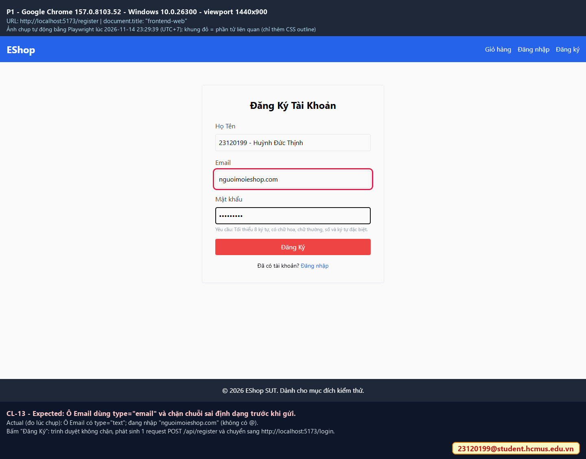

**Danh sách đầy đủ ảnh minh chứng theo nền tảng:**
- `CL-13` (`P1`): [`screenshots/task1_failed/P1_CL-13.png`](screenshots/task1_failed/P1_CL-13.png)
- `CL-13` (`P2`): [`screenshots/task1_failed/P2_CL-13.png`](screenshots/task1_failed/P2_CL-13.png)
- `CL-13` (`P3`): [`screenshots/task1_failed/P3_CL-13.png`](screenshots/task1_failed/P3_CL-13.png)
- `CL-14` (`P1`): [`screenshots/task1_failed/P1_CL-14.png`](screenshots/task1_failed/P1_CL-14.png)
- `CL-14` (`P2`): [`screenshots/task1_failed/P2_CL-14.png`](screenshots/task1_failed/P2_CL-14.png)
- `CL-14` (`P3`): [`screenshots/task1_failed/P3_CL-14.png`](screenshots/task1_failed/P3_CL-14.png)

#### GitHub Issue
- **Issue:** [#9 — [HW03-M1] [BUG-09] [IA-02] [Register, Login, ForgotPassword] Tất cả ô nhập Email khai báo type='text' khiến chuỗi sai định dạng email vẫn gửi request lên API](https://github.com/HuynhDucThinh/Software-Testing-HW03/issues/9)
- **Ảnh chụp trang GitHub Issue:** [`screenshots/github_issues/ISSUE-09_BUG-09.png`](screenshots/github_issues/ISSUE-09_BUG-09.png)

---

### BUG-10 (Issue #10) — [IA-03] [Profile] Truy cập trực tiếp /profile khi chưa đăng nhập không tự chuyển hướng về /login và không có liên kết đăng nhập trong vùng nội dung

#### Summary
Khi khách chưa đăng nhập truy cập trực tiếp đường dẫn được bảo vệ `http://localhost:5173/profile`, ứng dụng không tự động chuyển hướng sang `/login` mà giữ nguyên URL `/profile` và chỉ hiển thị dòng chữ tĩnh `Vui lòng đăng nhập` không kèm bất kỳ nút hoặc liên kết nào.

- **Bug ID:** `BUG-10`
- **Checklist item:** `CL-30`
- **Interface aspect:** `IA-03` — Navigation
- **Màn hình:** Profile (`/profile`)
- **Requirement:** FR-04 (eshop-sut/README.md:64); Nielsen #3 User control and freedom
- **Loại lỗi:** `State`
- **Severity:** **Major**
- **Priority:** **Medium**

#### Environment
- **SUT:** `eshop-sut @ 1a9304a (repo HEAD 6b6a7a9)` (Web `http://localhost:5173`, Backend API `http://localhost:3000`)
- **P1:** Google Chrome 157.0.8103.50 trên Windows 11
- **P2:** Mozilla Firefox trên Windows 11 (bản cài đặt `137.0.1` dùng để quan sát trực tiếp; nhân Gecko `159.0` bản Playwright dùng để đo DOM và chụp ảnh minh chứng)
- **P3:** Chrome Android 156.0.8078.79 trên OPPO Reno10 5G (Android 15, adb reverse)
- **URL kiểm thử:** `http://localhost:5173/profile`
- **Viewport:** Desktop `1440x900` (`P1`, `P2`); Mobile `360x801` / `1080x2412` (`P3`)

#### Preconditions
Trạng thái khách chưa đăng nhập (`localStorage` không có token/user).

#### Steps to reproduce
1. Đảm bảo chưa đăng nhập (hoặc bấm `Thoát` nếu đang đăng nhập).
2. Nhập trực tiếp địa chỉ `http://localhost:5173/profile` lên thanh URL trình duyệt và nhấn `Enter`.
3. Quan sát URL hiện hành và các phần tử tương tác bên trong vùng `<main>`.

#### Expected result
Theo `FR-04` (`eshop-sut/README.md:64`) và nguyên tắc Nielsen #3 (User control and freedom), trang bảo vệ `/profile` khi chưa xác thực cần tự động điều hướng về `/login` hoặc hiển thị nút/liên kết trực tiếp dẫn người dùng tới trang Đăng nhập.

- **`CL-30`** (*Xử lý điều hướng khi người dùng chưa đăng nhập truy cập trực tiếp đường dẫn /profile* — căn cứ: `FR-04 (eshop-sut/README.md:64); Nielsen #3 User control and freedom`): Khi truy cập `/profile` lúc chưa đăng nhập, ứng dụng tự động chuyển hướng về `/login` hoặc hiển thị thông báo yêu cầu đăng nhập kèm nút/liên kết điều hướng trực tiếp sang `/login` ngay trong vùng nội dung chính. Fail nếu trang hiển thị form rỗng lỗi hoặc chỉ hiện dòng chữ tĩnh `Vui lòng đăng nhập` cụt đường mà không tự chuyển hướng hay có nút/liên kết đi tới `/login` trong vùng thông báo.

#### Actual result
URL vẫn đứng yên tại `http://localhost:5173/profile`, vùng `<main>` chỉ render thẻ tĩnh `
Vui lòng đăng nhập
` với 0 nút bấm và 0 liên kết điều hướng (`Profile.jsx:57`).

**Dữ kiện `Actual` nguyên văn theo từng mục và nền tảng:**
- **`CL-30` trên `P1`:** Actual: Truy cập /profile khi chưa đăng nhập vẫn đứng tại URL "/profile", vùng nội dung chính chỉ hiện chữ tĩnh "Vui lòng đăng nhập" và có 0 nút/liên kết điều hướng sang /login.
- **`CL-30` trên `P2`:** Actual: Truy cập /profile khi chưa đăng nhập vẫn đứng tại URL "/profile", vùng nội dung chính chỉ hiện chữ tĩnh "Vui lòng đăng nhập" và có 0 nút/liên kết điều hướng sang /login.
- **`CL-30` trên `P3`:** Actual: Truy cập /profile khi chưa đăng nhập vẫn đứng tại URL "/profile", vùng nội dung chính chỉ hiện chữ tĩnh "Vui lòng đăng nhập" và có 0 nút/liên kết điều hướng sang /login.

#### Impact
Tạo điểm cụt điều hướng (dead-end) trong vùng nội dung chính, buộc người dùng phải tự tìm liên kết nhỏ trên thanh Header để đi đăng nhập.

#### Reproducibility
Luôn luôn (100%) trên các nền tảng áp dụng: `P1`, `P2`, `P3`.

#### Evidence
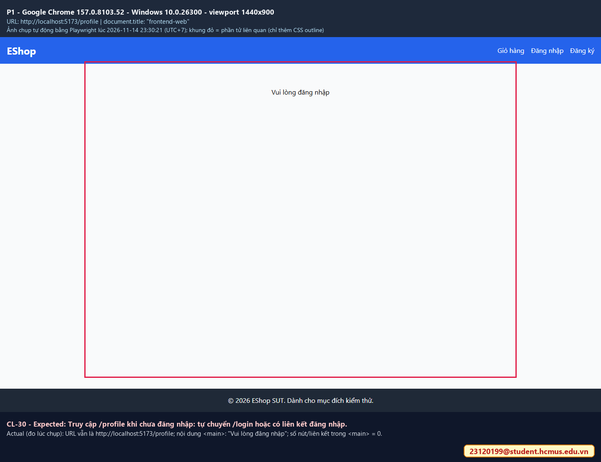

**Danh sách đầy đủ ảnh minh chứng theo nền tảng:**
- `CL-30` (`P1`): [`screenshots/task1_failed/P1_CL-30.png`](screenshots/task1_failed/P1_CL-30.png)
- `CL-30` (`P2`): [`screenshots/task1_failed/P2_CL-30.png`](screenshots/task1_failed/P2_CL-30.png)
- `CL-30` (`P3`): [`screenshots/task1_failed/P3_CL-30.png`](screenshots/task1_failed/P3_CL-30.png)

#### GitHub Issue
- **Issue:** [#10 — [HW03-M1] [BUG-10] [IA-03] [Profile] Truy cập trực tiếp /profile khi chưa đăng nhập không tự chuyển hướng về /login và không có liên kết đăng nhập trong vùng nội dung](https://github.com/HuynhDucThinh/Software-Testing-HW03/issues/10)
- **Ảnh chụp trang GitHub Issue:** [`screenshots/github_issues/ISSUE-10_BUG-10.png`](screenshots/github_issues/ISSUE-10_BUG-10.png)

---

### BUG-11 (Issue #11) — [IA-04] [Profile, Header] Lời chào trên thanh Header không cập nhật theo Họ Tên mới sau khi lưu Hồ sơ thành công

#### Summary
Sau khi người dùng đổi Họ Tên tại trang Hồ sơ (`/profile`) và nhận thông báo `Cập nhật thành công!`, thanh Header ở đầu trang vẫn tiếp tục hiển thị tên cũ do trạng thái người dùng trong `AuthContext`/`localStorage` không được đồng bộ.

- **Bug ID:** `BUG-11`
- **Checklist item:** `CL-36`
- **Interface aspect:** `IA-04` — Feedback / state
- **Màn hình:** Profile (`/profile`), Header/Navbar
- **Requirement:** FR-04 (eshop-sut/README.md:64); Nielsen #1 Visibility of system status
- **Loại lỗi:** `State`
- **Severity:** **Major**
- **Priority:** **Medium**

#### Environment
- **SUT:** `eshop-sut @ 1a9304a (repo HEAD 6b6a7a9)` (Web `http://localhost:5173`, Backend API `http://localhost:3000`)
- **P1:** Google Chrome 157.0.8103.50 trên Windows 11
- **P2:** Mozilla Firefox trên Windows 11 (bản cài đặt `137.0.1` dùng để quan sát trực tiếp; nhân Gecko `159.0` bản Playwright dùng để đo DOM và chụp ảnh minh chứng)
- **P3:** Chrome Android 156.0.8078.79 trên OPPO Reno10 5G (Android 15, adb reverse)
- **URL kiểm thử:** `http://localhost:5173/profile`
- **Viewport:** Desktop `1440x900` (`P1`, `P2`); Mobile `360x801` / `1080x2412` (`P3`)

#### Preconditions
Đã đăng nhập bằng tài khoản `test@eshop.com` (tên mặc định `Test User`).

#### Steps to reproduce
1. Đăng nhập bằng `test@eshop.com` / `Test1234!`, quan sát lời chào trên Header đang là `Chào, Test User`.
2. Truy cập `http://localhost:5173/profile`, sửa ô Họ Tên thành `23120199 - Huỳnh Đức Thịnh`, nhập SĐT `9123456789` (để vượt qua bộ lọc SĐT hiện tại) rồi bấm `Cập nhật`.
3. Đóng hộp thoại `Cập nhật thành công!` và quan sát lời chào trên thanh Header trước khi tải lại trang.

#### Expected result
Theo `FR-04` (`eshop-sut/README.md:64`) và nguyên tắc Nielsen #1 (Visibility of system status), ngay khi cập nhật hồ sơ thành công, lời chào trên thanh Header phải đồng bộ tức thì sang tên mới (`Chào, 23120199 - Huỳnh Đức Thịnh`) và giữ nguyên bền vững khi chuyển trang.

- **`CL-36`** (*Đồng bộ tên người dùng trên Header và bền vững dữ liệu sau khi cập nhật Hồ sơ thành công* — căn cứ: `FR-04 (eshop-sut/README.md:64); Nielsen #1 Visibility of system status`): Trong vòng 1 giây sau khi cập nhật hồ sơ thành công tại `/profile`, lời chào `Chào, <tên>` trên thanh Header tự động cập nhật sang `Họ Tên` mới mà không cần đăng xuất, đồng thời khi tải lại trang `/profile` các trường `Họ Tên`, `Số điện thoại`, `Địa chỉ giao hàng` vẫn hiển thị đúng giá trị vừa lưu. Fail nếu lời chào trên Header vẫn giữ tên cũ sau khi cập nhật hoặc khi tải lại trang `/profile` dữ liệu quay về giá trị cũ.

#### Actual result
Dù API `PUT /api/users/:id` đã lưu thành công vào SQLite và trang `/profile` nạp lại tên mới khi `F5`, thanh Header vẫn hiển thị tên cũ `Chào, Test User` (do `Profile.jsx:49` không cập nhật lại state `user` trong `AuthContext` và `localStorage`).

**Dữ kiện `Actual` nguyên văn theo từng mục và nền tảng:**
- **`CL-36` trên `P1`:** Actual: Sau 1 giây bấm Cập nhật hồ sơ, lời chào trên Header vẫn giữ nguyên tên cũ "Chào, Test User" (không đồng bộ sang "Chào, Nguyễn Văn Ánh" nếu chưa tải lại trang); sau khi F5 dữ liệu lưu bền=true.
- **`CL-36` trên `P2`:** Actual: Sau 1 giây bấm Cập nhật hồ sơ, lời chào trên Header vẫn giữ nguyên tên cũ "Chào, Test User" (không đồng bộ sang "Chào, Nguyễn Văn Ánh" nếu chưa tải lại trang); sau khi F5 dữ liệu lưu bền=true.
- **`CL-36` trên `P3`:** Actual: Sau 1 giây bấm Cập nhật hồ sơ, lời chào trên Header vẫn giữ nguyên tên cũ "Chào, Test User" (không đồng bộ sang "Chào, Nguyễn Văn Ánh" nếu chưa tải lại trang); sau khi F5 dữ liệu lưu bền=true.

#### Impact
Gây mâu thuẫn trạng thái hiển thị ngay trên cùng một màn hình khiến người dùng nghi ngờ thao tác cập nhật hồ sơ chưa có hiệu lực.

#### Reproducibility
Luôn luôn (100%) trên các nền tảng áp dụng: `P1`, `P2`, `P3`.

#### Evidence

**Danh sách đầy đủ ảnh minh chứng theo nền tảng:**
- `CL-36` (`P1`): [`screenshots/task1_failed/P1_CL-36.png`](screenshots/task1_failed/P1_CL-36.png)
- `CL-36` (`P2`): [`screenshots/task1_failed/P2_CL-36.png`](screenshots/task1_failed/P2_CL-36.png)
- `CL-36` (`P3`): [`screenshots/task1_failed/P3_CL-36.png`](screenshots/task1_failed/P3_CL-36.png)

#### GitHub Issue
- **Issue:** [#11 — [HW03-M1] [BUG-11] [IA-04] [Profile, Header] Lời chào trên thanh Header không cập nhật theo Họ Tên mới sau khi lưu Hồ sơ thành công](https://github.com/HuynhDucThinh/Software-Testing-HW03/issues/11)
- **Ảnh chụp trang GitHub Issue:** [`screenshots/github_issues/ISSUE-11_BUG-11.png`](screenshots/github_issues/ISSUE-11_BUG-11.png)

---

### BUG-12 (Issue #12) — [IA-02] [Register, Profile] Chấp nhận trường Họ Tên chỉ gồm toàn ký tự khoảng trắng khiến lời chào Header hiển thị cụt 'Chào,'

#### Summary
Biểu mẫu Đăng ký (`/register`) và Hồ sơ cá nhân (`/profile`) không cắt khoảng trắng đầu/cuối (`.trim()`) trước khi kiểm tra bắt buộc, cho phép lưu Họ Tên chỉ chứa toàn dấu cách (`'   '`) và làm lời chào trên Header hiển thị cụt lủn `Chào,`.

- **Bug ID:** `BUG-12`
- **Checklist item:** `SV-11`
- **Interface aspect:** `IA-02` — Forms
- **Màn hình:** Register (`/register`), Profile (`/profile`)
- **Requirement:** Nielsen #5 Error prevention; FR-01 (eshop-sut/README.md:32); Giả định GA7
- **Loại lỗi:** `State`
- **Severity:** **Major**
- **Priority:** **Medium**

#### Environment
- **SUT:** `eshop-sut @ 1a9304a (repo HEAD 6b6a7a9)` (Web `http://localhost:5173`, Backend API `http://localhost:3000`)
- **P1:** Google Chrome 157.0.8103.50 trên Windows 11
- **P2:** Mozilla Firefox trên Windows 11 (bản cài đặt `137.0.1` dùng để quan sát trực tiếp; nhân Gecko `159.0` bản Playwright dùng để đo DOM và chụp ảnh minh chứng)
- **P3:** Chrome Android 156.0.8078.79 trên OPPO Reno10 5G (Android 15, adb reverse)
- **URL kiểm thử:** `http://localhost:5173/register, http://localhost:5173/profile`
- **Viewport:** Desktop `1440x900` (`P1`, `P2`); Mobile `360x801` / `1080x2412` (`P3`)

#### Preconditions
Backend và Frontend đang hoạt động.

#### Steps to reproduce
1. Truy cập `http://localhost:5173/register`, nhập 3 dấu cách `'   '` vào ô Họ Tên, nhập Email mới hợp lệ và mật khẩu `Abcd123 `, sau đó bấm `Đăng Ký`.
2. Đăng nhập vào tài khoản vừa tạo (hoặc vào `/profile` của tài khoản đang đăng nhập, đổi Họ Tên thành `'   '` và lưu) rồi quan sát thanh Header.

#### Expected result
Theo `FR-01` (`eshop-sut/README.md:32`), giả định `GA7` và nguyên tắc Nielsen #5 (Error prevention), trường bắt buộc Họ Tên phải loại bỏ khoảng trắng thừa hai đầu và từ chối giá trị rỗng sau khi `trim`.

- **`SV-11`** (*Từ chối Họ Tên chỉ chứa khoảng trắng* — căn cứ: `Nielsen #5 Error prevention; FR-01 (eshop-sut/README.md:32); Giả định GA7`): Cả /register và /profile đều từ chối Họ Tên chỉ gồm khoảng trắng và hiển thị thông báo yêu cầu nhập Họ Tên, không lưu giá trị rỗng về nội dung. Fail nếu hệ thống chấp nhận đăng ký hoặc cập nhật với Họ Tên chỉ gồm khoảng trắng, khiến lời chào trên Header chỉ còn `Chào,`.

#### Actual result
Thuộc tính HTML `required` cho qua chuỗi `'   '`, cả `/register` và `/profile` đều gửi lưu thành công lên Backend (HTTP 200), và khi đăng nhập thanh Header hiển thị lời chào bị rỗng tên là `Chào,` trên cả `P1`, `P2` và `P3`.

**Dữ kiện `Actual` nguyên văn theo từng mục và nền tảng:**
- **`SV-11` trên `P1`:** Actual: Cả /register (chuyển sang /login=true) lẫn /profile (alert "Cập nhật thành công!") đều chấp nhận lưu Họ Tên chỉ gồm 3 khoảng trắng "   ", khiến lời chào trên Header chỉ còn "Chào,".
- **`SV-11` trên `P2`:** Actual: Cả /register (chuyển sang /login=true) lẫn /profile (alert "Cập nhật thành công!") đều chấp nhận lưu Họ Tên chỉ gồm 3 khoảng trắng "   ", khiến lời chào trên Header chỉ còn "Chào,".
- **`SV-11` trên `P3`:** Actual: Cả /register (chuyển sang /login=true) lẫn /profile (alert "Cập nhật thành công!") đều chấp nhận lưu Họ Tên chỉ gồm 3 khoảng trắng "   ", khiến lời chào trên Header chỉ còn "Chào,".

#### Impact
Tạo hồ sơ người dùng không có tên hiển thị hợp lệ trong hệ thống và làm hỏng giao diện lời chào cũng như thông tin người nhận đơn hàng.

#### Reproducibility
Luôn luôn (100%) trên các nền tảng áp dụng: `P1`, `P2`, `P3`.

#### Evidence
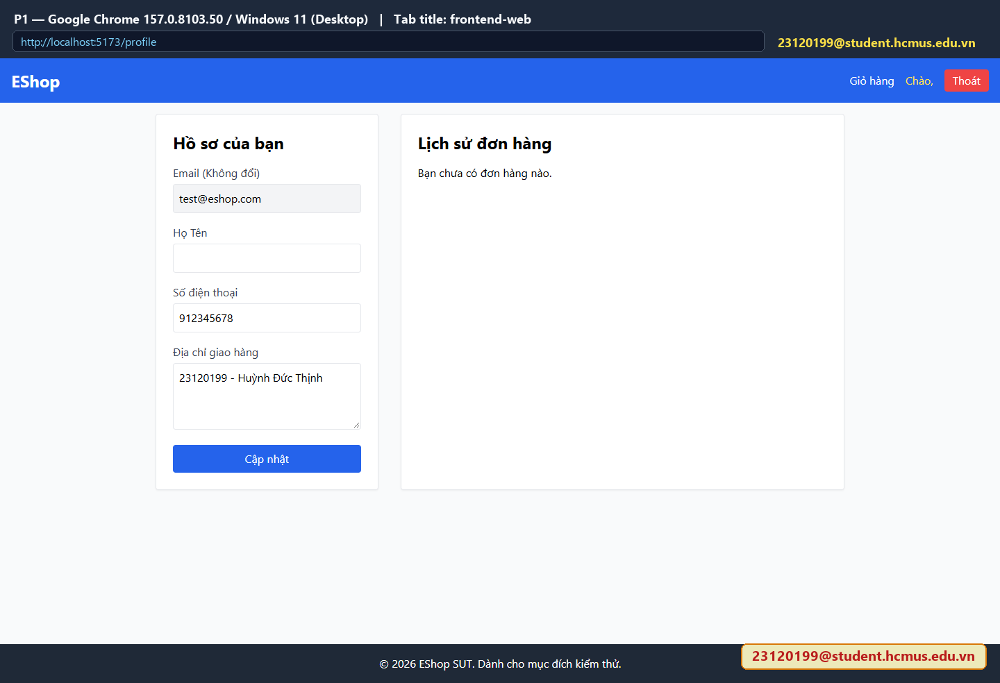

**Danh sách đầy đủ ảnh minh chứng theo nền tảng:**
- `SV-11` (`P1`): [`screenshots/task1_failed/P1_SV-11.png`](screenshots/task1_failed/P1_SV-11.png)
- `SV-11` (`P2`): [`screenshots/task1_failed/P2_SV-11.png`](screenshots/task1_failed/P2_SV-11.png)
- `SV-11` (`P3`): [`screenshots/task1_failed/P3_SV-11.png`](screenshots/task1_failed/P3_SV-11.png)

#### GitHub Issue
- **Issue:** [#12 — [HW03-M1] [BUG-12] [IA-02] [Register, Profile] Chấp nhận trường Họ Tên chỉ gồm toàn ký tự khoảng trắng khiến lời chào Header hiển thị cụt 'Chào,'](https://github.com/HuynhDucThinh/Software-Testing-HW03/issues/12)
- **Ảnh chụp trang GitHub Issue:** [`screenshots/github_issues/ISSUE-12_BUG-12.png`](screenshots/github_issues/ISSUE-12_BUG-12.png)

---

### BUG-13 (Issue #13) — [IA-01] [Register, Login, ForgotPassword, Profile] Cả 4 trang thiếu thẻ tiêu đề cấp trang h1 và trang Đăng nhập hiển thị sai tiêu đề thành 'Đăng Ký'

#### Summary
Tất cả 4 màn hình thuộc phạm vi xác thực & hồ sơ (`/register`, `/login`, `/forgot-password`, `/profile`) đều không có thẻ tiêu đề chính `<h1>` nào (chỉ dùng `<h2>`), nghiêm trọng nhất là trang Đăng nhập (`/login`) lại hiển thị tiêu đề sai chức năng là `Đăng Ký`.

- **Bug ID:** `BUG-13`
- **Checklist item:** `CL-03`, `CL-04`, `CL-05`, `CL-06`
- **Interface aspect:** `IA-01` — General UI standards
- **Màn hình:** Register (`/register`), Login (`/login`), ForgotPassword (`/forgot-password`), Profile (`/profile`)
- **Requirement:** FR-21 (eshop-sut/README.md:247); FR-05 (eshop-sut/README.md:81)
- **Loại lỗi:** `Visual-Layout`
- **Severity:** **Major**
- **Priority:** **Medium**

#### Environment
- **SUT:** `eshop-sut @ 1a9304a (repo HEAD 6b6a7a9)` (Web `http://localhost:5173`, Backend API `http://localhost:3000`)
- **P1:** Google Chrome 157.0.8103.50 trên Windows 11
- **P2:** Mozilla Firefox trên Windows 11 (bản cài đặt `137.0.1` dùng để quan sát trực tiếp; nhân Gecko `159.0` bản Playwright dùng để đo DOM và chụp ảnh minh chứng)
- **P3:** Chrome Android 156.0.8078.79 trên OPPO Reno10 5G (Android 15, adb reverse)
- **URL kiểm thử:** `http://localhost:5173/login`
- **Viewport:** Desktop `1440x900` (`P1`, `P2`); Mobile `360x801` / `1080x2412` (`P3`)

#### Preconditions
Mở lần lượt 4 trang `/register`, `/login`, `/forgot-password` (Bước 1 & Bước 2) và `/profile` (khi đã đăng nhập).

#### Steps to reproduce
1. Truy cập `http://localhost:5173/login`, quan sát dòng tiêu đề lớn nhất phía trên biểu mẫu và kiểm tra `document.querySelectorAll('h1').length` trong DevTools.
2. Lần lượt truy cập `/register`, `/forgot-password` (cả Bước 1 và Bước 2) và `/profile` (sau khi đăng nhập), kiểm tra số lượng thẻ `<h1>` và thẻ tiêu đề hiện có.

#### Expected result
Theo `FR-21` (`eshop-sut/README.md:247`), mỗi trang phải có đúng một thẻ tiêu đề chính `<h1>` phản ánh chính xác chức năng của trang đó (`Đăng ký tài khoản`, `Đăng nhập`, `Quên mật khẩu`, `Hồ sơ cá nhân`).

- **`CL-03`** (*Số lượng và nội dung thẻ tiêu đề chính h1 trên trang Đăng ký* — căn cứ: `FR-21 (eshop-sut/README.md:247); FR-05 (eshop-sut/README.md:81)`): Tiêu đề chính của trang /register khi kiểm tra DOM (`document.querySelectorAll('h1')`) có đúng 1 thẻ `<h1>` đang hiển thị và văn bản mô tả đúng chức năng đăng ký tài khoản. Fail nếu số lượng thẻ `<h1>` hiển thị bằng 0, lớn hơn 1, hoặc nội dung `<h1>` không phản ánh chức năng đăng ký.
- **`CL-04`** (*Số lượng thẻ h1 và tính chính xác của tiêu đề trang Đăng nhập* — căn cứ: `FR-21 (eshop-sut/README.md:247); FR-05 (eshop-sut/README.md:81)`): Tiêu đề chính trên trang /login khi mở trang và kiểm tra DOM có đúng 1 thẻ `<h1>` hiển thị với văn bản mô tả đúng chức năng 'Đăng nhập'. Fail nếu số lượng thẻ `<h1>` khác 1 hoặc văn bản tiêu đề hiển thị sai tên chức năng (ví dụ hiển thị 'Đăng Ký').
- **`CL-05`** (*Số lượng và nội dung thẻ tiêu đề chính h1 trên trang Quên mật khẩu ở cả 2 bước* — căn cứ: `FR-21 (eshop-sut/README.md:247); FR-05 (eshop-sut/README.md:81)`): Tiêu đề chính trên trang /forgot-password khi quan sát và kiểm tra DOM ở cả Bước 1 lẫn Bước 2 luôn có đúng 1 thẻ `<h1>` hiển thị mô tả chức năng quên/đặt lại mật khẩu. Fail nếu ở bất kỳ bước nào số lượng thẻ `<h1>` khác 1 hoặc nội dung tiêu đề sai lệch chức năng.
- **`CL-06`** (*Số lượng thẻ tiêu đề cấp trang h1 trên trang Hồ sơ cá nhân* — căn cứ: `FR-21 (eshop-sut/README.md:247); FR-05 (eshop-sut/README.md:81)`): Trang /profile khi đã đăng nhập và kiểm tra DOM có đúng 1 thẻ `<h1>` duy nhất làm tiêu đề cấp trang, các tiêu đề vùng con dùng từ `<h2>` trở xuống. Fail nếu `document.querySelectorAll('h1').length` bằng 0 hoặc lớn hơn 1.

#### Actual result
Cả 4 trang đều có 0 thẻ `<h1>` (đang dùng `<h2>`). Đặc biệt trên trang `/login` (`Login.jsx:33`), thẻ `<h2>` hiển thị nội dung sai hẳn chức năng là `Đăng Ký` thay vì `Đăng Nhập`.

**Dữ kiện `Actual` nguyên văn theo từng mục và nền tảng:**
- **`CL-03` trên `P1`:** Actual: Trên /register có 0 thẻ `<h1>` hiển thị ([]); tiêu đề chính đang dùng thẻ `<h2>` (["Đăng Ký Tài Khoản"]).
- **`CL-03` trên `P2`:** Actual: Trên /register có 0 thẻ `<h1>` hiển thị ([]); tiêu đề chính đang dùng thẻ `<h2>` (["Đăng Ký Tài Khoản"]).
- **`CL-03` trên `P3`:** Actual: Trên /register có 0 thẻ `<h1>` hiển thị ([]); tiêu đề chính đang dùng thẻ `<h2>` (["Đăng Ký Tài Khoản"]).
- **`CL-04` trên `P1`:** Actual: Trên /login có 0 thẻ `<h1>` hiển thị ([]); tiêu đề thực tế đang dùng thẻ `<h2>` với nội dung sai chức năng là ["Đăng Ký"].
- **`CL-04` trên `P2`:** Actual: Trên /login có 0 thẻ `<h1>` hiển thị ([]); tiêu đề thực tế đang dùng thẻ `<h2>` với nội dung sai chức năng là ["Đăng Ký"].
- **`CL-04` trên `P3`:** Actual: Trên /login có 0 thẻ `<h1>` hiển thị ([]); tiêu đề thực tế đang dùng thẻ `<h2>` với nội dung sai chức năng là ["Đăng Ký"].
- **`CL-05` trên `P1`:** Actual: Trang /forgot-password có 0 thẻ `<h1>` ở Bước 1 và 0 thẻ `<h1>` ở Bước 2 (đang dùng thẻ `<h2>`: ["Quên Mật Khẩu"]).
- **`CL-05` trên `P2`:** Actual: Trang /forgot-password có 0 thẻ `<h1>` ở Bước 1 và 0 thẻ `<h1>` ở Bước 2 (đang dùng thẻ `<h2>`: ["Quên Mật Khẩu"]).
- **`CL-05` trên `P3`:** Actual: Trang /forgot-password có 0 thẻ `<h1>` ở Bước 1 và 0 thẻ `<h1>` ở Bước 2 (đang dùng thẻ `<h2>`: ["Quên Mật Khẩu"]).
- **`CL-06` trên `P1`:** Actual: Trang /profile khi đã đăng nhập có 0 thẻ `<h1>` hiển thị; đang dùng 2 thẻ `<h2>` (["Hồ sơ của bạn","Lịch sử đơn hàng"]).
- **`CL-06` trên `P2`:** Actual: Trang /profile khi đã đăng nhập có 0 thẻ `<h1>` hiển thị; đang dùng 2 thẻ `<h2>` (["Hồ sơ của bạn","Lịch sử đơn hàng"]).
- **`CL-06` trên `P3`:** Actual: Trang /profile khi đã đăng nhập có 0 thẻ `<h1>` hiển thị; đang dùng 2 thẻ `<h2>` (["Hồ sơ của bạn","Lịch sử đơn hàng"]).

#### Impact
Tiêu đề `Đăng Ký` ngay trên trang `/login` gây nhầm lẫn nghiêm trọng cho người dùng (nhất là sau khi vừa đăng ký xong chuyển sang `/login` lại thấy tiêu đề `Đăng Ký` lần nữa), đồng thời thiếu `<h1>` làm giảm khả năng định vị trang của trình đọc màn hình.

#### Reproducibility
Luôn luôn (100%) trên các nền tảng áp dụng: `P1`, `P2`, `P3`.

#### Evidence

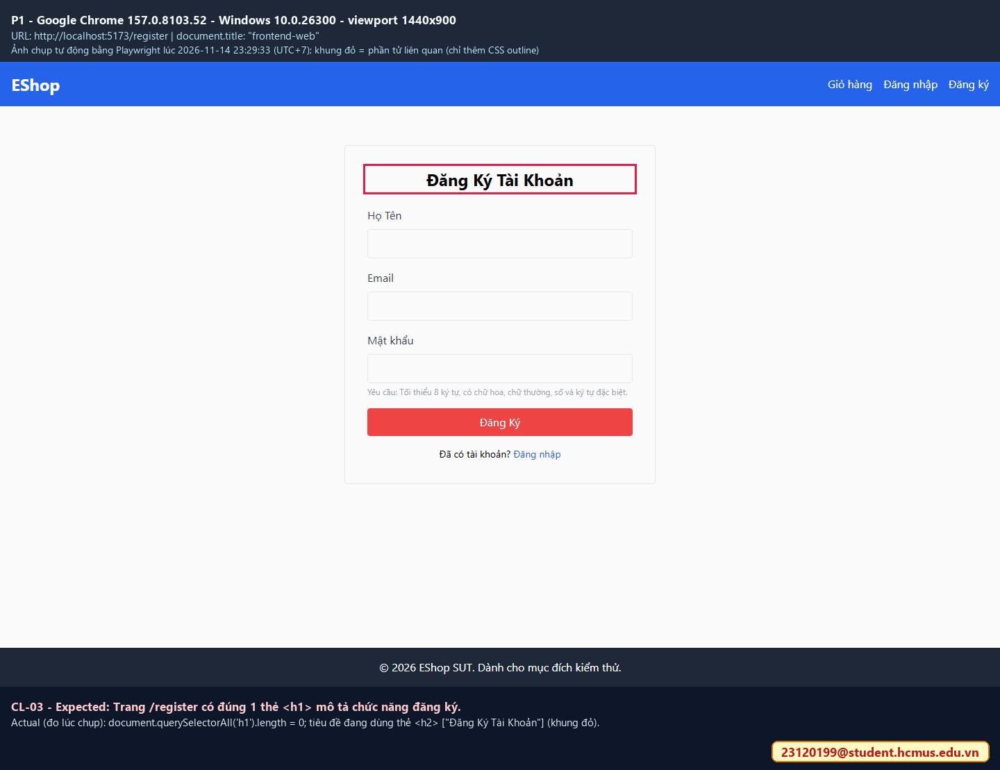

**Danh sách đầy đủ ảnh minh chứng theo nền tảng:**
- `CL-03` (`P1`): [`screenshots/task1_failed/P1_CL-03.png`](screenshots/task1_failed/P1_CL-03.png)
- `CL-03` (`P2`): [`screenshots/task1_failed/P2_CL-03.png`](screenshots/task1_failed/P2_CL-03.png)
- `CL-03` (`P3`): [`screenshots/task1_failed/P3_CL-03.png`](screenshots/task1_failed/P3_CL-03.png)
- `CL-04` (`P1`): [`screenshots/task1_failed/P1_CL-04.png`](screenshots/task1_failed/P1_CL-04.png)
- `CL-04` (`P2`): [`screenshots/task1_failed/P2_CL-04.png`](screenshots/task1_failed/P2_CL-04.png)
- `CL-04` (`P3`): [`screenshots/task1_failed/P3_CL-04.png`](screenshots/task1_failed/P3_CL-04.png)
- `CL-05` (`P1`): [`screenshots/task1_failed/P1_CL-05.png`](screenshots/task1_failed/P1_CL-05.png)
- `CL-05` (`P2`): [`screenshots/task1_failed/P2_CL-05.png`](screenshots/task1_failed/P2_CL-05.png)
- `CL-05` (`P3`): [`screenshots/task1_failed/P3_CL-05.png`](screenshots/task1_failed/P3_CL-05.png)
- `CL-06` (`P1`): [`screenshots/task1_failed/P1_CL-06.png`](screenshots/task1_failed/P1_CL-06.png)
- `CL-06` (`P2`): [`screenshots/task1_failed/P2_CL-06.png`](screenshots/task1_failed/P2_CL-06.png)
- `CL-06` (`P3`): [`screenshots/task1_failed/P3_CL-06.png`](screenshots/task1_failed/P3_CL-06.png)

#### GitHub Issue
- **Issue:** [#13 — [HW03-M1] [BUG-13] [IA-01] [Register, Login, ForgotPassword, Profile] Cả 4 trang thiếu thẻ tiêu đề cấp trang h1 và trang Đăng nhập hiển thị sai tiêu đề thành 'Đăng Ký'](https://github.com/HuynhDucThinh/Software-Testing-HW03/issues/13)
- **Ảnh chụp trang GitHub Issue:** [`screenshots/github_issues/ISSUE-13_BUG-13.png`](screenshots/github_issues/ISSUE-13_BUG-13.png)

---

### BUG-14 (Issue #14) — [IA-01] [Login, Header] Giao diện không nhất quán tiếng Việt: trang Đăng nhập trộn nhãn tiếng Anh ('Username', 'Sign In') và Header dùng nhãn 'Thoát' thay vì 'Đăng xuất'

#### Summary
Giao diện vi phạm quy chuẩn ngôn ngữ tiếng Việt nhất quán: trang `/login` pha trộn nhãn tiếng Anh `Username` và nút `Sign In` bên cạnh nhãn tiếng Việt `Mật khẩu`, còn thanh Header khi đã đăng nhập dùng chữ `Thoát` thay vì nhãn chuẩn `Đăng xuất`.

- **Bug ID:** `BUG-14`
- **Checklist item:** `CL-01`, `CL-25`
- **Interface aspect:** `IA-01` — General UI standards
- **Màn hình:** Login (`/login`), Header/Navbar
- **Requirement:** FR-21 (eshop-sut/README.md:244); FR-23 (eshop-sut/README.md:262)
- **Loại lỗi:** `Typo-Localization`
- **Severity:** **Minor**
- **Priority:** **Medium**

#### Environment
- **SUT:** `eshop-sut @ 1a9304a (repo HEAD 6b6a7a9)` (Web `http://localhost:5173`, Backend API `http://localhost:3000`)
- **P1:** Google Chrome 157.0.8103.50 trên Windows 11
- **P2:** Mozilla Firefox trên Windows 11 (bản cài đặt `137.0.1` dùng để quan sát trực tiếp; nhân Gecko `159.0` bản Playwright dùng để đo DOM và chụp ảnh minh chứng)
- **P3:** Chrome Android 156.0.8078.79 trên OPPO Reno10 5G (Android 15, adb reverse)
- **URL kiểm thử:** `http://localhost:5173/login`
- **Viewport:** Desktop `1440x900` (`P1`, `P2`); Mobile `360x801` / `1080x2412` (`P3`)

#### Preconditions
Kiểm tra `/login` ở trạng thái khách và kiểm tra thanh Header sau khi đăng nhập.

#### Steps to reproduce
1. Truy cập `http://localhost:5173/login` và quan sát nhãn các ô nhập liệu cùng nhãn nút gửi biểu mẫu.
2. Đăng nhập bằng tài khoản `test@eshop.com` / `Test1234!` và quan sát nút kết thúc phiên trên góc phải thanh Header.

#### Expected result
Theo `FR-21` (`eshop-sut/README.md:244`), toàn bộ giao diện phải sử dụng tiếng Việt nhất quán, không pha trộn tiếng Anh cho nhãn trường và nút hành động. Theo `FR-23` (`eshop-sut/README.md:262`), nút kết thúc phiên trên Header phải mang nhãn chuẩn `Đăng xuất`.

- **`CL-01`** (*Nhất quán ngôn ngữ tiếng Việt của nhãn trường và nút gửi trên trang Đăng nhập* — căn cứ: `FR-21 (eshop-sut/README.md:244)`): Các nhãn trường nhập liệu, nút gửi form và liên kết trên trang /login khi mở màn hình Đăng nhập đều hiển thị bằng tiếng Việt tự nhiên, nhất quán (chỉ trừ thuật ngữ chuẩn 'Email'). Fail nếu xuất hiện bất kỳ nhãn hoặc chữ trên nút bằng tiếng Anh thông thường (ví dụ 'Username', 'Sign In', 'Login', 'Password').
- **`CL-25`** (*Nhãn chuẩn 'Đăng xuất' và điều hướng kết thúc phiên đăng nhập trên Header* — căn cứ: `FR-23 (eshop-sut/README.md:262)`): Nút kết thúc phiên trên thanh Header khi đã đăng nhập hiển thị nhãn chính xác là `Đăng xuất` (không dùng từ `Thoát`), và khi nhấp/chạm vào nút thì xóa trạng thái đăng nhập, chuyển Header về hiển thị hai liên kết `Đăng nhập` và `Đăng ký`. Fail nếu nhãn nút khác `Đăng xuất` (ví dụ hiển thị `Thoát`) hoặc sau khi bấm vẫn còn lời chào người dùng.

#### Actual result
Trên `/login` (`Login.jsx:37,64`), nhãn ô đầu tiên là `Username` và nút gửi là `Sign In`. Trên Header (`App.jsx:28`), nút kết thúc phiên hiển thị nhãn `Thoát` thay vì `Đăng xuất` trên cả 3 nền tảng `P1`, `P2`, `P3`.

**Dữ kiện `Actual` nguyên văn theo từng mục và nền tảng:**
- **`CL-01` trên `P1`:** Actual: Trên /login nhãn trường = ["Username","Mật khẩu"], nút = ["Sign In"], liên kết = ["Quên mật khẩu?","Đăng ký ngay"]; xuất hiện từ tiếng Anh không đúng chuẩn tiếng Việt: ["Username","Sign In"].
- **`CL-01` trên `P2`:** Actual: Trên /login nhãn trường = ["Username","Mật khẩu"], nút = ["Sign In"], liên kết = ["Quên mật khẩu?","Đăng ký ngay"]; xuất hiện từ tiếng Anh không đúng chuẩn tiếng Việt: ["Username","Sign In"].
- **`CL-01` trên `P3`:** Actual: Trên /login nhãn trường = ["Username","Mật khẩu"], nút = ["Sign In"], liên kết = ["Quên mật khẩu?","Đăng ký ngay"]; xuất hiện từ tiếng Anh không đúng chuẩn tiếng Việt: ["Username","Sign In"].
- **`CL-25` trên `P1`:** Actual: Nút thoát phiên trên Header hiển thị nhãn là "Thoát" thay vì nhãn chuẩn "Đăng xuất" của FR-23 (chức năng xoá token và chuyển về ["Giỏ hàng","Đăng nhập","Đăng ký"] hoạt động=true).
- **`CL-25` trên `P2`:** Actual: Nút thoát phiên trên Header hiển thị nhãn là "Thoát" thay vì nhãn chuẩn "Đăng xuất" của FR-23 (chức năng xoá token và chuyển về ["Giỏ hàng","Đăng nhập","Đăng ký"] hoạt động=true).
- **`CL-25` trên `P3`:** Actual: Nút thoát phiên trên Header hiển thị nhãn là "Thoát" thay vì nhãn chuẩn "Đăng xuất" của FR-23 (chức năng xoá token và chuyển về ["Giỏ hàng","Đăng nhập","Đăng ký"] hoạt động=true).

#### Impact
Làm mất tính chuyên nghiệp và tính nhất quán thuật ngữ tiếng Việt giữa các màn hình trong cùng luồng xác thực.

#### Reproducibility
Luôn luôn (100%) trên các nền tảng áp dụng: `P1`, `P2`, `P3`.

#### Evidence

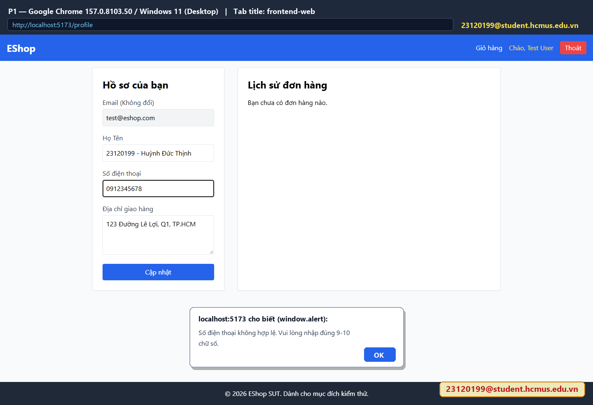

**Danh sách đầy đủ ảnh minh chứng theo nền tảng:**
- `CL-01` (`P1`): [`screenshots/task1_failed/P1_CL-01.png`](screenshots/task1_failed/P1_CL-01.png)
- `CL-01` (`P2`): [`screenshots/task1_failed/P2_CL-01.png`](screenshots/task1_failed/P2_CL-01.png)
- `CL-01` (`P3`): [`screenshots/task1_failed/P3_CL-01.png`](screenshots/task1_failed/P3_CL-01.png)
- `CL-25` (`P1`): [`screenshots/task1_failed/P1_CL-25.png`](screenshots/task1_failed/P1_CL-25.png)
- `CL-25` (`P2`): [`screenshots/task1_failed/P2_CL-25.png`](screenshots/task1_failed/P2_CL-25.png)
- `CL-25` (`P3`): [`screenshots/task1_failed/P3_CL-25.png`](screenshots/task1_failed/P3_CL-25.png)

#### GitHub Issue
- **Issue:** [#14 — [HW03-M1] [BUG-14] [IA-01] [Login, Header] Giao diện không nhất quán tiếng Việt: trang Đăng nhập trộn nhãn tiếng Anh ('Username', 'Sign In') và Header dùng nhãn 'Thoát' thay vì 'Đăng xuất'](https://github.com/HuynhDucThinh/Software-Testing-HW03/issues/14)
- **Ảnh chụp trang GitHub Issue:** [`screenshots/github_issues/ISSUE-14_BUG-14.png`](screenshots/github_issues/ISSUE-14_BUG-14.png)

---

### BUG-15 (Issue #15) — [IA-03] [Login] Thứ tự di chuyển focus bằng phím Tab bị đảo ngược do nút 'Sign In' gắn cứng tabIndex={1}

#### Summary
Trên trang Đăng nhập (`/login`), nút gửi biểu mẫu `Sign In` được gán cứng thuộc tính `tabIndex={1}`, khiến lần nhấn phím `Tab` đầu tiên nhảy cóc qua toàn bộ thanh Header và hai ô nhập liệu để rơi thẳng xuống nút `Sign In` ở cuối form rồi mới nhảy ngược lên đầu trang.

- **Bug ID:** `BUG-15`
- **Checklist item:** `SV-01`
- **Interface aspect:** `IA-03` — Navigation
- **Màn hình:** Login (`/login`)
- **Requirement:** FR-21 (eshop-sut/README.md:248); Slide 10 #9 Tab Order
- **Loại lỗi:** `State`
- **Severity:** **Major**
- **Priority:** **Medium**

#### Environment
- **SUT:** `eshop-sut @ 1a9304a (repo HEAD 6b6a7a9)` (Web `http://localhost:5173`, Backend API `http://localhost:3000`)
- **P1:** Google Chrome 157.0.8103.50 trên Windows 11
- **P2:** Mozilla Firefox trên Windows 11 (bản cài đặt `137.0.1` dùng để quan sát trực tiếp; nhân Gecko `159.0` bản Playwright dùng để đo DOM và chụp ảnh minh chứng)
- **URL kiểm thử:** `http://localhost:5173/login`
- **Viewport:** Desktop `1440x900` (`P1`, `P2`)

#### Preconditions
Mở trang `http://localhost:5173/login` trên trình duyệt máy tính để bàn (`P1` Chrome, `P2` Firefox).

#### Steps to reproduce
1. Tải mới trang `http://localhost:5173/login` (chưa nhấp chuột vào ô nhập nào).
2. Nhấn phím `Tab` liên tiếp từng lần và ghi nhận phần tử nhận focus cùng tọa độ hiển thị trên màn hình.

#### Expected result
Theo `FR-21` (`eshop-sut/README.md:248`) và Slide 10 #9 (Tab Order), thứ tự di chuyển focus bằng phím `Tab` phải tuân theo trật tự thị giác tự nhiên từ trên xuống dưới, từ trái sang phải (`Header` -> `Username` -> `Mật khẩu` -> `Quên mật khẩu?` -> `Sign In` -> `Đăng ký ngay`).

- **`SV-01`** (*Thứ tự di chuyển focus bằng phím Tab trên form Đăng nhập* — căn cứ: `FR-21 (eshop-sut/README.md:248); Slide 10 #9 Tab Order`): Khi nhấn Tab liên tiếp trên /login, focus đi lần lượt từ trên xuống dưới, trái sang phải qua các thành phần của form theo thứ tự hiển thị (ô tài khoản, ô mật khẩu, liên kết `Quên mật khẩu?`, nút gửi form, liên kết `Đăng ký ngay`) và không nhảy cóc. Fail nếu nút gửi form nhận focus trước ô tài khoản hoặc trước ô mật khẩu, hoặc thứ tự focus khác thứ tự hiển thị từ trên xuống dưới.

#### Actual result
Lần nhấn `Tab` đầu tiên nhảy thẳng xuống nút `Sign In` ở cuối biểu mẫu (`y=425px`) do `Login.jsx:62` gán `tabIndex={1}`, nhấn `Tab` lần 2 mới nhảy ngược lên logo `EShop` trên Header (`y=16px`) rồi mới đi qua các liên kết điều hướng và hai ô nhập liệu.

**Dữ kiện `Actual` nguyên văn theo từng mục và nền tảng:**
- **`SV-01` trên `P1`:** Actual: Nhấn Tab lần đầu tiên trên /login nhảy cóc thẳng tới nút "Sign In" (tabIndex=1, y=425px) trước cả thanh Header và trước cả hai ô Username, Mật khẩu; thứ tự thực tế: ["button:Sign In(y=425)","a:EShop(y=16)","a:Giỏ hàng(y=20)","a:Đăng nhập(y=20)","a:Đăng ký(y=20)","input:text(y=241)","input:text(y=331)","a:Quên mật khẩu?(y=389)"].
- **`SV-01` trên `P2`:** Actual: Nhấn Tab lần đầu tiên trên /login nhảy cóc thẳng tới nút "Sign In" (tabIndex=1, y=425px) trước cả thanh Header và trước cả hai ô Username, Mật khẩu; thứ tự thực tế: ["button:Sign In(y=425)","a:EShop(y=16)","a:Giỏ hàng(y=20)","a:Đăng nhập(y=20)","a:Đăng ký(y=20)","input:text(y=241)","input:text(y=331)","a:Quên mật khẩu?(y=390)"].

#### Impact
Gây rối loạn nghiêm trọng cho người dùng thao tác bằng bàn phím và người dùng công nghệ hỗ trợ khi muốn nhập nhanh tài khoản và mật khẩu.

#### Reproducibility
Luôn luôn (100%) trên các nền tảng áp dụng: `P1`, `P2`.

#### Evidence

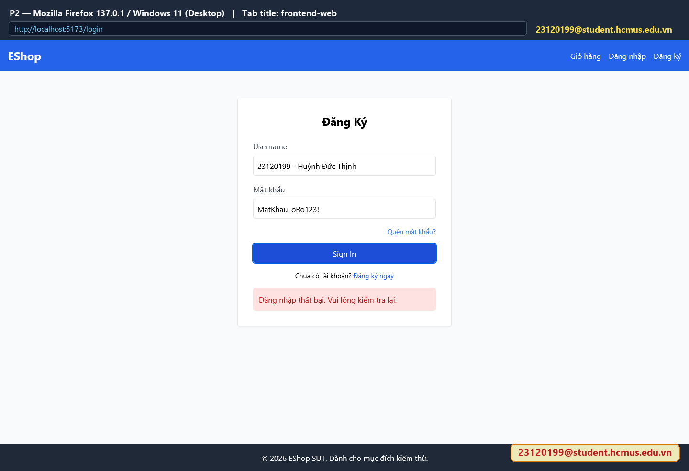

**Danh sách đầy đủ ảnh minh chứng theo nền tảng:**
- `SV-01` (`P1`): [`screenshots/task1_failed/P1_SV-01.png`](screenshots/task1_failed/P1_SV-01.png)
- `SV-01` (`P2`): [`screenshots/task1_failed/P2_SV-01.png`](screenshots/task1_failed/P2_SV-01.png)

#### GitHub Issue
- **Issue:** [#15 — [HW03-M1] [BUG-15] [IA-03] [Login] Thứ tự di chuyển focus bằng phím Tab bị đảo ngược do nút 'Sign In' gắn cứng tabIndex={1}](https://github.com/HuynhDucThinh/Software-Testing-HW03/issues/15)
- **Ảnh chụp trang GitHub Issue:** [`screenshots/github_issues/ISSUE-15_BUG-15.png`](screenshots/github_issues/ISSUE-15_BUG-15.png)

---

### BUG-16 (Issue #16) — [IA-04] [ForgotPassword, Profile] Sử dụng hộp thoại chặn window.alert() và hiển thị thông báo lỗi tiếng Anh thô 'Lỗi: User not found'

#### Summary
Trang Quên mật khẩu (`/forgot-password`) và trang Hồ sơ (`/profile`) sử dụng hộp thoại hệ thống `window.alert()` gây chặn luồng tương tác thay vì thông báo nội trang/toast, đồng thời hiển thị nguyên văn chuỗi lỗi tiếng Anh từ server `Lỗi: User not found` khi nhập email không tồn tại.

- **Bug ID:** `BUG-16`
- **Checklist item:** `CL-35`
- **Interface aspect:** `IA-04` — Feedback / state
- **Màn hình:** ForgotPassword (`/forgot-password`), Profile (`/profile`)
- **Requirement:** Slide 10 #15 Error Messages, #16 Input Validation; Nielsen #4 Consistency and standards
- **Loại lỗi:** `Visual-Layout`
- **Severity:** **Major**
- **Priority:** **Medium**

#### Environment
- **SUT:** `eshop-sut @ 1a9304a (repo HEAD 6b6a7a9)` (Web `http://localhost:5173`, Backend API `http://localhost:3000`)
- **P1:** Google Chrome 157.0.8103.50 trên Windows 11
- **P2:** Mozilla Firefox trên Windows 11 (bản cài đặt `137.0.1` dùng để quan sát trực tiếp; nhân Gecko `159.0` bản Playwright dùng để đo DOM và chụp ảnh minh chứng)
- **P3:** Chrome Android 156.0.8078.79 trên OPPO Reno10 5G (Android 15, adb reverse)
- **URL kiểm thử:** `http://localhost:5173/forgot-password, http://localhost:5173/profile`
- **Viewport:** Desktop `1440x900` (`P1`, `P2`); Mobile `360x801` / `1080x2412` (`P3`)

#### Preconditions
Backend và Frontend đang hoạt động.

#### Steps to reproduce
1. Mở `http://localhost:5173/forgot-password`, nhập email chưa đăng ký `khongtontai@eshop.com` rồi bấm `Lấy mã OTP`.
2. Tiếp tục nhập email hợp lệ `test@eshop.com` bấm `Lấy mã OTP`, sang Bước 2 nhập sai OTP rồi bấm `Đặt lại mật khẩu`.
3. Đăng nhập và vào `http://localhost:5173/profile`, nhập SĐT sai hoặc cập nhật thành công để quan sát cơ chế hiển thị thông báo.

#### Expected result
Theo `FR-21` (`eshop-sut/README.md:244`), Slide 10 #15 (Error Messages) và Nielsen #4 (Consistency and standards), phản hồi lỗi/thành công phải hiển thị trực quan bằng tiếng Việt ngay trên giao diện (inline banner hoặc toast đồng bộ như Login/Register), không dùng hộp thoại `window.alert()` chặn luồng hay phơi bày thông điệp tiếng Anh thô của server.

- **`CL-35`** (*Phản hồi thành công và lỗi hiển thị trực quan nội trang thay vì hộp thoại window.alert()* — căn cứ: `Slide 10 #15 Error Messages, #16 Input Validation; Nielsen #4 Consistency and standards`): Mọi phản hồi thành công hoặc báo lỗi trên `/forgot-password` và `/profile` đều được render thành khối thông báo nội trang (inline banner) hoặc toast trực quan bằng tiếng Việt, nhất quán với kiểu thông báo của `/register` và `/login`. Fail nếu trình duyệt bật hộp thoại hệ thống `window.alert()` chặn thao tác người dùng hoặc hiển thị chuỗi lỗi tiếng Anh thô (ví dụ `Lỗi: User not found`).

#### Actual result
Toàn bộ phản hồi trên `/forgot-password` và `/profile` đều bật hộp thoại modal hệ thống `window.alert()`, trong đó khi email không tồn tại ở Bước 1 Quên mật khẩu, hộp thoại hiển thị pha trộn Anh-Việt: `Lỗi: User not found`.

**Dữ kiện `Actual` nguyên văn theo từng mục và nền tảng:**
- **`CL-35` trên `P1`:** Actual: Cả /forgot-password lẫn /profile đều bật hộp thoại native window.alert() chặn luồng thao tác thay vì thông báo nội trang/toast, đồng thời lộ chuỗi tiếng Anh thô trên /forgot-password (alert: "Lỗi: User not found"; /profile alert: "Cập nhật thành công!").
- **`CL-35` trên `P2`:** Actual: Cả /forgot-password lẫn /profile đều bật hộp thoại native window.alert() chặn luồng thao tác thay vì thông báo nội trang/toast, đồng thời lộ chuỗi tiếng Anh thô trên /forgot-password (alert: "Lỗi: User not found"; /profile alert: "Cập nhật thành công!").
- **`CL-35` trên `P3`:** Actual: Cả /forgot-password lẫn /profile đều bật hộp thoại native window.alert() chặn luồng thao tác thay vì thông báo nội trang/toast, đồng thời lộ chuỗi tiếng Anh thô trên /forgot-password (alert: "Lỗi: User not found"; /profile alert: "Cập nhật thành công!").

#### Impact
Ngắt quãng thao tác người dùng bởi hộp thoại hệ thống, không giữ lại nội dung thông báo trên màn hình sau khi bấm OK (đặc biệt bất lợi khi người dùng cần đọc lại mã OTP hoặc lý do lỗi).

#### Reproducibility
Luôn luôn (100%) trên các nền tảng áp dụng: `P1`, `P2`, `P3`.

#### Evidence
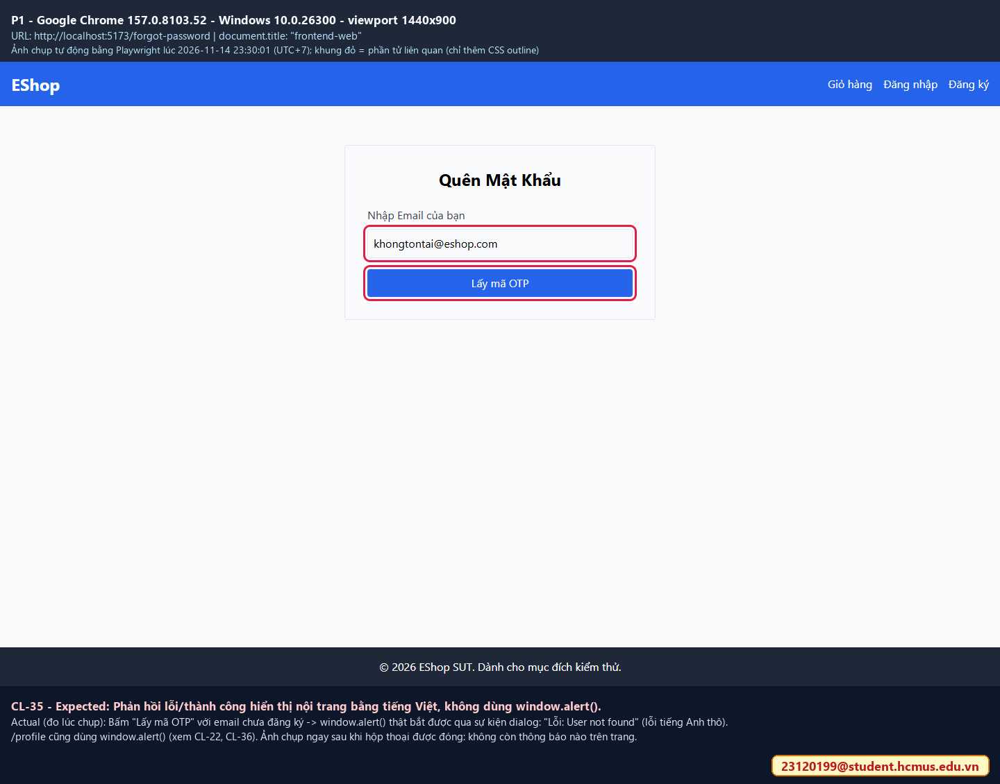

**Danh sách đầy đủ ảnh minh chứng theo nền tảng:**
- `CL-35` (`P1`): [`screenshots/task1_failed/P1_CL-35.png`](screenshots/task1_failed/P1_CL-35.png)
- `CL-35` (`P2`): [`screenshots/task1_failed/P2_CL-35.png`](screenshots/task1_failed/P2_CL-35.png)
- `CL-35` (`P3`): [`screenshots/task1_failed/P3_CL-35.png`](screenshots/task1_failed/P3_CL-35.png)

#### GitHub Issue
- **Issue:** [#16 — [HW03-M1] [BUG-16] [IA-04] [ForgotPassword, Profile] Sử dụng hộp thoại chặn window.alert() và hiển thị thông báo lỗi tiếng Anh thô 'Lỗi: User not found'](https://github.com/HuynhDucThinh/Software-Testing-HW03/issues/16)
- **Ảnh chụp trang GitHub Issue:** [`screenshots/github_issues/ISSUE-16_BUG-16.png`](screenshots/github_issues/ISSUE-16_BUG-16.png)

---

### BUG-17 (Issue #17) — [IA-02] [Login, Register] Vị trí khối thông báo lỗi đặt sai chuẩn: nằm bên dưới nút 'Sign In' ở Đăng nhập và cách xa nút 'Đăng Ký' 336px ở đầu form Đăng ký

#### Summary
Vị trí hiển thị thông báo lỗi biểu mẫu không nhất quán và trái quy chuẩn `FR-22`: trên `/login` khối lỗi bị đẩy xuống bên dưới nút `Sign In` và dòng chuyển trang, còn trên `/register` khối lỗi chỉ hiện ở sát đỉnh form cách nút `Đăng Ký` `336px` mà không có lỗi cạnh trường hoặc ngay trên nút gửi.

- **Bug ID:** `BUG-17`
- **Checklist item:** `SV-03`, `SV-04`
- **Interface aspect:** `IA-02` — Forms
- **Màn hình:** Login (`/login`), Register (`/register`)
- **Requirement:** FR-22 (eshop-sut/README.md:255); Giả định GA6
- **Loại lỗi:** `Visual-Layout`
- **Severity:** **Minor**
- **Priority:** **Medium**

#### Environment
- **SUT:** `eshop-sut @ 1a9304a (repo HEAD 6b6a7a9)` (Web `http://localhost:5173`, Backend API `http://localhost:3000`)
- **P1:** Google Chrome 157.0.8103.50 trên Windows 11
- **P2:** Mozilla Firefox trên Windows 11 (bản cài đặt `137.0.1` dùng để quan sát trực tiếp; nhân Gecko `159.0` bản Playwright dùng để đo DOM và chụp ảnh minh chứng)
- **P3:** Chrome Android 156.0.8078.79 trên OPPO Reno10 5G (Android 15, adb reverse)
- **URL kiểm thử:** `http://localhost:5173/login, http://localhost:5173/register`
- **Viewport:** Desktop `1440x900` (`P1`, `P2`); Mobile `360x801` / `1080x2412` (`P3`)

#### Preconditions
Truy cập trang `/login` và `/register`.

#### Steps to reproduce
1. Tại `http://localhost:5173/login`, nhập thông tin sai (`test@eshop.com` / `Wrong1`) rồi bấm `Sign In` và đo vị trí khối lỗi đỏ so với nút `Sign In`.
2. Tại `http://localhost:5173/register`, nhập mật khẩu yếu (`weak`) rồi bấm `Đăng Ký` và đo khoảng cách từ khối lỗi đỏ ở đầu form tới nút `Đăng Ký` và ô `Mật khẩu`.

#### Expected result
Theo `FR-22` (`eshop-sut/README.md:255`) và giả định `GA6`, thông báo lỗi cần hiển thị ngay cạnh trường bị lỗi hoặc ngay phía trên nút gửi biểu mẫu để nằm trong vùng chú ý trực tiếp của mắt khi người dùng vừa bấm Submit.

- **`SV-03`** (*Vị trí khối thông báo lỗi so với nút gửi form trên trang Đăng nhập* — căn cứ: `FR-22 (eshop-sut/README.md:255)`): Khối thông báo lỗi đăng nhập hiển thị phía trên nút gửi form (toạ độ `bottom` của khối lỗi nhỏ hơn hoặc bằng toạ độ `top` của nút gửi, đo bằng `getBoundingClientRect()`). Fail nếu khối thông báo lỗi nằm bên dưới nút gửi form.
- **`SV-04`** (*Vị trí khối thông báo lỗi so với nút Đăng Ký trên trang Đăng ký* — căn cứ: `FR-22 (eshop-sut/README.md:255); Giả định GA6`): Khối thông báo lỗi hiển thị trong form, liền kề phía trên nút `Đăng Ký` (khoảng cách dọc giữa mép dưới khối lỗi và mép trên nút nhỏ hơn khoảng cách tới tiêu đề trang, đo bằng `getBoundingClientRect()`). Fail nếu khối lỗi nằm phía trên tiêu đề trang hoặc phía trên tất cả các ô nhập, xa nút `Đăng Ký` đến mức người dùng phải cuộn mới thấy khi form dài.

#### Actual result
Trên `/login` (`Login.jsx:72`), khối lỗi nằm ở `y=514px`, thấp hơn đáy nút `Sign In` (`y=466px`) và thấp hơn cả dòng `Chưa có tài khoản? Đăng ký ngay`. Trên `/register` (`Register.jsx:43`), khối lỗi nằm ở đầu form (`y=209px`), cách đỉnh nút `Đăng Ký` tới `336px` (trên `P3` màn hình nhỏ dễ bị khuất phía trên khi cuộn xuống nút Submit).

**Dữ kiện `Actual` nguyên văn theo từng mục và nền tảng:**
- **`SV-03` trên `P1`:** Actual: Khối thông báo lỗi trên /login nằm BÊN DƯỚI nút gửi form (error.top=517px > submit.bottom=465px), vi phạm FR-22 yêu cầu nằm phía trên nút submit.
- **`SV-03` trên `P2`:** Actual: Khối thông báo lỗi trên /login nằm BÊN DƯỚI nút gửi form (error.top=517px > submit.bottom=465px), vi phạm FR-22 yêu cầu nằm phía trên nút submit.
- **`SV-03` trên `P3`:** Actual: Khối thông báo lỗi trên /login nằm BÊN DƯỚI nút gửi form (error.top=517px > submit.bottom=465px), vi phạm FR-22 yêu cầu nằm phía trên nút submit.
- **`SV-04` trên `P1`:** Actual: Khối lỗi trên /register nằm ngoài thẻ `<form>` (insideForm=false), phía trên tất cả các ô nhập (cách tiêu đề 24px nhưng cách nút "Đăng Ký" tới 306px), không nằm liền kề phía trên nút Submit theo GA6.
- **`SV-04` trên `P2`:** Actual: Khối lỗi trên /register nằm ngoài thẻ `<form>` (insideForm=false), phía trên tất cả các ô nhập (cách tiêu đề 24px nhưng cách nút "Đăng Ký" tới 306px), không nằm liền kề phía trên nút Submit theo GA6.
- **`SV-04` trên `P3`:** Actual: Khối lỗi trên /register nằm ngoài thẻ `<form>` (insideForm=false), phía trên tất cả các ô nhập (cách tiêu đề 24px nhưng cách nút "Đăng Ký" tới 322px), không nằm liền kề phía trên nút Submit theo GA6.

#### Impact
Người dùng đang nhìn vào nút Submit ở cuối form dễ bỏ lỡ thông báo lỗi xuất hiện ở vị trí bất thường hoặc ngoài vùng nhìn thấy trên màn hình nhỏ.

#### Reproducibility
Luôn luôn (100%) trên các nền tảng áp dụng: `P1`, `P2`, `P3`.

#### Evidence

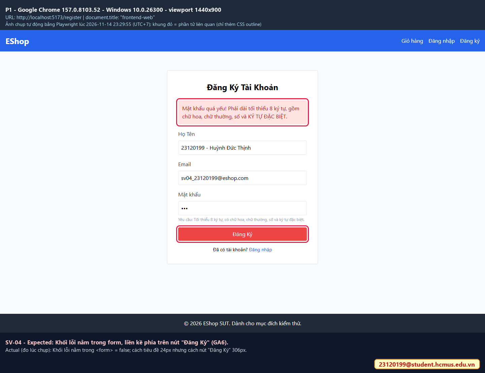

**Danh sách đầy đủ ảnh minh chứng theo nền tảng:**
- `SV-03` (`P1`): [`screenshots/task1_failed/P1_SV-03.png`](screenshots/task1_failed/P1_SV-03.png)
- `SV-03` (`P2`): [`screenshots/task1_failed/P2_SV-03.png`](screenshots/task1_failed/P2_SV-03.png)
- `SV-03` (`P3`): [`screenshots/task1_failed/P3_SV-03.png`](screenshots/task1_failed/P3_SV-03.png)
- `SV-04` (`P1`): [`screenshots/task1_failed/P1_SV-04.png`](screenshots/task1_failed/P1_SV-04.png)
- `SV-04` (`P2`): [`screenshots/task1_failed/P2_SV-04.png`](screenshots/task1_failed/P2_SV-04.png)
- `SV-04` (`P3`): [`screenshots/task1_failed/P3_SV-04.png`](screenshots/task1_failed/P3_SV-04.png)

#### GitHub Issue
- **Issue:** [#17 — [HW03-M1] [BUG-17] [IA-02] [Login, Register] Vị trí khối thông báo lỗi đặt sai chuẩn: nằm bên dưới nút 'Sign In' ở Đăng nhập và cách xa nút 'Đăng Ký' 336px ở đầu form Đăng ký](https://github.com/HuynhDucThinh/Software-Testing-HW03/issues/17)
- **Ảnh chụp trang GitHub Issue:** [`screenshots/github_issues/ISSUE-17_BUG-17.png`](screenshots/github_issues/ISSUE-17_BUG-17.png)

---

### BUG-18 (Issue #18) — [IA-01] [Header] Họ Tên dài 100 ký tự không khoảng trắng làm tràn ngang thanh Header và đẩy nút 'Thoát' ra khỏi khung nhìn

#### Summary
Thanh Header không giới hạn chiều rộng tối đa (`max-width` / `text-overflow: ellipsis`) cho chuỗi tên người dùng trong lời chào `Chào, <tên>`, khiến tên dài 100 ký tự liền mạch đẩy tràn thanh điều hướng ngang và làm mất nút `Thoát` trên màn hình di động hoặc cửa sổ hẹp.

- **Bug ID:** `BUG-18`
- **Checklist item:** `SV-06`
- **Interface aspect:** `IA-01` — General UI standards
- **Màn hình:** Header/Navbar, Profile (`/profile`)
- **Requirement:** Slide 10 #5 Field Limits, #18 Element Overlap, #19 Scroll Boundaries
- **Loại lỗi:** `Responsive`
- **Severity:** **Minor**
- **Priority:** **Medium**

#### Environment
- **SUT:** `eshop-sut @ 1a9304a (repo HEAD 6b6a7a9)` (Web `http://localhost:5173`, Backend API `http://localhost:3000`)
- **P1:** Google Chrome 157.0.8103.50 trên Windows 11
- **P2:** Mozilla Firefox trên Windows 11 (bản cài đặt `137.0.1` dùng để quan sát trực tiếp; nhân Gecko `159.0` bản Playwright dùng để đo DOM và chụp ảnh minh chứng)
- **P3:** Chrome Android 156.0.8078.79 trên OPPO Reno10 5G (Android 15, adb reverse)
- **URL kiểm thử:** `http://localhost:5173/profile`
- **Viewport:** Desktop `1440x900` (`P1`, `P2`); Mobile `360x801` / `1080x2412` (`P3`)

#### Preconditions
Tài khoản người dùng có Họ Tên dài 100 ký tự không khoảng trắng (`NguyenVanA` lặp 10 lần).

#### Steps to reproduce
1. Đăng ký hoặc cập nhật tài khoản với Họ Tên gồm 100 ký tự liền nhau (`NguyenVanA` x 10) rồi đăng nhập.
2. Quan sát thanh Header trên thiết bị di động `P3` (`360px`) và trên trình duyệt Desktop ở khung nhìn `375x667`.

#### Expected result
Theo Slide 10 #5 (Field Limits), #18 (Element Overlap) và #19 (Scroll Boundaries), phần tử hiển thị tên trên Header phải cắt gọn bằng dấu `...` (`truncate`) hoặc xuống dòng an toàn sao cho `scrollWidth <= clientWidth` và nút đăng xuất luôn nằm trọn trong khung nhìn.

- **`SV-06`** (*Bố cục Header khi Họ Tên người dùng rất dài và không có khoảng trắng* — căn cứ: `Slide 10 #5 Field Limits, #18 Element Overlap, #19 Scroll Boundaries`): Thanh Header với lời chào dài vẫn nằm gọn trong chiều rộng khung nhìn, không che nút `Đăng xuất` hay liên kết khác và không sinh thanh cuộn ngang (`document.documentElement.scrollWidth <= document.documentElement.clientWidth`); tên dài được cắt bớt, xuống dòng hoặc rút gọn. Fail nếu lời chào đẩy nút `Đăng xuất` ra ngoài màn hình, chồng lên phần tử khác hoặc tạo thanh cuộn ngang.

#### Actual result
Trên `P3` (`360px`), `document.documentElement.scrollWidth` bị kéo giãn lên tới `1118px` (`> clientWidth = 360px`); trên `P1`/`P2` ở khung nhìn `375px`, `scrollWidth` xấp xỉ `1137–1146px` (đo 11/11: `1146px`, đo lại 14/11: `1137px`), đẩy liên kết `Hồ sơ` và nút `Thoát` tràn hẳn ra ngoài cạnh phải màn hình.

**Dữ kiện `Actual` nguyên văn theo từng mục và nền tảng:**
- **`SV-06` trên `P1`:** Actual: Khi Họ Tên dài 100 ký tự không khoảng trắng, lời chào trên Header không có CSS cắt/xuống dòng làm tràn khung nhìn: 375px: scrollWidth=1146px > clientWidth=375px, nút thoát bị đẩy tới x=1146px ngoài màn hình.
- **`SV-06` trên `P2`:** Actual: Khi Họ Tên dài 100 ký tự không khoảng trắng, lời chào trên Header không có CSS cắt/xuống dòng làm tràn khung nhìn: 375px: scrollWidth=1146px > clientWidth=375px, nút thoát bị đẩy tới x=1146px ngoài màn hình.
- **`SV-06` trên `P3`:** Actual: Khi Họ Tên dài 100 ký tự không khoảng trắng, lời chào trên Header không có CSS cắt/xuống dòng làm tràn khung nhìn: mobile: scrollWidth=1118px > clientWidth=360px, nút thoát bị đẩy tới x=1118px ngoài màn hình.

#### Impact
Phá vỡ bố cục responsive trên thiết bị di động và khiến người dùng có tên dài không thấy nút đăng xuất nếu không cuộn ngang toàn trang.

#### Reproducibility
Luôn luôn (100%) trên các nền tảng áp dụng: `P1`, `P2`, `P3`.

#### Evidence
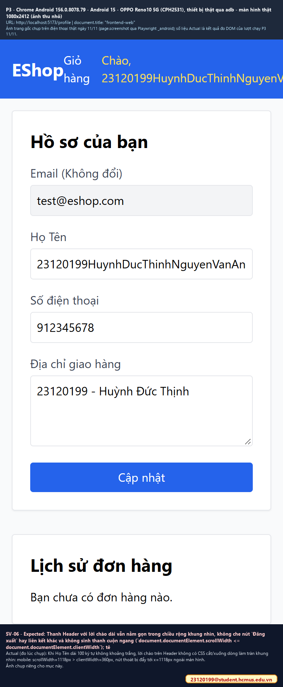

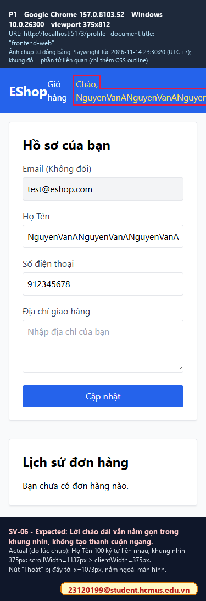

**Danh sách đầy đủ ảnh minh chứng theo nền tảng:**
- `SV-06` (`P1`): [`screenshots/task1_failed/P1_SV-06.png`](screenshots/task1_failed/P1_SV-06.png)
- `SV-06` (`P2`): [`screenshots/task1_failed/P2_SV-06.png`](screenshots/task1_failed/P2_SV-06.png)
- `SV-06` (`P3`): [`screenshots/task1_failed/P3_SV-06.png`](screenshots/task1_failed/P3_SV-06.png)

#### GitHub Issue
- **Issue:** [#18 — [HW03-M1] [BUG-18] [IA-01] [Header] Họ Tên dài 100 ký tự không khoảng trắng làm tràn ngang thanh Header và đẩy nút 'Thoát' ra khỏi khung nhìn](https://github.com/HuynhDucThinh/Software-Testing-HW03/issues/18)
- **Ảnh chụp trang GitHub Issue:** [`screenshots/github_issues/ISSUE-18_BUG-18.png`](screenshots/github_issues/ISSUE-18_BUG-18.png)

---

### BUG-19 (Issue #19) — [IA-01] [Register, ForgotPassword, Header] Màu sắc nút bấm vi phạm ngữ nghĩa: nút 'Đăng Ký' dùng màu đỏ nguy hiểm, hai nút Bước 2 Quên mật khẩu trùng màu xanh lá

#### Summary
Hệ thống màu sắc các nút hành động trong phân hệ M1 thiếu nhất quán và sai ngữ nghĩa chuẩn `FR-21`: nút chính `Đăng Ký` lại tô màu đỏ (vốn dành cho hành động xóa/nguy hiểm), ở Bước 2 Quên mật khẩu cả nút chính `Đặt lại mật khẩu` và nút phụ `← Quay lại` đều tô cùng màu xanh lá cây giống hệt nhau.

- **Bug ID:** `BUG-19`
- **Checklist item:** `CL-07`, `CL-08`
- **Interface aspect:** `IA-01` — General UI standards
- **Màn hình:** Register (`/register`), ForgotPassword (`/forgot-password` — Bước 2), Header/Navbar
- **Requirement:** FR-21 (eshop-sut/README.md:245); Slide 10 #2 Color and Palette
- **Loại lỗi:** `Visual-Layout`
- **Severity:** **Minor**
- **Priority:** **Medium**

#### Environment
- **SUT:** `eshop-sut @ 1a9304a (repo HEAD 6b6a7a9)` (Web `http://localhost:5173`, Backend API `http://localhost:3000`)
- **P1:** Google Chrome 157.0.8103.50 trên Windows 11
- **P2:** Mozilla Firefox trên Windows 11 (bản cài đặt `137.0.1` dùng để quan sát trực tiếp; nhân Gecko `159.0` bản Playwright dùng để đo DOM và chụp ảnh minh chứng)
- **P3:** Chrome Android 156.0.8078.79 trên OPPO Reno10 5G (Android 15, adb reverse)
- **URL kiểm thử:** `http://localhost:5173/register, http://localhost:5173/forgot-password`
- **Viewport:** Desktop `1440x900` (`P1`, `P2`); Mobile `360x801` / `1080x2412` (`P3`)

#### Preconditions
Mở trang `/register`, Bước 2 `/forgot-password` và thanh Header khi đã đăng nhập.

#### Steps to reproduce
1. So sánh màu nền nút Submit chính trên `/login` (`Sign In`), `/profile` (`Cập nhật`) với nút `Đăng Ký` trên `/register`.
2. Chuyển sang Bước 2 trang `/forgot-password`, quan sát màu nền của hai nút `Đặt lại mật khẩu` và `← Quay lại`.
3. (Đối chứng) Đăng nhập và quan sát nút `Thoát` trên thanh Header: nền đỏ `rgb(239, 68, 68)`, đúng quy ước.

#### Expected result
Theo `FR-21` (`eshop-sut/README.md:245`) và Slide 10 #2 (Color and Palette), nút hành động tích cực chính dùng màu xanh dương nhất quán, màu đỏ chỉ dùng cho hành động xóa/hủy nguy hiểm, và nút điều hướng phụ (`← Quay lại`) phải có kiểu dáng thứ cấp tách biệt rõ với nút gửi chính.

- **`CL-07`** (*Nhất quán màu xanh dương của nút hành động tích cực Submit trên Register, Login và Profile* — căn cứ: `FR-21 (eshop-sut/README.md:245); Slide 10 #2 Color and Palette`): Nút Submit chính trên /register ('Đăng Ký'), /login và /profile ('Cập nhật') khi hiển thị ở trạng thái mặc định đều có màu nền xanh dương đồng nhất (kiểm tra mắt thường và `getComputedStyle(btn).backgroundColor` thuộc dải xanh dương). Fail nếu bất kỳ nút Submit tích cực nào dùng màu đỏ (nhầm với nút nguy hiểm/hủy) hoặc màu khác xanh dương.
- **`CL-08`** (*Phân biệt màu sắc nút hành động tích cực, nút điều hướng phụ và nút đăng xuất trên ForgotPassword và Header* — căn cứ: `FR-21 (eshop-sut/README.md:245); Slide 10 #2 Color and Palette`): Các nút hành động tích cực ('Lấy mã OTP', 'Đặt lại mật khẩu') có nền màu xanh dương, nút phụ ('Quay lại') có kiểu trung tính phân biệt rõ với nút chính, và nút thoát phiên đăng nhập trên Header dùng màu đỏ theo quy ước. Fail nếu nút tích cực dùng màu khác xanh dương (ví dụ xanh lá) hoặc nút 'Đặt lại mật khẩu' và nút 'Quay lại' dùng cùng một màu nền gây nhầm lẫn vai trò.

#### Actual result
Nút `Đăng Ký` trên `/register` dùng nền đỏ `bg-red-500/600` (`rgb(239, 68, 68)`); ở Bước 2 `/forgot-password` cả hai nút `Đặt lại mật khẩu` và `← Quay lại` đều dùng nền xanh lá `bg-green-600` (`rgb(22, 163, 74)`) giống hệt nhau. (Nút `Thoát` trên Header có nền đỏ `rgb(239, 68, 68)` đúng quy ước nút nguy hiểm, nên không thuộc phạm vi lỗi này.)

**Dữ kiện `Actual` nguyên văn theo từng mục và nền tảng:**
- **`CL-07` trên `P1`:** Actual: Nút Submit trên Login ("Sign In": rgb(37, 99, 235)) và Profile ("Cập nhật": rgb(37, 99, 235)) dùng màu xanh dương, nhưng nút "Đăng Ký" trên /register lại dùng màu đỏ (rgb(239, 68, 68)).
- **`CL-07` trên `P2`:** Actual: Nút Submit trên Login ("Sign In": rgb(37, 99, 235)) và Profile ("Cập nhật": rgb(37, 99, 235)) dùng màu xanh dương, nhưng nút "Đăng Ký" trên /register lại dùng màu đỏ (rgb(220, 38, 38)).
- **`CL-07` trên `P3`:** Actual: Nút Submit trên Login ("Sign In": rgb(37, 99, 235)) và Profile ("Cập nhật": rgb(37, 99, 235)) dùng màu xanh dương, nhưng nút "Đăng Ký" trên /register lại dùng màu đỏ (rgb(239, 68, 68)).
- **`CL-08` trên `P1`:** Actual: Bước 1 nút "Lấy mã OTP" màu xanh dương (rgb(37, 99, 235)), nút "Thoát" trên Header màu đỏ (rgb(239, 68, 68)); tuy nhiên ở Bước 2 cả nút chính "Đặt lại mật khẩu" (rgb(22, 163, 74)) lẫn nút phụ "← Quay lại" (rgb(22, 163, 74)) đều dùng chung nền xanh lá cây, không dùng xanh dương cho nút chính và không phân biệt vai trò hai nút.
- **`CL-08` trên `P2`:** Actual: Bước 1 nút "Lấy mã OTP" màu xanh dương (rgb(37, 99, 235)), nút "Thoát" trên Header màu đỏ (rgb(239, 68, 68)); tuy nhiên ở Bước 2 cả nút chính "Đặt lại mật khẩu" (rgb(22, 163, 74)) lẫn nút phụ "← Quay lại" (rgb(22, 163, 74)) đều dùng chung nền xanh lá cây, không dùng xanh dương cho nút chính và không phân biệt vai trò hai nút.
- **`CL-08` trên `P3`:** Actual: Bước 1 nút "Lấy mã OTP" màu xanh dương (rgb(37, 99, 235)), nút "Thoát" trên Header màu đỏ (rgb(239, 68, 68)); tuy nhiên ở Bước 2 cả nút chính "Đặt lại mật khẩu" (rgb(22, 163, 74)) lẫn nút phụ "← Quay lại" (rgb(22, 163, 74)) đều dùng chung nền xanh lá cây, không dùng xanh dương cho nút chính và không phân biệt vai trò hai nút.

#### Impact
Tín hiệu thị giác đảo ngược dễ làm người dùng chần chừ khi bấm nút đỏ `Đăng Ký` hoặc bấm nhầm nút `← Quay lại` thay vì `Đặt lại mật khẩu` ở Bước 2.

#### Reproducibility
Luôn luôn (100%) trên các nền tảng áp dụng: `P1`, `P2`, `P3`.

#### Evidence
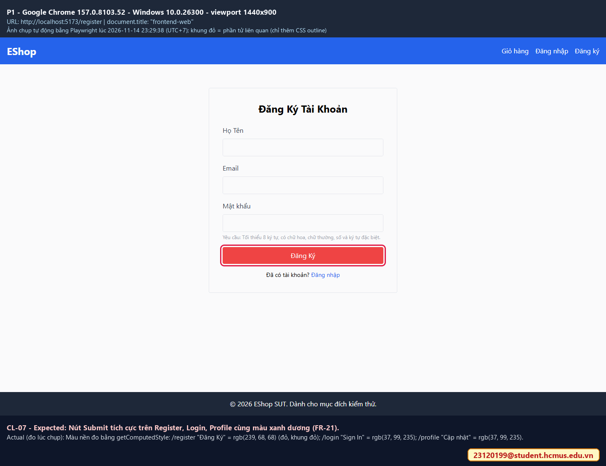

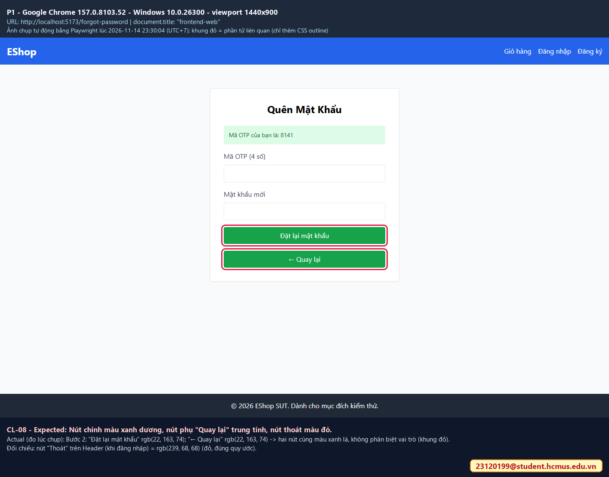

**Danh sách đầy đủ ảnh minh chứng theo nền tảng:**
- `CL-07` (`P1`): [`screenshots/task1_failed/P1_CL-07.png`](screenshots/task1_failed/P1_CL-07.png)
- `CL-07` (`P2`): [`screenshots/task1_failed/P2_CL-07.png`](screenshots/task1_failed/P2_CL-07.png)
- `CL-07` (`P3`): [`screenshots/task1_failed/P3_CL-07.png`](screenshots/task1_failed/P3_CL-07.png)
- `CL-08` (`P1`): [`screenshots/task1_failed/P1_CL-08.png`](screenshots/task1_failed/P1_CL-08.png)
- `CL-08` (`P2`): [`screenshots/task1_failed/P2_CL-08.png`](screenshots/task1_failed/P2_CL-08.png)
- `CL-08` (`P3`): [`screenshots/task1_failed/P3_CL-08.png`](screenshots/task1_failed/P3_CL-08.png)

#### GitHub Issue
- **Issue:** [#19 — [HW03-M1] [BUG-19] [IA-01] [Register, ForgotPassword, Header] Màu sắc nút bấm vi phạm ngữ nghĩa: nút 'Đăng Ký' dùng màu đỏ nguy hiểm, hai nút Bước 2 Quên mật khẩu trùng màu xanh lá](https://github.com/HuynhDucThinh/Software-Testing-HW03/issues/19)
- **Ảnh chụp trang GitHub Issue:** [`screenshots/github_issues/ISSUE-19_BUG-19.png`](screenshots/github_issues/ISSUE-19_BUG-19.png)

---

### BUG-20 (Issue #20) — [IA-01] [Register] Dòng hướng dẫn quy tắc mật khẩu màu xám nhạt (#9ca3af) chỉ đạt độ tương phản 2.54:1, thấp hơn chuẩn WCAG AA 4.5:1

#### Summary
Dòng văn bản hướng dẫn quy tắc mật khẩu bên dưới ô Mật khẩu trên trang `/register` sử dụng màu chữ xám quá nhạt (`text-gray-400` — `rgb(156, 163, 175)`) trên nền trắng `rgb(255, 255, 255)`, cho tỷ lệ tương phản chỉ `2.54:1`, không đạt ngưỡng tối thiểu `4.5:1` của WCAG 2.2 SC 1.4.3.

- **Bug ID:** `BUG-20`
- **Checklist item:** `CL-11`
- **Interface aspect:** `IA-01` — General UI standards
- **Màn hình:** Register (`/register`)
- **Requirement:** WCAG 2.2 SC 1.4.3 Contrast (Minimum); Nielsen #8 Aesthetic and minimalist design
- **Loại lỗi:** `Visual-Layout`
- **Severity:** **Minor**
- **Priority:** **Low**

#### Environment
- **SUT:** `eshop-sut @ 1a9304a (repo HEAD 6b6a7a9)` (Web `http://localhost:5173`, Backend API `http://localhost:3000`)
- **P1:** Google Chrome 157.0.8103.50 trên Windows 11
- **P2:** Mozilla Firefox trên Windows 11 (bản cài đặt `137.0.1` dùng để quan sát trực tiếp; nhân Gecko `159.0` bản Playwright dùng để đo DOM và chụp ảnh minh chứng)
- **P3:** Chrome Android 156.0.8078.79 trên OPPO Reno10 5G (Android 15, adb reverse)
- **URL kiểm thử:** `http://localhost:5173/register`
- **Viewport:** Desktop `1440x900` (`P1`, `P2`); Mobile `360x801` / `1080x2412` (`P3`)

#### Preconditions
Mở trang `http://localhost:5173/register`.

#### Steps to reproduce
1. Truy cập `http://localhost:5173/register` và quan sát dòng chữ nhỏ `Yêu cầu: Tối thiểu 8 ký tự...` bên dưới ô Mật khẩu.
2. Dùng DevTools kiểm tra mã màu computed `color` và `background-color` để tính tỷ lệ độ tương phản theo công thức WCAG.

#### Expected result
Theo WCAG 2.2 SC 1.4.3 (Contrast Minimum), văn bản cỡ thường (`< 18pt`, ở đây là `12px`) phải có tỷ lệ độ tương phản tối thiểu đạt `4.5:1` so với màu nền.

- **`CL-11`** (*Độ tương phản màu chữ và màu nền của nhãn, dòng hướng dẫn phụ và nút bấm* — căn cứ: `WCAG 2.2 SC 1.4.3 Contrast (Minimum); Nielsen #8 Aesthetic and minimalist design`): Toàn bộ văn bản hiển thị gồm tiêu đề, nhãn trường, dòng gợi ý yêu cầu mật khẩu dưới ô nhập, lời chào trên Header và chữ trên nút đều có độ tương phản rõ ràng với màu nền. Fail nếu bất kỳ văn bản thường nào (cỡ chữ < 18pt hoặc < 14pt in đậm) có tỷ lệ tương phản nhỏ hơn 4.5:1 hoặc văn bản lớn nhỏ hơn 3.0:1 (ví dụ chữ xám nhạt `text-gray-400` trên nền trắng).

#### Actual result
Thẻ `
` (`Register.jsx:85`) có màu chữ `rgb(156, 163, 175)` trên nền `rgb(255, 255, 255)`, đạt độ tương phản chỉ `2.54:1` (`< 4.5:1`) trên cả `P1`, `P2` và `P3`.

**Dữ kiện `Actual` nguyên văn theo từng mục và nền tảng:**
- **`CL-11` trên `P1`:** Actual: Phát hiện văn bản không đạt ngưỡng tương phản WCAG 4.5:1: Register "Yêu cầu: Tối thiểu 8 ký tự, có chữ " (2.54:1 < 4.5:1, fg=rgb(156, 163, 175), bg=rgb(255,255,255)); Register "Đăng Ký" (3.76:1 < 4.5:1, fg=rgb(255, 255, 255), bg=rgb(239,68,68)); Login "Quên mật khẩu?" (3.68:1 < 4.5:1, fg=rgb(59, 130, 246), bg=rgb(255,255,255)); ForgotStep2 "Đặt lại mật khẩu" (3.3:1 < 4.5:1, fg=rgb(255, 255, 255), bg=rgb(22,163,74)); ForgotStep2 "← Quay lại" (3.3:1 < 4.5:1, fg=rgb(255, 255, 255), bg=rgb(22,163,74)); Profile+Header "Chào, Test User" (3.92:1 < 4.5:1, fg=rgb(253, 224, 71), bg=rgb(37,99,235)); Profile+Header "Thoát" (3.76:1 < 4.5:1, fg=rgb(255, 255, 255), bg=rgb(239,68,68)).
- **`CL-11` trên `P2`:** Actual: Phát hiện văn bản không đạt ngưỡng tương phản WCAG 4.5:1: Register "Yêu cầu: Tối thiểu 8 ký tự, có chữ " (2.54:1 < 4.5:1, fg=rgb(156, 163, 175), bg=rgb(255,255,255)); Register "Đăng Ký" (3.76:1 < 4.5:1, fg=rgb(255, 255, 255), bg=rgb(239,68,68)); Login "Quên mật khẩu?" (3.68:1 < 4.5:1, fg=rgb(59, 130, 246), bg=rgb(255,255,255)); ForgotStep2 "Đặt lại mật khẩu" (3.3:1 < 4.5:1, fg=rgb(255, 255, 255), bg=rgb(22,163,74)); ForgotStep2 "← Quay lại" (3.3:1 < 4.5:1, fg=rgb(255, 255, 255), bg=rgb(22,163,74)); Profile+Header "Chào, Test User" (3.92:1 < 4.5:1, fg=rgb(253, 224, 71), bg=rgb(37,99,235)); Profile+Header "Thoát" (3.76:1 < 4.5:1, fg=rgb(255, 255, 255), bg=rgb(239,68,68)).
- **`CL-11` trên `P3`:** Actual: Phát hiện văn bản không đạt ngưỡng tương phản WCAG 4.5:1: Register "Yêu cầu: Tối thiểu 8 ký tự, có chữ " (2.54:1 < 4.5:1, fg=rgb(156, 163, 175), bg=rgb(255,255,255)); Register "Đăng Ký" (3.76:1 < 4.5:1, fg=rgb(255, 255, 255), bg=rgb(239,68,68)); Login "Quên mật khẩu?" (3.68:1 < 4.5:1, fg=rgb(59, 130, 246), bg=rgb(255,255,255)); ForgotStep2 "Đặt lại mật khẩu" (3.3:1 < 4.5:1, fg=rgb(255, 255, 255), bg=rgb(22,163,74)); ForgotStep2 "← Quay lại" (3.3:1 < 4.5:1, fg=rgb(255, 255, 255), bg=rgb(22,163,74)); Profile+Header "Chào, Test User" (3.92:1 < 4.5:1, fg=rgb(253, 224, 71), bg=rgb(37,99,235)); Profile+Header "Thoát" (3.76:1 < 4.5:1, fg=rgb(255, 255, 255), bg=rgb(239,68,68)).

#### Impact
Khó đọc đối với người dùng thị lực kém, màn hình độ sáng thấp hoặc khi sử dụng ngoài trời trên thiết bị di động.

#### Reproducibility
Luôn luôn (100%) trên các nền tảng áp dụng: `P1`, `P2`, `P3`.

#### Evidence
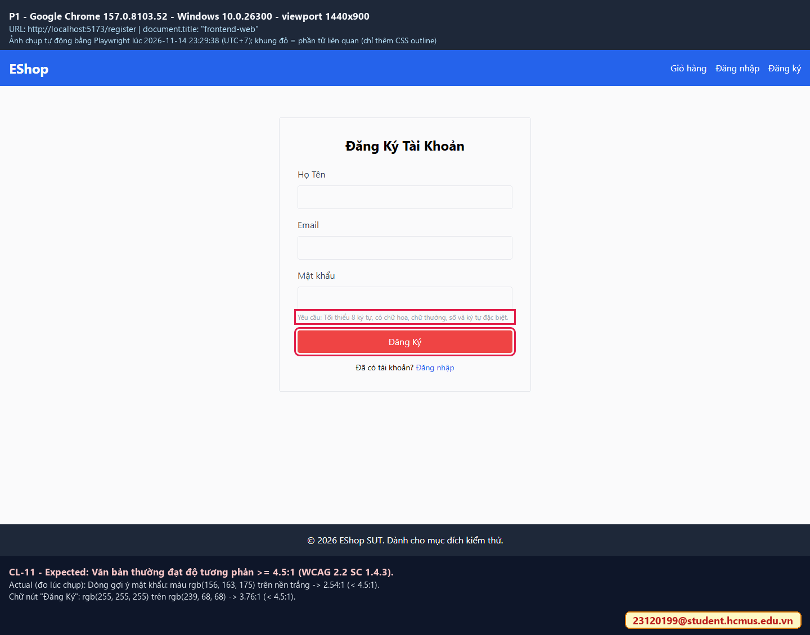

**Danh sách đầy đủ ảnh minh chứng theo nền tảng:**
- `CL-11` (`P1`): [`screenshots/task1_failed/P1_CL-11.png`](screenshots/task1_failed/P1_CL-11.png)
- `CL-11` (`P2`): [`screenshots/task1_failed/P2_CL-11.png`](screenshots/task1_failed/P2_CL-11.png)
- `CL-11` (`P3`): [`screenshots/task1_failed/P3_CL-11.png`](screenshots/task1_failed/P3_CL-11.png)

#### GitHub Issue
- **Issue:** [#20 — [HW03-M1] [BUG-20] [IA-01] [Register] Dòng hướng dẫn quy tắc mật khẩu màu xám nhạt (#9ca3af) chỉ đạt độ tương phản 2.54:1, thấp hơn chuẩn WCAG AA 4.5:1](https://github.com/HuynhDucThinh/Software-Testing-HW03/issues/20)
- **Ảnh chụp trang GitHub Issue:** [`screenshots/github_issues/ISSUE-20_BUG-20.png`](screenshots/github_issues/ISSUE-20_BUG-20.png)

---

### BUG-21 (Issue #21) — [IA-03] [ForgotPassword] Luồng Quên mật khẩu 2 bước thiếu chỉ báo bước (Step Indicator) và Bước 1 thiếu liên kết 'Quay lại đăng nhập'

#### Summary
Trang Quên mật khẩu (`/forgot-password`) được thiết kế gồm 2 bước nhưng không hiển thị chỉ báo bước (`Bước 1/2`, `Bước 2/2`) ở cả hai bước, đồng thời ở Bước 1 không có nút hoặc liên kết `Quay lại đăng nhập` như đặc tả `FR-03`.

- **Bug ID:** `BUG-21`
- **Checklist item:** `CL-17`, `CL-26`
- **Interface aspect:** `IA-03` — Navigation
- **Màn hình:** ForgotPassword (`/forgot-password`)
- **Requirement:** FR-03 (eshop-sut/README.md:52); FR-22 (eshop-sut/README.md:256); FR-03 (eshop-sut/README.md:53)
- **Loại lỗi:** `Visual-Layout`
- **Severity:** **Minor**
- **Priority:** **Medium**

#### Environment
- **SUT:** `eshop-sut @ 1a9304a (repo HEAD 6b6a7a9)` (Web `http://localhost:5173`, Backend API `http://localhost:3000`)
- **P1:** Google Chrome 157.0.8103.50 trên Windows 11
- **P2:** Mozilla Firefox trên Windows 11 (bản cài đặt `137.0.1` dùng để quan sát trực tiếp; nhân Gecko `159.0` bản Playwright dùng để đo DOM và chụp ảnh minh chứng)
- **P3:** Chrome Android 156.0.8078.79 trên OPPO Reno10 5G (Android 15, adb reverse)
- **URL kiểm thử:** `http://localhost:5173/forgot-password`
- **Viewport:** Desktop `1440x900` (`P1`, `P2`); Mobile `360x801` / `1080x2412` (`P3`)

#### Preconditions
Truy cập trang `http://localhost:5173/forgot-password`.

#### Steps to reproduce
1. Mở `http://localhost:5173/forgot-password` (Bước 1), kiểm tra xem có chỉ báo tiến trình bước và nút/liên kết `Quay lại đăng nhập` trong vùng biểu mẫu hay không.
2. Nhập `test@eshop.com` bấm `Lấy mã OTP` để sang Bước 2 và tiếp tục kiểm tra chỉ báo bước hiện tại.

#### Expected result
Theo `FR-03` (`eshop-sut/README.md:52-53`) và `FR-22` (`eshop-sut/README.md:256`), biểu mẫu nhiều bước phải hiển thị rõ chỉ báo bước hiện tại (`Bước 1/2`, `Bước 2/2`) và Bước 1 phải có nút/liên kết `Quay lại đăng nhập` dẫn về `/login`.

- **`CL-17`** (*Hiển thị chỉ báo bước (Step Indicator) rõ ràng trên form Quên mật khẩu 2 bước* — căn cứ: `FR-03 (eshop-sut/README.md:52); FR-22 (eshop-sut/README.md:256)`): Form /forgot-password hiển thị thành phần chỉ báo bước (Step Indicator, ví dụ `Bước 1 / 2` ở bước đầu và cập nhật sang `Bước 2 / 2` ở bước đặt lại mật khẩu) giúp người dùng nhận biết vị trí hiện tại trong quy trình. Fail nếu ở Bước 1 hoặc Bước 2 không có bất kỳ chỉ báo bước nào hiển thị trên giao diện.
- **`CL-26`** (*Sự tồn tại và điều hướng của nút 'Quay lại đăng nhập' ở Bước 1 trang Quên mật khẩu* — căn cứ: `FR-03 (eshop-sut/README.md:53)`): Màn hình Bước 1 tại /forgot-password hiển thị rõ nút hoặc liên kết `Quay lại đăng nhập`; khi người dùng nhấp/chạm vào thành phần này thì trình duyệt chuyển hướng ngay về trang `/login`. Fail nếu Bước 1 không có nút/liên kết `Quay lại đăng nhập` hoặc bấm vào không điều hướng về `/login`.

#### Actual result
Cả Bước 1 và Bước 2 đều chỉ hiển thị tiêu đề chung `Quên Mật Khẩu` mà không có bất kỳ phần tử chỉ báo bước nào; tại Bước 1 cũng không có liên kết `Quay lại đăng nhập` nào trong vùng nội dung `<main>`.

**Dữ kiện `Actual` nguyên văn theo từng mục và nền tảng:**
- **`CL-17` trên `P1`:** Actual: Cả Bước 1 và Bước 2 trên /forgot-password đều không có thành phần chỉ báo bước (Step Indicator) nào hiển thị vị trí bước hiện tại (ví dụ Bước 1/2, Bước 2/2).
- **`CL-17` trên `P2`:** Actual: Cả Bước 1 và Bước 2 trên /forgot-password đều không có thành phần chỉ báo bước (Step Indicator) nào hiển thị vị trí bước hiện tại (ví dụ Bước 1/2, Bước 2/2).
- **`CL-17` trên `P3`:** Actual: Cả Bước 1 và Bước 2 trên /forgot-password đều không có thành phần chỉ báo bước (Step Indicator) nào hiển thị vị trí bước hiện tại (ví dụ Bước 1/2, Bước 2/2).
- **`CL-26` trên `P1`:** Actual: Màn hình Bước 1 tại /forgot-password chỉ có nút ["Lấy mã OTP"] và liên kết trong main = [], hoàn toàn thiếu nút/liên kết "Quay lại đăng nhập".
- **`CL-26` trên `P2`:** Actual: Màn hình Bước 1 tại /forgot-password chỉ có nút ["Lấy mã OTP"] và liên kết trong main = [], hoàn toàn thiếu nút/liên kết "Quay lại đăng nhập".
- **`CL-26` trên `P3`:** Actual: Màn hình Bước 1 tại /forgot-password chỉ có nút ["Lấy mã OTP"] và liên kết trong main = [], hoàn toàn thiếu nút/liên kết "Quay lại đăng nhập".

#### Impact
Người dùng không nắm trước quy trình gồm mấy bước và khi bấm nhầm sang Quên mật khẩu không có lối thoát trực tiếp ngay trên biểu mẫu để quay về Đăng nhập.

#### Reproducibility
Luôn luôn (100%) trên các nền tảng áp dụng: `P1`, `P2`, `P3`.

#### Evidence
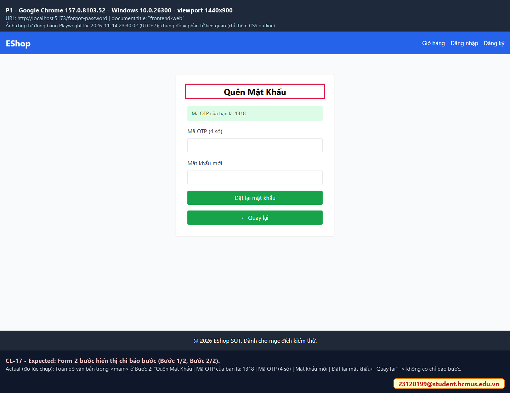

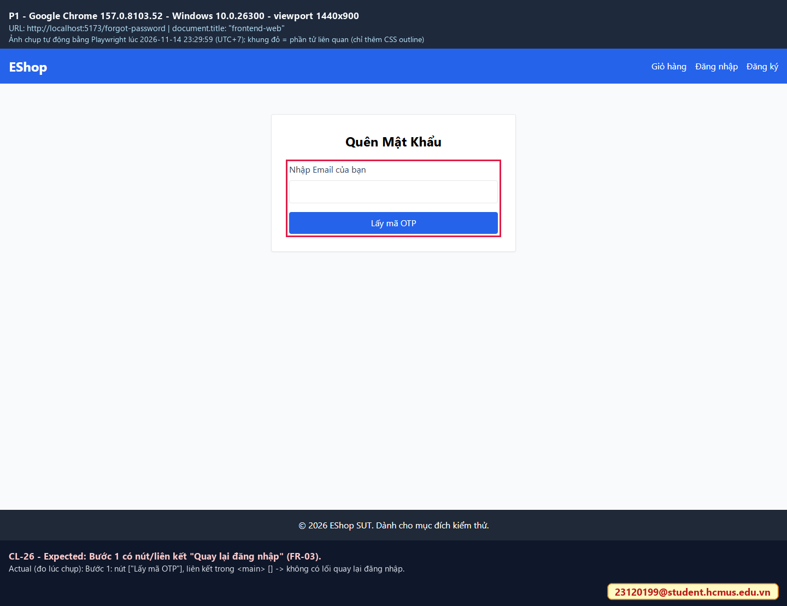

**Danh sách đầy đủ ảnh minh chứng theo nền tảng:**
- `CL-17` (`P1`): [`screenshots/task1_failed/P1_CL-17.png`](screenshots/task1_failed/P1_CL-17.png)
- `CL-17` (`P2`): [`screenshots/task1_failed/P2_CL-17.png`](screenshots/task1_failed/P2_CL-17.png)
- `CL-17` (`P3`): [`screenshots/task1_failed/P3_CL-17.png`](screenshots/task1_failed/P3_CL-17.png)
- `CL-26` (`P1`): [`screenshots/task1_failed/P1_CL-26.png`](screenshots/task1_failed/P1_CL-26.png)
- `CL-26` (`P2`): [`screenshots/task1_failed/P2_CL-26.png`](screenshots/task1_failed/P2_CL-26.png)
- `CL-26` (`P3`): [`screenshots/task1_failed/P3_CL-26.png`](screenshots/task1_failed/P3_CL-26.png)

#### GitHub Issue
- **Issue:** [#21 — [HW03-M1] [BUG-21] [IA-03] [ForgotPassword] Luồng Quên mật khẩu 2 bước thiếu chỉ báo bước (Step Indicator) và Bước 1 thiếu liên kết 'Quay lại đăng nhập'](https://github.com/HuynhDucThinh/Software-Testing-HW03/issues/21)
- **Ảnh chụp trang GitHub Issue:** [`screenshots/github_issues/ISSUE-21_BUG-21.png`](screenshots/github_issues/ISSUE-21_BUG-21.png)

---

### BUG-22 (Issue #22) — [IA-02] [ForgotPassword, Register] Bước 2 Quên mật khẩu thiếu hẳn dòng gợi ý quy tắc mật khẩu và dòng gợi ý trên Đăng ký không liệt kê tập ký tự đặc biệt cho phép

#### Summary
Ô `Mật khẩu mới` ở Bước 2 trang `/forgot-password` áp dụng kiểm tra độ mạnh mật khẩu nhưng không hiển thị bất kỳ dòng hướng dẫn quy tắc nào, còn trên trang `/register` dòng gợi ý chỉ ghi chung chung `ký tự đặc biệt` mà không liệt kê tập ký tự được phép (`@ $ ! % * ? &`).

- **Bug ID:** `BUG-22`
- **Checklist item:** `SV-13`, `SV-14`
- **Interface aspect:** `IA-02` — Forms
- **Màn hình:** ForgotPassword (`/forgot-password` — Bước 2), Register (`/register`)
- **Requirement:** FR-03 (eshop-sut/README.md:58); Nielsen #6 Recognition rather than recall; FR-01 (eshop-sut/README.md:34); Slide 10 #7 Assistive Hints
- **Loại lỗi:** `Visual-Layout`
- **Severity:** **Minor**
- **Priority:** **Low**

#### Environment
- **SUT:** `eshop-sut @ 1a9304a (repo HEAD 6b6a7a9)` (Web `http://localhost:5173`, Backend API `http://localhost:3000`)
- **P1:** Google Chrome 157.0.8103.50 trên Windows 11
- **P2:** Mozilla Firefox trên Windows 11 (bản cài đặt `137.0.1` dùng để quan sát trực tiếp; nhân Gecko `159.0` bản Playwright dùng để đo DOM và chụp ảnh minh chứng)
- **P3:** Chrome Android 156.0.8078.79 trên OPPO Reno10 5G (Android 15, adb reverse)
- **URL kiểm thử:** `http://localhost:5173/forgot-password, http://localhost:5173/register`
- **Viewport:** Desktop `1440x900` (`P1`, `P2`); Mobile `360x801` / `1080x2412` (`P3`)

#### Preconditions
Mở trang `/register` và Bước 2 trang `/forgot-password`.

#### Steps to reproduce
1. Truy cập Bước 2 trang `http://localhost:5173/forgot-password` và quan sát xung quanh ô `Mật khẩu mới`.
2. Truy cập `http://localhost:5173/register` và đọc nội dung dòng gợi ý bên dưới ô `Mật khẩu`.

#### Expected result
Theo `FR-01` (`eshop-sut/README.md:34`), `FR-03` (`eshop-sut/README.md:58`), Nielsen #6 (Recognition rather than recall) và Slide 10 #7 (Assistive Hints), cả hai màn hình đặt mật khẩu phải hiển thị trước quy tắc độ mạnh kèm tập ký tự đặc biệt được chấp nhận (`@ $ ! % * ? &`) để người dùng không phải đoán thử-sai.

- **`SV-13`** (*Hiển thị quy tắc mật khẩu mạnh cho ô Mật khẩu mới ở Bước 2* — căn cứ: `FR-03 (eshop-sut/README.md:58); Nielsen #6 Recognition rather than recall`): Ở Bước 2, gần ô `Mật khẩu mới` hiển thị dòng gợi ý nêu đủ quy tắc mật khẩu (tối thiểu 8 ký tự, chữ hoa, chữ thường, số, ký tự đặc biệt) giống gợi ý trên /register để người dùng không phải nhớ. Fail nếu Bước 2 không có bất kỳ dòng gợi ý quy tắc mật khẩu nào gần ô `Mật khẩu mới`.
- **`SV-14`** (*Dòng gợi ý mật khẩu liệt kê các ký tự đặc biệt được chấp nhận* — căn cứ: `FR-01 (eshop-sut/README.md:34); Slide 10 #7 Assistive Hints`): Dòng gợi ý dưới ô `Mật khẩu` nêu cụ thể các ký tự đặc biệt hợp lệ `@ $ ! % * ? &` để người dùng biết nên dùng ký tự nào. Fail nếu dòng gợi ý chỉ ghi chung chung "ký tự đặc biệt" mà không liệt kê tập ký tự được chấp nhận.

#### Actual result
Ở Bước 2 `/forgot-password` hoàn toàn không có thẻ gợi ý quy tắc mật khẩu nào (0 thẻ hướng dẫn); trên `/register` dòng gợi ý chỉ ghi `Yêu cầu: Tối thiểu 8 ký tự, có chữ hoa, chữ thường, số và ký tự đặc biệt.`, bỏ sót danh sách ký tự hợp lệ.

**Dữ kiện `Actual` nguyên văn theo từng mục và nền tảng:**
- **`SV-13` trên `P1`:** Actual: Ở Bước 2 trang /forgot-password không có bất kỳ dòng gợi ý quy tắc mật khẩu nào gần ô "Mật khẩu mới" (số thẻ gợi ý = 0).
- **`SV-13` trên `P2`:** Actual: Ở Bước 2 trang /forgot-password không có bất kỳ dòng gợi ý quy tắc mật khẩu nào gần ô "Mật khẩu mới" (số thẻ gợi ý = 0).
- **`SV-13` trên `P3`:** Actual: Ở Bước 2 trang /forgot-password không có bất kỳ dòng gợi ý quy tắc mật khẩu nào gần ô "Mật khẩu mới" (số thẻ gợi ý = 0).
- **`SV-14` trên `P1`:** Actual: Dòng gợi ý dưới ô Mật khẩu trên /register chỉ ghi chung chung "Yêu cầu: Tối thiểu 8 ký tự, có chữ hoa, chữ thường, số và ký tự đặc biệt.", không liệt kê tập ký tự đặc biệt hợp lệ (@ $ ! % * ? &).
- **`SV-14` trên `P2`:** Actual: Dòng gợi ý dưới ô Mật khẩu trên /register chỉ ghi chung chung "Yêu cầu: Tối thiểu 8 ký tự, có chữ hoa, chữ thường, số và ký tự đặc biệt.", không liệt kê tập ký tự đặc biệt hợp lệ (@ $ ! % * ? &).
- **`SV-14` trên `P3`:** Actual: Dòng gợi ý dưới ô Mật khẩu trên /register chỉ ghi chung chung "Yêu cầu: Tối thiểu 8 ký tự, có chữ hoa, chữ thường, số và ký tự đặc biệt.", không liệt kê tập ký tự đặc biệt hợp lệ (@ $ ! % * ? &).

#### Impact
Buộc người dùng phải nhớ hoặc nhập thử rồi mới nhận lỗi sau khi bấm Submit, làm tăng số lần nhập sai trên biểu mẫu.

#### Reproducibility
Luôn luôn (100%) trên các nền tảng áp dụng: `P1`, `P2`, `P3`.

#### Evidence
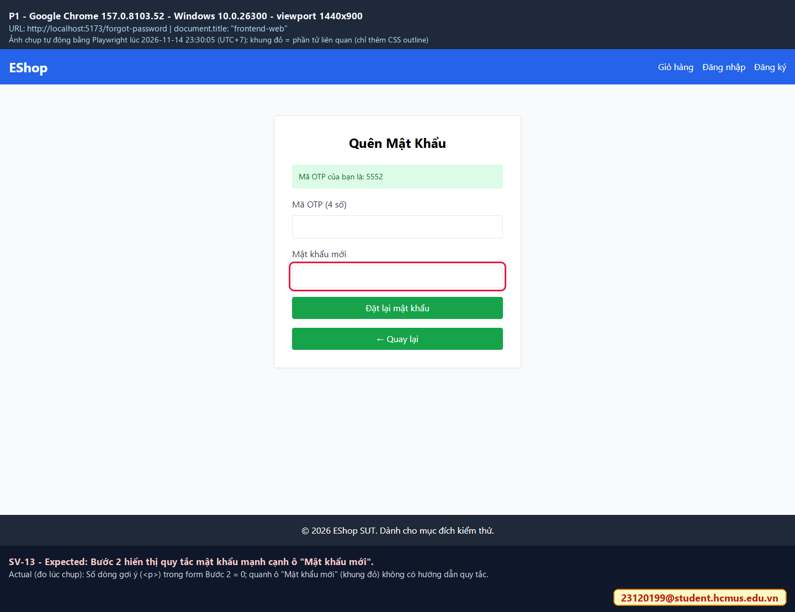

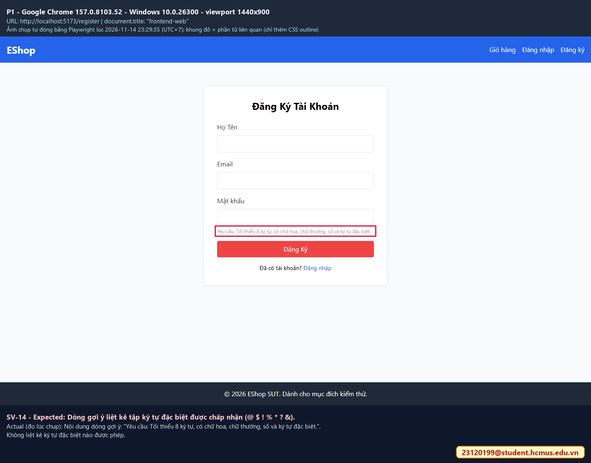

**Danh sách đầy đủ ảnh minh chứng theo nền tảng:**
- `SV-13` (`P1`): [`screenshots/task1_failed/P1_SV-13.png`](screenshots/task1_failed/P1_SV-13.png)
- `SV-13` (`P2`): [`screenshots/task1_failed/P2_SV-13.png`](screenshots/task1_failed/P2_SV-13.png)
- `SV-13` (`P3`): [`screenshots/task1_failed/P3_SV-13.png`](screenshots/task1_failed/P3_SV-13.png)
- `SV-14` (`P1`): [`screenshots/task1_failed/P1_SV-14.png`](screenshots/task1_failed/P1_SV-14.png)
- `SV-14` (`P2`): [`screenshots/task1_failed/P2_SV-14.png`](screenshots/task1_failed/P2_SV-14.png)
- `SV-14` (`P3`): [`screenshots/task1_failed/P3_SV-14.png`](screenshots/task1_failed/P3_SV-14.png)

#### GitHub Issue
- **Issue:** [#22 — [HW03-M1] [BUG-22] [IA-02] [ForgotPassword, Register] Bước 2 Quên mật khẩu thiếu hẳn dòng gợi ý quy tắc mật khẩu và dòng gợi ý trên Đăng ký không liệt kê tập ký tự đặc biệt cho phép](https://github.com/HuynhDucThinh/Software-Testing-HW03/issues/22)
- **Ảnh chụp trang GitHub Issue:** [`screenshots/github_issues/ISSUE-22_BUG-22.png`](screenshots/github_issues/ISSUE-22_BUG-22.png)

---

### BUG-23 (Issue #23) — [IA-02] [Register, Login, ForgotPassword, Profile] Tất cả nhãn trường bắt buộc thiếu dấu sao (*) và 10/10 thẻ label không liên kết htmlFor/id với ô nhập liệu

#### Summary
Trên cả 4 biểu mẫu thuộc phạm vi M1, không có bất kỳ nhãn trường bắt buộc nào hiển thị ký hiệu dấu sao (`*`), đồng thời toàn bộ `10/10` thẻ `<label>` đều không khai báo `htmlFor`/`id` liên kết với thẻ `<input>` tương ứng và thiếu `placeholder` gợi ý định dạng.

- **Bug ID:** `BUG-23`
- **Checklist item:** `CL-12`, `CL-23`
- **Interface aspect:** `IA-02` — Forms
- **Màn hình:** Register (`/register`), Login (`/login`), ForgotPassword (`/forgot-password`), Profile (`/profile`)
- **Requirement:** FR-22 (eshop-sut/README.md:252); WCAG 2.2 SC 1.3.1 Info and Relationships, SC 3.3.2 Labels or Instructions; Slide 10 #7 Assistive Hints
- **Loại lỗi:** `Visual-Layout`
- **Severity:** **Minor**
- **Priority:** **Medium**

#### Environment
- **SUT:** `eshop-sut @ 1a9304a (repo HEAD 6b6a7a9)` (Web `http://localhost:5173`, Backend API `http://localhost:3000`)
- **P1:** Google Chrome 157.0.8103.50 trên Windows 11
- **P2:** Mozilla Firefox trên Windows 11 (bản cài đặt `137.0.1` dùng để quan sát trực tiếp; nhân Gecko `159.0` bản Playwright dùng để đo DOM và chụp ảnh minh chứng)
- **P3:** Chrome Android 156.0.8078.79 trên OPPO Reno10 5G (Android 15, adb reverse)
- **URL kiểm thử:** `http://localhost:5173/register`
- **Viewport:** Desktop `1440x900` (`P1`, `P2`); Mobile `360x801` / `1080x2412` (`P3`)

#### Preconditions
Mở lần lượt các trang `/register`, `/login`, `/forgot-password` (Bước 1 & Bước 2) và `/profile`.

#### Steps to reproduce
1. Quan sát tất cả nhãn của các ô có thuộc tính `required` trên `/register` (3 ô), `/login` (2 ô), `/forgot-password` Bước 1 (1 ô) & Bước 2 (2 ô), và `/profile` (1 ô Họ Tên).
2. Nhấp chuột trực tiếp vào chữ của từng thẻ `<label>` và kiểm tra xem con trỏ có tự động focus vào ô `<input>` bên dưới hay không.

#### Expected result
Theo `FR-22` (`eshop-sut/README.md:252`), mọi trường bắt buộc phải có dấu sao (`*`) cạnh nhãn (đặc biệt trên `/profile` nơi cần phân biệt Họ Tên bắt buộc với Số điện thoại/Địa chỉ tùy chọn). Theo WCAG 2.2 SC 1.3.1 & SC 3.3.2, thẻ `<label>` phải liên kết ngữ nghĩa với `<input>` qua `for`/`id` để nhấp vào nhãn sẽ focus ô nhập và hỗ trợ trình đọc màn hình.

- **`CL-12`** (*Hiển thị ký hiệu dấu sao (*) bên cạnh nhãn tất cả các trường bắt buộc* — căn cứ: `FR-22 (eshop-sut/README.md:252)`): Tất cả các trường bắt buộc nhập trên /register (Họ Tên, Email, Mật khẩu, Xác nhận mật khẩu), /login (Email, Mật khẩu), /forgot-password (Email ở Bước 1; OTP, Mật khẩu mới, Xác nhận mật khẩu mới ở Bước 2) và /profile (Họ Tên) đều có ký hiệu `*` hiển thị rõ bên cạnh nhãn. Fail nếu bất kỳ trường bắt buộc nào thiếu ký hiệu `*` trên nhãn hiển thị.
- **`CL-23`** (*Liên kết ngữ nghĩa giữa thẻ label và ô nhập liệu kèm gợi ý định dạng rõ nghĩa* — căn cứ: `WCAG 2.2 SC 1.3.1 Info and Relationships, SC 3.3.2 Labels or Instructions; Slide 10 #7 Assistive Hints`): Mọi nhãn `<label>` trên các form /register, /login, /forgot-password và /profile được gắn kết với ô nhập tương ứng qua cặp `for`/`id` (hoặc bọc trực tiếp ô nhập) sao cho khi nhấp/chạm vào chữ trên nhãn thì con trỏ tự động focus vào ô nhập đó, đồng thời các trường có định dạng ràng buộc có gợi ý rõ nghĩa. Fail nếu nhấp vào nhãn `<label>` không làm focus ô nhập tương ứng (kiểm tra `label.htmlFor` rỗng và không bọc `input`).

#### Actual result
`0/9` nhãn trường bắt buộc có ký hiệu `*`, và `0/10` thẻ `<label>` trên cả 4 trang có thuộc tính `for`/`id` hoặc bọc thẻ `<input>` (nhấp vào nhãn không chuyển focus vào ô nhập); các ô SĐT, Email, OTP cũng để `placeholder` rỗng.

**Dữ kiện `Actual` nguyên văn theo từng mục và nền tảng:**
- **`CL-12` trên `P1`:** Actual: Có 0/9 nhãn trường bắt buộc hiển thị dấu "*": Register=["Họ Tên","Email","Mật khẩu"], Login=["Username","Mật khẩu"], ForgotB1=["Nhập Email của bạn"], ForgotB2=["Mã OTP (4 số)","Mật khẩu mới"], Profile(Họ Tên)="Họ Tên".
- **`CL-12` trên `P2`:** Actual: Có 0/9 nhãn trường bắt buộc hiển thị dấu "*": Register=["Họ Tên","Email","Mật khẩu"], Login=["Username","Mật khẩu"], ForgotB1=["Nhập Email của bạn"], ForgotB2=["Mã OTP (4 số)","Mật khẩu mới"], Profile(Họ Tên)="Họ Tên".
- **`CL-12` trên `P3`:** Actual: Có 0/9 nhãn trường bắt buộc hiển thị dấu "*": Register=["Họ Tên","Email","Mật khẩu"], Login=["Username","Mật khẩu"], ForgotB1=["Nhập Email của bạn"], ForgotB2=["Mã OTP (4 số)","Mật khẩu mới"], Profile(Họ Tên)="Họ Tên".
- **`CL-23` trên `P1`:** Actual: Kiểm tra trên cả 4 form (/register, /login, /forgot-password, /profile) có 0/10 thẻ `<label>` có thuộc tính for/id hoặc bọc trực tiếp ô input; nhấp vào nhãn không làm focus ô nhập tương ứng.
- **`CL-23` trên `P2`:** Actual: Kiểm tra trên cả 4 form (/register, /login, /forgot-password, /profile) có 0/10 thẻ `<label>` có thuộc tính for/id hoặc bọc trực tiếp ô input; nhấp vào nhãn không làm focus ô nhập tương ứng.
- **`CL-23` trên `P3`:** Actual: Kiểm tra trên cả 4 form (/register, /login, /forgot-password, /profile) có 0/10 thẻ `<label>` có thuộc tính for/id hoặc bọc trực tiếp ô input; nhấp vào nhãn không làm focus ô nhập tương ứng.

#### Impact
Người dùng không phân biệt trước được trường bắt buộc với trường không bắt buộc (nhất là trên trang Hồ sơ), giảm vùng nhấp chuột kích hoạt ô nhập và khiến trình đọc màn hình không đọc được nhãn của ô đang focus.

#### Reproducibility
Luôn luôn (100%) trên các nền tảng áp dụng: `P1`, `P2`, `P3`.

#### Evidence
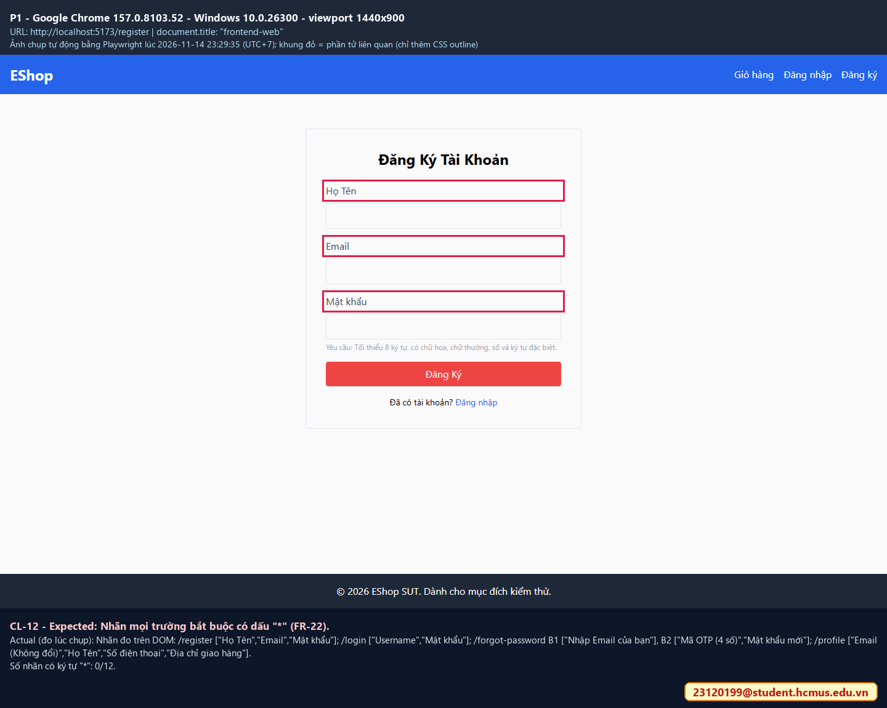

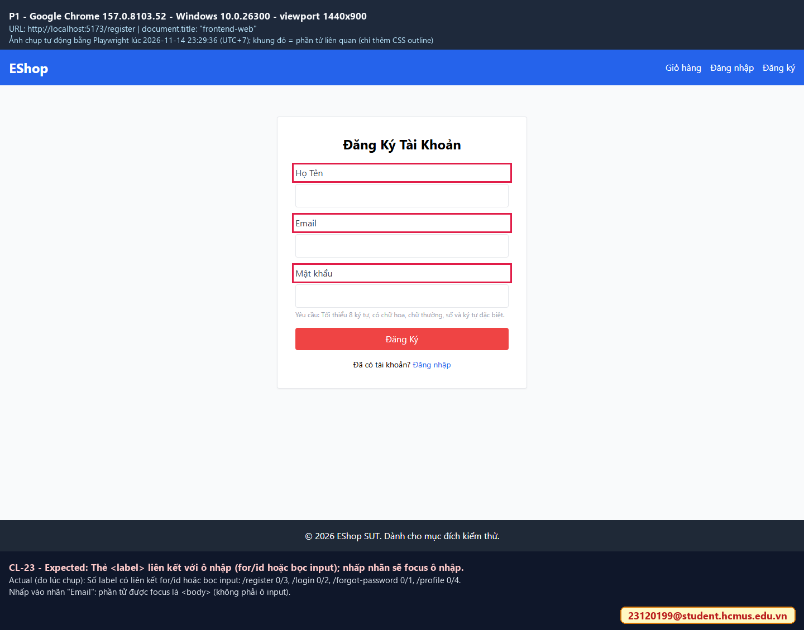

**Danh sách đầy đủ ảnh minh chứng theo nền tảng:**
- `CL-12` (`P1`): [`screenshots/task1_failed/P1_CL-12.png`](screenshots/task1_failed/P1_CL-12.png)
- `CL-12` (`P2`): [`screenshots/task1_failed/P2_CL-12.png`](screenshots/task1_failed/P2_CL-12.png)
- `CL-12` (`P3`): [`screenshots/task1_failed/P3_CL-12.png`](screenshots/task1_failed/P3_CL-12.png)
- `CL-23` (`P1`): [`screenshots/task1_failed/P1_CL-23.png`](screenshots/task1_failed/P1_CL-23.png)
- `CL-23` (`P2`): [`screenshots/task1_failed/P2_CL-23.png`](screenshots/task1_failed/P2_CL-23.png)
- `CL-23` (`P3`): [`screenshots/task1_failed/P3_CL-23.png`](screenshots/task1_failed/P3_CL-23.png)

#### GitHub Issue
- **Issue:** [#23 — [HW03-M1] [BUG-23] [IA-02] [Register, Login, ForgotPassword, Profile] Tất cả nhãn trường bắt buộc thiếu dấu sao (*) và 10/10 thẻ label không liên kết htmlFor/id với ô nhập liệu](https://github.com/HuynhDucThinh/Software-Testing-HW03/issues/23)
- **Ảnh chụp trang GitHub Issue:** [`screenshots/github_issues/ISSUE-23_BUG-23.png`](screenshots/github_issues/ISSUE-23_BUG-23.png)

---

### BUG-24 (Issue #24) — [IA-02] [Login, ForgotPassword, Profile] Ô nhập thiếu thuộc tính name/autocomplete gây tự điền nhầm Email vào ô OTP và ô Số điện thoại thiếu type='tel' mở bàn phím chữ trên di động

#### Summary
Các ô nhập trên `/login` và Bước 2 `/forgot-password` không khai báo thuộc tính `name` và `autocomplete` khiến trình quản lý mật khẩu của trình duyệt nhận diện nhầm cặp (`Mã OTP` + `Mật khẩu mới`) là (`Username` + `Password`) để điền đè email vào ô OTP; đồng thời ô Số điện thoại trên `/profile` dùng `type="text"` nên mở bàn phím chữ QWERTY thay vì bàn phím số trên điện thoại Android (`P3`).

- **Bug ID:** `BUG-24`
- **Checklist item:** `SV-12`, `SV-20`
- **Interface aspect:** `IA-02` — Forms
- **Màn hình:** Login (`/login`), ForgotPassword (`/forgot-password` — Bước 2), Profile (`/profile`)
- **Requirement:** WCAG 2.2 SC 1.3.5 Identify Input Purpose; Slide 10 #7 Assistive Hints; Slide 10 #5 Field Limits; Giả định NA2
- **Loại lỗi:** `State`
- **Severity:** **Minor**
- **Priority:** **Medium**

#### Environment
- **SUT:** `eshop-sut @ 1a9304a (repo HEAD 6b6a7a9)` (Web `http://localhost:5173`, Backend API `http://localhost:3000`)
- **P1:** Google Chrome 157.0.8103.50 trên Windows 11
- **P2:** Mozilla Firefox trên Windows 11 (bản cài đặt `137.0.1` dùng để quan sát trực tiếp; nhân Gecko `159.0` bản Playwright dùng để đo DOM và chụp ảnh minh chứng)
- **P3:** Chrome Android 156.0.8078.79 trên OPPO Reno10 5G (Android 15, adb reverse)
- **URL kiểm thử:** `http://localhost:5173/forgot-password, http://localhost:5173/profile`
- **Viewport:** Desktop `1440x900` (`P1`, `P2`); Mobile `360x801` / `1080x2412` (`P3`)

#### Preconditions
Kiểm tra `/login`, Bước 2 `/forgot-password` trên `P1`/`P2`/`P3` và kiểm tra ô Số điện thoại `/profile` trên Chrome Android (`P3`).

#### Steps to reproduce
1. Lưu thông tin đăng nhập trên trình duyệt, sau đó truy cập `/forgot-password` chuyển sang Bước 2 và quan sát hành vi tự động điền (autofill) vào hai ô `Mã OTP` + `Mật khẩu mới`, đồng thời kiểm tra thuộc tính `name`/`autocomplete` trong DOM.
2. Trên điện thoại Android (`P3`), đăng nhập và mở `http://localhost:5173/profile`, chạm ngón tay vào ô `Số điện thoại` và quan sát loại bàn phím ảo bật lên.

#### Expected result
Theo WCAG 2.2 SC 1.3.5 (Identify Input Purpose) và Slide 10 #5/#7, các ô email/mật khẩu/OTP phải khai báo đúng `autocomplete` (`username`, `current-password`, `one-time-code`, `new-password`) và ô Số điện thoại phải có `type="tel"` hoặc `inputmode="numeric"` để bật bàn phím số trên thiết bị cảm ứng.

- **`SV-12`** (*Thuộc tính autocomplete và hành vi tự điền của trình duyệt trên ô OTP, ô Email và ô mật khẩu* — căn cứ: `WCAG 2.2 SC 1.3.5 Identify Input Purpose; Slide 10 #7 Assistive Hints`): Ô OTP ở Bước 2 không bị trình duyệt tự điền email hay mật khẩu đã lưu (ô OTP không nhận giá trị trùng email) và các ô email, mật khẩu có thuộc tính `autocomplete` phù hợp (ví dụ `email`, `current-password`, `new-password`, `one-time-code`). Fail nếu ô OTP tự động hiện email đã lưu hoặc các ô trên không khai báo thuộc tính `autocomplete` phù hợp mục đích nhập.
- **`SV-20`** (*Loại bàn phím ảo hiển thị khi chạm vào ô Số điện thoại* — căn cứ: `Slide 10 #5 Field Limits; WCAG 2.2 SC 1.3.5 Identify Input Purpose; Giả định NA2`): Khi chạm vào ô `Số điện thoại` trên điện thoại Android, bàn phím ảo hiển thị dạng bàn phím số hoặc bàn phím điện thoại (ô khai báo `type="tel"` hoặc `inputmode="numeric"`) để nhập chữ số nhanh. Fail nếu bàn phím chữ cái thông thường hiện ra và người dùng phải chuyển sang bàn phím số thủ công.

#### Actual result
Tất cả ô nhập trên `/login` và Bước 2 `/forgot-password` đều có `name=null`, `autocomplete=null`; trên `P3` Chrome Android, ô Số điện thoại (`Profile.jsx:75` khai báo `<input type="text">` với `inputmode=null`) bật bàn phím chữ cái QWERTY thông thường thay vì bàn phím số.

**Dữ kiện `Actual` nguyên văn theo từng mục và nền tảng:**
- **`SV-12` trên `P1`:** Actual: Các ô nhập trên /login ([{"name":null,"autocomplete":null},{"name":null,"autocomplete":null}]) và Bước 2 /forgot-password ([{"name":null,"autocomplete":null},{"name":null,"autocomplete":null}]) đều thiếu thuộc tính name và autocomplete (null), khiến trình duyệt tự điền nhầm email đã lưu vào ô OTP.
- **`SV-12` trên `P2`:** Actual: Các ô nhập trên /login ([{"name":null,"autocomplete":null},{"name":null,"autocomplete":null}]) và Bước 2 /forgot-password ([{"name":null,"autocomplete":null},{"name":null,"autocomplete":null}]) đều thiếu thuộc tính name và autocomplete (null), khiến trình duyệt tự điền nhầm email đã lưu vào ô OTP.
- **`SV-12` trên `P3`:** Actual: Các ô nhập trên /login ([{"name":null,"autocomplete":null},{"name":null,"autocomplete":null}]) và Bước 2 /forgot-password ([{"name":null,"autocomplete":null},{"name":null,"autocomplete":null}]) đều thiếu thuộc tính name và autocomplete (null), khiến trình duyệt tự điền nhầm email đã lưu vào ô OTP.
- **`SV-20` trên `P3`:** Actual: Ô Số điện thoại trên /profile khai báo type="text", inputmode=null (không dùng type="tel" hay inputmode="numeric"), khi chạm trên điện thoại Android mở bàn phím chữ cái QWERTY thông thường thay vì bàn phím số.

#### Impact
Gây lỗi tự điền sai địa chỉ email vào ô mã OTP khi đặt lại mật khẩu và buộc người dùng di động phải chuyển chế độ bàn phím thủ công để gõ chữ số điện thoại.

#### Reproducibility
Luôn luôn (100%) trên các nền tảng áp dụng: `P1`, `P2`, `P3`.

#### Evidence
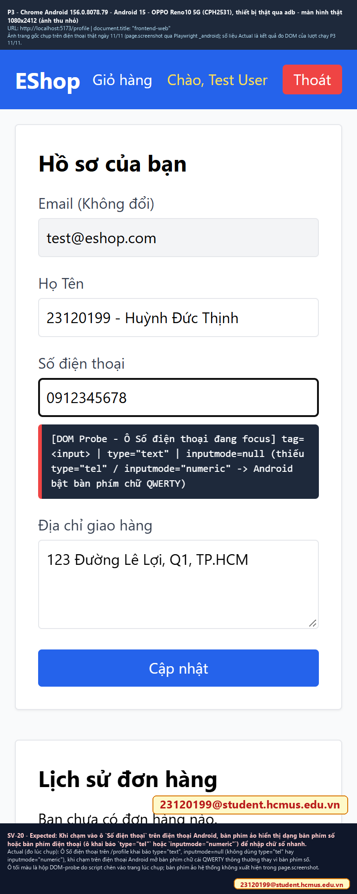

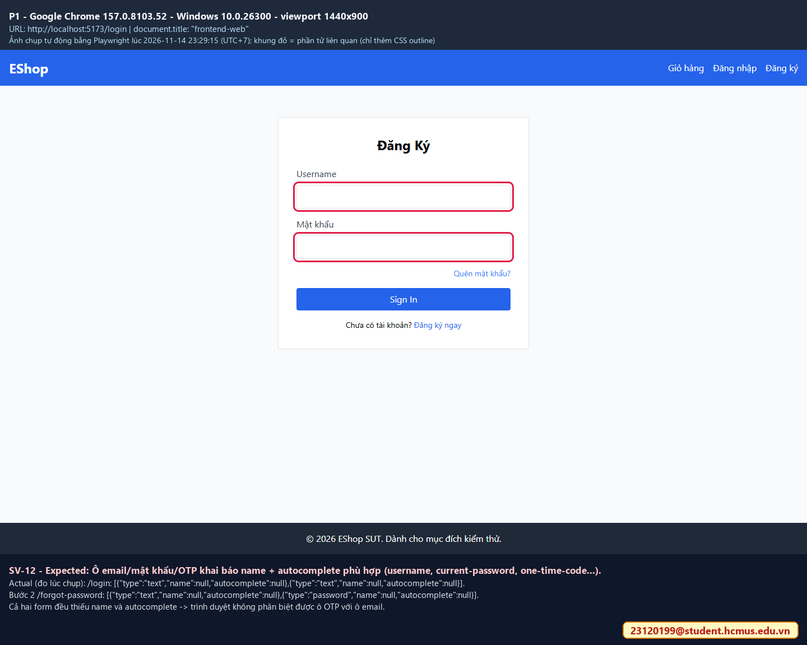

**Danh sách đầy đủ ảnh minh chứng theo nền tảng:**
- `SV-12` (`P1`): [`screenshots/task1_failed/P1_SV-12.png`](screenshots/task1_failed/P1_SV-12.png)
- `SV-12` (`P2`): [`screenshots/task1_failed/P2_SV-12.png`](screenshots/task1_failed/P2_SV-12.png)
- `SV-12` (`P3`): [`screenshots/task1_failed/P3_SV-12.png`](screenshots/task1_failed/P3_SV-12.png)
- `SV-20` (`P3`): [`screenshots/task1_failed/P3_SV-20.png`](screenshots/task1_failed/P3_SV-20.png)

#### GitHub Issue
- **Issue:** [#24 — [HW03-M1] [BUG-24] [IA-02] [Login, ForgotPassword, Profile] Ô nhập thiếu thuộc tính name/autocomplete gây tự điền nhầm Email vào ô OTP và ô Số điện thoại thiếu type='tel' mở bàn phím chữ trên di động](https://github.com/HuynhDucThinh/Software-Testing-HW03/issues/24)
- **Ảnh chụp trang GitHub Issue:** [`screenshots/github_issues/ISSUE-24_BUG-24.png`](screenshots/github_issues/ISSUE-24_BUG-24.png)

---

### BUG-25 (Issue #25) — [IA-03] [Header, Login] Thanh Navbar không đánh dấu mục trang đang mở, liên kết 'Quên mật khẩu?' gây tải lại toàn trang và tiêu đề tab trình duyệt giữ nguyên 'frontend-web' ở mọi route

#### Summary
Hệ thống định hướng điều hướng gặp 3 lỗi liên quan: (1) thanh Navbar không làm nổi bật liên kết của trang hiện tại (active link), (2) liên kết `Quên mật khẩu?` trên `/login` dùng thẻ `<a href>` thường làm trình duyệt tải lại toàn trang thay vì điều hướng SPA, và (3) cả 4 route đều giữ nguyên tiêu đề tab mặc định của Vite là `frontend-web`.

- **Bug ID:** `BUG-25`
- **Checklist item:** `CL-24`, `CL-28`, `SV-16`
- **Interface aspect:** `IA-03` — Navigation
- **Màn hình:** Header/Navbar, Login (`/login`), Register (`/register`), ForgotPassword (`/forgot-password`), Profile (`/profile`)
- **Requirement:** FR-23 (eshop-sut/README.md:260); Slide 31 Link Checker; Nielsen #4 Consistency and standards; WCAG 2.2 SC 2.4.2 Page Titled; Giả định GA8
- **Loại lỗi:** `Visual-Layout`
- **Severity:** **Minor**
- **Priority:** **Low**

#### Environment
- **SUT:** `eshop-sut @ 1a9304a (repo HEAD 6b6a7a9)` (Web `http://localhost:5173`, Backend API `http://localhost:3000`)
- **P1:** Google Chrome 157.0.8103.50 trên Windows 11
- **P2:** Mozilla Firefox trên Windows 11 (bản cài đặt `137.0.1` dùng để quan sát trực tiếp; nhân Gecko `159.0` bản Playwright dùng để đo DOM và chụp ảnh minh chứng)
- **P3:** Chrome Android 156.0.8078.79 trên OPPO Reno10 5G (Android 15, adb reverse)
- **URL kiểm thử:** `http://localhost:5173/login`
- **Viewport:** Desktop `1440x900` (`P1`, `P2`); Mobile `360x801` / `1080x2412` (`P3`)

#### Preconditions
Truy cập các trang `/login`, `/register`, `/forgot-password` và `/profile`.

#### Steps to reproduce
1. Truy cập `/login` và `/register` (khi chưa đăng nhập) và `/profile` (khi đã đăng nhập), so sánh kiểu chữ/màu sắc của liên kết đang mở với các liên kết còn lại trên thanh Navbar.
2. Tại trang `/login`, bấm vào liên kết `Quên mật khẩu?` và quan sát biểu tượng tải lại trang của trình duyệt / `PerformanceNavigationTiming`.
3. Quan sát tiêu đề trên thanh tab trình duyệt (`document.title`) khi chuyển qua lại giữa 4 trang.

#### Expected result
Theo `FR-23` (`eshop-sut/README.md:260`), mục menu tương ứng trang đang mở trên Navbar phải được đánh dấu nổi bật (active state). Theo chuẩn SPA và WCAG 2.2 SC 2.4.2 (Page Titled), liên kết nội bộ cần dùng bộ định tuyến SPA (`<Link>`) không tải lại toàn trang và mỗi trang phải có `document.title` mô tả riêng (ví dụ: `Đăng nhập - EShop`).

- **`CL-24`** (*Đánh dấu nổi bật (highlight) liên kết của trang đang mở trên thanh Navbar* — căn cứ: `FR-23 (eshop-sut/README.md:260)`): Thanh điều hướng trên Header khi người dùng đang đứng tại /login, /register hoặc /profile làm nổi bật rõ liên kết tương ứng của trang đang chọn (bằng màu nền, đường gạch chân cố định, độ đậm hoặc `aria-current="page"`) so với các liên kết khác. Fail nếu liên kết của trang đang mở có kiểu hiển thị giống hệt các liên kết không được chọn.
- **`CL-28`** (*Điều hướng nội bộ SPA không tải lại toàn bộ trang của các liên kết trên Login và Header* — căn cứ: `Slide 31 Link Checker; Nielsen #4 Consistency and standards`): Các liên kết điều hướng trên /login (`Quên mật khẩu?`, `Đăng ký ngay`) và trên Header (`EShop`, `Đăng nhập`, `Đăng ký`, `Chào, <tên>`) đều chuyển đúng tới route đích bằng cơ chế SPA của React Router mà không gây tải lại toàn trang trình duyệt. Fail nếu bất kỳ liên kết nào dẫn sai route hoặc dùng thẻ `<a href>` thường làm tải lại toàn bộ trang (làm mất state bộ nhớ tạm của ứng dụng).
- **`SV-16`** (*Tiêu đề tab trình duyệt mô tả riêng cho từng trang* — căn cứ: `WCAG 2.2 SC 2.4.2 Page Titled; Giả định GA8`): Mỗi trang trong 4 trang trên có tiêu đề tab (`document.title`) mô tả đúng chức năng và khác nhau giữa các trang (ví dụ phân biệt được trang đăng ký và đăng nhập). Fail nếu hai trang bất kỳ có cùng `document.title` hoặc tiêu đề tab không liên quan chức năng trang.

#### Actual result
`App.jsx` dùng `<Link>` tĩnh với cùng lớp `text-gray-600` cho mọi mục menu nên mục đang mở giống hệt mục khác; `Login.jsx:57` viết `<a href="/forgot-password">` gây full-page reload; `index.html` để cố định `<title>frontend-web</title>` không đổi trên cả 4 route.

**Dữ kiện `Actual` nguyên văn theo từng mục và nền tảng:**
- **`CL-24` trên `P1`:** Actual: Khi đang ở /login, liên kết "Đăng nhập" có cùng class "hover:underline", aria-current=null, màu rgb(255, 255, 255) giống hệt liên kết không chọn "Đăng ký" ("hover:underline"); trên /profile liên kết "Chào, `<tên>`" cũng giữ nguyên class "hover:underline text-yellow-300" như khi đứng ở trang chủ.
- **`CL-24` trên `P2`:** Actual: Khi đang ở /login, liên kết "Đăng nhập" có cùng class "hover:underline", aria-current=null, màu rgb(255, 255, 255) giống hệt liên kết không chọn "Đăng ký" ("hover:underline"); trên /profile liên kết "Chào, `<tên>`" cũng giữ nguyên class "hover:underline text-yellow-300" như khi đứng ở trang chủ.
- **`CL-24` trên `P3`:** Actual: Khi đang ở /login, liên kết "Đăng nhập" có cùng class "hover:underline", aria-current=null, màu rgb(255, 255, 255) giống hệt liên kết không chọn "Đăng ký" ("hover:underline"); trên /profile liên kết "Chào, `<tên>`" cũng giữ nguyên class "hover:underline text-yellow-300" như khi đứng ở trang chủ.
- **`CL-28` trên `P1`:** Actual: Phát hiện liên kết làm tải lại toàn bộ trang trình duyệt thay vì điều hướng SPA: Login -> "Quên mật khẩu?" (dùng `<a href="/forgot-password">` gây reload toàn trang).
- **`CL-28` trên `P2`:** Actual: Phát hiện liên kết làm tải lại toàn bộ trang trình duyệt thay vì điều hướng SPA: Login -> "Quên mật khẩu?" (dùng `<a href="/forgot-password">` gây reload toàn trang).
- **`CL-28` trên `P3`:** Actual: Phát hiện liên kết làm tải lại toàn bộ trang trình duyệt thay vì điều hướng SPA: Login -> "Quên mật khẩu?" (dùng `<a href="/forgot-password">` gây reload toàn trang).
- **`SV-16` trên `P1`:** Actual: Cả 4 trang đều có cùng document.title mặc định giống hệt nhau: {"/register":"frontend-web","/login":"frontend-web","/forgot-password":"frontend-web","/profile":"frontend-web"}, không mô tả chức năng từng trang.
- **`SV-16` trên `P2`:** Actual: Cả 4 trang đều có cùng document.title mặc định giống hệt nhau: {"/register":"frontend-web","/login":"frontend-web","/forgot-password":"frontend-web","/profile":"frontend-web"}, không mô tả chức năng từng trang.
- **`SV-16` trên `P3`:** Actual: Cả 4 trang đều có cùng document.title mặc định giống hệt nhau: {"/register":"frontend-web","/login":"frontend-web","/forgot-password":"frontend-web","/profile":"frontend-web"}, không mô tả chức năng từng trang.

#### Impact
Giảm khả năng nhận biết vị trí hiện tại của người dùng trên thanh điều hướng cũng như khi mở nhiều tab trình duyệt cùng lúc, đồng thời gây nháy tải lại ứng dụng không cần thiết khi bấm `Quên mật khẩu?`.

#### Reproducibility
Luôn luôn (100%) trên các nền tảng áp dụng: `P1`, `P2`, `P3`.

#### Evidence
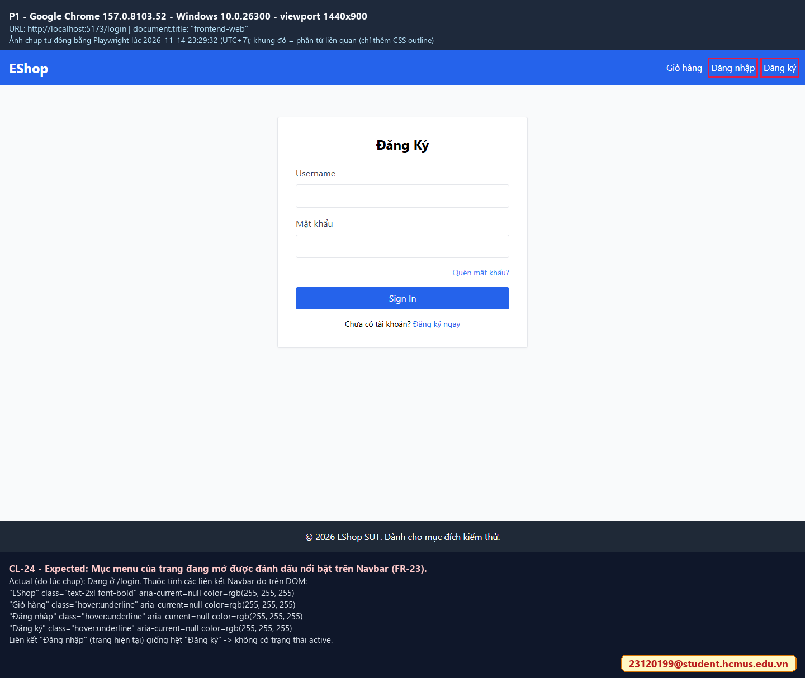

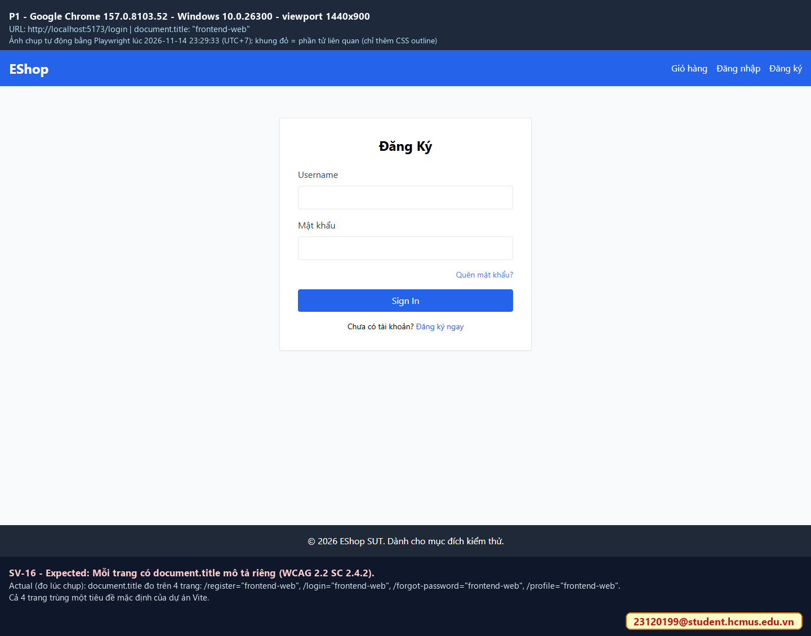

**Danh sách đầy đủ ảnh minh chứng theo nền tảng:**
- `CL-24` (`P1`): [`screenshots/task1_failed/P1_CL-24.png`](screenshots/task1_failed/P1_CL-24.png)
- `CL-24` (`P2`): [`screenshots/task1_failed/P2_CL-24.png`](screenshots/task1_failed/P2_CL-24.png)
- `CL-24` (`P3`): [`screenshots/task1_failed/P3_CL-24.png`](screenshots/task1_failed/P3_CL-24.png)
- `CL-28` (`P1`): [`screenshots/task1_failed/P1_CL-28.png`](screenshots/task1_failed/P1_CL-28.png)
- `CL-28` (`P2`): [`screenshots/task1_failed/P2_CL-28.png`](screenshots/task1_failed/P2_CL-28.png)
- `CL-28` (`P3`): [`screenshots/task1_failed/P3_CL-28.png`](screenshots/task1_failed/P3_CL-28.png)
- `SV-16` (`P1`): [`screenshots/task1_failed/P1_SV-16.png`](screenshots/task1_failed/P1_SV-16.png)
- `SV-16` (`P2`): [`screenshots/task1_failed/P2_SV-16.png`](screenshots/task1_failed/P2_SV-16.png)
- `SV-16` (`P3`): [`screenshots/task1_failed/P3_SV-16.png`](screenshots/task1_failed/P3_SV-16.png)

#### GitHub Issue
- **Issue:** [#25 — [HW03-M1] [BUG-25] [IA-03] [Header, Login] Thanh Navbar không đánh dấu mục trang đang mở, liên kết 'Quên mật khẩu?' gây tải lại toàn trang và tiêu đề tab trình duyệt giữ nguyên 'frontend-web' ở mọi route](https://github.com/HuynhDucThinh/Software-Testing-HW03/issues/25)
- **Ảnh chụp trang GitHub Issue:** [`screenshots/github_issues/ISSUE-25_BUG-25.png`](screenshots/github_issues/ISSUE-25_BUG-25.png)

---

### BUG-26 (Issue #26) — [IA-04] [Register, Login, ForgotPassword, Profile] Các nút gửi biểu mẫu thiếu trạng thái đang xử lý (loading) và không khóa tạm (disabled) để chống bấm đúp khi chờ API

#### Summary
Trên cả 4 biểu mẫu Đăng ký, Đăng nhập, Quên mật khẩu và Hồ sơ cá nhân, khi người dùng bấm nút gửi trong điều kiện mạng chậm, nút Submit không chuyển sang trạng thái `disabled` và không hiển thị chỉ báo đang xử lý, cho phép bấm đúp phát sinh nhiều request trùng lặp lên server.

- **Bug ID:** `BUG-26`
- **Checklist item:** `CL-37`
- **Interface aspect:** `IA-04` — Feedback / state
- **Màn hình:** Register (`/register`), Login (`/login`), ForgotPassword (`/forgot-password`), Profile (`/profile`)
- **Requirement:** Slide 10 #13 Processing States; Slide 11 IA-04
- **Loại lỗi:** `State`
- **Severity:** **Minor**
- **Priority:** **Medium**

#### Environment
- **SUT:** `eshop-sut @ 1a9304a (repo HEAD 6b6a7a9)` (Web `http://localhost:5173`, Backend API `http://localhost:3000`)
- **P1:** Google Chrome 157.0.8103.50 trên Windows 11
- **P2:** Mozilla Firefox trên Windows 11 (bản cài đặt `137.0.1` dùng để quan sát trực tiếp; nhân Gecko `159.0` bản Playwright dùng để đo DOM và chụp ảnh minh chứng)
- **URL kiểm thử:** `http://localhost:5173/register`
- **Viewport:** Desktop `1440x900` (`P1`, `P2`)

#### Preconditions
Mở DevTools -> Network -> chọn chế độ giả lập mạng chậm (`Slow 3G`) trên `P1`/`P2`.

#### Steps to reproduce
1. Bật chế độ mạng chậm trong DevTools trên trang `/register` (và tương tự trên `/login`, `/forgot-password`, `/profile`).
2. Điền thông tin hợp lệ rồi bấm liên tiếp 2 lần nhanh vào nút Submit trong lúc request đầu tiên đang ở trạng thái `pending`.
3. Quan sát trạng thái thuộc tính `disabled`/nhãn nút Submit và số lượng request gửi đi trong tab Network.

#### Expected result
Theo Slide 10 #13 (Processing States) và Slide 11 (`IA-04`), ngay khi gửi biểu mẫu chờ phản hồi mạng, nút Submit phải khóa tạm thời (`disabled`) kèm chỉ báo đang tải (spinner hoặc đổi nhãn `Đang xử lý...`) để ngăn gửi trùng request.

- **`CL-37`** (*Chỉ báo đang xử lý (loading) và khóa tạm nút Submit chống bấm đúp khi chờ API* — căn cứ: `Slide 10 #13 Processing States; Slide 11 IA-04`): Trong vòng 0,1 giây sau khi bấm gửi form và trong suốt lúc chờ API phản hồi, nút Submit hiển thị trạng thái đang xử lý (đổi nhãn hoặc hiện biểu tượng xoay) và có thuộc tính `disabled` ngăn bấm lặp lại nhiều lần, sau đó trở về bình thường khi hoàn tất. Fail nếu nút Submit vẫn cho phép nhấp liên tiếp phát sinh nhiều request API trùng nhau trong lúc đang chờ phản hồi.

#### Actual result
Cả 4 component không quản lý biến state `isSubmitting`; trong lúc chờ API phản hồi, nút bấm vẫn giữ `disabled=false` và nhãn cũ, bấm đúp phát sinh `>= 2` request `POST`/`PUT` liên tiếp (ví dụ sinh 2 mã OTP liên tiếp hoặc cộng dồn số lần sai mật khẩu).

**Dữ kiện `Actual` nguyên văn theo từng mục và nền tảng:**
- **`CL-37` trên `P1`:** Actual: Trong lúc chờ API phản hồi chậm, nút Submit vẫn có disabled=false, giữ nguyên nhãn "Sign In" (không có chỉ báo loading) và cho phép bấm đúp phát sinh 2 request API trùng lặp.
- **`CL-37` trên `P2`:** Actual: Trong lúc chờ API phản hồi chậm, nút Submit vẫn có disabled=false, giữ nguyên nhãn "Sign In" (không có chỉ báo loading) và cho phép bấm đúp phát sinh 2 request API trùng lặp.

#### Impact
Trên kết nối mạng di động hoặc mạng chập chờn, người dùng bấm lại nút gửi sẽ vô tình tạo bản ghi trùng, làm mất hiệu lực mã OTP đầu tiên hoặc làm tăng gấp đôi bộ đếm khóa tài khoản.

#### Reproducibility
Luôn luôn (100%) trên các nền tảng áp dụng: `P1`, `P2`.

#### Evidence

**Danh sách đầy đủ ảnh minh chứng theo nền tảng:**
- `CL-37` (`P1`): [`screenshots/task1_failed/P1_CL-37.png`](screenshots/task1_failed/P1_CL-37.png)
- `CL-37` (`P2`): [`screenshots/task1_failed/P2_CL-37.png`](screenshots/task1_failed/P2_CL-37.png)

#### GitHub Issue
- **Issue:** [#26 — [HW03-M1] [BUG-26] [IA-04] [Register, Login, ForgotPassword, Profile] Các nút gửi biểu mẫu thiếu trạng thái đang xử lý (loading) và không khóa tạm (disabled) để chống bấm đúp khi chờ API](https://github.com/HuynhDucThinh/Software-Testing-HW03/issues/26)
- **Ảnh chụp trang GitHub Issue:** [`screenshots/github_issues/ISSUE-26_BUG-26.png`](screenshots/github_issues/ISSUE-26_BUG-26.png)

---

### BUG-27 (Issue #27) — [IA-03] [All M1 Screens] Nút bấm và liên kết điều hướng thiếu hiệu ứng phản hồi khi rê chuột (:hover) và chiều cao vùng chạm liên kết nhỏ hơn ngưỡng 24x24 CSS px

#### Summary
Nhiều nút hành động (`Lấy mã OTP`, `Đặt lại mật khẩu`, `← Quay lại`, `Thoát`, `Cập nhật`) và logo `EShop` thiếu phản hồi màu sắc khi rê chuột (`:hover`), trong khi `Sign In` lại có, gây thiếu nhất quán, đồng thời các liên kết điều hướng nội dòng (`Đăng nhập`, `Quên mật khẩu?`, `Đăng ký ngay`) chỉ có chiều cao `16px-19px` không có đệm `padding`, thấp hơn ngưỡng vùng chạm tối thiểu `24x24 CSS px` của WCAG 2.2.

- **Bug ID:** `BUG-27`
- **Checklist item:** `CL-31`, `SV-19`
- **Interface aspect:** `IA-03` — Navigation
- **Màn hình:** Register (`/register`), Login (`/login`), ForgotPassword (`/forgot-password`), Profile (`/profile`), Header/Navbar
- **Requirement:** Slide 10 #10 Default Actions, #12 Hover and Focus; WCAG 2.2 SC 2.5.8 Target Size (Minimum); Slide 10 #18 Element Overlap
- **Loại lỗi:** `Visual-Layout`
- **Severity:** **Cosmetic**
- **Priority:** **Low**

#### Environment
- **SUT:** `eshop-sut @ 1a9304a (repo HEAD 6b6a7a9)` (Web `http://localhost:5173`, Backend API `http://localhost:3000`)
- **P1:** Google Chrome 157.0.8103.50 trên Windows 11
- **P2:** Mozilla Firefox trên Windows 11 (bản cài đặt `137.0.1` dùng để quan sát trực tiếp; nhân Gecko `159.0` bản Playwright dùng để đo DOM và chụp ảnh minh chứng)
- **P3:** Chrome Android 156.0.8078.79 trên OPPO Reno10 5G (Android 15, adb reverse)
- **URL kiểm thử:** `http://localhost:5173/login`
- **Viewport:** Desktop `1440x900` (`P1`, `P2`); Mobile `360x801` / `1080x2412` (`P3`)

#### Preconditions
Kiểm tra `:hover` trên Desktop (`P1`, `P2`) và đo bounding box của các liên kết trên cả 3 nền tảng (`P1`, `P2`, `P3`).

#### Steps to reproduce
1. Trên `P1`/`P2`, di chuyển con trỏ chuột lần lượt lên logo `EShop`, nút `Thoát` trên Header và các nút `Sign In`, `Lấy mã OTP`, `Đặt lại mật khẩu`, `← Quay lại`, `Cập nhật` để so sánh màu nền/màu chữ trước và trong khi hover.
2. Dùng DevTools đo kích thước `getBoundingClientRect()` của các liên kết `Đăng nhập` (`/register`), `Quên mật khẩu?` và `Đăng ký ngay` (`/login`) trên `P1`, `P2` và `P3`.

#### Expected result
Theo Slide 10 #12 (Hover and Focus), các nút và liên kết tương tác cần có phản hồi thị giác rõ ràng khi rê chuột (`:hover`). Theo WCAG 2.2 SC 2.5.8 (Target Size Minimum), vùng tương tác cần đạt tối thiểu `24x24 CSS px` (hoặc có khoảng đệm đủ tách biệt) để tránh chạm nhầm.

- **`CL-31`** (*Phản hồi thị giác khi hover chuột lên nút/liên kết và gửi form mặc định bằng phím Enter* — căn cứ: `Slide 10 #10 Default Actions, #12 Hover and Focus`): Trên các màn hình M1 và Header, khi di con trỏ chuột (`hover`) lên các nút bấm hoặc liên kết điều hướng thì con trỏ chuyển thành `pointer` kèm hiệu ứng đổi màu nền hoặc gạch chân rõ ràng; đồng thời khi đang đặt con trỏ tại ô `input` trong form và nhấn phím `Enter` thì kích hoạt gửi form tương ứng. Fail nếu nút/liên kết không có phản hồi thị giác khi hover, thiếu `cursor: pointer`, hoặc nhấn `Enter` trong ô `input` không gửi form.
- **`SV-19`** (*Kích thước vùng chạm của nút và liên kết* — căn cứ: `WCAG 2.2 SC 2.5.8 Target Size (Minimum); Slide 10 #18 Element Overlap`): Mọi nút và liên kết dạng chữ trên 5 vùng giao diện có vùng chạm tối thiểu 24 x 24 CSS px (đo bằng `getBoundingClientRect()`), và trên điện thoại Android chạm đúng một lần vào phần tử cần chọn mà không bấm nhầm phần tử kề bên. Fail nếu có nút hoặc liên kết có chiều cao hoặc chiều rộng nhỏ hơn 24 CSS px, hoặc chạm một lần trên điện thoại Android kích hoạt nhầm phần tử kề bên.

#### Actual result
Đo `getComputedStyle` trước và trong khi rê chuột trên `P1`, `P2`: 6/8 phần tử được đo **không** đổi màu nền/màu chữ/gạch chân gồm logo `EShop`, nút `Lấy mã OTP`, `Đặt lại mật khẩu`, `← Quay lại`, `Thoát`, `Cập nhật` (riêng `Sign In` đổi nền sang `rgb(29, 78, 216)` và `Quên mật khẩu?` có gạch chân, nên giao diện thiếu nhất quán); chiều cao thực tế các liên kết `Đăng nhập`, `Quên mật khẩu?`, `Đăng ký ngay` chỉ đạt `19px` trên `P1`/`P2` và `16px` trên `P3` (`< 24px`).

**Dữ kiện `Actual` nguyên văn theo từng mục và nền tảng:**
- **`CL-31` trên `P1`:** Actual: Nhấn phím Enter gửi form=true; tuy nhiên các nút thiếu hiệu ứng đổi màu khi hover hoặc thiếu cursor: pointer gồm: Register `<a>` "EShop" (cursor=pointer, đổi màu/gạch chân khi hover=false); Login `<a>` "EShop" (cursor=pointer, đổi màu/gạch chân khi hover=false); ForgotB1 `<a>` "EShop" (cursor=pointer, đổi màu/gạch chân khi hover=false); ForgotB1 `<button>` "Lấy mã OTP" (cursor=pointer, đổi màu/gạch chân khi hover=false); ForgotB2 `<a>` "EShop" (cursor=pointer, đổi màu/gạch chân khi hover=false); ForgotB2 `<button>` "Đặt lại mật khẩu" (cursor=pointer, đổi màu/gạch chân khi hover=false); ForgotB2 `<button>` "← Quay lại" (cursor=pointer, đổi màu/gạch chân khi hover=false); Profile+Header `<a>` "EShop" (cursor=pointer, đổi màu/gạch chân khi hover=false); Profile+Header `<button>` "Thoát" (cursor=pointer, đổi màu/gạch chân khi hover=false); Profile+Header `<button>` "Cập nhật" (cursor=pointer, đổi màu/gạch chân khi hover=false).
- **`CL-31` trên `P2`:** Actual: Nhấn phím Enter gửi form=true; tuy nhiên các nút thiếu hiệu ứng đổi màu khi hover hoặc thiếu cursor: pointer gồm: Register `<a>` "EShop" (cursor=pointer, đổi màu/gạch chân khi hover=false); Login `<a>` "EShop" (cursor=pointer, đổi màu/gạch chân khi hover=false); ForgotB1 `<a>` "EShop" (cursor=pointer, đổi màu/gạch chân khi hover=false); ForgotB1 `<button>` "Lấy mã OTP" (cursor=pointer, đổi màu/gạch chân khi hover=false); ForgotB2 `<a>` "EShop" (cursor=pointer, đổi màu/gạch chân khi hover=false); ForgotB2 `<button>` "Đặt lại mật khẩu" (cursor=pointer, đổi màu/gạch chân khi hover=false); ForgotB2 `<button>` "← Quay lại" (cursor=pointer, đổi màu/gạch chân khi hover=false); Profile+Header `<a>` "EShop" (cursor=pointer, đổi màu/gạch chân khi hover=false); Profile+Header `<button>` "Thoát" (cursor=pointer, đổi màu/gạch chân khi hover=false); Profile+Header `<button>` "Cập nhật" (cursor=pointer, đổi màu/gạch chân khi hover=false).
- **`SV-19` trên `P1`:** Actual: Các liên kết có chiều cao vùng chạm nhỏ hơn ngưỡng 24x24 CSS px: Register "Đăng nhập" (68x19px); Login "Quên mật khẩu?" (102x19px); Login "Đăng ký ngay" (85x19px).
- **`SV-19` trên `P2`:** Actual: Các liên kết có chiều cao vùng chạm nhỏ hơn ngưỡng 24x24 CSS px: Register "Đăng nhập" (68x19px); Login "Quên mật khẩu?" (102x19px); Login "Đăng ký ngay" (85x19px).
- **`SV-19` trên `P3`:** Actual: Các liên kết có chiều cao vùng chạm nhỏ hơn ngưỡng 24x24 CSS px: Register "Đăng nhập" (67x16px); Login "Quên mật khẩu?" (101x16px); Login "Đăng ký ngay" (83x16px).

#### Impact
Giảm phản hồi cảm nhận tương tác khi dùng chuột trên máy tính và làm người dùng màn hình cảm ứng (`P3`) khó chạm chính xác vào các liên kết nhỏ như `Quên mật khẩu?`.

#### Reproducibility
Luôn luôn (100%) trên các nền tảng áp dụng: `P1`, `P2`, `P3`.

#### Evidence
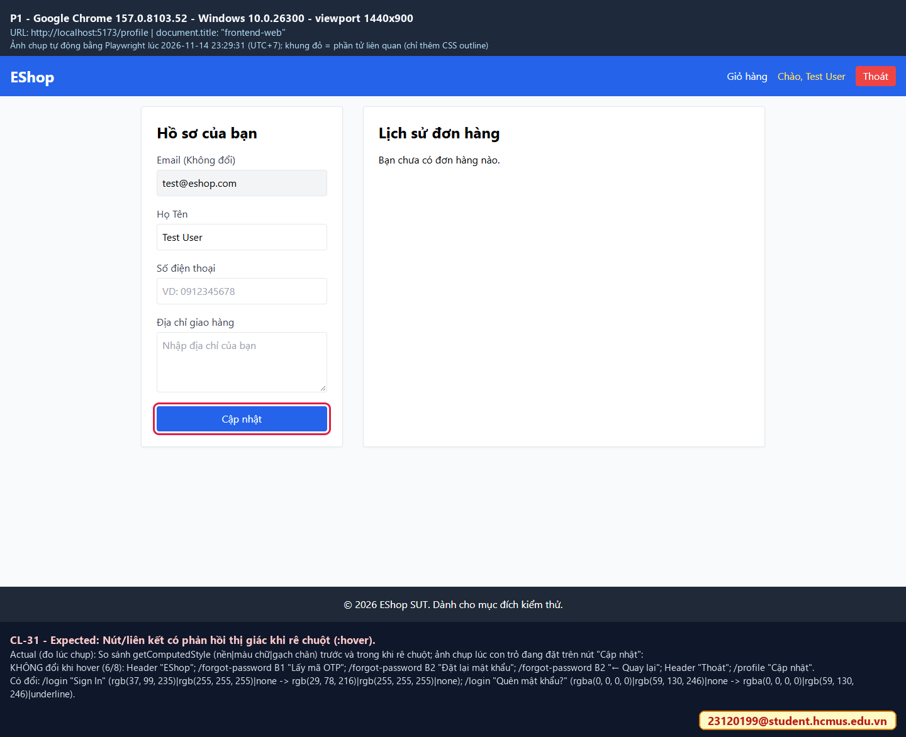

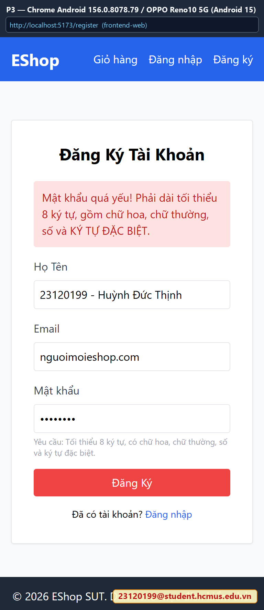

**Danh sách đầy đủ ảnh minh chứng theo nền tảng:**
- `CL-31` (`P1`): [`screenshots/task1_failed/P1_CL-31.png`](screenshots/task1_failed/P1_CL-31.png)
- `CL-31` (`P2`): [`screenshots/task1_failed/P2_CL-31.png`](screenshots/task1_failed/P2_CL-31.png)
- `SV-19` (`P1`): [`screenshots/task1_failed/P1_SV-19.png`](screenshots/task1_failed/P1_SV-19.png)
- `SV-19` (`P2`): [`screenshots/task1_failed/P2_SV-19.png`](screenshots/task1_failed/P2_SV-19.png)
- `SV-19` (`P3`): [`screenshots/task1_failed/P3_SV-19.png`](screenshots/task1_failed/P3_SV-19.png)

#### GitHub Issue
- **Issue:** [#27 — [HW03-M1] [BUG-27] [IA-03] [All M1 Screens] Nút bấm và liên kết điều hướng thiếu hiệu ứng phản hồi khi rê chuột (:hover) và chiều cao vùng chạm liên kết nhỏ hơn ngưỡng 24x24 CSS px](https://github.com/HuynhDucThinh/Software-Testing-HW03/issues/27)
- **Ảnh chụp trang GitHub Issue:** [`screenshots/github_issues/ISSUE-27_BUG-27.png`](screenshots/github_issues/ISSUE-27_BUG-27.png)

---

### BUG-28 (Issue #28) — [IA-04] [Profile] Dữ liệu Số điện thoại và Địa chỉ giao hàng vừa cập nhật biến mất sạch trên biểu mẫu khi điều hướng nội bộ SPA quay lại trang Hồ sơ

#### Summary
Sau khi người dùng nhập Số điện thoại và Địa chỉ giao hàng tại trang Hồ sơ (`/profile`), bấm `Cập nhật` và nhận thông báo `Cập nhật thành công!`, nếu điều hướng nội bộ SPA sang màn hình khác (ví dụ bấm logo `EShop` ra Trang chủ) rồi bấm liên kết `Chào, <tên>` quay lại `/profile` mà không nhấn `F5`, toàn bộ Số điện thoại và Địa chỉ giao hàng vừa lưu biến mất sạch về ô trống do `Profile.jsx` khởi tạo lại state từ đối tượng `user` cũ trong `AuthContext`.

- **Bug ID:** `BUG-28`
- **Nguồn phát hiện:** **Task 2 — Usability Evaluation** (Phiên chính thức `S05` với người tham gia `P05` tại mốc `01:34 – 01:48`, đối chứng với `S07` tại `01:02 – 01:08`)
- **Interface aspect:** `IA-04` — Feedback / state
- **Màn hình:** Profile (`/profile`)
- **Requirement:** FR-04 (eshop-sut/README.md:64); Nielsen #1 Visibility of system status & #5 Error prevention
- **Loại lỗi:** `State`
- **Severity:** **Major**
- **Priority:** **High**

#### Environment
- **SUT:** `eshop-sut @ 1a9304a` (Web `http://localhost:5173`, Backend API `http://localhost:3000`)
- **Nền tảng phát hiện & tái hiện:** `P1` Google Chrome 157 trên Windows 11 (tái hiện tương tự 100% trên `P2` Firefox và `P3` Chrome Android 156)
- **URL kiểm thử:** `http://localhost:5173/profile`
- **Viewport:** Desktop `1440x900` / `1920x1080`

#### Preconditions
Người dùng vừa đăng ký tài khoản mới và đăng nhập lần đầu (khi đăng nhập, đối tượng `user` lưu trong `AuthContext` có `phone: null`, `shipping_address: null`), hoặc đang đăng nhập tài khoản hiện có mà chưa tải lại toàn trang (`F5`).

#### Steps to reproduce
1. Đăng ký tài khoản mới tại `/register` và đăng nhập tại `/login` (ví dụ tài khoản `lethie` trong phiên `S05`).
2. Bấm vào liên kết `Chào, lethie` trên thanh Header để mở `/profile`.
3. Nhập Số điện thoại `912345678` (vượt bộ lọc `BUG-05`) và Địa chỉ giao hàng `Hà Nội`, sau đó bấm nút `Cập nhật` và đóng hộp thoại `Cập nhật thành công!` (`S05.mp4 @ 01:34`).
4. Không nhấn `F5`, bấm vào logo `EShop` góc trái thanh Header để ra Trang chủ (`S05.mp4 @ 01:46`), sau đó bấm lại vào `Chào, lethie` trên thanh Header để mở lại trang `/profile` (`S05.mp4 @ 01:48`).

#### Expected result
Theo `FR-04` (`eshop-sut/README.md:64`) và nguyên tắc nhất quán trạng thái phiên làm việc, sau khi API `PUT /api/users/me` báo cập nhật thành công, mọi lần mở lại trang `/profile` bằng điều hướng nội bộ SPA đều phải hiển thị đầy đủ giá trị `Họ Tên`, `Số điện thoại` (`912345678`) và `Địa chỉ giao hàng` (`Hà Nội`) vừa lưu mà không cần tải lại toàn bộ trình duyệt.

#### Actual result
Khi quay lại `/profile` qua liên kết SPA ở Bước 4, cả hai ô `Số điện thoại` và `Địa chỉ giao hàng` đều bị xóa trắng quay về placeholder (`VD: 0912345678` và `Nhập địa chỉ của bạn`), và `Họ Tên` cũng quay về giá trị lúc mới đăng nhập (do `Profile.jsx:31-60` chỉ đọc từ `AuthContext.user` cũ và không đồng bộ lại sau `PUT /api/users/me`).

#### Impact
Phá vỡ niềm tin của người dùng ngay sau thông báo `Cập nhật thành công!` và gây nguy cơ ghi đè mất dữ liệu thật trong SQLite nếu người dùng bấm `Cập nhật` lại khi ô địa chỉ đang bị xóa trắng.

#### Reproducibility
Luôn luôn (100%) trên các nền tảng áp dụng: `P1`, `P2`, `P3`.

#### Evidence
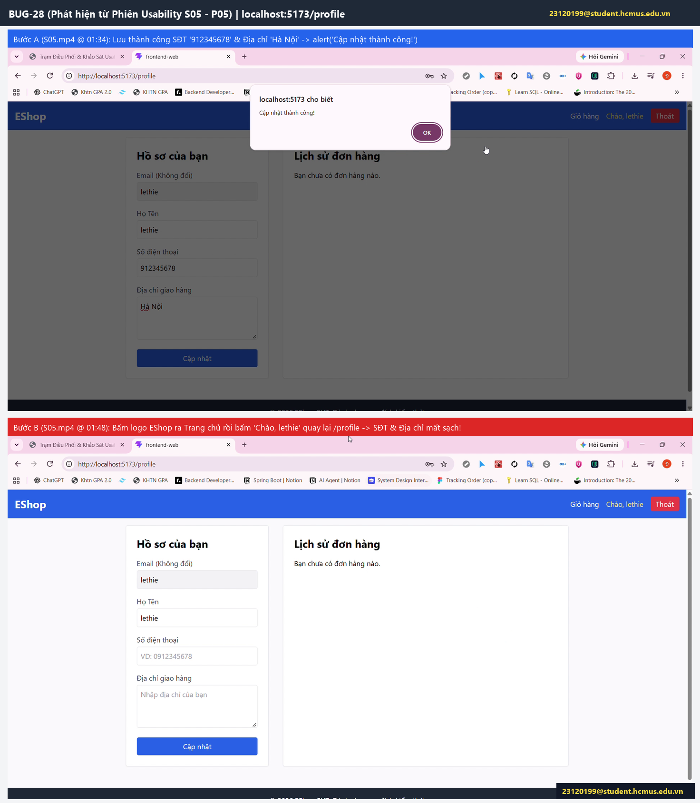

- **Ảnh minh chứng trích xuất từ phiên thật `S05`:** [`screenshots/usability/BUG-28_S05_SPA_State_Loss.png`](screenshots/usability/BUG-28_S05_SPA_State_Loss.png)
- **Video gốc phiên `S05` (`01:34 – 01:48`):** [Xem `S05.mp4` trên Google Drive](https://drive.google.com/file/d/1gWECeWQ6mcj3_2ohrK13QzmSIMHllwbd/view)

#### GitHub Issue
- **Issue:** [#28 — [HW03-M1] [BUG-28] [IA-04] [Profile] Dữ liệu Số điện thoại và Địa chỉ giao hàng vừa cập nhật biến mất sạch trên biểu mẫu khi điều hướng nội bộ SPA quay lại trang Hồ sơ](https://github.com/HuynhDucThinh/Software-Testing-HW03/issues/28)
- **Ảnh chụp trang GitHub Issue:** [`screenshots/github_issues/ISSUE-28_BUG-28.png`](screenshots/github_issues/ISSUE-28_BUG-28.png)

---
