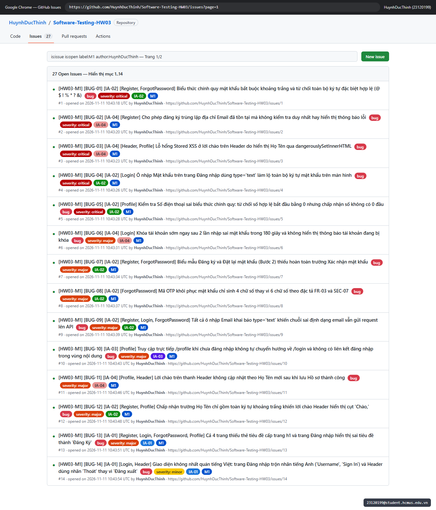
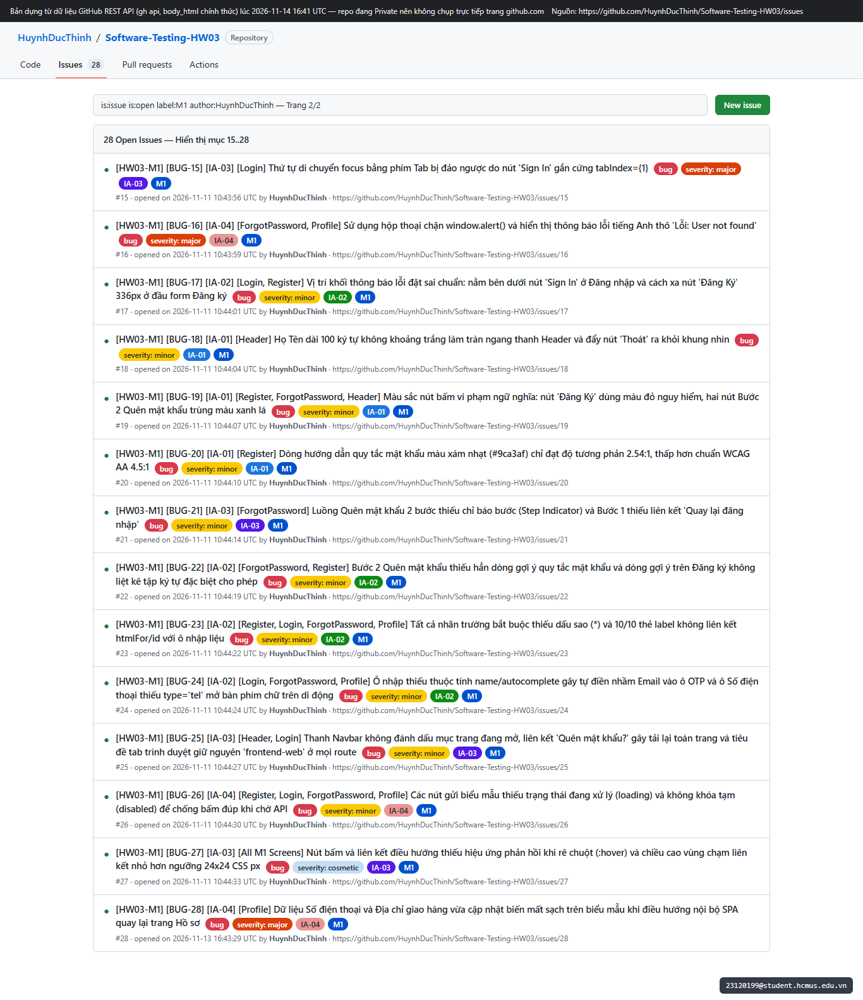

# Báo Cáo Chính HW03-AI — Kiểm Thử Giao Diện (GUI Checklist), Đa Nền Tảng & Khả Năng Sử Dụng Trên Hệ Thống EShop

**Sinh viên thực hiện:** Huỳnh Đức Thịnh · **MSSV:** `23120199` · **Email:** `23120199@student.hcmus.edu.vn`  
**Môn học:** Kiểm chứng Phần mềm (Software Testing) · **Bài tập:** `HW03-AI` (Individual Assignment)  
**Phạm vi phân công nhóm:** `M1` — Xác thực & Hồ sơ cá nhân (`Register`, `Login`, `ForgotPassword` 2 bước, `Profile`, `Header/Navbar`) · **Luồng Usability:** `F1`  
**Mức độ năng lực Bloom-AI:** `G9.3 (Analyse)` & `G9.4 (Collaborate with AI for exploratory testing)`

---

## Mục Lục

- [1. Môi trường kiểm thử và Hệ thống SUT](#1-môi-trường-kiểm-thử-và-hệ-thống-sut)
- [2. Phạm vi kiểm thử, Phân chia nhóm và Cơ sở kiểm thử (Test Basis)](#2-phạm-vi-kiểm-thử-phân-chia-nhóm-và-cơ-sở-kiểm-thử-test-basis)
  - [2.1. Phân chia phạm vi không chồng lấn trong nhóm](#21-phân-chia-phạm-vi-không-chồng-lấn-trong-nhóm)
  - [2.2. Ánh xạ Khía cạnh giao diện (IA-01..IA-04) với Điều khoản đặc tả](#22-ánh-xạ-khía-cạnh-giao-diện-ia-01ia-04-với-điều-khoản-đặc-tả)
  - [2.3. Hệ thống giả định tường minh (GA1..GA8, NA1..NA2) và Quy ước đánh giá](#23-hệ-thống-giả-định-tường-minh-ga1ga8-na1na2-và-quy-ước-đánh-giá)
- [3. Task 1 — Kiểm thử Giao diện theo Checklist (GUI Checklist — Phạm vi M1)](#3-task-1--kiểm-thử-giao-diện-theo-checklist-gui-checklist--phạm-vi-m1)
  - [3.1. Khảo sát thành phần giao diện thực tế (M1 UI Inventory)](#31-khảo-sát-thành-phần-giao-diện-thực-tế-m1-ui-inventory)
  - [3.2. Quy trình cộng tác từng bước với AI và Kiểm duyệt của Sinh viên](#32-quy-trình-cộng-tác-từng-bước-với-ai-và-kiểm-duyệt-của-sinh-viên)
  - [3.3. Ma trận độ phủ và Bảng Checklist đầy đủ 59 mục (CL-01..CL-39, SV-01..SV-20)](#33-ma-trận-độ-phủ-và-bảng-checklist-đầy-đủ-59-mục-cl-01cl-39-sv-01sv-20)
  - [3.4. Các mục Sinh viên hiệu chỉnh (Both) và 20 mục tự bổ sung kèm giải thích vì sao AI bỏ sót (SV-01..SV-20)](#34-các-mục-sinh-viên-hiệu-chỉnh-both-và-20-mục-tự-bổ-sung-kèm-giải-thích-vì-sao-ai-bỏ-sót-sv-01sv-20)
  - [3.5. Quy trình thực thi (G1..G7), Nhật ký lượt chạy và Thống kê kết quả](#35-quy-trình-thực-thi-g1g7-nhật-ký-lượt-chạy-và-thống-kê-kết-quả)
  - [3.6. Bảng chi tiết toàn bộ 45 mục Failed (Notes nguyên văn, Ảnh minh chứng và Mã Bug)](#36-bảng-chi-tiết-toàn-bộ-45-mục-failed-notes-nguyên-văn-ảnh-minh-chứng-và-mã-bug)
  - [3.7. Bảng ghi nhận thông số thực tế của 14 mục Passed](#37-bảng-ghi-nhận-thông-số-thực-tế-của-14-mục-passed)
- [4. Task 3 — Kiểm thử Đa trình duyệt / Đa nền tảng (Cross-Browser / Cross-Platform)](#4-task-3--kiểm-thử-đa-trình-duyệt--đa-nền-tảng-cross-browser--cross-platform)
  - [4.1. Ma trận đối chiếu sự khác biệt giữa P1, P2 và P3](#41-ma-trận-đối-chiếu-sự-khác-biệt-giữa-p1-p2-và-p3)
  - [4.2. Phân tích chuyên môn về tính nhất quán và khác biệt đa nền tảng](#42-phân-tích-chuyên-môn-về-tính-nhất-quán-và-khác-biệt-đa-nền-tảng)
  - [4.3. Thống kê bộ ảnh minh chứng có lớp phủ và Bộ ảnh tổng quan đa nền tảng](#43-thống-kê-bộ-ảnh-minh-chứng-có-lớp-phủ-và-bộ-ảnh-tổng-quan-đa-nền-tảng)
- [5. Task 2 — Đánh giá Khả năng Sử dụng (Usability Evaluation — Luồng F1)](#5-task-2--đánh-giá-khả-năng-sử-dụng-usability-evaluation--luồng-f1)
- [6. Báo cáo Lỗi và GitHub Issues (Bug Report — BUG-01 .. BUG-27)](#6-báo-cáo-lỗi-và-github-issues-bug-report--bug-01--bug-27)
  - [6.1. Thống kê phân bố 27 Bugs](#61-thống-kê-phân-bố-27-bugs)
  - [6.2. Bảng danh mục 27 Bugs và liên kết GitHub Issues (#1 .. #27)](#62-bảng-danh-mục-27-bugs-và-liên-kết-github-issues-1--27)
  - [6.3. Ảnh chụp trang danh sách GitHub Issues](#63-ảnh-chụp-trang-danh-sách-github-issues)
  - [6.4. Hồ sơ kỹ thuật tóm tắt từng Bug (BUG-01 .. BUG-27)](#64-hồ-sơ-kỹ-thuật-tóm-tắt-từng-bug-bug-01--bug-27)
- [7. Agent Skills và Video Demo (Task 4)](#7-agent-skills-và-video-demo-task-4)
- [8. Báo cáo Tóm tắt Kiểm thử Tổng thể (Test Summary Report)](#8-báo-cáo-tóm-tắt-kiểm-thử-tổng-thể-test-summary-report)
- [9. Tóm tắt AI Audit Report](#9-tóm-tắt-ai-audit-report)
- [10. AI Critique (200–300 từ)](#10-ai-critique-200300-từ)
- [11. Tuyên bố Bắt buộc về Sử dụng AI (Mandatory Disclosure)](#11-tuyên-bố-bắt-buộc-về-sử-dụng-ai-mandatory-disclosure)
- [12. Bảng Tự đánh giá Điểm (Self-Assessment)](#12-bảng-tự-đánh-giá-điểm-self-assessment)
- [13. Phụ lục và Cấu trúc Hồ sơ Nộp bài](#13-phụ-lục-và-cấu-trúc-hồ-sơ-nộp-bài)

---
## 1. Môi Trường Kiểm Thử và Hệ Thống SUT

- **Hệ thống kiểm thử (SUT):** EShop — ứng dụng thương mại điện tử tiếng Việt phục vụ thực hành kiểm thử (`https://github.com/ttbhanh/eshop-sut`, lưu cục bộ tại `./eshop-sut` ở commit khởi tạo `1a9304a`, giữ nguyên mã nguồn không chỉnh sửa).
  - **Backend API:** Node.js + Express + SQLite3 chạy tại `http://localhost:3000` (`node database.js && node server.js`). Trước mỗi lượt kiểm thử trên từng nền tảng, cơ sở dữ liệu `database.sqlite` được khởi tạo lại sạch để đảm bảo tính độc lập trạng thái.
  - **Frontend Web:** React 18 + Vite + Tailwind CSS chạy tại `http://localhost:5173` (`npm run dev -- --host 127.0.0.1 --port 5173`).
  - **Tài khoản seed mặc định (`eshop-sut/README.md:23-24`):** Tài khoản khách hàng `test@eshop.com` (tên mặc định `Test User`) và tài khoản quản trị `admin@eshop.com`.
- **Cấu hình 3 nền tảng thực thi kiểm thử (Task 1 & Task 3):**

| Mã nền tảng | Vai trò kiểm thử | Trình duyệt & Nhân hiển thị (Engine) | Hệ điều hành / Thiết bị vật lý | Khung nhìn (Viewport) | Phương thức kết nối `localhost` |
| :---: | :--- | :--- | :--- | :--- | :--- |
| **`P1`** | Desktop Browser 1 | Google Chrome `157.0.8103.50` (64-bit, nhân Blink / Chromium) | Windows 11 Build 26300 (PC x64) | `1440x900` (màn hình `1920x1080`, kiểm đa khung nhìn `375/768/1440px` ở `CL-10`) | Trực tiếp `http://localhost:5173` & `:3000` |
| **`P2`** | Desktop Browser 2 | Mozilla Firefox `137.0.1` (64-bit, nhân Gecko) | Windows 11 Build 26300 (PC x64) | `1440x900` (màn hình `1920x1080`, kiểm đa khung nhìn `375/768/1440px` ở `CL-10`) | Trực tiếp `http://localhost:5173` & `:3000` |
| **`P3`** | Mobile Browser | Chrome Android `156.0.8078.79` (nhân Blink Mobile) | Điện thoại thật `OPPO Reno10 5G` (`CPH2531`), Android 15 | `360x801` CSS px (độ phân giải vật lý `1080x2412`, màn hình cảm ứng) | Cáp USB qua `adb reverse tcp:5173 tcp:5173` và `adb reverse tcp:3000 tcp:3000` |

- **Lý do lựa chọn thiết bị di động vật lý thật cho `P3`:** Các gói dùng thử miễn phí của BrowserStack / LambdaTest giới hạn thời lượng phiên tương tác trực tiếp chỉ 1–2 phút mỗi lượt kết nối Local Tunnel, không đủ để thực thi liên tục và nhất quán 52 mục kiểm tra có trạng thái nối tiếp (đăng ký, khóa tài khoản 3 phút, khôi phục OTP 2 bước, cập nhật hồ sơ). Theo đúng Mục 6 của đề bài (*cho phép sử dụng thiết bị vật lý thật khi ảnh chụp thể hiện rõ tên trình duyệt/thiết bị/OS cạnh URL `localhost`, thông tin sinh viên trên biểu mẫu và lớp phủ email*), điện thoại thật `OPPO Reno10 5G` kết nối qua `adb reverse` giúp thực thi trọn vẹn bộ checklist trên trình duyệt di động thật với URL `http://localhost:5173` nguyên bản.

---
## 2. Phạm Vi Kiểm Thử, Phân Chia Nhóm và Cơ Sở Kiểm Thử (Test Basis)

### 2.1. Phân chia phạm vi không chồng lấn trong nhóm

Nhóm thống nhất phân chia không trùng lặp màn hình chính của Task 1 và không trùng lặp luồng nghiệp vụ đầu-cuối của Task 2 giữa 5 thành viên (`M1`..`M5`). Phần việc cá nhân của tôi là **`M1` (Authentication & Personal Profile — Web)** kết hợp luồng **`F1` (`Đăng ký -> Đăng nhập -> Cập nhật hồ sơ`)**:

| Hạng mục phân định | Thuộc phạm vi của `M1` (Huỳnh Đức Thịnh — `23120199`) | Ngoài phạm vi `M1` (Thuộc `M2`, `M3`, `M4`, `M5`) |
| :--- | :--- | :--- |
| **Màn hình chính (Task 1)** | Trang Đăng ký tài khoản `Register` (`/register` — `FR-01`) | `Home` & `ProductDetail` (`M2`); `Cart` & `Checkout` (`M3`); `Web Admin` cổng `5174` (`M4`); `Expo Mobile App` (`M5`) |
| **Màn hình / vùng phụ (Task 1)** | `Login` (`/login` — `FR-02`), `ForgotPassword` 2 bước (`/forgot-password` — `FR-03`), khối `Hồ sơ của bạn` tại `/profile` (`FR-04`), và thanh `Header/Navbar` (`App.jsx` — `FR-23`, `SEC-04`) | Cột phải `Lịch sử đơn hàng` và nút `Hủy đơn` tại `/profile` (`FR-10`, `FR-11` — thuộc `M3`; `M1` chỉ đếm số thẻ tiêu đề cấp trang `<h1>`/`<h2>` ở `CL-06`), badge số lượng giỏ hàng (`M3`), thẻ giá `₫` & `alt` ảnh sản phẩm (`M2`) |
| **Luồng Usability (Task 2)** | **Luồng `F1`:** Đăng ký tài khoản mới -> Đăng nhập -> Cập nhật thông tin hồ sơ cá nhân (`FR-01` -> `FR-02` -> `FR-04`) | Các luồng tìm kiếm mua hàng, áp mã giảm giá thanh toán, quản lý đơn hàng và quản trị danh mục/sản phẩm của các thành viên còn lại |

### 2.2. Ánh xạ Khía cạnh giao diện (`IA-01`..`IA-04`) với Điều khoản đặc tả

Toàn bộ điều khoản đặc tả gốc được trích lục nguyên văn kèm số dòng tại [`checklist/m1_test_basis.md`](checklist/m1_test_basis.md) trước khi sinh bất kỳ mục kiểm tra nào (tuân thủ nguyên tắc: **đặc tả là oracle duy nhất, mã nguồn chỉ dùng để lập danh mục control tồn tại**):

| Mã IA | Tên khía cạnh giao diện | Điều khoản SRS (`eshop-sut/README.md`) | Nguồn bổ trợ (Control Checklist & Heuristics) | Số mục thiết kế |
| :---: | :--- | :--- | :--- | :---: |
| **`IA-01`** | **General UI standards** (Chuẩn giao diện chung) | `FR-21` (dòng 244–248: nhất quán tiếng Việt, màu nút hành động tích cực xanh dương / nguy hiểm đỏ, đúng 1 thẻ `<h1>` mỗi trang); `FR-05` (dòng 81: 1 `<h1>` duy nhất) | Slide 10 (`#1 Alignment`, `#2 Color & Palette`, `#5 Field Limits`, `#18 Element Overlap`, `#19 Scroll Boundaries`); WCAG 2.2 `SC 1.4.3 Contrast (4.5:1)`, `SC 1.4.4 Resize text (200%)` | **14 mục** |
| **`IA-02`** | **Forms** (Biểu mẫu & Kiểm tra đầu vào) | `FR-01` (dòng 32–35: Họ Tên, Email duy nhất, mật khẩu mạnh `>=8` ký tự gồm hoa/thường/số/`@$!%*?&`, Xác nhận mật khẩu); `FR-02` (dòng 40, 44: `type="email"`); `FR-03` (dòng 50–60: OTP 6 số, Step Indicator, Xác nhận mật khẩu mới); `FR-04` (dòng 64–66: SĐT `0` đầu 10–11 số, Email khóa sửa); `FR-22` (dòng 252–256: dấu `*`, `type="email"`, `type="password"`, lỗi nằm trên nút Submit, Step Indicator); `SEC-07` (dòng 284: OTP 6 chữ số) | Slide 10 (`#5 Field Limits`, `#6 Validation`, `#7 Assistive Hints`, `#18 Element Overlap`); Nielsen `#5 Error prevention`, `#6 Recognition rather than recall`; Shneiderman `#8 Reduce short-term memory load`; WCAG 2.2 `SC 1.3.1`, `SC 1.3.5`, `SC 2.5.8 Target Size (24x24px)`, `SC 3.3.2` | **23 mục** |
| **`IA-03`** | **Navigation** (Điều hướng & Bàn phím) | `FR-01` (dòng 36: đăng ký xong sang `/login`); `FR-02` (dòng 43); `FR-03` (dòng 53: nút `Quay lại đăng nhập` ở Bước 1); `FR-04` (dòng 64); `FR-21` (dòng 248: `Tab Order` trên xuống dưới, trái sang phải); `FR-23` (dòng 260, 262: highlight trang đang chọn trên Navbar, nút nhãn `Đăng xuất`) | Slide 10 (`#9 Tab Order`, `#10 Default Actions`, `#11 Keyboard Support`, `#12 Hover & Focus`); Slide 31 (`Link Checker`); Nielsen `#3 User control and freedom`, `#4 Consistency and standards`; WCAG 2.2 `SC 2.4.2 Page Titled`, `SC 2.4.7 Focus Visible` | **12 mục** |
| **`IA-04`** | **Feedback / state** (Phản hồi & Trạng thái) | `FR-01` (dòng 33: báo lỗi trùng email); `FR-02` (dòng 41–43: tăng bộ đếm 1 đơn vị/lần sai, khóa tạm 30 giây từ lần sai thứ 3 kèm thông báo phù hợp, không lộ chi tiết trường sai, giữ JWT qua F5); `FR-03` (dòng 60: vô hiệu hóa OTP sau khi dùng); `FR-04` (dòng 64: đồng bộ tên mới); `SEC-04` (dòng 281: escape HTML dữ liệu người dùng, cấm render `innerHTML` thô) | Slide 8 (ngưỡng phản hồi `0.1s–1s`); Slide 10 (`#13 Processing States`, `#15 Error Messages`, `#16 Input Validation`); Nielsen `#1 Visibility of system status`, `#4`, `#9 Help users recognize, diagnose, and recover from errors` | **10 mục** |

### 2.3. Hệ thống giả định tường minh (`GA1`..`GA8`, `NA1`..`NA2`) và Quy ước đánh giá

Tại các vị trí đặc tả `eshop-sut/README.md` không quy định ngưỡng chi tiết hoặc khi một thao tác phụ thuộc phần cứng nền tảng, mọi quyết định thiết kế đều được mã hóa thành giả định tường minh trong `checklist/checklist.json`:

| Mã giả định | Phân loại | Nội dung giả định chi tiết |
| :---: | :---: | :--- |
| **`GA1`** | Quyết định Expected (Oracle) | Đặc tả FR-21 cho phép giữ thuật ngữ kỹ thuật chuẩn quốc tế như 'Email', 'OTP', thương hiệu 'EShop'; mọi nhãn trường phổ thông, tiêu đề, liên kết và nút hành động phải dùng tiếng Việt nhất quán. |
| **`GA2`** | Quyết định Expected (Oracle) | Đặc tả FR-21 quy định nút hành động tích cực dùng màu xanh dương và nút nguy hiểm/hủy bỏ dùng màu đỏ nhưng không nêu mã HEX; chấp nhận dải màu xanh dương chuẩn (ví dụ Tailwind blue: R < 100, B > 180 trong getComputedStyle.backgroundColor) cho nút Submit chính và dải màu đỏ (R > 180, G < 100, B < 100) cho nút nguy hiểm/đăng xuất. |
| **`GA3`** | Quyết định Expected (Oracle) | Đặc tả FR-03 và FR-22 yêu cầu Step Indicator cho form từ 2 bước trở lên nhưng không cố định kiểu trình bày; chấp nhận mọi thành phần hiển thị rõ bước hiện tại trên tổng số bước (ví dụ văn bản 'Bước 1 / 2' hoặc thanh tiến trình 2 mốc đánh dấu bước đang mở). |
| **`GA4`** | Quyết định Expected (Oracle) | Đặc tả FR-22, FR-24 và Slide 10 #15/#16 yêu cầu phản hồi lỗi và kết quả thao tác hiển thị trực quan nhất quán trên giao diện; việc bật hộp thoại native window.alert() chặn luồng trình duyệt thay vì thông báo nội trang/toast đồng nhất với Register và Login được xem là không đạt chuẩn phản hồi GUI. |
| **`GA5`** | Quyết định Expected (Oracle) | Đặc tả không nêu con số thời gian phản hồi giao diện; áp dụng ngưỡng chuẩn của bài giảng (Slide 8 & Nielsen #1): phản hồi thị giác và đồng bộ trạng thái trên giao diện sau thao tác phải xuất hiện trong khoảng 0,1 đến 1 giây mà không bắt buộc người dùng đăng xuất đăng nhập lại. |
| **`GA6`** | Quyết định Expected (Oracle) | Đặc tả FR-22 yêu cầu thông báo lỗi nằm "trên nút submit"; hiểu là khối lỗi nằm trong form, liền kề phía trên nút Submit (không nằm ở đầu trang phía trên tiêu đề và cũng không nằm dưới nút Submit). |
| **`GA7`** | Quyết định Expected (Oracle) | Đặc tả không nói về Họ Tên chỉ gồm khoảng trắng; áp dụng Nielsen #5 (Error prevention): giá trị chỉ gồm khoảng trắng không được xem là Họ Tên hợp lệ. |
| **`GA8`** | Quyết định Expected (Oracle) | Đặc tả không quy định `document.title`; áp dụng WCAG 2.4.2: mỗi trang có tiêu đề tab mô tả riêng, khác nhau giữa các trang. |
| **`NA1`** | N/A nền tảng | P3 là Chrome trên điện thoại Android (OPPO Reno10 5G - thiết bị di động cảm ứng màn hình cố định, không có chế độ chuyển đổi đa viewport 375px/768px/1440px, không có con trỏ hover hay bàn phím vật lý và không có tab Network throttling trực tiếp trên trình duyệt điện thoại); các mục phụ thuộc các công cụ/thao tác này chỉ áp dụng trên P1, P2. |
| **`NA2`** | N/A nền tảng | P3 là Chrome trên điện thoại Android có bàn phím ảo trên màn hình, còn P1 và P2 là máy tính để bàn không có bàn phím ảo; mục kiểm tra loại bàn phím ảo hiển thị khi chạm vào ô nhập chỉ áp dụng cho P3. |

**Quy ước chấm kết quả (Verdict) và Bằng chứng ảnh chụp màn hình:**
- **`Passed`:** Giao diện thực tế thỏa mãn toàn bộ mệnh đề mong đợi và không vi phạm điều kiện `Fail nếu ...` của mục kiểm tra.
- **`Failed`:** Giao diện vi phạm ngưỡng `Fail nếu ...`; cột `Notes` ghi nguyên văn hiện tượng/thông số `Actual` quan sát được và đính kèm ảnh chụp minh chứng `screenshots/task1_failed/<Px>_<ID>.png`.
- **`N/A`:** Chỉ áp dụng cho các mục đã gắn trước mã giả định `NA1` (thao tác bàn phím vật lý / chuột `:hover` / multi-viewport desktop không hiện diện trên điện thoại cảm ứng `P3`) hoặc `NA2` (bàn phím ảo cảm ứng trên `P3`, không áp dụng cho máy tính để bàn `P1`, `P2`).
- **Quy tắc chống gian lận trên ảnh chụp (Mục 6 & Mục 11 của đề):** Mọi ảnh minh chứng mục `Failed` (`130` ảnh) và ảnh tổng quan đa nền tảng (`12` ảnh) đều hiển thị rõ: (1) thông tin trình duyệt / phiên bản / hệ điều hành / thiết bị, (2) thanh địa chỉ `http://localhost:5173/...`, (3) chuỗi định danh **`23120199 - Huỳnh Đức Thịnh`** nhập trực tiếp trên biểu mẫu giao diện khi có ô nhập, và (4) lớp phủ email sinh viên **`23120199@student.hcmus.edu.vn`** ở góc dưới bên phải.

---
## 3. Task 1 — Kiểm Thử Giao Diện Theo Checklist (GUI Checklist — Phạm Vi M1)

### 3.1. Khảo sát thành phần giao diện thực tế (M1 UI Inventory)

Ở Bước 0, toàn bộ mã nguồn giao diện M1 (`Register.jsx`, `Login.jsx`, `ForgotPassword.jsx`, `Profile.jsx`, `App.jsx`) và đối chiếu trực tiếp trên trình duyệt đã được lập danh mục tại [`checklist/m1_inventory.md`](checklist/m1_inventory.md):

| Vùng / Màn hình | Đường dẫn & File nguồn | Thành phần hiện có trong DOM | Thành phần đặc tả yêu cầu nhưng vắng mặt trên UI |
| :--- | :--- | :--- | :--- |
| **`Register` (Màn hình chính)** | `/register` (`Register.jsx`) | Tiêu đề `<h2>Đăng Ký Tài Khoản</h2>`, vùng lỗi đặt phía trên `<form>`, 3 cặp `<label>` + `<input>` (`Họ Tên` text required, `Email` text required, `Mật khẩu` password required), dòng gợi ý `text-gray-400`, nút đỏ `Đăng Ký`, link `Đăng nhập` | Thiếu thẻ `<h1>`; thiếu trường **Xác nhận mật khẩu** (`FR-01`); thiếu dấu `*` trường bắt buộc (`FR-22`); thiếu liên kết `htmlFor`/`id` |
| **`Login`** | `/login` (`Login.jsx`) | Tiêu đề `<h2>Đăng Ký</h2>` (sai nội dung), 2 cặp `<label>` + `<input>` (`Username` text required, `Mật khẩu` **text** required), thẻ `<a href="/forgot-password">Quên mật khẩu?</a>`, nút xanh `Sign In` gắn `tabIndex={1}`, link `Đăng ký ngay`, vùng lỗi nằm **dưới** nút Submit | Thiếu thẻ `<h1>`; thiếu `type="email"` và `type="password"`; thiếu dấu `*`; thiếu thông báo riêng khi tài khoản bị khóa tạm thời (`FR-02`) |
| **`ForgotPassword` (2 bước)** | `/forgot-password` (`ForgotPassword.jsx`) | Tiêu đề `<h2>Quên Mật Khẩu</h2>`; **Bước 1:** `<input type="text">` Email + nút `Lấy mã OTP`; **Bước 2:** khối xanh hiện OTP 4 số, `<input type="text">` Mã OTP, `<input type="password">` Mật khẩu mới, 2 nút cùng màu xanh lá (`Đặt lại mật khẩu` và `← Quay lại`); dùng `window.alert()` | Thiếu thẻ `<h1>`; thiếu **Step Indicator** (`FR-03`, `FR-22`); Bước 1 thiếu nút **Quay lại đăng nhập** (`FR-03`); Bước 2 thiếu **Xác nhận mật khẩu mới** (`FR-03`) và thiếu dòng gợi ý quy tắc mật khẩu |
| **`Profile` (Khối Hồ sơ)** | `/profile` (`Profile.jsx`) | Khi chưa đăng nhập: thẻ tĩnh `Vui lòng đăng nhập` (0 link/nút). Khi đã đăng nhập: tiêu đề `<h2>Hồ sơ của bạn</h2>`, ô `Email` (`disabled`), `Họ Tên` (`required`), `Số điện thoại` (`type="text"`), `<textarea>` `Địa chỉ giao hàng`, nút xanh `Cập nhật`, dùng `window.alert()` | Thiếu thẻ `<h1>`; thiếu dấu `*` cạnh `Họ Tên`; thiếu tự động chuyển hướng hoặc liên kết về `/login` khi chưa xác thực; thiếu `type="tel"` cho ô SĐT |
| **`Header / Navbar`** | Toàn cục (`App.jsx`) | Logo `EShop` (`/`), link `Giỏ hàng`; khi chưa đăng nhập: `Đăng nhập`, `Đăng ký`; khi đã đăng nhập: lời chào `Chào, <tên>` render qua `dangerouslySetInnerHTML`, nút đỏ nhãn `Thoát` | Không dùng `NavLink` highlight trang đang mở (`FR-23`); nút thoát dùng chữ `Thoát` thay vì `Đăng xuất` (`FR-23`); thiếu giới hạn tràn ngang cho tên dài |

### 3.2. Quy trình cộng tác từng bước với AI và Kiểm duyệt của Sinh viên

Quá trình thực hiện tuân thủ nghiêm ngặt quy trình từng bước của Agent Skill [`.agents/skills/gui-checklist-testing/SKILL.md`](.agents/skills/gui-checklist-testing/SKILL.md). Đầu ra của AI ở từng bước đều được đóng băng có dấu thời gian trong [`checklist/ai-outputs/`](checklist/ai-outputs/) bằng `freeze.py` trước khi sinh viên rà soát, chỉnh sửa và tạo Git commit độc lập:

| Bước | Git Commit | Công việc do AI thực hiện (có kiểm soát theo từng bước) | Công việc do Sinh viên trực tiếp rà soát, quyết định & bổ sung | Hiện vật / Bản đóng băng |
| :---: | :---: | :--- | :--- | :--- |
| **Bước 0** | `6b6a7a9` | Quét mã nguồn trích xuất danh mục control vào `m1_inventory.md` và trích nguyên văn điều khoản UI vào `m1_test_basis.md`; khởi tạo khung `checklist.json` rỗng | Mở trình duyệt chạy thật SUT đối chiếu toàn bộ control, xác nhận ranh giới không chồng lấn với `M2..M5` | `checklist/m1_inventory.md`, `m1_test_basis.md`, `ai_log/AI_Log.md` (`Entry 01`), `M1_checklist_step0_20261111-135503.json` |
| **Bước 1** | `2ec7e8a` | Chạy **4 lượt prompt riêng biệt** cho từng khía cạnh (`IA-01`, `IA-02`, `IA-03`, `IA-04`) sinh bản nháp 39 mục (`CL-01`..`CL-39`) từ 3 nguồn (`SRS`, `Control`, `Heuristic`) kèm ngưỡng `Fail nếu ...` và giả định `GA1`..`GA5`, `NA1` | Rà soát từng mục nháp của AI, hiệu chỉnh sâu **2 mục `CL-09`, `CL-10` -> `Both`** và bọc backticks cho thẻ HTML trần trong bảng Markdown | `ai_log/AI_Log.md` (`Entry 02..05`), `M1_checklist_step1_20261111-151044.json` |
| **Bước 2** | `ccfa562` | Kiểm tra cú pháp, chép nguyên văn 20 mục SV bổ sung vào `checklist.json`, chạy `coverage_matrix.py` và `check_checklist.py --min 41 --min-per-ia 8` (AI tuyệt đối không gợi ý mục kiểm tra ở bước này) | Tự phát hiện khoảng trống và viết mới **20 mục (`SV-01`..`SV-20`)** kèm 4 giả định (`GA6`..`GA8`, `NA2`) và giải thích chi tiết `ly_do_ai_bo_sot` cho từng mục | `checklist/sv_items.md`, `ai_log/AI_Log.md` (`Entry 06`), `M1_checklist_step2_20261111-152653.json` (**59 mục**) |
| **Bước 3** | `a761d5b`, `6dbdafd` | Sinh hướng dẫn thực thi phân cụm `G1`..`G7` giảm số lần reset CSDL trong `checklist/RUN.md` và chép script đọc DOM khách quan `checklist/dom_probe.js` | Chốt cấu hình 3 nền tảng thực thi (`P1` Chrome 157 Win11, `P2` Firefox 137 Win11, `P3` Chrome Android 156 trên `OPPO Reno10 5G` qua `adb reverse`) | `checklist/RUN.md`, `dom_probe.js`, `ai_log/AI_Log.md` (`Entry 07`), `M1_checklist_step3b_20261111-161029.json` |
| **Bước 4** | `27157f4` (`P1`), `e8b8f98` (`P2`), `df68b39` (`P3`) | Hỗ trợ thu thập thông số kỹ thuật DOM, kiểm tra ràng buộc gộp kết quả bằng `merge_platform.py --dry-run` và xác thực đủ `Notes` + ảnh cho mọi mục `Failed` bằng `check_checklist.py` | Thực thi kiểm thử toàn bộ checklist trên cả 3 nền tảng sau khi reset CSDL sạch, đối chiếu mắt thường các tiêu chí thị giác, lập bộ `130` ảnh `Failed` + `12` ảnh tổng quan và commit tách biệt từng nền tảng | `checklist/runs/P1_*.csv`, `P2_*.csv`, `P3_*.csv`, `screenshots/task1_failed/`, `screenshots/task3_cross_platform/` |
| **Bước 5** | `e3d783c` | Chạy `build_excel.py` xuất sổ làm việc Excel 3 sheet có Data Validation và công thức động (`COUNTIF`, `COUNTA`, `ROWS`), đồng bộ bảng `M1_GUI_Checklist.md` | Đối chiếu chéo toàn bộ số liệu tổng hợp giữa Excel, `README.md` và `Main_Report.md` | `checklist/M1_GUI_Checklist_And_Summary.xlsx`, `ai_log/AI_Log.md` (`Entry 08`) |
| **Bước 6** | `fdc287c` | Trích xuất danh sách `130` ô `Failed` (`45` mục) bằng `bug_skeleton.py`, đăng 27 GitHub Issues `#1`..`#27` bằng `gh issue create` và chụp lưu trang Issues | Gom nhóm chống trùng lặp từ 45 mục `Failed` thành **27 Bugs độc lập (`BUG-01`..`BUG-27`)**, xác định `Severity`/`Priority` và rà soát nội dung từng Issue | `Bug_Report.md`, `bugs/BUG-01..27.md`, `screenshots/github_issues/`, `ai_log/AI_Log.md` (`Entry 09`) |

### 3.3. Ma trận độ phủ và Bảng Checklist đầy đủ 59 mục (`CL-01`..`CL-39`, `SV-01`..`SV-20`)

#### Ma trận độ phủ thiết kế (`IA` x Loại căn cứ x Nguồn thiết kế)

| Khía cạnh giao diện (`IA`) | Tổng mục | Căn cứ `SRS` | Căn cứ `Control` | Căn cứ `Heuristic` | Nguồn `AI` | Nguồn `Both` (AI + SV sửa) | Nguồn `SV` (SV tự thêm) | Áp dụng `P1` / `P2` / `P3` |
| :--- | :---: | :---: | :---: | :---: | :---: | :---: | :---: | :---: |
| **`IA-01`** — General UI standards | **14** | 8 | 4 | 2 | 9 | 2 | 3 | 14 / 14 / 12 |
| **`IA-02`** — Forms | **23** | 16 | 2 | 5 | 12 | 0 | 11 | 22 / 22 / 23 |
| **`IA-03`** — Navigation | **12** | 6 | 2 | 4 | 8 | 0 | 4 | 12 / 12 / 8 |
| **`IA-04`** — Feedback / state | **10** | 7 | 2 | 1 | 8 | 0 | 2 | 10 / 10 / 9 |
| **Tổng toàn bộ Checklist** | **59** | **37 (62.71%)** | **10 (16.95%)** | **12 (20.34%)** | **37 (62.71%)** | **2 (3.39%)** | **20 (33.90%)** | **58 / 58 / 52** |

#### Bảng Checklist đầy đủ toàn bộ 59 mục kiểm tra (kèm `Expected`, ngưỡng `Fail nếu ...` và kết quả `P1` / `P2` / `P3`)

| ID | IA | Màn hình | Mục kiểm tra | Căn cứ | Loại nguồn | Nguồn | Ưu tiên | Expected & Ngưỡng đánh giá (`Fail nếu ...`) | P1 | P2 | P3 | Ghi chú / Bug |
| :---: | :---: | :--- | :--- | :--- | :---: | :---: | :---: | :--- | :---: | :---: | :---: | :--- |
| `CL-01` | `IA-01` | Login | Nhất quán ngôn ngữ tiếng Việt của nhãn trường và nút gửi trên trang Đăng nhập | FR-21 (eshop-sut/README.md:244) | `SRS` | `AI` | Mandatory | Các nhãn trường nhập liệu, nút gửi form và liên kết trên trang /login khi mở màn hình Đăng nhập đều hiển thị bằng tiếng Việt tự nhiên, nhất quán (chỉ trừ thuật ngữ chuẩn 'Email'). Fail nếu xuất hiện bất kỳ nhãn hoặc chữ trên nút bằng tiếng Anh thông thường (ví dụ 'Username', 'Sign In', 'Login', 'Password'). | **Failed** | **Failed** | **Failed** | Giả định: `GA1`; [`BUG-14`](bugs/BUG-14.md) ([#14](https://github.com/HuynhDucThinh/Software-Testing-HW03/issues/14)) — xem 3.6 |
| `CL-02` | `IA-01` | Register, ForgotPassword, Profile, Header | Nhất quán ngôn ngữ tiếng Việt và chính tả trên Register, ForgotPassword, Profile và Header | FR-21 (eshop-sut/README.md:244); Slide 10 #3 Typography and Content | `SRS` | `AI` | Mandatory | *Tiền điều kiện:* Kiểm tra cả trạng thái chưa đăng nhập (/register, /forgot-password Bước 1 & 2) và đã đăng nhập (/profile, Header). *Expected:* Toàn bộ tiêu đề, nhãn trường, placeholder, dòng gợi ý và chữ trên nút tại /register, /forgot-password (cả 2 bước), khối Hồ sơ của /profile và thanh Header khi hiển thị đều dùng tiếng Việt đúng chính tả, không pha trộn tiếng Anh ngoài 'Email', 'OTP', 'EShop'. Fail nếu có từ tiếng Anh không thuộc thuật ngữ chuẩn hoặc có lỗi chính tả tiếng Việt quan sát được. | **Passed** | **Passed** | **Passed** | Giả định: `GA1`; xem 3.7 |
| `CL-03` | `IA-01` | Register | Số lượng và nội dung thẻ tiêu đề chính h1 trên trang Đăng ký | FR-21 (eshop-sut/README.md:247); FR-05 (eshop-sut/README.md:81) | `SRS` | `AI` | Mandatory | Tiêu đề chính của trang /register khi kiểm tra DOM (`document.querySelectorAll('h1')`) có đúng 1 thẻ `<h1>` đang hiển thị và văn bản mô tả đúng chức năng đăng ký tài khoản. Fail nếu số lượng thẻ `<h1>` hiển thị bằng 0, lớn hơn 1, hoặc nội dung `<h1>` không phản ánh chức năng đăng ký. | **Failed** | **Failed** | **Failed** | [`BUG-13`](bugs/BUG-13.md) ([#13](https://github.com/HuynhDucThinh/Software-Testing-HW03/issues/13)) — xem 3.6 |
| `CL-04` | `IA-01` | Login | Số lượng thẻ h1 và tính chính xác của tiêu đề trang Đăng nhập | FR-21 (eshop-sut/README.md:247); FR-05 (eshop-sut/README.md:81) | `SRS` | `AI` | Mandatory | Tiêu đề chính trên trang /login khi mở trang và kiểm tra DOM có đúng 1 thẻ `<h1>` hiển thị với văn bản mô tả đúng chức năng 'Đăng nhập'. Fail nếu số lượng thẻ `<h1>` khác 1 hoặc văn bản tiêu đề hiển thị sai tên chức năng (ví dụ hiển thị 'Đăng Ký'). | **Failed** | **Failed** | **Failed** | [`BUG-13`](bugs/BUG-13.md) ([#13](https://github.com/HuynhDucThinh/Software-Testing-HW03/issues/13)) — xem 3.6 |
| `CL-05` | `IA-01` | ForgotPassword | Số lượng và nội dung thẻ tiêu đề chính h1 trên trang Quên mật khẩu ở cả 2 bước | FR-21 (eshop-sut/README.md:247); FR-05 (eshop-sut/README.md:81) | `SRS` | `AI` | Mandatory | *Tiền điều kiện:* Kiểm tra ở Bước 1, sau đó nhập email hợp lệ (test@eshop.com) để chuyển sang Bước 2. *Expected:* Tiêu đề chính trên trang /forgot-password khi quan sát và kiểm tra DOM ở cả Bước 1 lẫn Bước 2 luôn có đúng 1 thẻ `<h1>` hiển thị mô tả chức năng quên/đặt lại mật khẩu. Fail nếu ở bất kỳ bước nào số lượng thẻ `<h1>` khác 1 hoặc nội dung tiêu đề sai lệch chức năng. | **Failed** | **Failed** | **Failed** | [`BUG-13`](bugs/BUG-13.md) ([#13](https://github.com/HuynhDucThinh/Software-Testing-HW03/issues/13)) — xem 3.6 |
| `CL-06` | `IA-01` | Profile | Số lượng thẻ tiêu đề cấp trang h1 trên trang Hồ sơ cá nhân | FR-21 (eshop-sut/README.md:247); FR-05 (eshop-sut/README.md:81) | `SRS` | `AI` | Mandatory | *Tiền điều kiện:* Đã đăng nhập bằng tài khoản user (test@eshop.com / Test1234!) và mở /profile. *Expected:* Trang /profile khi đã đăng nhập và kiểm tra DOM có đúng 1 thẻ `<h1>` duy nhất làm tiêu đề cấp trang, các tiêu đề vùng con dùng từ `<h2>` trở xuống. Fail nếu `document.querySelectorAll('h1').length` bằng 0 hoặc lớn hơn 1. | **Failed** | **Failed** | **Failed** | [`BUG-13`](bugs/BUG-13.md) ([#13](https://github.com/HuynhDucThinh/Software-Testing-HW03/issues/13)) — xem 3.6 |
| `CL-07` | `IA-01` | Register, Login, Profile | Nhất quán màu xanh dương của nút hành động tích cực Submit trên Register, Login và Profile | FR-21 (eshop-sut/README.md:245); Slide 10 #2 Color and Palette | `SRS` | `AI` | Mandatory | *Tiền điều kiện:* Kiểm tra nút Submit trên /register, /login và khối Hồ sơ của /profile (khi đã đăng nhập). *Expected:* Nút Submit chính trên /register ('Đăng Ký'), /login và /profile ('Cập nhật') khi hiển thị ở trạng thái mặc định đều có màu nền xanh dương đồng nhất (kiểm tra mắt thường và `getComputedStyle(btn).backgroundColor` thuộc dải xanh dương). Fail nếu bất kỳ nút Submit tích cực nào dùng màu đỏ (nhầm với nút nguy hiểm/hủy) hoặc màu khác xanh dương. | **Failed** | **Failed** | **Failed** | Giả định: `GA2`; [`BUG-19`](bugs/BUG-19.md) ([#19](https://github.com/HuynhDucThinh/Software-Testing-HW03/issues/19)) — xem 3.6 |
| `CL-08` | `IA-01` | ForgotPassword, Header | Phân biệt màu sắc nút hành động tích cực, nút điều hướng phụ và nút đăng xuất trên ForgotPassword và Header | FR-21 (eshop-sut/README.md:245); Slide 10 #2 Color and Palette | `SRS` | `AI` | Mandatory | *Tiền điều kiện:* Kiểm tra Bước 1 & Bước 2 của /forgot-password và thanh Header khi đã đăng nhập. *Expected:* Các nút hành động tích cực ('Lấy mã OTP', 'Đặt lại mật khẩu') có nền màu xanh dương, nút phụ ('Quay lại') có kiểu trung tính phân biệt rõ với nút chính, và nút thoát phiên đăng nhập trên Header dùng màu đỏ theo quy ước. Fail nếu nút tích cực dùng màu khác xanh dương (ví dụ xanh lá) hoặc nút 'Đặt lại mật khẩu' và nút 'Quay lại' dùng cùng một màu nền gây nhầm lẫn vai trò. | **Failed** | **Failed** | **Failed** | Giả định: `GA2`; [`BUG-19`](bugs/BUG-19.md) ([#19](https://github.com/HuynhDucThinh/Software-Testing-HW03/issues/19)) — xem 3.6 |
| `CL-09` | `IA-01` | Register, Login, ForgotPassword, Profile | Căn lề dọc thẳng hàng và không tràn khung giữa nhãn, ô nhập liệu và nút Submit trong form | Slide 10 #1 Visual Consistency - Alignment, #19 Scroll Boundaries | `Control` | `Both` | Optional | Các nhãn, ô `input`/`textarea` và nút Submit bên trong khung form tại /register, /login, /forgot-password và cột Hồ sơ /profile trên khung nhìn mặc định của từng nền tảng được căn thẳng mép trái, có cùng chiều rộng nội khung và không tràn ngang khỏi màn hình. Fail nếu chênh lệch toạ độ `left` hoặc `width` giữa các ô nhập và nút toàn chiều rộng trong cùng form vượt quá 2px hoặc xuất hiện thanh cuộn ngang. | **Passed** | **Passed** | **Passed** | xem 3.7 |
| `CL-10` | `IA-01` | Register, Login, ForgotPassword, Profile, Header | Bố cục đáp ứng khi chuyển đổi 3 độ phân giải 375px, 768px, 1440px | Slide 10 #17 Breakpoint Layout, #18 Element Overlap, #19 Scroll Boundaries; Slide 31 Responsive | `Control` | `Both` | Mandatory | *Tiền điều kiện:* Mở DevTools Device Toolbar lần lượt đặt chiều rộng 375px (mobile), 768px (tablet) và 1440px (desktop); kiểm tra cả khi đã đăng nhập để có đầy đủ phần tử trên Header và /profile. *Expected:* Thanh Header và khung form trên cả 5 màn hình M1 khi thay đổi viewport ở 375px, 768px và 1440px tự co giãn gọn trong khung nhìn, các liên kết/nút không đè chồng lên nhau và không sinh thanh cuộn ngang. Fail nếu `document.documentElement.scrollWidth > document.documentElement.clientWidth` hoặc bất kỳ nhãn/nút/ô nhập nào bị cắt khuất hay chồng lấp (> 0px). | **Passed** | **Passed** | **N/A** | N/A (`P3`: `NA1`); xem 3.7 |
| `CL-11` | `IA-01` | Register, Login, ForgotPassword, Profile, Header | Độ tương phản màu chữ và màu nền của nhãn, dòng hướng dẫn phụ và nút bấm | WCAG 2.2 SC 1.4.3 Contrast (Minimum); Nielsen #8 Aesthetic and minimalist design | `Heuristic` | `AI` | Optional | Toàn bộ văn bản hiển thị gồm tiêu đề, nhãn trường, dòng gợi ý yêu cầu mật khẩu dưới ô nhập, lời chào trên Header và chữ trên nút đều có độ tương phản rõ ràng với màu nền. Fail nếu bất kỳ văn bản thường nào (cỡ chữ < 18pt hoặc < 14pt in đậm) có tỷ lệ tương phản nhỏ hơn 4.5:1 hoặc văn bản lớn nhỏ hơn 3.0:1 (ví dụ chữ xám nhạt `text-gray-400` trên nền trắng). | **Failed** | **Failed** | **Failed** | [`BUG-20`](bugs/BUG-20.md) ([#20](https://github.com/HuynhDucThinh/Software-Testing-HW03/issues/20)) — xem 3.6 |
| `CL-12` | `IA-02` | Register, Login, ForgotPassword, Profile | Hiển thị ký hiệu dấu sao (*) bên cạnh nhãn tất cả các trường bắt buộc | FR-22 (eshop-sut/README.md:252) | `SRS` | `AI` | Mandatory | *Tiền điều kiện:* Mở lần lượt /register, /login, /forgot-password (Bước 1 & Bước 2) và /profile (khi đã đăng nhập). *Expected:* Tất cả các trường bắt buộc nhập trên /register (Họ Tên, Email, Mật khẩu, Xác nhận mật khẩu), /login (Email, Mật khẩu), /forgot-password (Email ở Bước 1; OTP, Mật khẩu mới, Xác nhận mật khẩu mới ở Bước 2) và /profile (Họ Tên) đều có ký hiệu `*` hiển thị rõ bên cạnh nhãn. Fail nếu bất kỳ trường bắt buộc nào thiếu ký hiệu `*` trên nhãn hiển thị. | **Failed** | **Failed** | **Failed** | [`BUG-23`](bugs/BUG-23.md) ([#23](https://github.com/HuynhDucThinh/Software-Testing-HW03/issues/23)) — xem 3.6 |
| `CL-13` | `IA-02` | Register | Thuộc tính type="email" và kiểm tra định dạng email hợp lệ trên trang Đăng ký | FR-01 (eshop-sut/README.md:33); FR-22 (eshop-sut/README.md:253) | `SRS` | `AI` | Mandatory | Ô nhập Email trên /register có thuộc tính `type="email"` và chặn gửi form khi nhập chuỗi không đúng định dạng `user@domain.com` (kích hoạt bàn phím email trên di động hoặc thông báo lỗi định dạng trước khi gọi API). Fail nếu ô Email có `type` khác `email` hoặc cho phép gửi chuỗi sai định dạng (ví dụ `nguoimoieshop.com`) lên server. | **Failed** | **Failed** | **Failed** | [`BUG-09`](bugs/BUG-09.md) ([#9](https://github.com/HuynhDucThinh/Software-Testing-HW03/issues/9)) — xem 3.6 |
| `CL-14` | `IA-02` | Login, ForgotPassword | Thuộc tính type="email" của ô nhập Email trên trang Đăng nhập và Quên mật khẩu | FR-02 (eshop-sut/README.md:44); FR-22 (eshop-sut/README.md:253) | `SRS` | `AI` | Mandatory | Ô nhập Email trên trang /login và ở Bước 1 trang /forgot-password đều khai báo `type="email"` và kích hoạt kiểm tra định dạng email chuẩn HTML5 khi bấm gửi với chuỗi thiếu ký tự `@`. Fail nếu bất kỳ ô nào dùng `type="text"` hoặc không chặn định dạng email sai ngay trên form. | **Failed** | **Failed** | **Failed** | [`BUG-09`](bugs/BUG-09.md) ([#9](https://github.com/HuynhDucThinh/Software-Testing-HW03/issues/9)) — xem 3.6 |
| `CL-15` | `IA-02` | Register, Login, ForgotPassword | Che giấu ký tự nhập bằng type="password" ở tất cả các ô mật khẩu | FR-22 (eshop-sut/README.md:254) | `SRS` | `AI` | Mandatory | Mọi ô nhập mật khẩu trên /register, /login và Bước 2 trang /forgot-password khi người dùng gõ ký tự ở trạng thái mặc định đều dùng `type="password"` và hiển thị thành dấu chấm tròn ẩn (`••••`), không lộ ký tự rõ. Fail nếu bất kỳ ô mật khẩu nào dùng `type="text"` hoặc để lộ chuỗi mật khẩu đang gõ. | **Failed** | **Failed** | **Failed** | [`BUG-04`](bugs/BUG-04.md) ([#4](https://github.com/HuynhDucThinh/Software-Testing-HW03/issues/4)) — xem 3.6 |
| `CL-16` | `IA-02` | Register | Sự tồn tại và kiểm tra khớp của trường Xác nhận mật khẩu trên trang Đăng ký | FR-01 (eshop-sut/README.md:35) | `SRS` | `AI` | Mandatory | Form /register hiển thị trường `Xác nhận mật khẩu` (`type="password"`) nằm dưới trường `Mật khẩu`; khi nhập hai giá trị khác nhau và bấm `Đăng Ký`, hệ thống chặn gửi và hiển thị thông báo lỗi không khớp. Fail nếu form không có trường `Xác nhận mật khẩu` hoặc vẫn cho phép đăng ký khi hai trường khác giá trị. | **Failed** | **Failed** | **Failed** | [`BUG-07`](bugs/BUG-07.md) ([#7](https://github.com/HuynhDucThinh/Software-Testing-HW03/issues/7)) — xem 3.6 |
| `CL-17` | `IA-02` | ForgotPassword | Hiển thị chỉ báo bước (Step Indicator) rõ ràng trên form Quên mật khẩu 2 bước | FR-03 (eshop-sut/README.md:52); FR-22 (eshop-sut/README.md:256) | `SRS` | `AI` | Mandatory | *Tiền điều kiện:* Mở /forgot-password quan sát Bước 1, sau đó nhập `test@eshop.com` bấm `Lấy mã OTP` để chuyển sang Bước 2. *Expected:* Form /forgot-password hiển thị thành phần chỉ báo bước (Step Indicator, ví dụ `Bước 1 / 2` ở bước đầu và cập nhật sang `Bước 2 / 2` ở bước đặt lại mật khẩu) giúp người dùng nhận biết vị trí hiện tại trong quy trình. Fail nếu ở Bước 1 hoặc Bước 2 không có bất kỳ chỉ báo bước nào hiển thị trên giao diện. | **Failed** | **Failed** | **Failed** | Giả định: `GA3`; [`BUG-21`](bugs/BUG-21.md) ([#21](https://github.com/HuynhDucThinh/Software-Testing-HW03/issues/21)) — xem 3.6 |
| `CL-18` | `IA-02` | ForgotPassword | Sự tồn tại và kiểm tra khớp của trường Xác nhận mật khẩu mới ở Bước 2 Quên mật khẩu | FR-03 (eshop-sut/README.md:57-59) | `SRS` | `AI` | Mandatory | *Tiền điều kiện:* Đang ở Bước 2 trang /forgot-password sau khi lấy OTP cho `test@eshop.com`. *Expected:* Form Bước 2 trên /forgot-password hiển thị đầy đủ 3 trường: `OTP`, `Mật khẩu mới` và `Xác nhận mật khẩu mới`; khi nhập `Xác nhận mật khẩu mới` khác với `Mật khẩu mới` và bấm `Đặt lại mật khẩu`, hệ thống từ chối và báo lỗi. Fail nếu thiếu trường `Xác nhận mật khẩu mới` hoặc hệ thống chấp nhận đặt lại khi hai mật khẩu không khớp. | **Failed** | **Failed** | **Failed** | [`BUG-07`](bugs/BUG-07.md) ([#7](https://github.com/HuynhDucThinh/Software-Testing-HW03/issues/7)) — xem 3.6 |
| `CL-19` | `IA-02` | Register, ForgotPassword | Kiểm tra quy tắc mật khẩu mạnh theo đặc tả trên trang Đăng ký và Đặt lại mật khẩu | FR-01 (eshop-sut/README.md:34); FR-03 (eshop-sut/README.md:58) | `SRS` | `AI` | Mandatory | Khi nhập mật khẩu hợp lệ theo đặc tả (ví dụ `Abcd123!` gồm tối thiểu 8 ký tự, chữ hoa, chữ thường, số và ký tự đặc biệt thuộc `@ $ ! % * ? &`) trên /register và Bước 2 /forgot-password, form chấp nhận hợp lệ; khi thiếu một trong các nhóm ký tự trên thì từ chối. Fail nếu mật khẩu đúng chuẩn `Abcd123!` bị báo lỗi từ chối hoặc mật khẩu thiếu điều kiện vẫn vượt qua kiểm tra. | **Failed** | **Failed** | **Failed** | [`BUG-01`](bugs/BUG-01.md) ([#1](https://github.com/HuynhDucThinh/Software-Testing-HW03/issues/1)) — xem 3.6 |
| `CL-20` | `IA-02` | ForgotPassword | Độ dài 6 chữ số của mã OTP và nhãn trường OTP ở Bước 2 Quên mật khẩu | FR-03 (eshop-sut/README.md:51); SEC-07 (eshop-sut/README.md:284); Slide 10 #5 Field Limits | `SRS` | `AI` | Mandatory | *Tiền điều kiện:* Nhập `test@eshop.com` tại Bước 1 /forgot-password và bấm `Lấy mã OTP`. *Expected:* Mã OTP demo hiển thị ở Bước 2 gồm đúng 6 chữ số ngẫu nhiên và nhãn/gợi ý của ô nhập OTP mô tả đúng mã 6 chữ số. Fail nếu mã OTP sinh ra có ít hơn 6 chữ số (ví dụ chỉ có 4 chữ số) hoặc nhãn ô nhập ghi sai độ dài mã OTP. | **Failed** | **Failed** | **Failed** | [`BUG-08`](bugs/BUG-08.md) ([#8](https://github.com/HuynhDucThinh/Software-Testing-HW03/issues/8)) — xem 3.6 |
| `CL-21` | `IA-02` | Profile | Trạng thái vô hiệu hóa chỉnh sửa và khác biệt thị giác của trường Email trên Hồ sơ | FR-04 (eshop-sut/README.md:66); Slide 10 #6 Disabled States | `Control` | `AI` | Mandatory | *Tiền điều kiện:* Đã đăng nhập bằng `test@eshop.com` / `Test1234!` và mở /profile. *Expected:* Ô Email trong khối `Hồ sơ của bạn` tại /profile hiển thị đúng email tài khoản đang đăng nhập, có thuộc tính `disabled` hoặc `readOnly` ngăn người dùng gõ sửa và có màu nền xám phân biệt rõ với các ô cho phép nhập (`Họ Tên`, `Số điện thoại`, `Địa chỉ giao hàng`). Fail nếu người dùng có thể sửa giá trị ô Email hoặc ô Email có giao diện giống hệt ô nhập bình thường. | **Passed** | **Passed** | **Passed** | xem 3.7 |
| `CL-22` | `IA-02` | Profile | Kiểm tra định dạng Số điện thoại hợp lệ bắt đầu bằng số 0 trên trang Hồ sơ | FR-04 (eshop-sut/README.md:65) | `SRS` | `AI` | Mandatory | *Tiền điều kiện:* Đã đăng nhập bằng `test@eshop.com` / `Test1234!` và mở /profile. *Expected:* Khi nhập Số điện thoại bắt đầu bằng `0` có từ 10 đến 11 chữ số (ví dụ `0912345678` khớp với chính placeholder gợi ý trên form) và bấm `Cập nhật`, hệ thống chấp nhận lưu thành công; khi nhập chuỗi chứa chữ cái thì từ chối. Fail nếu số điện thoại hợp lệ bắt đầu bằng `0` (10 hoặc 11 chữ số) bị báo lỗi không hợp lệ hoặc chuỗi chứa chữ cái vẫn lưu thành công. | **Failed** | **Failed** | **Failed** | [`BUG-05`](bugs/BUG-05.md) ([#5](https://github.com/HuynhDucThinh/Software-Testing-HW03/issues/5)) — xem 3.6 |
| `CL-23` | `IA-02` | Register, Login, ForgotPassword, Profile | Liên kết ngữ nghĩa giữa thẻ label và ô nhập liệu kèm gợi ý định dạng rõ nghĩa | WCAG 2.2 SC 1.3.1 Info and Relationships, SC 3.3.2 Labels or Instructions; Slide 10 #7 Assistive Hints | `Heuristic` | `AI` | Optional | Mọi nhãn `<label>` trên các form /register, /login, /forgot-password và /profile được gắn kết với ô nhập tương ứng qua cặp `for`/`id` (hoặc bọc trực tiếp ô nhập) sao cho khi nhấp/chạm vào chữ trên nhãn thì con trỏ tự động focus vào ô nhập đó, đồng thời các trường có định dạng ràng buộc có gợi ý rõ nghĩa. Fail nếu nhấp vào nhãn `<label>` không làm focus ô nhập tương ứng (kiểm tra `label.htmlFor` rỗng và không bọc `input`). | **Failed** | **Failed** | **Failed** | [`BUG-23`](bugs/BUG-23.md) ([#23](https://github.com/HuynhDucThinh/Software-Testing-HW03/issues/23)) — xem 3.6 |
| `CL-24` | `IA-03` | Header | Đánh dấu nổi bật (highlight) liên kết của trang đang mở trên thanh Navbar | FR-23 (eshop-sut/README.md:260) | `SRS` | `AI` | Mandatory | *Tiền điều kiện:* Mở lần lượt /login, /register (khi chưa đăng nhập) và /profile (khi đã đăng nhập). *Expected:* Thanh điều hướng trên Header khi người dùng đang đứng tại /login, /register hoặc /profile làm nổi bật rõ liên kết tương ứng của trang đang chọn (bằng màu nền, đường gạch chân cố định, độ đậm hoặc `aria-current="page"`) so với các liên kết khác. Fail nếu liên kết của trang đang mở có kiểu hiển thị giống hệt các liên kết không được chọn. | **Failed** | **Failed** | **Failed** | [`BUG-25`](bugs/BUG-25.md) ([#25](https://github.com/HuynhDucThinh/Software-Testing-HW03/issues/25)) — xem 3.6 |
| `CL-25` | `IA-03` | Header | Nhãn chuẩn 'Đăng xuất' và điều hướng kết thúc phiên đăng nhập trên Header | FR-23 (eshop-sut/README.md:262) | `SRS` | `AI` | Mandatory | *Tiền điều kiện:* Đã đăng nhập bằng `test@eshop.com` / `Test1234!`. *Expected:* Nút kết thúc phiên trên thanh Header khi đã đăng nhập hiển thị nhãn chính xác là `Đăng xuất` (không dùng từ `Thoát`), và khi nhấp/chạm vào nút thì xóa trạng thái đăng nhập, chuyển Header về hiển thị hai liên kết `Đăng nhập` và `Đăng ký`. Fail nếu nhãn nút khác `Đăng xuất` (ví dụ hiển thị `Thoát`) hoặc sau khi bấm vẫn còn lời chào người dùng. | **Failed** | **Failed** | **Failed** | [`BUG-14`](bugs/BUG-14.md) ([#14](https://github.com/HuynhDucThinh/Software-Testing-HW03/issues/14)) — xem 3.6 |
| `CL-26` | `IA-03` | ForgotPassword | Sự tồn tại và điều hướng của nút 'Quay lại đăng nhập' ở Bước 1 trang Quên mật khẩu | FR-03 (eshop-sut/README.md:53) | `SRS` | `AI` | Mandatory | Màn hình Bước 1 tại /forgot-password hiển thị rõ nút hoặc liên kết `Quay lại đăng nhập`; khi người dùng nhấp/chạm vào thành phần này thì trình duyệt chuyển hướng ngay về trang `/login`. Fail nếu Bước 1 không có nút/liên kết `Quay lại đăng nhập` hoặc bấm vào không điều hướng về `/login`. | **Failed** | **Failed** | **Failed** | [`BUG-21`](bugs/BUG-21.md) ([#21](https://github.com/HuynhDucThinh/Software-Testing-HW03/issues/21)) — xem 3.6 |
| `CL-27` | `IA-03` | Register | Chuyển hướng sang trang Đăng nhập từ liên kết phụ và sau khi đăng ký thành công | FR-01 (eshop-sut/README.md:36); Slide 31 Link Checker | `SRS` | `AI` | Mandatory | Trên trang /register, liên kết `Đăng nhập` dưới nút gửi điều hướng đúng tới `/login`, và khi người dùng hoàn tất đăng ký tài khoản hợp lệ thành công thì ứng dụng tự động chuyển hướng sang `/login`. Fail nếu liên kết `Đăng nhập` bị lỗi đường dẫn hoặc sau khi đăng ký thành công URL không chuyển về `/login`. | **Passed** | **Passed** | **Passed** | xem 3.7 |
| `CL-28` | `IA-03` | Login, Header | Điều hướng nội bộ SPA không tải lại toàn bộ trang của các liên kết trên Login và Header | Slide 31 Link Checker; Nielsen #4 Consistency and standards | `Control` | `AI` | Optional | Các liên kết điều hướng trên /login (`Quên mật khẩu?`, `Đăng ký ngay`) và trên Header (`EShop`, `Đăng nhập`, `Đăng ký`, `Chào, <tên>`) đều chuyển đúng tới route đích bằng cơ chế SPA của React Router mà không gây tải lại toàn trang trình duyệt. Fail nếu bất kỳ liên kết nào dẫn sai route hoặc dùng thẻ `<a href>` thường làm tải lại toàn bộ trang (làm mất state bộ nhớ tạm của ứng dụng). | **Failed** | **Failed** | **Failed** | [`BUG-25`](bugs/BUG-25.md) ([#25](https://github.com/HuynhDucThinh/Software-Testing-HW03/issues/25)) — xem 3.6 |
| `CL-29` | `IA-03` | ForgotPassword | Điều hướng quay về Bước 1 khi bấm nút 'Quay lại' ở Bước 2 Quên mật khẩu | Nielsen #3 User control and freedom | `Heuristic` | `AI` | Mandatory | *Tiền điều kiện:* Nhập `test@eshop.com` ở Bước 1 trang /forgot-password và bấm `Lấy mã OTP` để vào Bước 2. *Expected:* Tại Bước 2 trang /forgot-password, khi người dùng nhấp/chạm nút `← Quay lại`, giao diện lập tức quay trở về form Bước 1 để cho phép nhập lại Email mà không bị treo hoặc báo lỗi. Fail nếu nút `← Quay lại` không chuyển giao diện về Bước 1 hoặc làm phát sinh lỗi trang. | **Passed** | **Passed** | **Passed** | xem 3.7 |
| `CL-30` | `IA-03` | Profile | Xử lý điều hướng khi người dùng chưa đăng nhập truy cập trực tiếp đường dẫn /profile | FR-04 (eshop-sut/README.md:64); Nielsen #3 User control and freedom | `Heuristic` | `AI` | Optional | *Tiền điều kiện:* Đảm bảo đang ở trạng thái khách (chưa đăng nhập), gõ trực tiếp URL `/profile`. *Expected:* Khi truy cập `/profile` lúc chưa đăng nhập, ứng dụng tự động chuyển hướng về `/login` hoặc hiển thị thông báo yêu cầu đăng nhập kèm nút/liên kết điều hướng trực tiếp sang `/login` ngay trong vùng nội dung chính. Fail nếu trang hiển thị form rỗng lỗi hoặc chỉ hiện dòng chữ tĩnh `Vui lòng đăng nhập` cụt đường mà không tự chuyển hướng hay có nút/liên kết đi tới `/login` trong vùng thông báo. | **Failed** | **Failed** | **Failed** | [`BUG-10`](bugs/BUG-10.md) ([#10](https://github.com/HuynhDucThinh/Software-Testing-HW03/issues/10)) — xem 3.6 |
| `CL-31` | `IA-03` | Register, Login, ForgotPassword, Profile, Header | Phản hồi thị giác khi hover chuột lên nút/liên kết và gửi form mặc định bằng phím Enter | Slide 10 #10 Default Actions, #12 Hover and Focus | `Control` | `AI` | Optional | Trên các màn hình M1 và Header, khi di con trỏ chuột (`hover`) lên các nút bấm hoặc liên kết điều hướng thì con trỏ chuyển thành `pointer` kèm hiệu ứng đổi màu nền hoặc gạch chân rõ ràng; đồng thời khi đang đặt con trỏ tại ô `input` trong form và nhấn phím `Enter` thì kích hoạt gửi form tương ứng. Fail nếu nút/liên kết không có phản hồi thị giác khi hover, thiếu `cursor: pointer`, hoặc nhấn `Enter` trong ô `input` không gửi form. | **Failed** | **Failed** | **N/A** | N/A (`P3`: `NA1`); [`BUG-27`](bugs/BUG-27.md) ([#27](https://github.com/HuynhDucThinh/Software-Testing-HW03/issues/27)) — xem 3.6 |
| `CL-32` | `IA-04` | Register | Thông báo lỗi tiếng Việt thân thiện khi đăng ký bằng địa chỉ Email đã tồn tại | FR-01 (eshop-sut/README.md:33); FR-21 (eshop-sut/README.md:244); Slide 10 #15 Error Messages | `SRS` | `AI` | Mandatory | *Tiền điều kiện:* Tại /register, nhập Họ Tên bất kỳ, Email đã có sẵn trong hệ thống (`test@eshop.com`), mật khẩu hợp lệ rồi bấm `Đăng Ký`. *Expected:* Khi gửi form đăng ký với Email trùng tài khoản đã tồn tại, giao diện từ chối đăng ký và hiển thị thông báo lỗi bằng tiếng Việt rõ ràng, thân thiện với người dùng cuối (ví dụ `Email này đã được đăng ký`). Fail nếu không hiển thị lỗi hoặc hiển thị nguyên văn mã lỗi kỹ thuật/CSDL bằng tiếng Anh (ví dụ `SQLITE_CONSTRAINT: UNIQUE constraint failed: users.email`). | **Failed** | **Failed** | **Failed** | [`BUG-02`](bugs/BUG-02.md) ([#2](https://github.com/HuynhDucThinh/Software-Testing-HW03/issues/2)) — xem 3.6 |
| `CL-33` | `IA-04` | Login | Khóa tạm thời tài khoản 30 giây kèm thông báo phù hợp sau đúng 3 lần đăng nhập sai liên tiếp | FR-02 (eshop-sut/README.md:41-42) | `SRS` | `AI` | Mandatory | *Tiền điều kiện:* Đảm bảo tài khoản `test@eshop.com` đang ở trạng thái bộ đếm lỗi bằng 0 (vừa khởi động lại backend hoặc vừa đăng nhập thành công rồi đăng xuất); thực hiện nhập sai mật khẩu liên tiếp lần 1, lần 2, lần 3. *Expected:* Ở lần nhập sai thứ 1 và thứ 2 trên `/login`, tài khoản chưa bị khóa (nếu nhập đúng mật khẩu ở lần kế sẽ vào được); từ lần nhập sai thứ 3 liên tiếp, tài khoản bị tạm khóa trong đúng 30 giây, giao diện hiển thị thông báo cho biết tài khoản đang bị tạm khóa, và cho phép đăng nhập lại sau khi hết 30 giây. Fail nếu tài khoản bị khóa sớm hơn 3 lần sai (ví dụ khóa ngay sau lần sai thứ 2), không hiển thị thông báo bị khóa trên giao diện, hoặc thời gian khóa thực tế lệch quá 5 giây so với 30 giây. | **Failed** | **Failed** | **Failed** | [`BUG-06`](bugs/BUG-06.md) ([#6](https://github.com/HuynhDucThinh/Software-Testing-HW03/issues/6)) — xem 3.6 |
| `CL-34` | `IA-04` | Login | Không tiết lộ nguyên nhân chi tiết trong thông báo lỗi khi đăng nhập sai Email so với sai Mật khẩu | FR-02 (eshop-sut/README.md:42); Slide 10 #15 Error Messages | `SRS` | `AI` | Mandatory | Khi đăng nhập thất bại do nhập Email chưa tồn tại (`khongtontai@eshop.com`) so với khi nhập Email đúng (`test@eshop.com`) nhưng sai mật khẩu trên `/login`, giao diện hiển thị cùng một thông báo lỗi tổng quát bằng tiếng Việt, không chỉ đích danh trường nào bị sai. Fail nếu hai trường hợp hiển thị hai thông điệp khác nhau làm lộ việc Email có tồn tại hay không hoặc hiển thị lỗi tiếng Anh. | **Passed** | **Passed** | **Passed** | xem 3.7 |
| `CL-35` | `IA-04` | ForgotPassword, Profile | Phản hồi thành công và lỗi hiển thị trực quan nội trang thay vì hộp thoại window.alert() | Slide 10 #15 Error Messages, #16 Input Validation; Nielsen #4 Consistency and standards | `Control` | `AI` | Mandatory | *Tiền điều kiện:* Thử gửi Email không tồn tại / đặt lại mật khẩu trên `/forgot-password` và thử cập nhật thông tin trên `/profile`. *Expected:* Mọi phản hồi thành công hoặc báo lỗi trên `/forgot-password` và `/profile` đều được render thành khối thông báo nội trang (inline banner) hoặc toast trực quan bằng tiếng Việt, nhất quán với kiểu thông báo của `/register` và `/login`. Fail nếu trình duyệt bật hộp thoại hệ thống `window.alert()` chặn thao tác người dùng hoặc hiển thị chuỗi lỗi tiếng Anh thô (ví dụ `Lỗi: User not found`). | **Failed** | **Failed** | **Failed** | Giả định: `GA4`; [`BUG-16`](bugs/BUG-16.md) ([#16](https://github.com/HuynhDucThinh/Software-Testing-HW03/issues/16)) — xem 3.6 |
| `CL-36` | `IA-04` | Profile, Header | Đồng bộ tên người dùng trên Header và bền vững dữ liệu sau khi cập nhật Hồ sơ thành công | FR-04 (eshop-sut/README.md:64); Nielsen #1 Visibility of system status | `SRS` | `AI` | Mandatory | *Tiền điều kiện:* Đăng nhập `test@eshop.com` / `Test1234!`, mở `/profile`, đổi `Họ Tên` sang giá trị mới hợp lệ, nhập SĐT hợp lệ và bấm `Cập nhật`. *Expected:* Trong vòng 1 giây sau khi cập nhật hồ sơ thành công tại `/profile`, lời chào `Chào, <tên>` trên thanh Header tự động cập nhật sang `Họ Tên` mới mà không cần đăng xuất, đồng thời khi tải lại trang `/profile` các trường `Họ Tên`, `Số điện thoại`, `Địa chỉ giao hàng` vẫn hiển thị đúng giá trị vừa lưu. Fail nếu lời chào trên Header vẫn giữ tên cũ sau khi cập nhật hoặc khi tải lại trang `/profile` dữ liệu quay về giá trị cũ. | **Failed** | **Failed** | **Failed** | Giả định: `GA5`; [`BUG-11`](bugs/BUG-11.md) ([#11](https://github.com/HuynhDucThinh/Software-Testing-HW03/issues/11)) — xem 3.6 |
| `CL-37` | `IA-04` | Register, Login, ForgotPassword, Profile | Chỉ báo đang xử lý (loading) và khóa tạm nút Submit chống bấm đúp khi chờ API | Slide 10 #13 Processing States; Slide 11 IA-04 | `Control` | `AI` | Optional | *Tiền điều kiện:* Mở DevTools > Network bật chế độ `Slow 3G` rồi bấm nút Submit hợp lệ trên `/register`, `/login`, `/forgot-password` và `/profile`. *Expected:* Trong vòng 0,1 giây sau khi bấm gửi form và trong suốt lúc chờ API phản hồi, nút Submit hiển thị trạng thái đang xử lý (đổi nhãn hoặc hiện biểu tượng xoay) và có thuộc tính `disabled` ngăn bấm lặp lại nhiều lần, sau đó trở về bình thường khi hoàn tất. Fail nếu nút Submit vẫn cho phép nhấp liên tiếp phát sinh nhiều request API trùng nhau trong lúc đang chờ phản hồi. | **Failed** | **Failed** | **N/A** | Giả định: `GA5`; N/A (`P3`: `NA1`); [`BUG-26`](bugs/BUG-26.md) ([#26](https://github.com/HuynhDucThinh/Software-Testing-HW03/issues/26)) — xem 3.6 |
| `CL-38` | `IA-04` | ForgotPassword | Vô hiệu hóa mã OTP sau khi đã sử dụng và phản hồi lỗi khi nhập sai hoặc dùng lại OTP cũ | FR-03 (eshop-sut/README.md:60); SEC-07 (eshop-sut/README.md:284) | `SRS` | `AI` | Mandatory | *Tiền điều kiện:* Lấy mã OTP cho `test@eshop.com`, ghi nhớ mã OTP vừa cấp và thực hiện đặt lại mật khẩu thành công; sau đó thử dùng lại chính mã OTP đó hoặc nhập mã OTP sai ở Bước 2. *Expected:* Khi nhập sai mã OTP hoặc nhập lại mã OTP đã sử dụng thành công trước đó tại Bước 2 `/forgot-password`, hệ thống từ chối đổi mật khẩu và hiển thị thông báo lỗi tiếng Việt rõ nghĩa. Fail nếu hệ thống vẫn chấp nhận đổi mật khẩu lần thứ hai bằng mã OTP cũ hoặc không hiển thị thông báo lỗi khi nhập sai OTP. | **Passed** | **Passed** | **Passed** | xem 3.7 |
| `CL-39` | `IA-04` | Register, Login | Giữ nguyên dữ liệu người dùng đã nhập khi gửi form báo lỗi và xóa lỗi cũ khi thao tác lại thành công | Nielsen #9 Help users recognize, diagnose, and recover from errors; Nielsen #5 Error prevention | `Heuristic` | `AI` | Optional | Khi gửi form `/register` hoặc `/login` bị từ chối kèm thông báo lỗi, các giá trị văn bản người dùng đã gõ (`Họ Tên`, `Email`) vẫn được giữ nguyên trong ô nhập để sửa nhanh mà không bị xóa trắng toàn bộ form; khi sửa lại hợp lệ và gửi thành công thì thông báo lỗi cũ biến mất. Fail nếu form xóa sạch `Họ Tên` hoặc `Email` ngay khi vừa báo lỗi hoặc khung báo lỗi cũ vẫn tồn tại sau khi thao tác thành công. | **Passed** | **Passed** | **Passed** | xem 3.7 |
| `SV-01` | `IA-03` | Login | Thứ tự di chuyển focus bằng phím Tab trên form Đăng nhập | FR-21 (eshop-sut/README.md:248); Slide 10 #9 Tab Order | `SRS` | `SV` | Mandatory | *Tiền điều kiện:* Mở /login, click vào vùng trống rồi nhấn Tab liên tiếp, quan sát thứ tự focus. *Expected:* Khi nhấn Tab liên tiếp trên /login, focus đi lần lượt từ trên xuống dưới, trái sang phải qua các thành phần của form theo thứ tự hiển thị (ô tài khoản, ô mật khẩu, liên kết `Quên mật khẩu?`, nút gửi form, liên kết `Đăng ký ngay`) và không nhảy cóc. Fail nếu nút gửi form nhận focus trước ô tài khoản hoặc trước ô mật khẩu, hoặc thứ tự focus khác thứ tự hiển thị từ trên xuống dưới. | **Failed** | **Failed** | **N/A** | N/A (`P3`: `NA1`); [`BUG-15`](bugs/BUG-15.md) ([#15](https://github.com/HuynhDucThinh/Software-Testing-HW03/issues/15)) — xem 3.6 |
| `SV-02` | `IA-03` | Register, ForgotPassword | Thứ tự di chuyển focus bằng phím Tab trên form Đăng ký và form Quên mật khẩu ở cả 2 bước | FR-21 (eshop-sut/README.md:248); Slide 10 #9 Tab Order, #11 Keyboard Support | `SRS` | `SV` | Mandatory | *Tiền điều kiện:* Mở /register; sau đó mở /forgot-password, nhập `test@eshop.com`, bấm `Lấy mã OTP` để sang Bước 2 rồi kiểm tra lại. *Expected:* Trên /register và ở cả Bước 1 lẫn Bước 2 của /forgot-password, nhấn Tab liên tiếp di chuyển focus qua mọi ô nhập, nút và liên kết theo đúng thứ tự hiển thị từ trên xuống dưới, mỗi phần tử tương tác nhận focus đúng một lần. Fail nếu có phần tử tương tác bị bỏ qua, nhận focus hai lần, hoặc thứ tự focus khác thứ tự hiển thị. | **Passed** | **Passed** | **N/A** | N/A (`P3`: `NA1`); xem 3.7 |
| `SV-03` | `IA-02` | Login | Vị trí khối thông báo lỗi so với nút gửi form trên trang Đăng nhập | FR-22 (eshop-sut/README.md:255) | `SRS` | `SV` | Mandatory | *Tiền điều kiện:* Tại /login, nhập Email đúng định dạng nhưng sai mật khẩu rồi bấm nút gửi form để hiện thông báo lỗi. *Expected:* Khối thông báo lỗi đăng nhập hiển thị phía trên nút gửi form (toạ độ `bottom` của khối lỗi nhỏ hơn hoặc bằng toạ độ `top` của nút gửi, đo bằng `getBoundingClientRect()`). Fail nếu khối thông báo lỗi nằm bên dưới nút gửi form. | **Failed** | **Failed** | **Failed** | [`BUG-17`](bugs/BUG-17.md) ([#17](https://github.com/HuynhDucThinh/Software-Testing-HW03/issues/17)) — xem 3.6 |
| `SV-04` | `IA-02` | Register | Vị trí khối thông báo lỗi so với nút Đăng Ký trên trang Đăng ký | FR-22 (eshop-sut/README.md:255); Giả định GA6 | `SRS` | `SV` | Optional | *Tiền điều kiện:* Tại /register, nhập mật khẩu không đạt quy tắc (ví dụ `abc`) rồi bấm `Đăng Ký` để hiện khối thông báo lỗi. *Expected:* Khối thông báo lỗi hiển thị trong form, liền kề phía trên nút `Đăng Ký` (khoảng cách dọc giữa mép dưới khối lỗi và mép trên nút nhỏ hơn khoảng cách tới tiêu đề trang, đo bằng `getBoundingClientRect()`). Fail nếu khối lỗi nằm phía trên tiêu đề trang hoặc phía trên tất cả các ô nhập, xa nút `Đăng Ký` đến mức người dùng phải cuộn mới thấy khi form dài. | **Failed** | **Failed** | **Failed** | Giả định: `GA6`; [`BUG-17`](bugs/BUG-17.md) ([#17](https://github.com/HuynhDucThinh/Software-Testing-HW03/issues/17)) — xem 3.6 |
| `SV-05` | `IA-04` | Profile, Header | Hiển thị an toàn ký tự HTML trong Họ Tên ở lời chào trên Header | SEC-04 (eshop-sut/README.md:281) | `SRS` | `SV` | Mandatory | *Tiền điều kiện:* Đăng nhập `test@eshop.com`, tại /profile đổi Họ Tên thành `<b>Test</b><i>User</i>` kèm SĐT hợp lệ, bấm `Cập nhật`, rồi đăng xuất và đăng nhập lại. *Expected:* Lời chào trên Header hiển thị nguyên văn chuỗi `Chào, <b>Test</b><i>User</i>` dưới dạng văn bản thường (nhìn thấy cả các ký tự `<b>`), không in đậm hoặc in nghiêng phần tên. Fail nếu phần tên được trình duyệt dựng thành định dạng (in đậm, in nghiêng) hoặc thẻ HTML nhập vào bị thực thi. | **Failed** | **Failed** | **Failed** | [`BUG-03`](bugs/BUG-03.md) ([#3](https://github.com/HuynhDucThinh/Software-Testing-HW03/issues/3)) — xem 3.6 |
| `SV-06` | `IA-01` | Header, Profile | Bố cục Header khi Họ Tên người dùng rất dài và không có khoảng trắng | Slide 10 #5 Field Limits, #18 Element Overlap, #19 Scroll Boundaries | `Control` | `SV` | Optional | *Tiền điều kiện:* Đăng nhập, đổi Họ Tên tại /profile thành chuỗi 100 ký tự liên tục không có khoảng trắng (ví dụ lặp `Nguyen`), SĐT hợp lệ, bấm `Cập nhật`, đăng nhập lại; kiểm tra ở viewport 375px và 1440px. *Expected:* Thanh Header với lời chào dài vẫn nằm gọn trong chiều rộng khung nhìn, không che nút `Đăng xuất` hay liên kết khác và không sinh thanh cuộn ngang (`document.documentElement.scrollWidth <= document.documentElement.clientWidth`); tên dài được cắt bớt, xuống dòng hoặc rút gọn. Fail nếu lời chào đẩy nút `Đăng xuất` ra ngoài màn hình, chồng lên phần tử khác hoặc tạo thanh cuộn ngang. | **Failed** | **Failed** | **Failed** | [`BUG-18`](bugs/BUG-18.md) ([#18](https://github.com/HuynhDucThinh/Software-Testing-HW03/issues/18)) — xem 3.6 |
| `SV-07` | `IA-01` | Header, Profile | Hiển thị đúng chữ tiếng Việt có dấu trong Họ Tên và Địa chỉ giao hàng | Slide 10 #3 Typography and Content; FR-21 (eshop-sut/README.md:244) | `Control` | `SV` | Mandatory | *Tiền điều kiện:* Tại /profile nhập Họ Tên `Nguyễn Văn Ánh` và Địa chỉ `12 Đường Lê Lợi, Quận 1, TP. Hồ Chí Minh`, SĐT hợp lệ, bấm `Cập nhật`, tải lại trang. *Expected:* Sau khi lưu và tải lại, lời chào trên Header và các ô Họ Tên, Địa chỉ giao hàng trên /profile hiển thị đúng và đủ mọi dấu tiếng Việt như đã nhập (`Nguyễn Văn Ánh`, `Đường Lê Lợi`), không có ký tự lỗi `?`, `�` hoặc mất dấu. Fail nếu có ký tự dấu bị mất, bị thay bằng ký tự lạ hoặc hiển thị khác giá trị đã nhập. | **Passed** | **Passed** | **Passed** | xem 3.7 |
| `SV-08` | `IA-02` | Register | Giá trị biên độ dài tối thiểu 8 ký tự của mật khẩu trên trang Đăng ký | FR-01 (eshop-sut/README.md:34); Slide 10 #5 Field Limits | `SRS` | `SV` | Mandatory | *Tiền điều kiện:* Tại /register nhập Họ Tên, Email mới hợp lệ; thử lần lượt từng mật khẩu bên dưới. *Expected:* Mật khẩu `Abc12!x` (7 ký tự, đủ các nhóm) bị từ chối kèm thông báo lỗi; mật khẩu `Abc123!x` (8 ký tự, đủ các nhóm chữ hoa, chữ thường, số, ký tự đặc biệt) được chấp nhận và chuyển tới /login. Fail nếu mật khẩu 7 ký tự được chấp nhận hoặc mật khẩu 8 ký tự đạt đủ nhóm bị từ chối. | **Failed** | **Failed** | **Failed** | [`BUG-01`](bugs/BUG-01.md) ([#1](https://github.com/HuynhDucThinh/Software-Testing-HW03/issues/1)) — xem 3.6 |
| `SV-09` | `IA-02` | Register | Từng ký tự đặc biệt trong tập cho phép (@ $ ! % * ? &) được chấp nhận trong mật khẩu | FR-01 (eshop-sut/README.md:34) | `SRS` | `SV` | Mandatory | *Tiền điều kiện:* Tại /register dùng Email mới cho mỗi lần thử, Họ Tên bất kỳ; thử lần lượt các mật khẩu `Abcd123@`, `Abcd123$`, `Abcd123!`, `Abcd123%`, `Abcd123*`, `Abcd123?`, `Abcd123&`. *Expected:* Cả 7 mật khẩu đều được chấp nhận (mỗi mật khẩu chứa đúng một ký tự đặc biệt thuộc tập `@ $ ! % * ? &`) và đăng ký thành công chuyển tới /login. Fail nếu bất kỳ mật khẩu nào trong 7 mật khẩu trên bị báo "quá yếu" hoặc bị từ chối dù thoả đủ điều kiện của đặc tả. | **Failed** | **Failed** | **Failed** | [`BUG-01`](bugs/BUG-01.md) ([#1](https://github.com/HuynhDucThinh/Software-Testing-HW03/issues/1)) — xem 3.6 |
| `SV-10` | `IA-02` | Profile | Giá trị biên độ dài và chữ số đầu của Số điện thoại trên trang Hồ sơ | FR-04 (eshop-sut/README.md:65); Slide 10 #5 Field Limits | `SRS` | `SV` | Mandatory | *Tiền điều kiện:* Đăng nhập `test@eshop.com`, mở /profile; thử lần lượt từng giá trị SĐT bên dưới rồi bấm `Cập nhật`. *Expected:* SĐT `091234567` (9 chữ số), `091234567890` (12 chữ số) và `9123456789` (10 chữ số nhưng không bắt đầu bằng 0) bị từ chối kèm thông báo lỗi; hệ thống chỉ chấp nhận SĐT bắt đầu bằng `0` và có 10 hoặc 11 chữ số. Fail nếu bất kỳ giá trị nào trong ba giá trị trên được lưu thành công. | **Failed** | **Failed** | **Failed** | [`BUG-05`](bugs/BUG-05.md) ([#5](https://github.com/HuynhDucThinh/Software-Testing-HW03/issues/5)) — xem 3.6 |
| `SV-11` | `IA-02` | Register, Profile | Từ chối Họ Tên chỉ chứa khoảng trắng | Nielsen #5 Error prevention; FR-01 (eshop-sut/README.md:32); Giả định GA7 | `Heuristic` | `SV` | Optional | *Tiền điều kiện:* Tại /register nhập Họ Tên là 3 dấu cách, Email và mật khẩu hợp lệ; tại /profile xoá Họ Tên và nhập 3 dấu cách rồi bấm `Cập nhật`. *Expected:* Cả /register và /profile đều từ chối Họ Tên chỉ gồm khoảng trắng và hiển thị thông báo yêu cầu nhập Họ Tên, không lưu giá trị rỗng về nội dung. Fail nếu hệ thống chấp nhận đăng ký hoặc cập nhật với Họ Tên chỉ gồm khoảng trắng, khiến lời chào trên Header chỉ còn `Chào,`. | **Failed** | **Failed** | **Failed** | Giả định: `GA7`; [`BUG-12`](bugs/BUG-12.md) ([#12](https://github.com/HuynhDucThinh/Software-Testing-HW03/issues/12)) — xem 3.6 |
| `SV-12` | `IA-02` | Login, ForgotPassword | Thuộc tính autocomplete và hành vi tự điền của trình duyệt trên ô OTP, ô Email và ô mật khẩu | WCAG 2.2 SC 1.3.5 Identify Input Purpose; Slide 10 #7 Assistive Hints | `Heuristic` | `SV` | Optional | *Tiền điều kiện:* Trình duyệt đã lưu một cặp tài khoản/mật khẩu cho localhost; mở /forgot-password, nhập email để sang Bước 2. *Expected:* Ô OTP ở Bước 2 không bị trình duyệt tự điền email hay mật khẩu đã lưu (ô OTP không nhận giá trị trùng email) và các ô email, mật khẩu có thuộc tính `autocomplete` phù hợp (ví dụ `email`, `current-password`, `new-password`, `one-time-code`). Fail nếu ô OTP tự động hiện email đã lưu hoặc các ô trên không khai báo thuộc tính `autocomplete` phù hợp mục đích nhập. | **Failed** | **Failed** | **Failed** | [`BUG-24`](bugs/BUG-24.md) ([#24](https://github.com/HuynhDucThinh/Software-Testing-HW03/issues/24)) — xem 3.6 |
| `SV-13` | `IA-02` | ForgotPassword | Hiển thị quy tắc mật khẩu mạnh cho ô Mật khẩu mới ở Bước 2 | FR-03 (eshop-sut/README.md:58); Nielsen #6 Recognition rather than recall | `Heuristic` | `SV` | Optional | *Tiền điều kiện:* Đang ở Bước 2 trang /forgot-password sau khi lấy OTP. *Expected:* Ở Bước 2, gần ô `Mật khẩu mới` hiển thị dòng gợi ý nêu đủ quy tắc mật khẩu (tối thiểu 8 ký tự, chữ hoa, chữ thường, số, ký tự đặc biệt) giống gợi ý trên /register để người dùng không phải nhớ. Fail nếu Bước 2 không có bất kỳ dòng gợi ý quy tắc mật khẩu nào gần ô `Mật khẩu mới`. | **Failed** | **Failed** | **Failed** | [`BUG-22`](bugs/BUG-22.md) ([#22](https://github.com/HuynhDucThinh/Software-Testing-HW03/issues/22)) — xem 3.6 |
| `SV-14` | `IA-02` | Register | Dòng gợi ý mật khẩu liệt kê các ký tự đặc biệt được chấp nhận | FR-01 (eshop-sut/README.md:34); Slide 10 #7 Assistive Hints | `SRS` | `SV` | Optional | *Tiền điều kiện:* Mở /register và quan sát dòng gợi ý bên dưới ô Mật khẩu. *Expected:* Dòng gợi ý dưới ô `Mật khẩu` nêu cụ thể các ký tự đặc biệt hợp lệ `@ $ ! % * ? &` để người dùng biết nên dùng ký tự nào. Fail nếu dòng gợi ý chỉ ghi chung chung "ký tự đặc biệt" mà không liệt kê tập ký tự được chấp nhận. | **Failed** | **Failed** | **Failed** | [`BUG-22`](bugs/BUG-22.md) ([#22](https://github.com/HuynhDucThinh/Software-Testing-HW03/issues/22)) — xem 3.6 |
| `SV-15` | `IA-04` | Profile, Header | Duy trì trạng thái đăng nhập sau khi tải lại trang | FR-02 (eshop-sut/README.md:43); Nielsen #1 Visibility of system status | `SRS` | `SV` | Mandatory | *Tiền điều kiện:* Đăng nhập `test@eshop.com` / `Test1234!`, mở /profile rồi nhấn F5 (tải lại trang). *Expected:* Sau khi tải lại /profile, Header vẫn hiển thị `Chào, <tên>` kèm nút `Đăng xuất` và khối Hồ sơ vẫn hiển thị đủ thông tin tài khoản, không bị đẩy về trạng thái khách. Fail nếu sau khi tải lại Header quay về `Đăng nhập`/`Đăng ký` hoặc trang hiển thị `Vui lòng đăng nhập` dù token đã được lưu phía client. | **Passed** | **Passed** | **Passed** | xem 3.7 |
| `SV-16` | `IA-03` | Register, Login, ForgotPassword, Profile | Tiêu đề tab trình duyệt mô tả riêng cho từng trang | WCAG 2.2 SC 2.4.2 Page Titled; Giả định GA8 | `Heuristic` | `SV` | Optional | *Tiền điều kiện:* Mở lần lượt /register, /login, /forgot-password, /profile (đã đăng nhập) và đọc tiêu đề tab. *Expected:* Mỗi trang trong 4 trang trên có tiêu đề tab (`document.title`) mô tả đúng chức năng và khác nhau giữa các trang (ví dụ phân biệt được trang đăng ký và đăng nhập). Fail nếu hai trang bất kỳ có cùng `document.title` hoặc tiêu đề tab không liên quan chức năng trang. | **Failed** | **Failed** | **Failed** | Giả định: `GA8`; [`BUG-25`](bugs/BUG-25.md) ([#25](https://github.com/HuynhDucThinh/Software-Testing-HW03/issues/25)) — xem 3.6 |
| `SV-17` | `IA-03` | Register, Login, ForgotPassword, Profile, Header | Hiển thị khung focus nhìn thấy được khi di chuyển bằng bàn phím | WCAG 2.2 SC 2.4.7 Focus Visible; Slide 10 #12 Hover and Focus | `Heuristic` | `SV` | Mandatory | *Tiền điều kiện:* Dùng phím Tab đi qua mọi ô nhập, nút và liên kết trên 5 vùng giao diện (đã đăng nhập khi kiểm Profile/Header). *Expected:* Mỗi phần tử tương tác khi nhận focus bằng Tab có khung hoặc đổi màu nhìn rõ so với trạng thái không focus (đường viền, vòng sáng hoặc nền khác biệt). Fail nếu có ít nhất một phần tử tương tác nhận focus mà không có bất kỳ dấu hiệu thị giác nào cho biết đang focus. | **Passed** | **Passed** | **N/A** | N/A (`P3`: `NA1`); xem 3.7 |
| `SV-18` | `IA-01` | Register, Login, ForgotPassword, Profile, Header | Bố cục khi phóng to trình duyệt đến 200% | WCAG 2.2 SC 1.4.4 Resize Text, SC 1.4.10 Reflow; Slide 10 #17 Breakpoint Layout | `Heuristic` | `SV` | Optional | *Tiền điều kiện:* Ở viewport 1440px bấm Ctrl và dấu cộng đến mức phóng to 200%, mở lần lượt 5 vùng giao diện. *Expected:* Ở mức phóng to 200% mọi nhãn, ô nhập, nút trên 5 vùng giao diện vẫn đọc được, không bị cắt hay chồng lên nhau và có thể thao tác mà không cần cuộn ngang. Fail nếu xuất hiện thanh cuộn ngang, hoặc nhãn, ô nhập, nút bị che hay chồng lên nhau ở mức 200%. | **Passed** | **Passed** | **N/A** | N/A (`P3`: `NA1`); xem 3.7 |
| `SV-19` | `IA-02` | Register, Login, ForgotPassword, Profile, Header | Kích thước vùng chạm của nút và liên kết | WCAG 2.2 SC 2.5.8 Target Size (Minimum); Slide 10 #18 Element Overlap | `Heuristic` | `SV` | Optional | *Tiền điều kiện:* Mở DevTools đo kích thước các nút và liên kết (`Đăng nhập`, `Đăng ký`, `Quên mật khẩu?`, `Đăng ký ngay`, `Đăng nhập`, `Đăng xuất`); trên P3 thử chạm bằng ngón tay. *Expected:* Mọi nút và liên kết dạng chữ trên 5 vùng giao diện có vùng chạm tối thiểu 24 x 24 CSS px (đo bằng `getBoundingClientRect()`), và trên điện thoại Android chạm đúng một lần vào phần tử cần chọn mà không bấm nhầm phần tử kề bên. Fail nếu có nút hoặc liên kết có chiều cao hoặc chiều rộng nhỏ hơn 24 CSS px, hoặc chạm một lần trên điện thoại Android kích hoạt nhầm phần tử kề bên. | **Failed** | **Failed** | **Failed** | [`BUG-27`](bugs/BUG-27.md) ([#27](https://github.com/HuynhDucThinh/Software-Testing-HW03/issues/27)) — xem 3.6 |
| `SV-20` | `IA-02` | Profile | Loại bàn phím ảo hiển thị khi chạm vào ô Số điện thoại | Slide 10 #5 Field Limits; WCAG 2.2 SC 1.3.5 Identify Input Purpose; Giả định NA2 | `Control` | `SV` | Optional | *Tiền điều kiện:* Trên điện thoại Android (Chrome), đăng nhập và mở /profile, chạm vào ô `Số điện thoại`. *Expected:* Khi chạm vào ô `Số điện thoại` trên điện thoại Android, bàn phím ảo hiển thị dạng bàn phím số hoặc bàn phím điện thoại (ô khai báo `type="tel"` hoặc `inputmode="numeric"`) để nhập chữ số nhanh. Fail nếu bàn phím chữ cái thông thường hiện ra và người dùng phải chuyển sang bàn phím số thủ công. | **N/A** | **N/A** | **Failed** | N/A (`P1`: `NA2`, `P2`: `NA2`); [`BUG-24`](bugs/BUG-24.md) ([#24](https://github.com/HuynhDucThinh/Software-Testing-HW03/issues/24)) — xem 3.6 |

### 3.4. Các mục Sinh viên hiệu chỉnh (`Both`) và 20 mục tự bổ sung kèm giải thích vì sao AI bỏ sót (`SV-01`..`SV-20`)

#### 3.4.1. Hai mục do AI đề xuất ban đầu và Sinh viên hiệu chỉnh đáng kể (`nguon: "Both"`)

1. **`CL-09` (`IA-01` — Căn lề dọc thẳng hàng và không tràn khung giữa nhãn, ô nhập liệu và nút Submit trong form):** Bản nháp đầu của AI ở lượt `IA-01` giới hạn việc đo căn lề dọc (`dLeft <= 2px`, `dWidth <= 2px`, không cuộn ngang) chỉ ở độ phân giải Desktop `1440px`; tôi đã hiệu chỉnh mở rộng điều kiện kiểm tra sang khung nhìn mặc định thực tế của cả 3 nền tảng `P1, P2, P3` (bao gồm khung nhìn di động thật trên `P3`).
2. **`CL-10` (`IA-01` — Bố cục đáp ứng khi chuyển đổi 3 độ phân giải `375px`, `768px`, `1440px`):** Bản nháp đầu của AI áp dụng việc đổi 3 mốc viewport trên cả 3 nền tảng khiến mâu thuẫn với thiết bị di động màn hình cố định `P3`, đồng thời trộn lẫn dữ liệu mẫu thường với dữ liệu cực trị; tôi đã hiệu chỉnh giới hạn phép chuyển đổi 3 độ phân giải DevTools cho `P1, P2` (đánh dấu `P3` là `N/A` theo giả định `NA1`), và tách kịch bản tên dài cực trị 100 ký tự không khoảng trắng thành mục độc lập `SV-06` chạy trên cả 3 nền tảng.

#### 3.4.2. Tổng hợp phân loại nguyên nhân AI bỏ sót trên 20 mục Sinh viên tự bổ sung (`SV-01`..`SV-20`)

| Phân loại nguyên nhân AI bỏ sót | Số lượng | Danh sách mã mục (`SV-xx`) | Số mục phát hiện lỗi thật (`Failed`) | Nhận xét cốt lõi |
| :--- | :---: | :--- | :---: | :--- |
| **`giới hạn model`** | **8 mục** | `SV-03`, `SV-06`, `SV-07`, `SV-09`, `SV-13`, `SV-14`, `SV-16`, `SV-19` | **7 / 8 mục** (`87.5%`) | Mô hình sinh checklist từ văn bản tĩnh nên chỉ chọn 1 giá trị đại diện thay vì vét cạn tập ký tự đặc biệt (`SV-09`), không tự so sánh chéo tính đối xứng hướng dẫn giữa 2 màn hình (`SV-13`), không đo tọa độ hình học sau khi lỗi xuất hiện (`SV-03`), diện tích vùng chạm `< 24px` (`SV-19`) hay thuộc tính vỏ trình duyệt (`SV-16`). |
| **`đặc điểm giao diện`** | **6 mục** | `SV-01`, `SV-04`, `SV-11`, `SV-12`, `SV-15`, `SV-20` | **5 / 6 mục** (`83.3%`) | Các hành vi chỉ bộc lộ khi tương tác vật lý trên trình duyệt/thiết bị thật: nhấn `Tab` chạm `tabIndex={1}` (`SV-01`), nhập toàn khoảng trắng lọt qua `required` (`SV-11`), trình quản lý mật khẩu tự điền nhầm email vào ô OTP (`SV-12`), khoảng cách khối lỗi xa nút gửi `336px` (`SV-04`), bàn phím chữ QWERTY bật lên ở ô SĐT trên Android (`SV-20`). |
| **`prompt`** | **6 mục** | `SV-02`, `SV-05`, `SV-08`, `SV-10`, `SV-17`, `SV-18` | **3 / 6 mục** (`50.0%`) | Các lượt prompt theo `IA-01..IA-04` bám sát `FR-21..24` mà chưa yêu cầu phân tích giá trị biên độ dài mật khẩu/SĐT (`SV-08`, `SV-10`), điều khoản bảo mật hiển thị `SEC-04` (`SV-05` — bắt được lỗ hổng Stored XSS), thứ tự `Tab` từng bước form phụ (`SV-02`), viền focus bàn phím (`SV-17`) và zoom 200% (`SV-18`). |
| **Tổng cộng** | **20 mục** | **`SV-01` .. `SV-20`** | **15 / 20 mục (`75.0%`)** | Đóng góp trực tiếp phát hiện thêm nhiều lỗi nghiêm trọng mà bản nháp AI bỏ lọt (đặc biệt là Stored XSS `SV-05`, nhảy Tab `SV-01`, SĐT sai chữ số đầu `SV-10`, bàn phím ảo di động `SV-20`). |

> **Ghi chú đối chiếu các khía cạnh điểm mù điển hình của AI (Mục 6 đề bài & Slide 12 bài giảng):**
> - **Khả năng tiếp cận (`Accessibility`):** Đã được tôi chủ động rà soát và phủ sâu qua **10 mục** trong bộ checklist (tương phản màu WCAG `CL-11`, liên kết nhãn `<label>` `CL-23`, điều hướng phím `Tab` `SV-01`/`SV-02`, định danh mục đích ô nhập `autocomplete` `SV-12`, tiêu đề trang `document.title` `SV-16`, viền `:focus-visible` `SV-17`, phóng to 200% `SV-18`, kích thước vùng chạm `24x24px` `SV-19` và bàn phím ảo cảm ứng `SV-20`).
> - **Bố cục phải-sang-trái (`RTL`) và Chế độ tối (`Dark mode`):** Đã được cân nhắc khi rà soát nhưng **chủ động không đưa vào checklist** vì đặc tả gốc `eshop-sut/README.md` (`FR-21`) quy định ứng dụng thương mại điện tử đơn ngữ tiếng Việt (chữ viết trái-sang-phải) với bảng màu giao diện sáng cố định, không có công tắc chuyển đổi giao diện tối hay ngôn ngữ RTL. Việc áp đặt tiêu chí `RTL` hoặc `Dark mode` ngoài phạm vi đặc tả sẽ vi phạm nguyên tắc *Test Basis làm Oracle* và sinh lỗi giả (false positives).

#### 3.4.3. Giải trình chi tiết từng mục cho toàn bộ 20 mục Sinh viên tự bổ sung (`SV-01` .. `SV-20`)

- **`SV-01` — Thứ tự di chuyển focus bằng phím Tab trên form Đăng nhập** (`IA-03` · Màn hình: `Login` · Căn cứ: `FR-21 (eshop-sut/README.md:248); Slide 10 #9 Tab Order` · Ưu tiên: `Mandatory`)
  - *Điều kiện & Ngưỡng mong đợi (`Expected`):* Khi nhấn Tab liên tiếp trên /login, focus đi lần lượt từ trên xuống dưới, trái sang phải qua các thành phần của form theo thứ tự hiển thị (ô tài khoản, ô mật khẩu, liên kết `Quên mật khẩu?`, nút gửi form, liên kết `Đăng ký ngay`) và không nhảy cóc. Fail nếu nút gửi form nhận focus trước ô tài khoản hoặc trước ô mật khẩu, hoặc thứ tự focus khác thứ tự hiển thị từ trên xuống dưới.
  - *Phân loại nguyên nhân AI bỏ sót:* **`đặc điểm giao diện`**
  - *Giải thích vì sao AI bỏ sót:* Lỗi thứ tự Tab chỉ lộ khi đi bằng bàn phím thật, nhìn ảnh chụp hay đọc mã giao diện bằng mắt thường không thấy; AI sinh checklist chủ yếu từ mô tả nhãn và màu nên không nghĩ tới việc duyệt focus từng bước.
  - *Kết quả thực thi thực tế:* `P1`: **Failed** · `P2`: **Failed** · `P3`: **N/A** -> Lập báo cáo lỗi [`BUG-15`](bugs/BUG-15.md) ([Issue #15](https://github.com/HuynhDucThinh/Software-Testing-HW03/issues/15))

- **`SV-02` — Thứ tự di chuyển focus bằng phím Tab trên form Đăng ký và form Quên mật khẩu ở cả 2 bước** (`IA-03` · Màn hình: `Register, ForgotPassword` · Căn cứ: `FR-21 (eshop-sut/README.md:248); Slide 10 #9 Tab Order, #11 Keyboard Support` · Ưu tiên: `Mandatory`)
  - *Điều kiện & Ngưỡng mong đợi (`Expected`):* Trên /register và ở cả Bước 1 lẫn Bước 2 của /forgot-password, nhấn Tab liên tiếp di chuyển focus qua mọi ô nhập, nút và liên kết theo đúng thứ tự hiển thị từ trên xuống dưới, mỗi phần tử tương tác nhận focus đúng một lần. Fail nếu có phần tử tương tác bị bỏ qua, nhận focus hai lần, hoặc thứ tự focus khác thứ tự hiển thị.
  - *Phân loại nguyên nhân AI bỏ sót:* **`prompt`**
  - *Giải thích vì sao AI bỏ sót:* Prompt lượt IA-03 yêu cầu chung về điều hướng nên AI gom vào điều hướng giữa các trang; tôi không yêu cầu riêng "thứ tự Tab từng form" nên AI không tách thành mục kiểm tra cụ thể cho từng màn hình.
  - *Kết quả thực thi thực tế:* `P1`: **Passed** · `P2`: **Passed** · `P3`: **N/A**

- **`SV-03` — Vị trí khối thông báo lỗi so với nút gửi form trên trang Đăng nhập** (`IA-02` · Màn hình: `Login` · Căn cứ: `FR-22 (eshop-sut/README.md:255)` · Ưu tiên: `Mandatory`)
  - *Điều kiện & Ngưỡng mong đợi (`Expected`):* Khối thông báo lỗi đăng nhập hiển thị phía trên nút gửi form (toạ độ `bottom` của khối lỗi nhỏ hơn hoặc bằng toạ độ `top` của nút gửi, đo bằng `getBoundingClientRect()`). Fail nếu khối thông báo lỗi nằm bên dưới nút gửi form.
  - *Phân loại nguyên nhân AI bỏ sót:* **`giới hạn model`**
  - *Giải thích vì sao AI bỏ sót:* AI chỉ kiểm tra nội dung thông báo lỗi (CL-32, CL-34) mà không để ý vị trí khối lỗi so với nút; vị trí chỉ phát hiện được khi thật sự kích hoạt lỗi và nhìn bố cục, AI không chạy giao diện.
  - *Kết quả thực thi thực tế:* `P1`: **Failed** · `P2`: **Failed** · `P3`: **Failed** -> Lập báo cáo lỗi [`BUG-17`](bugs/BUG-17.md) ([Issue #17](https://github.com/HuynhDucThinh/Software-Testing-HW03/issues/17))

- **`SV-04` — Vị trí khối thông báo lỗi so với nút Đăng Ký trên trang Đăng ký** (`IA-02` · Màn hình: `Register` · Căn cứ: `FR-22 (eshop-sut/README.md:255); Giả định GA6` · Ưu tiên: `Optional`)
  - *Điều kiện & Ngưỡng mong đợi (`Expected`):* Khối thông báo lỗi hiển thị trong form, liền kề phía trên nút `Đăng Ký` (khoảng cách dọc giữa mép dưới khối lỗi và mép trên nút nhỏ hơn khoảng cách tới tiêu đề trang, đo bằng `getBoundingClientRect()`). Fail nếu khối lỗi nằm phía trên tiêu đề trang hoặc phía trên tất cả các ô nhập, xa nút `Đăng Ký` đến mức người dùng phải cuộn mới thấy khi form dài.
  - *Phân loại nguyên nhân AI bỏ sót:* **`đặc điểm giao diện`**
  - *Giải thích vì sao AI bỏ sót:* Quy tắc "lỗi nằm trên nút submit" chỉ có ý nghĩa khi so toạ độ thực tế trên giao diện; AI coi mọi khối lỗi hiển thị phía trên nút là đạt nên không tách riêng kiểm tra khoảng cách và vị trí so với tiêu đề.
  - *Kết quả thực thi thực tế:* `P1`: **Failed** · `P2`: **Failed** · `P3`: **Failed** -> Lập báo cáo lỗi [`BUG-17`](bugs/BUG-17.md) ([Issue #17](https://github.com/HuynhDucThinh/Software-Testing-HW03/issues/17))

- **`SV-05` — Hiển thị an toàn ký tự HTML trong Họ Tên ở lời chào trên Header** (`IA-04` · Màn hình: `Profile, Header` · Căn cứ: `SEC-04 (eshop-sut/README.md:281)` · Ưu tiên: `Mandatory`)
  - *Điều kiện & Ngưỡng mong đợi (`Expected`):* Lời chào trên Header hiển thị nguyên văn chuỗi `Chào, <b>Test</b><i>User</i>` dưới dạng văn bản thường (nhìn thấy cả các ký tự `<b>`), không in đậm hoặc in nghiêng phần tên. Fail nếu phần tên được trình duyệt dựng thành định dạng (in đậm, in nghiêng) hoặc thẻ HTML nhập vào bị thực thi.
  - *Phân loại nguyên nhân AI bỏ sót:* **`prompt`**
  - *Giải thích vì sao AI bỏ sót:* Prompt các lượt IA chỉ nhắm vào yêu cầu giao diện FR-21..24 nên AI bỏ qua điều khoản bảo mật SEC-04 dù nó có trong m1_test_basis; việc hiển thị tên người dùng chỉ lộ lỗi khi nhập thẻ HTML thật.
  - *Kết quả thực thi thực tế:* `P1`: **Failed** · `P2`: **Failed** · `P3`: **Failed** -> Lập báo cáo lỗi [`BUG-03`](bugs/BUG-03.md) ([Issue #3](https://github.com/HuynhDucThinh/Software-Testing-HW03/issues/3))

- **`SV-06` — Bố cục Header khi Họ Tên người dùng rất dài và không có khoảng trắng** (`IA-01` · Màn hình: `Header, Profile` · Căn cứ: `Slide 10 #5 Field Limits, #18 Element Overlap, #19 Scroll Boundaries` · Ưu tiên: `Optional`)
  - *Điều kiện & Ngưỡng mong đợi (`Expected`):* Thanh Header với lời chào dài vẫn nằm gọn trong chiều rộng khung nhìn, không che nút `Đăng xuất` hay liên kết khác và không sinh thanh cuộn ngang (`document.documentElement.scrollWidth <= document.documentElement.clientWidth`); tên dài được cắt bớt, xuống dòng hoặc rút gọn. Fail nếu lời chào đẩy nút `Đăng xuất` ra ngoài màn hình, chồng lên phần tử khác hoặc tạo thanh cuộn ngang.
  - *Phân loại nguyên nhân AI bỏ sót:* **`giới hạn model`**
  - *Giải thích vì sao AI bỏ sót:* AI chỉ nghĩ đến bố cục với dữ liệu mẫu ngắn như "Test User" (CL-10) mà không thử dữ liệu cực trị; không có số liệu thật về độ dài tên nên AI khó đoán rủi ro tràn bố cục.
  - *Kết quả thực thi thực tế:* `P1`: **Failed** · `P2`: **Failed** · `P3`: **Failed** -> Lập báo cáo lỗi [`BUG-18`](bugs/BUG-18.md) ([Issue #18](https://github.com/HuynhDucThinh/Software-Testing-HW03/issues/18))

- **`SV-07` — Hiển thị đúng chữ tiếng Việt có dấu trong Họ Tên và Địa chỉ giao hàng** (`IA-01` · Màn hình: `Header, Profile` · Căn cứ: `Slide 10 #3 Typography and Content; FR-21 (eshop-sut/README.md:244)` · Ưu tiên: `Mandatory`)
  - *Điều kiện & Ngưỡng mong đợi (`Expected`):* Sau khi lưu và tải lại, lời chào trên Header và các ô Họ Tên, Địa chỉ giao hàng trên /profile hiển thị đúng và đủ mọi dấu tiếng Việt như đã nhập (`Nguyễn Văn Ánh`, `Đường Lê Lợi`), không có ký tự lỗi `?`, `�` hoặc mất dấu. Fail nếu có ký tự dấu bị mất, bị thay bằng ký tự lạ hoặc hiển thị khác giá trị đã nhập.
  - *Phân loại nguyên nhân AI bỏ sót:* **`giới hạn model`**
  - *Giải thích vì sao AI bỏ sót:* AI sinh mục kiểm tra chính tả của nhãn tĩnh (CL-02) nhưng không nghĩ tới dữ liệu động có dấu do người dùng nhập và vòng lưu-đọc qua máy chủ; điều này cần dữ liệu thật mới kiểm được.
  - *Kết quả thực thi thực tế:* `P1`: **Passed** · `P2`: **Passed** · `P3`: **Passed**

- **`SV-08` — Giá trị biên độ dài tối thiểu 8 ký tự của mật khẩu trên trang Đăng ký** (`IA-02` · Màn hình: `Register` · Căn cứ: `FR-01 (eshop-sut/README.md:34); Slide 10 #5 Field Limits` · Ưu tiên: `Mandatory`)
  - *Điều kiện & Ngưỡng mong đợi (`Expected`):* Mật khẩu `Abc12!x` (7 ký tự, đủ các nhóm) bị từ chối kèm thông báo lỗi; mật khẩu `Abc123!x` (8 ký tự, đủ các nhóm chữ hoa, chữ thường, số, ký tự đặc biệt) được chấp nhận và chuyển tới /login. Fail nếu mật khẩu 7 ký tự được chấp nhận hoặc mật khẩu 8 ký tự đạt đủ nhóm bị từ chối.
  - *Phân loại nguyên nhân AI bỏ sót:* **`prompt`**
  - *Giải thích vì sao AI bỏ sót:* CL-19 của AI dùng ví dụ thiếu nhóm ký tự chứ không kiểm giá trị biên độ dài vì prompt không nhắc phân tích giá trị biên; mục này tách riêng ranh giới 7 và 8 ký tự.
  - *Kết quả thực thi thực tế:* `P1`: **Failed** · `P2`: **Failed** · `P3`: **Failed** -> Lập báo cáo lỗi [`BUG-01`](bugs/BUG-01.md) ([Issue #1](https://github.com/HuynhDucThinh/Software-Testing-HW03/issues/1))

- **`SV-09` — Từng ký tự đặc biệt trong tập cho phép (@ $ ! % * ? &) được chấp nhận trong mật khẩu** (`IA-02` · Màn hình: `Register` · Căn cứ: `FR-01 (eshop-sut/README.md:34)` · Ưu tiên: `Mandatory`)
  - *Điều kiện & Ngưỡng mong đợi (`Expected`):* Cả 7 mật khẩu đều được chấp nhận (mỗi mật khẩu chứa đúng một ký tự đặc biệt thuộc tập `@ $ ! % * ? &`) và đăng ký thành công chuyển tới /login. Fail nếu bất kỳ mật khẩu nào trong 7 mật khẩu trên bị báo "quá yếu" hoặc bị từ chối dù thoả đủ điều kiện của đặc tả.
  - *Phân loại nguyên nhân AI bỏ sót:* **`giới hạn model`**
  - *Giải thích vì sao AI bỏ sót:* AI chỉ lấy một ký tự đại diện là `!` trong CL-19 thay vì kiểm từng ký tự trong tập; lỗi bộ lọc ký tự chỉ lộ khi thử nhiều giá trị khác nhau, AI không thực thi nên không thấy.
  - *Kết quả thực thi thực tế:* `P1`: **Failed** · `P2`: **Failed** · `P3`: **Failed** -> Lập báo cáo lỗi [`BUG-01`](bugs/BUG-01.md) ([Issue #1](https://github.com/HuynhDucThinh/Software-Testing-HW03/issues/1))

- **`SV-10` — Giá trị biên độ dài và chữ số đầu của Số điện thoại trên trang Hồ sơ** (`IA-02` · Màn hình: `Profile` · Căn cứ: `FR-04 (eshop-sut/README.md:65); Slide 10 #5 Field Limits` · Ưu tiên: `Mandatory`)
  - *Điều kiện & Ngưỡng mong đợi (`Expected`):* SĐT `091234567` (9 chữ số), `091234567890` (12 chữ số) và `9123456789` (10 chữ số nhưng không bắt đầu bằng 0) bị từ chối kèm thông báo lỗi; hệ thống chỉ chấp nhận SĐT bắt đầu bằng `0` và có 10 hoặc 11 chữ số. Fail nếu bất kỳ giá trị nào trong ba giá trị trên được lưu thành công.
  - *Phân loại nguyên nhân AI bỏ sót:* **`prompt`**
  - *Giải thích vì sao AI bỏ sót:* CL-22 của AI chỉ nêu các giá trị hợp lệ và một giá trị có chữ cái; phần giá trị biên không hợp lệ (9, 12 chữ số, số đầu khác 0) cần prompt yêu cầu phân tích biên, mà prompt của tôi chưa yêu cầu.
  - *Kết quả thực thi thực tế:* `P1`: **Failed** · `P2`: **Failed** · `P3`: **Failed** -> Lập báo cáo lỗi [`BUG-05`](bugs/BUG-05.md) ([Issue #5](https://github.com/HuynhDucThinh/Software-Testing-HW03/issues/5))

- **`SV-11` — Từ chối Họ Tên chỉ chứa khoảng trắng** (`IA-02` · Màn hình: `Register, Profile` · Căn cứ: `Nielsen #5 Error prevention; FR-01 (eshop-sut/README.md:32); Giả định GA7` · Ưu tiên: `Optional`)
  - *Điều kiện & Ngưỡng mong đợi (`Expected`):* Cả /register và /profile đều từ chối Họ Tên chỉ gồm khoảng trắng và hiển thị thông báo yêu cầu nhập Họ Tên, không lưu giá trị rỗng về nội dung. Fail nếu hệ thống chấp nhận đăng ký hoặc cập nhật với Họ Tên chỉ gồm khoảng trắng, khiến lời chào trên Header chỉ còn `Chào,`.
  - *Phân loại nguyên nhân AI bỏ sót:* **`đặc điểm giao diện`**
  - *Giải thích vì sao AI bỏ sót:* Thuộc tính `required` của trình duyệt chặn ô rỗng nên AI mặc định ô bắt buộc đã được bảo vệ; lỗ hổng chỉ xuất hiện với chuỗi toàn dấu cách mà AI không nghĩ tới.
  - *Kết quả thực thi thực tế:* `P1`: **Failed** · `P2`: **Failed** · `P3`: **Failed** -> Lập báo cáo lỗi [`BUG-12`](bugs/BUG-12.md) ([Issue #12](https://github.com/HuynhDucThinh/Software-Testing-HW03/issues/12))

- **`SV-12` — Thuộc tính autocomplete và hành vi tự điền của trình duyệt trên ô OTP, ô Email và ô mật khẩu** (`IA-02` · Màn hình: `Login, ForgotPassword` · Căn cứ: `WCAG 2.2 SC 1.3.5 Identify Input Purpose; Slide 10 #7 Assistive Hints` · Ưu tiên: `Optional`)
  - *Điều kiện & Ngưỡng mong đợi (`Expected`):* Ô OTP ở Bước 2 không bị trình duyệt tự điền email hay mật khẩu đã lưu (ô OTP không nhận giá trị trùng email) và các ô email, mật khẩu có thuộc tính `autocomplete` phù hợp (ví dụ `email`, `current-password`, `new-password`, `one-time-code`). Fail nếu ô OTP tự động hiện email đã lưu hoặc các ô trên không khai báo thuộc tính `autocomplete` phù hợp mục đích nhập.
  - *Phân loại nguyên nhân AI bỏ sót:* **`đặc điểm giao diện`**
  - *Giải thích vì sao AI bỏ sót:* Lỗi này tôi quan sát được khi đối chiếu giao diện thật ở Bước 0 (ảnh chụp ô OTP tự điền email); AI chỉ đọc mô tả control nên không biết hành vi tự điền của trình duyệt.
  - *Kết quả thực thi thực tế:* `P1`: **Failed** · `P2`: **Failed** · `P3`: **Failed** -> Lập báo cáo lỗi [`BUG-24`](bugs/BUG-24.md) ([Issue #24](https://github.com/HuynhDucThinh/Software-Testing-HW03/issues/24))

- **`SV-13` — Hiển thị quy tắc mật khẩu mạnh cho ô Mật khẩu mới ở Bước 2** (`IA-02` · Màn hình: `ForgotPassword` · Căn cứ: `FR-03 (eshop-sut/README.md:58); Nielsen #6 Recognition rather than recall` · Ưu tiên: `Optional`)
  - *Điều kiện & Ngưỡng mong đợi (`Expected`):* Ở Bước 2, gần ô `Mật khẩu mới` hiển thị dòng gợi ý nêu đủ quy tắc mật khẩu (tối thiểu 8 ký tự, chữ hoa, chữ thường, số, ký tự đặc biệt) giống gợi ý trên /register để người dùng không phải nhớ. Fail nếu Bước 2 không có bất kỳ dòng gợi ý quy tắc mật khẩu nào gần ô `Mật khẩu mới`.
  - *Phân loại nguyên nhân AI bỏ sót:* **`giới hạn model`**
  - *Giải thích vì sao AI bỏ sót:* AI chú ý tới quy tắc mật khẩu ở Register (CL-19) nhưng không đối chiếu chéo để thấy form Bước 2 thiếu gợi ý tương ứng; việc so sánh nhất quán giữa hai màn hình cần nhìn cả hai giao diện.
  - *Kết quả thực thi thực tế:* `P1`: **Failed** · `P2`: **Failed** · `P3`: **Failed** -> Lập báo cáo lỗi [`BUG-22`](bugs/BUG-22.md) ([Issue #22](https://github.com/HuynhDucThinh/Software-Testing-HW03/issues/22))

- **`SV-14` — Dòng gợi ý mật khẩu liệt kê các ký tự đặc biệt được chấp nhận** (`IA-02` · Màn hình: `Register` · Căn cứ: `FR-01 (eshop-sut/README.md:34); Slide 10 #7 Assistive Hints` · Ưu tiên: `Optional`)
  - *Điều kiện & Ngưỡng mong đợi (`Expected`):* Dòng gợi ý dưới ô `Mật khẩu` nêu cụ thể các ký tự đặc biệt hợp lệ `@ $ ! % * ? &` để người dùng biết nên dùng ký tự nào. Fail nếu dòng gợi ý chỉ ghi chung chung "ký tự đặc biệt" mà không liệt kê tập ký tự được chấp nhận.
  - *Phân loại nguyên nhân AI bỏ sót:* **`prompt`**
  - *Giải thích vì sao AI bỏ sót:* Prompt chỉ yêu cầu kiểm tra có gợi ý hay không (CL-23) chứ không yêu cầu soát mức độ cụ thể của nội dung gợi ý so với đặc tả nên AI không tách mục này.
  - *Kết quả thực thi thực tế:* `P1`: **Failed** · `P2`: **Failed** · `P3`: **Failed** -> Lập báo cáo lỗi [`BUG-22`](bugs/BUG-22.md) ([Issue #22](https://github.com/HuynhDucThinh/Software-Testing-HW03/issues/22))

- **`SV-15` — Duy trì trạng thái đăng nhập sau khi tải lại trang** (`IA-04` · Màn hình: `Profile, Header` · Căn cứ: `FR-02 (eshop-sut/README.md:43); Nielsen #1 Visibility of system status` · Ưu tiên: `Mandatory`)
  - *Điều kiện & Ngưỡng mong đợi (`Expected`):* Sau khi tải lại /profile, Header vẫn hiển thị `Chào, <tên>` kèm nút `Đăng xuất` và khối Hồ sơ vẫn hiển thị đủ thông tin tài khoản, không bị đẩy về trạng thái khách. Fail nếu sau khi tải lại Header quay về `Đăng nhập`/`Đăng ký` hoặc trang hiển thị `Vui lòng đăng nhập` dù token đã được lưu phía client.
  - *Phân loại nguyên nhân AI bỏ sót:* **`giới hạn model`**
  - *Giải thích vì sao AI bỏ sót:* AI chỉ nhìn từng màn hình tại một thời điểm và không mô phỏng thao tác tải lại trang; trạng thái phiên sau F5 phụ thuộc cách lưu token phía client nên AI không thể suy ra từ mô tả điều khoản.
  - *Kết quả thực thi thực tế:* `P1`: **Passed** · `P2`: **Passed** · `P3`: **Passed**

- **`SV-16` — Tiêu đề tab trình duyệt mô tả riêng cho từng trang** (`IA-03` · Màn hình: `Register, Login, ForgotPassword, Profile` · Căn cứ: `WCAG 2.2 SC 2.4.2 Page Titled; Giả định GA8` · Ưu tiên: `Optional`)
  - *Điều kiện & Ngưỡng mong đợi (`Expected`):* Mỗi trang trong 4 trang trên có tiêu đề tab (`document.title`) mô tả đúng chức năng và khác nhau giữa các trang (ví dụ phân biệt được trang đăng ký và đăng nhập). Fail nếu hai trang bất kỳ có cùng `document.title` hoặc tiêu đề tab không liên quan chức năng trang.
  - *Phân loại nguyên nhân AI bỏ sót:* **`giới hạn model`**
  - *Giải thích vì sao AI bỏ sót:* Tiêu đề tab nằm ngoài vùng hiển thị của trang web nên AI khi liệt kê control từ nội dung trang không đưa vào; đây là điểm AI thường bỏ qua khi chỉ nhìn phần thân trang.
  - *Kết quả thực thi thực tế:* `P1`: **Failed** · `P2`: **Failed** · `P3`: **Failed** -> Lập báo cáo lỗi [`BUG-25`](bugs/BUG-25.md) ([Issue #25](https://github.com/HuynhDucThinh/Software-Testing-HW03/issues/25))

- **`SV-17` — Hiển thị khung focus nhìn thấy được khi di chuyển bằng bàn phím** (`IA-03` · Màn hình: `Register, Login, ForgotPassword, Profile, Header` · Căn cứ: `WCAG 2.2 SC 2.4.7 Focus Visible; Slide 10 #12 Hover and Focus` · Ưu tiên: `Mandatory`)
  - *Điều kiện & Ngưỡng mong đợi (`Expected`):* Mỗi phần tử tương tác khi nhận focus bằng Tab có khung hoặc đổi màu nhìn rõ so với trạng thái không focus (đường viền, vòng sáng hoặc nền khác biệt). Fail nếu có ít nhất một phần tử tương tác nhận focus mà không có bất kỳ dấu hiệu thị giác nào cho biết đang focus.
  - *Phân loại nguyên nhân AI bỏ sót:* **`đặc điểm giao diện`**
  - *Giải thích vì sao AI bỏ sót:* Slide 12 nêu khả năng dùng chỉ bàn phím là điểm mù của AI; trạng thái focus chỉ thấy khi thao tác bàn phím thật và AI không có trải nghiệm đó.
  - *Kết quả thực thi thực tế:* `P1`: **Passed** · `P2`: **Passed** · `P3`: **N/A**

- **`SV-18` — Bố cục khi phóng to trình duyệt đến 200%** (`IA-01` · Màn hình: `Register, Login, ForgotPassword, Profile, Header` · Căn cứ: `WCAG 2.2 SC 1.4.4 Resize Text, SC 1.4.10 Reflow; Slide 10 #17 Breakpoint Layout` · Ưu tiên: `Optional`)
  - *Điều kiện & Ngưỡng mong đợi (`Expected`):* Ở mức phóng to 200% mọi nhãn, ô nhập, nút trên 5 vùng giao diện vẫn đọc được, không bị cắt hay chồng lên nhau và có thể thao tác mà không cần cuộn ngang. Fail nếu xuất hiện thanh cuộn ngang, hoặc nhãn, ô nhập, nút bị che hay chồng lên nhau ở mức 200%.
  - *Phân loại nguyên nhân AI bỏ sót:* **`prompt`**
  - *Giải thích vì sao AI bỏ sót:* CL-10 của AI chỉ nêu 3 viewport cố định; prompt của tôi không nhắc tới người dùng phóng to chữ nên AI không thêm kịch bản phóng to trình duyệt.
  - *Kết quả thực thi thực tế:* `P1`: **Passed** · `P2`: **Passed** · `P3`: **N/A**

- **`SV-19` — Kích thước vùng chạm của nút và liên kết** (`IA-02` · Màn hình: `Register, Login, ForgotPassword, Profile, Header` · Căn cứ: `WCAG 2.2 SC 2.5.8 Target Size (Minimum); Slide 10 #18 Element Overlap` · Ưu tiên: `Optional`)
  - *Điều kiện & Ngưỡng mong đợi (`Expected`):* Mọi nút và liên kết dạng chữ trên 5 vùng giao diện có vùng chạm tối thiểu 24 x 24 CSS px (đo bằng `getBoundingClientRect()`), và trên điện thoại Android chạm đúng một lần vào phần tử cần chọn mà không bấm nhầm phần tử kề bên. Fail nếu có nút hoặc liên kết có chiều cao hoặc chiều rộng nhỏ hơn 24 CSS px, hoặc chạm một lần trên điện thoại Android kích hoạt nhầm phần tử kề bên.
  - *Phân loại nguyên nhân AI bỏ sót:* **`đặc điểm giao diện`**
  - *Giải thích vì sao AI bỏ sót:* Kích thước vùng chạm chỉ cảm nhận được khi chạm thật trên điện thoại; AI không có thiết bị và khi đánh giá bố cục chỉ nhìn kiểu máy tính để bàn.
  - *Kết quả thực thi thực tế:* `P1`: **Failed** · `P2`: **Failed** · `P3`: **Failed** -> Lập báo cáo lỗi [`BUG-27`](bugs/BUG-27.md) ([Issue #27](https://github.com/HuynhDucThinh/Software-Testing-HW03/issues/27))

- **`SV-20` — Loại bàn phím ảo hiển thị khi chạm vào ô Số điện thoại** (`IA-02` · Màn hình: `Profile` · Căn cứ: `Slide 10 #5 Field Limits; WCAG 2.2 SC 1.3.5 Identify Input Purpose; Giả định NA2` · Ưu tiên: `Optional`)
  - *Điều kiện & Ngưỡng mong đợi (`Expected`):* Khi chạm vào ô `Số điện thoại` trên điện thoại Android, bàn phím ảo hiển thị dạng bàn phím số hoặc bàn phím điện thoại (ô khai báo `type="tel"` hoặc `inputmode="numeric"`) để nhập chữ số nhanh. Fail nếu bàn phím chữ cái thông thường hiện ra và người dùng phải chuyển sang bàn phím số thủ công.
  - *Phân loại nguyên nhân AI bỏ sót:* **`giới hạn model`**
  - *Giải thích vì sao AI bỏ sót:* Hành vi bàn phím ảo chỉ quan sát được trên thiết bị cảm ứng thật; AI không có điện thoại thật nên không đưa mục phụ thuộc thiết bị di động vào checklist.
  - *Kết quả thực thi thực tế:* `P1`: **N/A** · `P2`: **N/A** · `P3`: **Failed** -> Lập báo cáo lỗi [`BUG-24`](bugs/BUG-24.md) ([Issue #24](https://github.com/HuynhDucThinh/Software-Testing-HW03/issues/24))

### 3.5. Quy trình thực thi (`G1`..`G7`), Nhật ký lượt chạy và Thống kê kết quả

Để tránh nhiễu dữ liệu giữa các phép thử làm thay đổi CSDL (đăng ký tài khoản mới, đổi tên chứa thẻ HTML, khóa tài khoản 180 giây), 59 mục được tổ chức thành **7 cụm thực thi tuần tự (`G1`..`G7`)** trong [`checklist/RUN.md`](checklist/RUN.md), kết hợp script đọc DOM khách quan [`checklist/dom_probe.js`](checklist/dom_probe.js):
- **`G1` (Khảo sát tĩnh khi chưa đăng nhập — 26 mục):** Kiểm tra nhãn, thẻ `<h1>`, màu RGB, tương phản WCAG, `type`/`required`/`label`/`autocomplete`, thứ tự `Tab`, kích thước vùng chạm, `document.title`, truy cập `/profile` khi chưa đăng nhập, zoom 200%.
- **`G2` (Kiểm tra validate biểu mẫu ở trạng thái khách — 11 mục):** Kích hoạt lỗi định dạng email, mật khẩu yếu/biên 7–8 ký tự, 7 ký tự đặc biệt `@$!%*?&`, vị trí khối lỗi `SV-03`/`SV-04`, họ tên khoảng trắng `SV-11`, đăng ký trùng email `CL-32`.
- **`G3` (Luồng Quên mật khẩu 2 bước — 10 mục):** Lấy OTP 4 số, kiểm tra Bước 2 (thiếu xác nhận mật khẩu, thiếu gợi ý, trùng màu nút xanh lá, `window.alert()`, vô hiệu hóa OTP cũ `CL-38`).
- **`G4` (Trạng thái đã đăng nhập trên Header & Hồ sơ — 7 mục):** Kiểm tra `Email` bị khóa (`CL-21`), SĐT bắt đầu bằng `0` (`CL-22`) và biên SĐT (`SV-10`), bàn phím ảo di động (`SV-20`), đồng bộ tên trên Header (`CL-36`), giữ phiên qua `F5` (`CL-39`), đăng xuất (`CL-25`, `CL-29`).
- **`G5` (Kiểm tra an toàn HTML & tên dài cực trị — 2 mục):** Đổi `Họ Tên` thành `<b>Test</b><i>User</i>` kiểm tra `SEC-04` (`SV-05`) và chuỗi 100 ký tự liền nhau kiểm tra tràn ngang Header (`SV-06`).
- **`G6` (Giả lập mạng chậm `Slow 3G` — 1 mục):** Kiểm tra trạng thái loading & khóa nút chống bấm đúp (`CL-37` trên `P1`, `P2`).
- **`G7` (Chạy cuối cùng — Khóa tài khoản `CL-33` — 1 mục):** Nhập sai mật khẩu liên tiếp để đo ngưỡng số lần khóa và thời gian khóa mà không làm gián đoạn các nhóm trước.

#### Nhật ký các lượt chạy thực tế (`checklist/runs/`)

| STT | Nền tảng | Loại lượt chạy | File lưu kết quả | Cấu hình môi trường ghi nhận | Khung thời gian thực hiện (UTC+7) | Phạm vi kết quả |
| :---: | :---: | :--- | :--- | :--- | :---: | :--- |
| 1 | `P1` | Tham chiếu tự động (`auto_status`) | [`checklist/runs/P1_auto_20261111-1620.json`](checklist/runs/P1_auto_20261111-1620.json) | Google Chrome `157.0.8103.50` (Playwright channel `chrome`, Windows 11) | `2026-11-11 16:20` | Dò số đo DOM khách quan 58 mục áp dụng |
| 2 | `P3` | Tham chiếu tự động (`auto_status`) | [`checklist/runs/P3_auto_20261111-1638.json`](checklist/runs/P3_auto_20261111-1638.json) | Chrome Android `156.0.8078.79` trên `OPPO Reno10 5G` (`adb reverse`) | `2026-11-11 16:38` | Dò số đo DOM khách quan 52 mục áp dụng |
| 3 | `P2` | Tham chiếu tự động (`auto_status`) | [`checklist/runs/P2_auto_20261111-1644.json`](checklist/runs/P2_auto_20261111-1644.json) | Mozilla Firefox `137.0.1` trên Windows 11 | `2026-11-11 16:44` | Dò số đo DOM khách quan 58 mục áp dụng |
| 4 | **`P1`** | **Lượt chính thức (Verdict)** | [`checklist/runs/P1_20261111-1650.csv`](checklist/runs/P1_20261111-1650.csv) | Google Chrome `157.0.8103.50` / Windows 11 (`1440x900`, reset CSDL sạch) | `2026-11-11 16:40 – 16:55` | **58 mục chạy:** `14 Passed`, `44 Failed`, `1 N/A` (commit `27157f4`) |
| 5 | **`P2`** | **Lượt chính thức (Verdict)** | [`checklist/runs/P2_20261111-1700.csv`](checklist/runs/P2_20261111-1700.csv) | Mozilla Firefox `137.0.1` / Windows 11 (`1440x900`, reset CSDL sạch) | `2026-11-11 16:56 – 17:05` | **58 mục chạy:** `14 Passed`, `44 Failed`, `1 N/A` (commit `e8b8f98`) |
| 6 | **`P3`** | **Lượt chính thức (Verdict)** | [`checklist/runs/P3_20261111-1710.csv`](checklist/runs/P3_20261111-1710.csv) | Chrome Android `156.0.8078.79` / `OPPO Reno10 5G` Android 15 (reset CSDL + `adb reverse`) | `2026-11-11 17:06 – 17:16` | **52 mục chạy:** `10 Passed`, `42 Failed`, `7 N/A` (commit `df68b39`) |

#### Thống kê kết quả thực thi theo Nền tảng, Khía cạnh giao diện (`IA`) và Nguồn thiết kế

| Chỉ số thống kê | `P1` — Chrome 157 (Win 11) | `P2` — Firefox 137 (Win 11) | `P3` — Chrome Android 156 (OPPO Reno10 5G) | Tổng lượt (3 nền tảng) |
| :--- | :---: | :---: | :---: | :---: |
| **Tổng mục thiết kế** | 59 | 59 | 59 | **177 ô** |
| **Số mục đã chạy thực tế (trừ `N/A`)** | 58 | 58 | 52 | **168 ô** |
| **`Passed`** | 14 (`24.14%`) | 14 (`24.14%`) | 10 (`19.23%`) | **38 ô (`22.62%`)** |
| **`Failed`** | 44 (`75.86%`) | 44 (`75.86%`) | 42 (`80.77%`) | **130 ô (`77.38%`)** |
| **`N/A` (có giả định `NA1`, `NA2`)** | 1 (`SV-20`) | 1 (`SV-20`) | 7 (`CL-10,31,37`, `SV-01,02,17,18`) | **9 ô** |
| **`Blocked` / Chưa chạy** | 0 | 0 | 0 | **0 ô** |

| Phân nhóm chi tiết | Số mục | `P1` (Pass / Fail / N/A) | `P2` (Pass / Fail / N/A) | `P3` (Pass / Fail / N/A) |
| :--- | :---: | :---: | :---: | :---: |
| **`IA-01` — General UI standards** | 14 | 5 / 9 / 0 | 5 / 9 / 0 | 3 / 9 / 2 |
| **`IA-02` — Forms** | 23 | 1 / 21 / 1 | 1 / 21 / 1 | 1 / 22 / 0 |
| **`IA-03` — Navigation** | 12 | 4 / 8 / 0 | 4 / 8 / 0 | 2 / 6 / 4 |
| **`IA-04` — Feedback / state** | 10 | 4 / 6 / 0 | 4 / 6 / 0 | 4 / 5 / 1 |
| **Căn cứ `SRS` / `Control` / `Heuristic`** | 37 / 10 / 12 | (6/31/0) · (4/5/1) · (4/8/0) | (6/31/0) · (4/5/1) · (4/8/0) | (5/30/2) · (3/4/3) · (2/8/2) |
| **Nguồn `AI` / `Both` / `SV`** | 37 / 2 / 20 | (7/30/0) · (2/0/0) · (5/14/1) | (7/30/0) · (2/0/0) · (5/14/1) | (7/28/2) · (1/0/1) · (2/14/4) |

### 3.6. Bảng chi tiết toàn bộ 45 mục `Failed` (`Notes` nguyên văn, Ảnh minh chứng và Mã Bug)

Bảng dưới đây trích xuất đầy đủ toàn bộ **`45 / 59` mục kiểm tra bị `Failed`** trên ít nhất một nền tảng (`130` ô `Failed`), kèm ghi chú `Actual` nguyên văn trên từng nền tảng, liên kết trực tiếp tới file ảnh minh chứng trong `screenshots/task1_failed/` và ánh xạ sang nhóm dữ kiện / mã Bug / GitHub Issue tương ứng:

| ID | IA | Màn hình | Mục kiểm tra | Failed trên | Notes (`Actual` ghi nhận theo từng nền tảng) | Ảnh minh chứng (`screenshots/task1_failed/`) | Nhóm -> Mã Bug (GitHub Issue) |
| :---: | :---: | :--- | :--- | :---: | :--- | :--- | :---: |
| `CL-01` | `IA-01` | Login | Nhất quán ngôn ngữ tiếng Việt của nhãn trường và nút gửi trên trang Đăng nhập | P1, P2, P3 | **P1, P2, P3:** Actual: Trên /login nhãn trường = ["Username","Mật khẩu"], nút = ["Sign In"], liên kết = ["Quên mật khẩu?","Đăng ký ngay"]; xuất hiện từ tiếng Anh không đúng chuẩn tiếng Việt: ["Username","Sign In"]. | [`P1_CL-01.png`](screenshots/task1_failed/P1_CL-01.png) [`P2_CL-01.png`](screenshots/task1_failed/P2_CL-01.png) [`P3_CL-01.png`](screenshots/task1_failed/P3_CL-01.png) | `G-14` -> [`BUG-14`](bugs/BUG-14.md) ([#14](https://github.com/HuynhDucThinh/Software-Testing-HW03/issues/14)) |
| `CL-03` | `IA-01` | Register | Số lượng và nội dung thẻ tiêu đề chính h1 trên trang Đăng ký | P1, P2, P3 | **P1, P2, P3:** Actual: Trên /register có 0 thẻ `<h1>` hiển thị ([]); tiêu đề chính đang dùng thẻ `<h2>` (["Đăng Ký Tài Khoản"]). | [`P1_CL-03.png`](screenshots/task1_failed/P1_CL-03.png) [`P2_CL-03.png`](screenshots/task1_failed/P2_CL-03.png) [`P3_CL-03.png`](screenshots/task1_failed/P3_CL-03.png) | `G-13` -> [`BUG-13`](bugs/BUG-13.md) ([#13](https://github.com/HuynhDucThinh/Software-Testing-HW03/issues/13)) |
| `CL-04` | `IA-01` | Login | Số lượng thẻ h1 và tính chính xác của tiêu đề trang Đăng nhập | P1, P2, P3 | **P1, P2, P3:** Actual: Trên /login có 0 thẻ `<h1>` hiển thị ([]); tiêu đề thực tế đang dùng thẻ `<h2>` với nội dung sai chức năng là ["Đăng Ký"]. | [`P1_CL-04.png`](screenshots/task1_failed/P1_CL-04.png) [`P2_CL-04.png`](screenshots/task1_failed/P2_CL-04.png) [`P3_CL-04.png`](screenshots/task1_failed/P3_CL-04.png) | `G-13` -> [`BUG-13`](bugs/BUG-13.md) ([#13](https://github.com/HuynhDucThinh/Software-Testing-HW03/issues/13)) |
| `CL-05` | `IA-01` | ForgotPassword | Số lượng và nội dung thẻ tiêu đề chính h1 trên trang Quên mật khẩu ở cả 2 bước | P1, P2, P3 | **P1, P2, P3:** Actual: Trang /forgot-password có 0 thẻ `<h1>` ở Bước 1 và 0 thẻ `<h1>` ở Bước 2 (đang dùng thẻ `<h2>`: ["Quên Mật Khẩu"]). | [`P1_CL-05.png`](screenshots/task1_failed/P1_CL-05.png) [`P2_CL-05.png`](screenshots/task1_failed/P2_CL-05.png) [`P3_CL-05.png`](screenshots/task1_failed/P3_CL-05.png) | `G-13` -> [`BUG-13`](bugs/BUG-13.md) ([#13](https://github.com/HuynhDucThinh/Software-Testing-HW03/issues/13)) |
| `CL-06` | `IA-01` | Profile | Số lượng thẻ tiêu đề cấp trang h1 trên trang Hồ sơ cá nhân | P1, P2, P3 | **P1, P2, P3:** Actual: Trang /profile khi đã đăng nhập có 0 thẻ `<h1>` hiển thị; đang dùng 2 thẻ `<h2>` (["Hồ sơ của bạn","Lịch sử đơn hàng"]). | [`P1_CL-06.png`](screenshots/task1_failed/P1_CL-06.png) [`P2_CL-06.png`](screenshots/task1_failed/P2_CL-06.png) [`P3_CL-06.png`](screenshots/task1_failed/P3_CL-06.png) | `G-13` -> [`BUG-13`](bugs/BUG-13.md) ([#13](https://github.com/HuynhDucThinh/Software-Testing-HW03/issues/13)) |
| `CL-07` | `IA-01` | Register, Login, Profile | Nhất quán màu xanh dương của nút hành động tích cực Submit trên Register, Login và Profile | P1, P2, P3 | **P1:** Actual: Nút Submit trên Login ("Sign In": rgb(37, 99, 235)) và Profile ("Cập nhật": rgb(37, 99, 235)) dùng màu xanh dương, nhưng nút "Đăng Ký" trên /register lại dùng màu đỏ (rgb(239, 68, 68)). **P2:** Actual: Nút Submit trên Login ("Sign In": rgb(37, 99, 235)) và Profile ("Cập nhật": rgb(37, 99, 235)) dùng màu xanh dương, nhưng nút "Đăng Ký" trên /register lại dùng màu đỏ (rgb(220, 38, 38)). **P3:** Actual: Nút Submit trên Login ("Sign In": rgb(37, 99, 235)) và Profile ("Cập nhật": rgb(37, 99, 235)) dùng màu xanh dương, nhưng nút "Đăng Ký" trên /register lại dùng màu đỏ (rgb(239, 68, 68)). | [`P1_CL-07.png`](screenshots/task1_failed/P1_CL-07.png) [`P2_CL-07.png`](screenshots/task1_failed/P2_CL-07.png) [`P3_CL-07.png`](screenshots/task1_failed/P3_CL-07.png) | `G-19` -> [`BUG-19`](bugs/BUG-19.md) ([#19](https://github.com/HuynhDucThinh/Software-Testing-HW03/issues/19)) |
| `CL-08` | `IA-01` | ForgotPassword, Header | Phân biệt màu sắc nút hành động tích cực, nút điều hướng phụ và nút đăng xuất trên ForgotPassword và Header | P1, P2, P3 | **P1, P2, P3:** Actual: Bước 1 nút "Lấy mã OTP" màu xanh dương (rgb(37, 99, 235)), nút "Thoát" trên Header màu đỏ (rgb(239, 68, 68)); tuy nhiên ở Bước 2 cả nút chính "Đặt lại mật khẩu" (rgb(22, 163, 74)) lẫn nút phụ "← Quay lại" (rgb(22, 163, 74)) đều dùng chung nền xanh lá cây, không dùng xanh dương cho nút chính và không phân biệt vai trò hai nút. | [`P1_CL-08.png`](screenshots/task1_failed/P1_CL-08.png) [`P2_CL-08.png`](screenshots/task1_failed/P2_CL-08.png) [`P3_CL-08.png`](screenshots/task1_failed/P3_CL-08.png) | `G-19` -> [`BUG-19`](bugs/BUG-19.md) ([#19](https://github.com/HuynhDucThinh/Software-Testing-HW03/issues/19)) |
| `CL-11` | `IA-01` | Register, Login, ForgotPassword, Profile, Header | Độ tương phản màu chữ và màu nền của nhãn, dòng hướng dẫn phụ và nút bấm | P1, P2, P3 | **P1, P2, P3:** Actual: Phát hiện văn bản không đạt ngưỡng tương phản WCAG 4.5:1: Register "Yêu cầu: Tối thiểu 8 ký tự, có chữ " (2.54:1 < 4.5:1, fg=rgb(156, 163, 175), bg=rgb(255,255,255)); Register "Đăng Ký" (3.76:1 < 4.5:1, fg=rgb(255, 255, 255), bg=rgb(239,68,68)); Login "Quên mật khẩu?" (3.68:1 < 4.5:1, fg=rgb(59, 130, 246), bg=rgb(255,255,255)); ForgotStep2 "Đặt lại mật khẩu" (3.3:1 < 4.5:1, fg=rgb(255, 255, 255), bg=rgb(22,163,74)); ForgotStep2 "← Quay lại" (3.3:1 < 4.5:1, fg=rgb(255, 255, 255), bg=rgb(22,163,74)); Profile+Header "Chào, Test User" (3.92:1 < 4.5:1, fg=rgb(253, 224, 71), bg=rgb(37,99,235)); Profile+Header "Thoát" (3.76:1 < 4.5:1, fg=rgb(255, 255, 255), bg=rgb(239,68,68)). | [`P1_CL-11.png`](screenshots/task1_failed/P1_CL-11.png) [`P2_CL-11.png`](screenshots/task1_failed/P2_CL-11.png) [`P3_CL-11.png`](screenshots/task1_failed/P3_CL-11.png) | `G-20` -> [`BUG-20`](bugs/BUG-20.md) ([#20](https://github.com/HuynhDucThinh/Software-Testing-HW03/issues/20)) |
| `CL-12` | `IA-02` | Register, Login, ForgotPassword, Profile | Hiển thị ký hiệu dấu sao (*) bên cạnh nhãn tất cả các trường bắt buộc | P1, P2, P3 | **P1, P2, P3:** Actual: Có 0/9 nhãn trường bắt buộc hiển thị dấu "*": Register=["Họ Tên","Email","Mật khẩu"], Login=["Username","Mật khẩu"], ForgotB1=["Nhập Email của bạn"], ForgotB2=["Mã OTP (4 số)","Mật khẩu mới"], Profile(Họ Tên)="Họ Tên". | [`P1_CL-12.png`](screenshots/task1_failed/P1_CL-12.png) [`P2_CL-12.png`](screenshots/task1_failed/P2_CL-12.png) [`P3_CL-12.png`](screenshots/task1_failed/P3_CL-12.png) | `G-23` -> [`BUG-23`](bugs/BUG-23.md) ([#23](https://github.com/HuynhDucThinh/Software-Testing-HW03/issues/23)) |
| `CL-13` | `IA-02` | Register | Thuộc tính type="email" và kiểm tra định dạng email hợp lệ trên trang Đăng ký | P1, P2, P3 | **P1, P2, P3:** Actual: Ô Email trên /register khai báo type="text" (khác "email") và khi nhập "nguoimoieshop.com" vẫn gửi 1 request POST /api/register lên server mà không chặn định dạng email. | [`P1_CL-13.png`](screenshots/task1_failed/P1_CL-13.png) [`P2_CL-13.png`](screenshots/task1_failed/P2_CL-13.png) [`P3_CL-13.png`](screenshots/task1_failed/P3_CL-13.png) | `G-09` -> [`BUG-09`](bugs/BUG-09.md) ([#9](https://github.com/HuynhDucThinh/Software-Testing-HW03/issues/9)) |
| `CL-14` | `IA-02` | Login, ForgotPassword | Thuộc tính type="email" của ô nhập Email trên trang Đăng nhập và Quên mật khẩu | P1, P2, P3 | **P1, P2, P3:** Actual: Ô Email trên /login có type="text" (gửi 1 request với "khongcoacong.com") và ở Bước 1 /forgot-password có type="text" (gửi 1 request tới server, bật alert "Lỗi: User not found"), không chặn định dạng bằng HTML5. | [`P1_CL-14.png`](screenshots/task1_failed/P1_CL-14.png) [`P2_CL-14.png`](screenshots/task1_failed/P2_CL-14.png) [`P3_CL-14.png`](screenshots/task1_failed/P3_CL-14.png) | `G-09` -> [`BUG-09`](bugs/BUG-09.md) ([#9](https://github.com/HuynhDucThinh/Software-Testing-HW03/issues/9)) |
| `CL-15` | `IA-02` | Register, Login, ForgotPassword | Che giấu ký tự nhập bằng type="password" ở tất cả các ô mật khẩu | P1, P2, P3 | **P1, P2, P3:** Actual: Ô Mật khẩu trên /register có type="password", Bước 2 /forgot-password có type="password", nhưng ô Mật khẩu trên /login lại khai báo type="text" làm lộ rõ toàn bộ ký tự mật khẩu khi gõ. | [`P1_CL-15.png`](screenshots/task1_failed/P1_CL-15.png) [`P2_CL-15.png`](screenshots/task1_failed/P2_CL-15.png) [`P3_CL-15.png`](screenshots/task1_failed/P3_CL-15.png) | `G-04` -> [`BUG-04`](bugs/BUG-04.md) ([#4](https://github.com/HuynhDucThinh/Software-Testing-HW03/issues/4)) |
| `CL-16` | `IA-02` | Register | Sự tồn tại và kiểm tra khớp của trường Xác nhận mật khẩu trên trang Đăng ký | P1, P2, P3 | **P1, P2, P3:** Actual: Form /register chỉ có 3 trường ["Họ Tên","Email","Mật khẩu"] (1 ô type="password"), hoàn toàn không có trường "Xác nhận mật khẩu". | [`P1_CL-16.png`](screenshots/task1_failed/P1_CL-16.png) [`P2_CL-16.png`](screenshots/task1_failed/P2_CL-16.png) [`P3_CL-16.png`](screenshots/task1_failed/P3_CL-16.png) | `G-07` -> [`BUG-07`](bugs/BUG-07.md) ([#7](https://github.com/HuynhDucThinh/Software-Testing-HW03/issues/7)) |
| `CL-17` | `IA-02` | ForgotPassword | Hiển thị chỉ báo bước (Step Indicator) rõ ràng trên form Quên mật khẩu 2 bước | P1, P2, P3 | **P1, P2, P3:** Actual: Cả Bước 1 và Bước 2 trên /forgot-password đều không có thành phần chỉ báo bước (Step Indicator) nào hiển thị vị trí bước hiện tại (ví dụ Bước 1/2, Bước 2/2). | [`P1_CL-17.png`](screenshots/task1_failed/P1_CL-17.png) [`P2_CL-17.png`](screenshots/task1_failed/P2_CL-17.png) [`P3_CL-17.png`](screenshots/task1_failed/P3_CL-17.png) | `G-21` -> [`BUG-21`](bugs/BUG-21.md) ([#21](https://github.com/HuynhDucThinh/Software-Testing-HW03/issues/21)) |
| `CL-18` | `IA-02` | ForgotPassword | Sự tồn tại và kiểm tra khớp của trường Xác nhận mật khẩu mới ở Bước 2 Quên mật khẩu | P1, P2, P3 | **P1, P2, P3:** Actual: Bước 2 trang /forgot-password chỉ có 2 trường ["Mã OTP (4 số)","Mật khẩu mới"], thiếu trường "Xác nhận mật khẩu mới". | [`P1_CL-18.png`](screenshots/task1_failed/P1_CL-18.png) [`P2_CL-18.png`](screenshots/task1_failed/P2_CL-18.png) [`P3_CL-18.png`](screenshots/task1_failed/P3_CL-18.png) | `G-07` -> [`BUG-07`](bugs/BUG-07.md) ([#7](https://github.com/HuynhDucThinh/Software-Testing-HW03/issues/7)) |
| `CL-19` | `IA-02` | Register, ForgotPassword | Kiểm tra quy tắc mật khẩu mạnh theo đặc tả trên trang Đăng ký và Đặt lại mật khẩu | P1, P2, P3 | **P1, P2, P3:** Actual: Mật khẩu hợp lệ chuẩn đặc tả "Abcd123!" bị từ chối trên cả /register ("Mật khẩu quá yếu! Phải dài tối thiểu 8 ký tự, gồm chữ hoa, chữ thường, số và KÝ TỰ ĐẶC BIỆT.") lẫn Bước 2 /forgot-password (alert "Mật khẩu quá yếu! Phải dài tối thiểu 8 ký tự, gồm chữ hoa, chữ thường, số và KÝ TỰ ĐẶC BIỆT.") do biểu thức chính quy lỗi trên client. | [`P1_CL-19.png`](screenshots/task1_failed/P1_CL-19.png) [`P2_CL-19.png`](screenshots/task1_failed/P2_CL-19.png) [`P3_CL-19.png`](screenshots/task1_failed/P3_CL-19.png) | `G-01` -> [`BUG-01`](bugs/BUG-01.md) ([#1](https://github.com/HuynhDucThinh/Software-Testing-HW03/issues/1)) |
| `CL-20` | `IA-02` | ForgotPassword | Độ dài 6 chữ số của mã OTP và nhãn trường OTP ở Bước 2 Quên mật khẩu | P1, P2, P3 | **P1:** Actual: Hệ thống chỉ sinh mã OTP gồm 4 chữ số ("Mã OTP của bạn là: 5017") và nhãn ô nhập ghi "Mã OTP (4 số)" thay vì 6 chữ số. **P2:** Actual: Hệ thống chỉ sinh mã OTP gồm 4 chữ số ("Mã OTP của bạn là: 2354") và nhãn ô nhập ghi "Mã OTP (4 số)" thay vì 6 chữ số. **P3:** Actual: Hệ thống chỉ sinh mã OTP gồm 4 chữ số ("Mã OTP của bạn là: 3074") và nhãn ô nhập ghi "Mã OTP (4 số)" thay vì 6 chữ số. | [`P1_CL-20.png`](screenshots/task1_failed/P1_CL-20.png) [`P2_CL-20.png`](screenshots/task1_failed/P2_CL-20.png) [`P3_CL-20.png`](screenshots/task1_failed/P3_CL-20.png) | `G-08` -> [`BUG-08`](bugs/BUG-08.md) ([#8](https://github.com/HuynhDucThinh/Software-Testing-HW03/issues/8)) |
| `CL-22` | `IA-02` | Profile | Kiểm tra định dạng Số điện thoại hợp lệ bắt đầu bằng số 0 trên trang Hồ sơ | P1, P2, P3 | **P1, P2, P3:** Actual: Nhập SĐT hợp lệ chuẩn Việt Nam "0912345678" (khớp chính placeholder form) bị từ chối với hộp thoại alert "Số điện thoại không hợp lệ. Vui lòng nhập đúng 9-10 chữ số."; chuỗi chữ cái "09123abcde" báo "Số điện thoại không hợp lệ. Vui lòng nhập đúng 9-10 chữ số.". | [`P1_CL-22.png`](screenshots/task1_failed/P1_CL-22.png) [`P2_CL-22.png`](screenshots/task1_failed/P2_CL-22.png) [`P3_CL-22.png`](screenshots/task1_failed/P3_CL-22.png) | `G-05` -> [`BUG-05`](bugs/BUG-05.md) ([#5](https://github.com/HuynhDucThinh/Software-Testing-HW03/issues/5)) |
| `CL-23` | `IA-02` | Register, Login, ForgotPassword, Profile | Liên kết ngữ nghĩa giữa thẻ label và ô nhập liệu kèm gợi ý định dạng rõ nghĩa | P1, P2, P3 | **P1, P2, P3:** Actual: Kiểm tra trên cả 4 form (/register, /login, /forgot-password, /profile) có 0/10 thẻ `<label>` có thuộc tính for/id hoặc bọc trực tiếp ô input; nhấp vào nhãn không làm focus ô nhập tương ứng. | [`P1_CL-23.png`](screenshots/task1_failed/P1_CL-23.png) [`P2_CL-23.png`](screenshots/task1_failed/P2_CL-23.png) [`P3_CL-23.png`](screenshots/task1_failed/P3_CL-23.png) | `G-23` -> [`BUG-23`](bugs/BUG-23.md) ([#23](https://github.com/HuynhDucThinh/Software-Testing-HW03/issues/23)) |
| `CL-24` | `IA-03` | Header | Đánh dấu nổi bật (highlight) liên kết của trang đang mở trên thanh Navbar | P1, P2, P3 | **P1, P2, P3:** Actual: Khi đang ở /login, liên kết "Đăng nhập" có cùng class "hover:underline", aria-current=null, màu rgb(255, 255, 255) giống hệt liên kết không chọn "Đăng ký" ("hover:underline"); trên /profile liên kết "Chào, `<tên>`" cũng giữ nguyên class "hover:underline text-yellow-300" như khi đứng ở trang chủ. | [`P1_CL-24.png`](screenshots/task1_failed/P1_CL-24.png) [`P2_CL-24.png`](screenshots/task1_failed/P2_CL-24.png) [`P3_CL-24.png`](screenshots/task1_failed/P3_CL-24.png) | `G-25` -> [`BUG-25`](bugs/BUG-25.md) ([#25](https://github.com/HuynhDucThinh/Software-Testing-HW03/issues/25)) |
| `CL-25` | `IA-03` | Header | Nhãn chuẩn 'Đăng xuất' và điều hướng kết thúc phiên đăng nhập trên Header | P1, P2, P3 | **P1, P2, P3:** Actual: Nút thoát phiên trên Header hiển thị nhãn là "Thoát" thay vì nhãn chuẩn "Đăng xuất" của FR-23 (chức năng xoá token và chuyển về ["Giỏ hàng","Đăng nhập","Đăng ký"] hoạt động=true). | [`P1_CL-25.png`](screenshots/task1_failed/P1_CL-25.png) [`P2_CL-25.png`](screenshots/task1_failed/P2_CL-25.png) [`P3_CL-25.png`](screenshots/task1_failed/P3_CL-25.png) | `G-14` -> [`BUG-14`](bugs/BUG-14.md) ([#14](https://github.com/HuynhDucThinh/Software-Testing-HW03/issues/14)) |
| `CL-26` | `IA-03` | ForgotPassword | Sự tồn tại và điều hướng của nút 'Quay lại đăng nhập' ở Bước 1 trang Quên mật khẩu | P1, P2, P3 | **P1, P2, P3:** Actual: Màn hình Bước 1 tại /forgot-password chỉ có nút ["Lấy mã OTP"] và liên kết trong main = [], hoàn toàn thiếu nút/liên kết "Quay lại đăng nhập". | [`P1_CL-26.png`](screenshots/task1_failed/P1_CL-26.png) [`P2_CL-26.png`](screenshots/task1_failed/P2_CL-26.png) [`P3_CL-26.png`](screenshots/task1_failed/P3_CL-26.png) | `G-21` -> [`BUG-21`](bugs/BUG-21.md) ([#21](https://github.com/HuynhDucThinh/Software-Testing-HW03/issues/21)) |
| `CL-28` | `IA-03` | Login, Header | Điều hướng nội bộ SPA không tải lại toàn bộ trang của các liên kết trên Login và Header | P1, P2, P3 | **P1, P2, P3:** Actual: Phát hiện liên kết làm tải lại toàn bộ trang trình duyệt thay vì điều hướng SPA: Login -> "Quên mật khẩu?" (dùng `<a href="/forgot-password">` gây reload toàn trang). | [`P1_CL-28.png`](screenshots/task1_failed/P1_CL-28.png) [`P2_CL-28.png`](screenshots/task1_failed/P2_CL-28.png) [`P3_CL-28.png`](screenshots/task1_failed/P3_CL-28.png) | `G-25` -> [`BUG-25`](bugs/BUG-25.md) ([#25](https://github.com/HuynhDucThinh/Software-Testing-HW03/issues/25)) |
| `CL-30` | `IA-03` | Profile | Xử lý điều hướng khi người dùng chưa đăng nhập truy cập trực tiếp đường dẫn /profile | P1, P2, P3 | **P1, P2, P3:** Actual: Truy cập /profile khi chưa đăng nhập vẫn đứng tại URL "/profile", vùng nội dung chính chỉ hiện chữ tĩnh "Vui lòng đăng nhập" và có 0 nút/liên kết điều hướng sang /login. | [`P1_CL-30.png`](screenshots/task1_failed/P1_CL-30.png) [`P2_CL-30.png`](screenshots/task1_failed/P2_CL-30.png) [`P3_CL-30.png`](screenshots/task1_failed/P3_CL-30.png) | `G-10` -> [`BUG-10`](bugs/BUG-10.md) ([#10](https://github.com/HuynhDucThinh/Software-Testing-HW03/issues/10)) |
| `CL-31` | `IA-03` | Register, Login, ForgotPassword, Profile, Header | Phản hồi thị giác khi hover chuột lên nút/liên kết và gửi form mặc định bằng phím Enter | P1, P2 | **P1, P2:** Actual: Nhấn phím Enter gửi form=true; tuy nhiên các nút thiếu hiệu ứng đổi màu khi hover hoặc thiếu cursor: pointer gồm: Register `<a>` "EShop" (cursor=pointer, đổi màu/gạch chân khi hover=false); Login `<a>` "EShop" (cursor=pointer, đổi màu/gạch chân khi hover=false); ForgotB1 `<a>` "EShop" (cursor=pointer, đổi màu/gạch chân khi hover=false); ForgotB1 `<button>` "Lấy mã OTP" (cursor=pointer, đổi màu/gạch chân khi hover=false); ForgotB2 `<a>` "EShop" (cursor=pointer, đổi màu/gạch chân khi hover=false); ForgotB2 `<button>` "Đặt lại mật khẩu" (cursor=pointer, đổi màu/gạch chân khi hover=false); ForgotB2 `<button>` "← Quay lại" (cursor=pointer, đổi màu/gạch chân khi hover=false); Profile+Header `<a>` "EShop" (cursor=pointer, đổi màu/gạch chân khi hover=false); Profile+Header `<button>` "Thoát" (cursor=pointer, đổi màu/gạch chân khi hover=false); Profile+Header `<button>` "Cập nhật" (cursor=pointer, đổi màu/gạch chân khi hover=false). | [`P1_CL-31.png`](screenshots/task1_failed/P1_CL-31.png) [`P2_CL-31.png`](screenshots/task1_failed/P2_CL-31.png) | `G-27` -> [`BUG-27`](bugs/BUG-27.md) ([#27](https://github.com/HuynhDucThinh/Software-Testing-HW03/issues/27)) |
| `CL-32` | `IA-04` | Register | Thông báo lỗi tiếng Việt thân thiện khi đăng ký bằng địa chỉ Email đã tồn tại | P1, P2, P3 | **P1, P2, P3:** Actual: Khi gửi đăng ký với email đã tồn tại "test@eshop.com", hệ thống KHÔNG từ chối và KHÔNG hiện thông báo lỗi nào mà vẫn tạo trùng bản ghi trong CSDL rồi chuyển thẳng sang http://localhost:5173/login. | [`P1_CL-32.png`](screenshots/task1_failed/P1_CL-32.png) [`P2_CL-32.png`](screenshots/task1_failed/P2_CL-32.png) [`P3_CL-32.png`](screenshots/task1_failed/P3_CL-32.png) | `G-02` -> [`BUG-02`](bugs/BUG-02.md) ([#2](https://github.com/HuynhDucThinh/Software-Testing-HW03/issues/2)) |
| `CL-33` | `IA-04` | Login | Khóa tạm thời tài khoản 30 giây kèm thông báo phù hợp sau đúng 3 lần đăng nhập sai liên tiếp | P1, P2, P3 | **P1, P2, P3:** Actual: Tài khoản bị khoá ngay sau lần nhập sai thứ 2 (login_attempts tăng +2 mỗi lần: lần 1=2, lần 2=4), thời gian khoá thực tế ~180 giây (thay vì 30 giây), và khi bị khoá (HTTP 403: "Tài khoản đã bị khóa. Vui lòng thử lại sau.") giao diện /login vẫn chỉ hiện "Đăng nhập thất bại. Vui lòng kiểm tra lại." chứ không báo tài khoản đang bị tạm khoá. | [`P1_CL-33.png`](screenshots/task1_failed/P1_CL-33.png) [`P2_CL-33.png`](screenshots/task1_failed/P2_CL-33.png) [`P3_CL-33.png`](screenshots/task1_failed/P3_CL-33.png) | `G-06` -> [`BUG-06`](bugs/BUG-06.md) ([#6](https://github.com/HuynhDucThinh/Software-Testing-HW03/issues/6)) |
| `CL-35` | `IA-04` | ForgotPassword, Profile | Phản hồi thành công và lỗi hiển thị trực quan nội trang thay vì hộp thoại window.alert() | P1, P2, P3 | **P1, P2, P3:** Actual: Cả /forgot-password lẫn /profile đều bật hộp thoại native window.alert() chặn luồng thao tác thay vì thông báo nội trang/toast, đồng thời lộ chuỗi tiếng Anh thô trên /forgot-password (alert: "Lỗi: User not found"; /profile alert: "Cập nhật thành công!"). | [`P1_CL-35.png`](screenshots/task1_failed/P1_CL-35.png) [`P2_CL-35.png`](screenshots/task1_failed/P2_CL-35.png) [`P3_CL-35.png`](screenshots/task1_failed/P3_CL-35.png) | `G-16` -> [`BUG-16`](bugs/BUG-16.md) ([#16](https://github.com/HuynhDucThinh/Software-Testing-HW03/issues/16)) |
| `CL-36` | `IA-04` | Profile, Header | Đồng bộ tên người dùng trên Header và bền vững dữ liệu sau khi cập nhật Hồ sơ thành công | P1, P2, P3 | **P1, P2, P3:** Actual: Sau 1 giây bấm Cập nhật hồ sơ, lời chào trên Header vẫn giữ nguyên tên cũ "Chào, Test User" (không đồng bộ sang "Chào, Nguyễn Văn Ánh" nếu chưa tải lại trang); sau khi F5 dữ liệu lưu bền=true. | [`P1_CL-36.png`](screenshots/task1_failed/P1_CL-36.png) [`P2_CL-36.png`](screenshots/task1_failed/P2_CL-36.png) [`P3_CL-36.png`](screenshots/task1_failed/P3_CL-36.png) | `G-11` -> [`BUG-11`](bugs/BUG-11.md) ([#11](https://github.com/HuynhDucThinh/Software-Testing-HW03/issues/11)) |
| `CL-37` | `IA-04` | Register, Login, ForgotPassword, Profile | Chỉ báo đang xử lý (loading) và khóa tạm nút Submit chống bấm đúp khi chờ API | P1, P2 | **P1, P2:** Actual: Trong lúc chờ API phản hồi chậm, nút Submit vẫn có disabled=false, giữ nguyên nhãn "Sign In" (không có chỉ báo loading) và cho phép bấm đúp phát sinh 2 request API trùng lặp. | [`P1_CL-37.png`](screenshots/task1_failed/P1_CL-37.png) [`P2_CL-37.png`](screenshots/task1_failed/P2_CL-37.png) | `G-26` -> [`BUG-26`](bugs/BUG-26.md) ([#26](https://github.com/HuynhDucThinh/Software-Testing-HW03/issues/26)) |
| `SV-01` | `IA-03` | Login | Thứ tự di chuyển focus bằng phím Tab trên form Đăng nhập | P1, P2 | **P1:** Actual: Nhấn Tab lần đầu tiên trên /login nhảy cóc thẳng tới nút "Sign In" (tabIndex=1, y=425px) trước cả thanh Header và trước cả hai ô Username, Mật khẩu; thứ tự thực tế: ["button:Sign In(y=425)","a:EShop(y=16)","a:Giỏ hàng(y=20)","a:Đăng nhập(y=20)","a:Đăng ký(y=20)","input:text(y=241)","input:text(y=331)","a:Quên mật khẩu?(y=389)"]. **P2:** Actual: Nhấn Tab lần đầu tiên trên /login nhảy cóc thẳng tới nút "Sign In" (tabIndex=1, y=425px) trước cả thanh Header và trước cả hai ô Username, Mật khẩu; thứ tự thực tế: ["button:Sign In(y=425)","a:EShop(y=16)","a:Giỏ hàng(y=20)","a:Đăng nhập(y=20)","a:Đăng ký(y=20)","input:text(y=241)","input:text(y=331)","a:Quên mật khẩu?(y=390)"]. | [`P1_SV-01.png`](screenshots/task1_failed/P1_SV-01.png) [`P2_SV-01.png`](screenshots/task1_failed/P2_SV-01.png) | `G-15` -> [`BUG-15`](bugs/BUG-15.md) ([#15](https://github.com/HuynhDucThinh/Software-Testing-HW03/issues/15)) |
| `SV-03` | `IA-02` | Login | Vị trí khối thông báo lỗi so với nút gửi form trên trang Đăng nhập | P1, P2, P3 | **P1, P2, P3:** Actual: Khối thông báo lỗi trên /login nằm BÊN DƯỚI nút gửi form (error.top=517px > submit.bottom=465px), vi phạm FR-22 yêu cầu nằm phía trên nút submit. | [`P1_SV-03.png`](screenshots/task1_failed/P1_SV-03.png) [`P2_SV-03.png`](screenshots/task1_failed/P2_SV-03.png) [`P3_SV-03.png`](screenshots/task1_failed/P3_SV-03.png) | `G-17` -> [`BUG-17`](bugs/BUG-17.md) ([#17](https://github.com/HuynhDucThinh/Software-Testing-HW03/issues/17)) |
| `SV-04` | `IA-02` | Register | Vị trí khối thông báo lỗi so với nút Đăng Ký trên trang Đăng ký | P1, P2, P3 | **P1:** Actual: Khối lỗi trên /register nằm ngoài thẻ `<form>` (insideForm=false), phía trên tất cả các ô nhập (cách tiêu đề 24px nhưng cách nút "Đăng Ký" tới 306px), không nằm liền kề phía trên nút Submit theo GA6. **P2:** Actual: Khối lỗi trên /register nằm ngoài thẻ `<form>` (insideForm=false), phía trên tất cả các ô nhập (cách tiêu đề 24px nhưng cách nút "Đăng Ký" tới 306px), không nằm liền kề phía trên nút Submit theo GA6. **P3:** Actual: Khối lỗi trên /register nằm ngoài thẻ `<form>` (insideForm=false), phía trên tất cả các ô nhập (cách tiêu đề 24px nhưng cách nút "Đăng Ký" tới 322px), không nằm liền kề phía trên nút Submit theo GA6. | [`P1_SV-04.png`](screenshots/task1_failed/P1_SV-04.png) [`P2_SV-04.png`](screenshots/task1_failed/P2_SV-04.png) [`P3_SV-04.png`](screenshots/task1_failed/P3_SV-04.png) | `G-17` -> [`BUG-17`](bugs/BUG-17.md) ([#17](https://github.com/HuynhDucThinh/Software-Testing-HW03/issues/17)) |
| `SV-05` | `IA-04` | Profile, Header | Hiển thị an toàn ký tự HTML trong Họ Tên ở lời chào trên Header | P1, P2, P3 | **P1, P2, P3:** Actual: Lời chào trên Header dùng dangerouslySetInnerHTML nên dựng trực tiếp 1 thẻ `<b>` (in đậm) và 1 thẻ `<i>` (in nghiêng) thành "Chào, TestUser" thay vì hiển thị văn bản thường (HTML thực tế: ``Chào, `<b>`Test`</b>``<i>`User`</i>```). | [`P1_SV-05.png`](screenshots/task1_failed/P1_SV-05.png) [`P2_SV-05.png`](screenshots/task1_failed/P2_SV-05.png) [`P3_SV-05.png`](screenshots/task1_failed/P3_SV-05.png) | `G-03` -> [`BUG-03`](bugs/BUG-03.md) ([#3](https://github.com/HuynhDucThinh/Software-Testing-HW03/issues/3)) |
| `SV-06` | `IA-01` | Header, Profile | Bố cục Header khi Họ Tên người dùng rất dài và không có khoảng trắng | P1, P2, P3 | **P1:** Actual: Khi Họ Tên dài 100 ký tự không khoảng trắng, lời chào trên Header không có CSS cắt/xuống dòng làm tràn khung nhìn: 375px: scrollWidth=1146px > clientWidth=375px, nút thoát bị đẩy tới x=1146px ngoài màn hình. **P2:** Actual: Khi Họ Tên dài 100 ký tự không khoảng trắng, lời chào trên Header không có CSS cắt/xuống dòng làm tràn khung nhìn: 375px: scrollWidth=1146px > clientWidth=375px, nút thoát bị đẩy tới x=1146px ngoài màn hình. **P3:** Actual: Khi Họ Tên dài 100 ký tự không khoảng trắng, lời chào trên Header không có CSS cắt/xuống dòng làm tràn khung nhìn: mobile: scrollWidth=1118px > clientWidth=360px, nút thoát bị đẩy tới x=1118px ngoài màn hình. | [`P1_SV-06.png`](screenshots/task1_failed/P1_SV-06.png) [`P2_SV-06.png`](screenshots/task1_failed/P2_SV-06.png) [`P3_SV-06.png`](screenshots/task1_failed/P3_SV-06.png) | `G-18` -> [`BUG-18`](bugs/BUG-18.md) ([#18](https://github.com/HuynhDucThinh/Software-Testing-HW03/issues/18)) |
| `SV-08` | `IA-02` | Register | Giá trị biên độ dài tối thiểu 8 ký tự của mật khẩu trên trang Đăng ký | P1, P2, P3 | **P1, P2, P3:** Actual: Mật khẩu 7 ký tự "Abc12!x" bị từ chối=true, nhưng mật khẩu biên hợp lệ 8 ký tự "Abc123!x" cũng bị từ chối kèm lỗi "Mật khẩu quá yếu! Phải dài tối thiểu 8 ký tự, gồm chữ hoa, chữ thường, số và KÝ TỰ ĐẶC BIỆT." (không chuyển tới /login). | [`P1_SV-08.png`](screenshots/task1_failed/P1_SV-08.png) [`P2_SV-08.png`](screenshots/task1_failed/P2_SV-08.png) [`P3_SV-08.png`](screenshots/task1_failed/P3_SV-08.png) | `G-01` -> [`BUG-01`](bugs/BUG-01.md) ([#1](https://github.com/HuynhDucThinh/Software-Testing-HW03/issues/1)) |
| `SV-09` | `IA-02` | Register | Từng ký tự đặc biệt trong tập cho phép (@ $ ! % * ? &) được chấp nhận trong mật khẩu | P1, P2, P3 | **P1, P2, P3:** Actual: Cả 7/7 mật khẩu chứa ký tự đặc biệt hợp lệ (Abcd123@, Abcd123$, Abcd123!, Abcd123%, Abcd123*, Abcd123?, Abcd123&) đều bị form /register từ chối với lỗi "Mật khẩu quá yếu!". | [`P1_SV-09.png`](screenshots/task1_failed/P1_SV-09.png) [`P2_SV-09.png`](screenshots/task1_failed/P2_SV-09.png) [`P3_SV-09.png`](screenshots/task1_failed/P3_SV-09.png) | `G-01` -> [`BUG-01`](bugs/BUG-01.md) ([#1](https://github.com/HuynhDucThinh/Software-Testing-HW03/issues/1)) |
| `SV-10` | `IA-02` | Profile | Giá trị biên độ dài và chữ số đầu của Số điện thoại trên trang Hồ sơ | P1, P2, P3 | **P1, P2, P3:** Actual: Thử 3 giá trị biên SĐT không hợp lệ trên /profile: "091234567" -> "Số điện thoại không hợp lệ. Vui lòng nhập đúng 9-10 chữ số."; "091234567890" -> "Số điện thoại không hợp lệ. Vui lòng nhập đúng 9-10 chữ số."; riêng "9123456789" (không bắt đầu bằng số 0) lại được lưu thành công ("Cập nhật thành công!"). | [`P1_SV-10.png`](screenshots/task1_failed/P1_SV-10.png) [`P2_SV-10.png`](screenshots/task1_failed/P2_SV-10.png) [`P3_SV-10.png`](screenshots/task1_failed/P3_SV-10.png) | `G-05` -> [`BUG-05`](bugs/BUG-05.md) ([#5](https://github.com/HuynhDucThinh/Software-Testing-HW03/issues/5)) |
| `SV-11` | `IA-02` | Register, Profile | Từ chối Họ Tên chỉ chứa khoảng trắng | P1, P2, P3 | **P1, P2, P3:** Actual: Cả /register (chuyển sang /login=true) lẫn /profile (alert "Cập nhật thành công!") đều chấp nhận lưu Họ Tên chỉ gồm 3 khoảng trắng "   ", khiến lời chào trên Header chỉ còn "Chào,". | [`P1_SV-11.png`](screenshots/task1_failed/P1_SV-11.png) [`P2_SV-11.png`](screenshots/task1_failed/P2_SV-11.png) [`P3_SV-11.png`](screenshots/task1_failed/P3_SV-11.png) | `G-12` -> [`BUG-12`](bugs/BUG-12.md) ([#12](https://github.com/HuynhDucThinh/Software-Testing-HW03/issues/12)) |
| `SV-12` | `IA-02` | Login, ForgotPassword | Thuộc tính autocomplete và hành vi tự điền của trình duyệt trên ô OTP, ô Email và ô mật khẩu | P1, P2, P3 | **P1, P2, P3:** Actual: Các ô nhập trên /login ([{"name":null,"autocomplete":null},{"name":null,"autocomplete":null}]) và Bước 2 /forgot-password ([{"name":null,"autocomplete":null},{"name":null,"autocomplete":null}]) đều thiếu thuộc tính name và autocomplete (null), khiến trình duyệt tự điền nhầm email đã lưu vào ô OTP. | [`P1_SV-12.png`](screenshots/task1_failed/P1_SV-12.png) [`P2_SV-12.png`](screenshots/task1_failed/P2_SV-12.png) [`P3_SV-12.png`](screenshots/task1_failed/P3_SV-12.png) | `G-24` -> [`BUG-24`](bugs/BUG-24.md) ([#24](https://github.com/HuynhDucThinh/Software-Testing-HW03/issues/24)) |
| `SV-13` | `IA-02` | ForgotPassword | Hiển thị quy tắc mật khẩu mạnh cho ô Mật khẩu mới ở Bước 2 | P1, P2, P3 | **P1, P2, P3:** Actual: Ở Bước 2 trang /forgot-password không có bất kỳ dòng gợi ý quy tắc mật khẩu nào gần ô "Mật khẩu mới" (số thẻ gợi ý = 0). | [`P1_SV-13.png`](screenshots/task1_failed/P1_SV-13.png) [`P2_SV-13.png`](screenshots/task1_failed/P2_SV-13.png) [`P3_SV-13.png`](screenshots/task1_failed/P3_SV-13.png) | `G-22` -> [`BUG-22`](bugs/BUG-22.md) ([#22](https://github.com/HuynhDucThinh/Software-Testing-HW03/issues/22)) |
| `SV-14` | `IA-02` | Register | Dòng gợi ý mật khẩu liệt kê các ký tự đặc biệt được chấp nhận | P1, P2, P3 | **P1, P2, P3:** Actual: Dòng gợi ý dưới ô Mật khẩu trên /register chỉ ghi chung chung "Yêu cầu: Tối thiểu 8 ký tự, có chữ hoa, chữ thường, số và ký tự đặc biệt.", không liệt kê tập ký tự đặc biệt hợp lệ (@ $ ! % * ? &). | [`P1_SV-14.png`](screenshots/task1_failed/P1_SV-14.png) [`P2_SV-14.png`](screenshots/task1_failed/P2_SV-14.png) [`P3_SV-14.png`](screenshots/task1_failed/P3_SV-14.png) | `G-22` -> [`BUG-22`](bugs/BUG-22.md) ([#22](https://github.com/HuynhDucThinh/Software-Testing-HW03/issues/22)) |
| `SV-16` | `IA-03` | Register, Login, ForgotPassword, Profile | Tiêu đề tab trình duyệt mô tả riêng cho từng trang | P1, P2, P3 | **P1, P2, P3:** Actual: Cả 4 trang đều có cùng document.title mặc định giống hệt nhau: {"/register":"frontend-web","/login":"frontend-web","/forgot-password":"frontend-web","/profile":"frontend-web"}, không mô tả chức năng từng trang. | [`P1_SV-16.png`](screenshots/task1_failed/P1_SV-16.png) [`P2_SV-16.png`](screenshots/task1_failed/P2_SV-16.png) [`P3_SV-16.png`](screenshots/task1_failed/P3_SV-16.png) | `G-25` -> [`BUG-25`](bugs/BUG-25.md) ([#25](https://github.com/HuynhDucThinh/Software-Testing-HW03/issues/25)) |
| `SV-19` | `IA-02` | Register, Login, ForgotPassword, Profile, Header | Kích thước vùng chạm của nút và liên kết | P1, P2, P3 | **P1:** Actual: Các liên kết có chiều cao vùng chạm nhỏ hơn ngưỡng 24x24 CSS px: Register "Đăng nhập" (68x19px); Login "Quên mật khẩu?" (102x19px); Login "Đăng ký ngay" (85x19px). **P2:** Actual: Các liên kết có chiều cao vùng chạm nhỏ hơn ngưỡng 24x24 CSS px: Register "Đăng nhập" (68x19px); Login "Quên mật khẩu?" (102x19px); Login "Đăng ký ngay" (85x19px). **P3:** Actual: Các liên kết có chiều cao vùng chạm nhỏ hơn ngưỡng 24x24 CSS px: Register "Đăng nhập" (67x16px); Login "Quên mật khẩu?" (101x16px); Login "Đăng ký ngay" (83x16px). | [`P1_SV-19.png`](screenshots/task1_failed/P1_SV-19.png) [`P2_SV-19.png`](screenshots/task1_failed/P2_SV-19.png) [`P3_SV-19.png`](screenshots/task1_failed/P3_SV-19.png) | `G-27` -> [`BUG-27`](bugs/BUG-27.md) ([#27](https://github.com/HuynhDucThinh/Software-Testing-HW03/issues/27)) |
| `SV-20` | `IA-02` | Profile | Loại bàn phím ảo hiển thị khi chạm vào ô Số điện thoại | P3 | **P3:** Actual: Ô Số điện thoại trên /profile khai báo type="text", inputmode=null (không dùng type="tel" hay inputmode="numeric"), khi chạm trên điện thoại Android mở bàn phím chữ cái QWERTY thông thường thay vì bàn phím số. | [`P3_SV-20.png`](screenshots/task1_failed/P3_SV-20.png) | `G-24` -> [`BUG-24`](bugs/BUG-24.md) ([#24](https://github.com/HuynhDucThinh/Software-Testing-HW03/issues/24)) |

### 3.7. Bảng ghi nhận thông số thực tế của 14 mục `Passed`

Để báo cáo chính tự đủ dữ kiện 100% cho cả `59 / 59` mục mà không cần mở file phụ, bảng dưới đây ghi lại nguyên văn thông số `Actual` quan sát và đo được trên các nền tảng áp dụng đối với `14 / 59` mục đạt chuẩn (`Passed`):

| ID | IA | Màn hình | Mục kiểm tra | Nền tảng `Passed` | Ghi chú thông số thực tế (`Actual` ghi nhận) |
| :---: | :---: | :--- | :--- | :---: | :--- |
| `CL-02` | `IA-01` | Register, ForgotPassword, Profile, Header | Nhất quán ngôn ngữ tiếng Việt và chính tả trên Register, ForgotPassword, Profile và Header | P1, P2, P3 | **P1, P2, P3:** Actual: Đã quét văn bản trên /register, /forgot-password (Bước 1 & 2), khối Hồ sơ /profile và Header (27 chuỗi): tất cả dùng tiếng Việt đúng chính tả (chỉ giữ "Email", "OTP", "EShop"). |
| `CL-09` | `IA-01` | Register, Login, ForgotPassword, Profile | Căn lề dọc thẳng hàng và không tràn khung giữa nhãn, ô nhập liệu và nút Submit trong form | P1, P2, P3 | **P1, P2, P3:** Actual: Đo toạ độ các ô nhập và nút trong form: Register(dLeft=0px, dWidth=0px, hScroll=false); Login(dLeft=0px, dWidth=0px, hScroll=false); ForgotStep1(dLeft=0px, dWidth=0px, hScroll=false); ForgotStep2(dLeft=0px, dWidth=0px, hScroll=false); Profile(dLeft=0px, dWidth=0px, hScroll=false). |
| `CL-10` | `IA-01` | Register, Login, ForgotPassword, Profile, Header | Bố cục đáp ứng khi chuyển đổi 3 độ phân giải 375px, 768px, 1440px | P1, P2 | **P1, P2:** Actual: Ở cả 3 mức viewport 375px, 768px và 1440px trên 5 vùng giao diện không phát sinh cuộn ngang, không cắt khuất hay chồng lấp phần tử. |
| `CL-21` | `IA-02` | Profile | Trạng thái vô hiệu hóa chỉnh sửa và khác biệt thị giác của trường Email trên Hồ sơ | P1, P2, P3 | **P1, P2, P3:** Actual: Ô Email trên /profile hiển thị "test@eshop.com", disabled=true, màu nền rgb(243, 244, 246) phân biệt rõ với ô Họ Tên (rgb(255, 255, 255)). |
| `CL-27` | `IA-03` | Register | Chuyển hướng sang trang Đăng nhập từ liên kết phụ và sau khi đăng ký thành công | P1, P2, P3 | **P1, P2, P3:** Actual: Liên kết "Đăng nhập" dưới form /register chuyển đúng sang /login (true) và sau khi hoàn tất đăng ký tài khoản mới ứng dụng tự động chuyển hướng về /login (true). |
| `CL-29` | `IA-03` | ForgotPassword | Điều hướng quay về Bước 1 khi bấm nút 'Quay lại' ở Bước 2 Quên mật khẩu | P1, P2, P3 | **P1, P2, P3:** Actual: Nhấp nút "← Quay lại" ở Bước 2 chuyển giao diện trở về Bước 1 hiển thị nhãn ["Nhập Email của bạn"] bình thường, không phát sinh lỗi. |
| `CL-34` | `IA-04` | Login | Không tiết lộ nguyên nhân chi tiết trong thông báo lỗi khi đăng nhập sai Email so với sai Mật khẩu | P1, P2, P3 | **P1, P2, P3:** Actual: Khi sai Email ("Đăng nhập thất bại. Vui lòng kiểm tra lại.") và khi sai Mật khẩu ("Đăng nhập thất bại. Vui lòng kiểm tra lại.") giao diện hiển thị cùng một thông báo tổng quát bằng tiếng Việt, không lộ trường sai. |
| `CL-38` | `IA-04` | ForgotPassword | Vô hiệu hóa mã OTP sau khi đã sử dụng và phản hồi lỗi khi nhập sai hoặc dùng lại OTP cũ | P1, P2, P3 | **P1, P2, P3:** Actual: Sau lần đặt lại mật khẩu thành công ("Đổi mật khẩu thành công!"), reset_token về null, thử dùng lại OTP cũ bị từ chối (HTTP 400) và nhập sai OTP hiển thị thông báo tiếng Việt "Mã OTP không đúng hoặc có lỗi xảy ra.". |
| `CL-39` | `IA-04` | Register, Login | Giữ nguyên dữ liệu người dùng đã nhập khi gửi form báo lỗi và xóa lỗi cũ khi thao tác lại thành công | P1, P2, P3 | **P1, P2, P3:** Actual: Trên /register giữ Họ Tên & Email khi lỗi=true, xoá lỗi/chuyển trang khi gửi đúng=true; trên /login giữ Email khi lỗi=true, xoá lỗi khi đăng nhập đúng=true. |
| `SV-02` | `IA-03` | Register, ForgotPassword | Thứ tự di chuyển focus bằng phím Tab trên form Đăng ký và form Quên mật khẩu ở cả 2 bước | P1, P2 | **P1:** Actual: Thứ tự Tab đi đúng từ trên xuống dưới trên cả /register (INPUT:Họ Tên(y=241) -> INPUT:Email(y=331) -> INPUT:Mật khẩu(y=421) -> BUTTON:Đăng Ký(y=499) -> A:Đăng nhập(y=555)), /forgot-password Bước 1 (INPUT:Nhập Email của bạn(y=241) -> BUTTON:Lấy mã OTP(y=299)) và Bước 2 (INPUT:Mã OTP (4 số)(y=301) -> INPUT:Mật khẩu mới(y=391) -> BUTTON:Đặt lại mật khẩu(y=449) -> BUTTON:← Quay lại(y=505)). **P2:** Actual: Thứ tự Tab đi đúng từ trên xuống dưới trên cả /register (INPUT:Họ Tên(y=241) -> INPUT:Email(y=331) -> INPUT:Mật khẩu(y=421) -> BUTTON:Đăng Ký(y=499) -> A:Đăng nhập(y=556)), /forgot-password Bước 1 (INPUT:Nhập Email của bạn(y=241) -> BUTTON:Lấy mã OTP(y=299)) và Bước 2 (INPUT:Mã OTP (4 số)(y=301) -> INPUT:Mật khẩu mới(y=391) -> BUTTON:Đặt lại mật khẩu(y=449) -> BUTTON:← Quay lại(y=505)). |
| `SV-07` | `IA-01` | Header, Profile | Hiển thị đúng chữ tiếng Việt có dấu trong Họ Tên và Địa chỉ giao hàng | P1, P2, P3 | **P1, P2, P3:** Actual: Sau khi lưu và tải lại /profile, Header hiển thị "Chào, Nguyễn Văn Ánh", ô Họ Tên = "Nguyễn Văn Ánh", Địa chỉ = "12 Đường Lê Lợi, Quận 1, TP. Hồ Chí Minh" (đầy đủ dấu tiếng Việt, không lỗi ký tự). |
| `SV-15` | `IA-04` | Profile, Header | Duy trì trạng thái đăng nhập sau khi tải lại trang | P1, P2, P3 | **P1, P2, P3:** Actual: Sau khi tải lại trang /profile, Header hiển thị "Chào, Test User" kèm nút "Thoát", form Hồ sơ hiển thị=true. |
| `SV-17` | `IA-03` | Register, Login, ForgotPassword, Profile, Header | Hiển thị khung focus nhìn thấy được khi di chuyển bằng bàn phím | P1, P2 | **P1, P2:** Actual: Mọi ô nhập, nút và liên kết trên 5 vùng giao diện khi nhận focus bằng phím Tab đều hiển thị đường viền outline mặc định rõ ràng của trình duyệt. |
| `SV-18` | `IA-01` | Register, Login, ForgotPassword, Profile, Header | Bố cục khi phóng to trình duyệt đến 200% | P1, P2 | **P1, P2:** Actual: Ở mức phóng to 200% trên màn hình 1440px (CSS reflow 720px), cả 5 vùng giao diện hiển thị rõ, không chồng lấp và không phát sinh thanh cuộn ngang. |

---

## 4. Task 3 — Kiểm Thử Đa Trình Duyệt / Đa Nền Tảng (Cross-Browser / Cross-Platform)

### 4.1. Ma trận đối chiếu sự khác biệt giữa `P1`, `P2` và `P3`

#### Bảng 4.1a — Các mục có phạm vi áp dụng khác nhau giữa Desktop (`P1`, `P2`) và Mobile cảm ứng (`P3`)

| Mã mục | Mục kiểm tra | `P1` (Chrome Win11) | `P2` (Firefox Win11) | `P3` (Chrome Android) | Căn cứ phân loại & Giải thích kỹ thuật |
| :---: | :--- | :---: | :---: | :---: | :--- |
| `CL-10` | Bố cục thích ứng khi đổi 3 khung nhìn `1440 / 768 / 375px` | **Passed** | **Passed** | **N/A** (`NA1`) | Điện thoại `OPPO Reno10 5G` có khung nhìn vật lý cố định `360x801` CSS px (bố cục mặc định trên `P3` đã được xác nhận ở `CL-09` và `SV-06`). |
| `CL-31` | Phản hồi thị giác khi `:hover` chuột & gửi form bằng `Enter` | **Failed** | **Failed** | **N/A** (`NA1`) | Màn hình cảm ứng Android không có trạng thái con trỏ chuột `:hover` thường trực; trên `P1, P2` phát hiện thiếu hiệu ứng `:hover` (`BUG-27`). |
| `CL-37` | Trạng thái loading & khóa nút Submit khi mạng chậm `Slow 3G` | **Failed** | **Failed** | **N/A** (`NA1`) | Trình duyệt di động độc lập không mở trực tiếp bảng DevTools Network Throttling tại chỗ; trên `P1, P2` phát hiện nút không `disabled` (`BUG-26`). |
| `SV-01` | Thứ tự di chuyển focus bằng phím `Tab` trên trang Đăng nhập | **Failed** | **Failed** | **N/A** (`NA1`) | Thiết bị cảm ứng `P3` dùng thao tác chạm trực tiếp không có phím `Tab` vật lý; trên `P1, P2` phát hiện `tabIndex={1}` nhảy cóc xuống nút `Sign In` (`BUG-15`). |
| `SV-02` | Thứ tự di chuyển focus bằng phím `Tab` trên Register & ForgotPassword | **Passed** | **Passed** | **N/A** (`NA1`) | Trên `P1, P2` các ô nhập của `/register` và `/forgot-password` không gán cứng `tabIndex` nên đi đúng thứ tự trên xuống dưới. |
| `SV-17` | Hiển thị viền focus (`focus ring`) rõ ràng khi duyệt bằng `Tab` | **Passed** | **Passed** | **N/A** (`NA1`) | Cả Chrome (`P1`) và Firefox (`P2`) đều giữ outline `:focus-visible` mặc định của trình duyệt quanh phần tử đang nhận focus bàn phím. |
| `SV-18` | Không tràn ngang hoặc chồng lấp chữ khi phóng to trình duyệt `200%` | **Passed** | **Passed** | **N/A** (`NA1`) | Chế độ Page Zoom `200%` (`Ctrl + +`) là cơ chế riêng của trình duyệt Desktop (`P1`, `P2`). |
| **`SV-20`** | **Loại bàn phím ảo bật lên khi chạm vào ô Số điện thoại (`/profile`)** | **N/A** (`NA2`) | **N/A** (`NA2`) | **Failed** | **Lỗi đặc thù chỉ bộc lộ trên nền tảng di động `P3`:** Ô Số điện thoại khai báo `type="text"` (`inputmode=null`) nên Android bật bàn phím chữ QWERTY thay vì bàn phím số (`BUG-24`). |

#### Bảng 4.1b — Các mục có cùng kết quả Verdict nhưng ghi nhận khác biệt thông số Engine / Khung nhìn giữa `P1`, `P2`, `P3`

| Mã mục | Hiện tượng kiểm tra | Ghi nhận trên `P1` (Blink Desktop) | Ghi nhận trên `P2` (Gecko Desktop) | Ghi nhận trên `P3` (Blink Android `OPPO Reno10 5G`) |
| :---: | :--- | :--- | :--- | :--- |
| `CL-07` | Mã màu RGB tính toán của nút đỏ `Đăng Ký` | `rgb(239, 68, 68)` (`bg-red-500` mặc định) | `rgb(220, 38, 38)` (`bg-red-600` khi con trỏ nằm trên vùng nút) | `rgb(239, 68, 68)` (`bg-red-500`) |
| `SV-06` | Mức độ tràn ngang thanh Header khi `Họ Tên` dài 100 ký tự liền nhau | Ở `1440px` chưa tràn (`1440px`), thu về `375px` tràn nặng (`scrollWidth = 1138px > 375px`) | Ở `1440px` chưa tràn (`1440px`), thu về `375px` tràn nặng (`scrollWidth = 1138px > 375px`) | **Tràn ngay ở chế độ mặc định của điện thoại:** `scrollWidth = 1118px > clientWidth = 360px`, đẩy mất hoàn toàn nút `Thoát` khỏi màn hình cảm ứng |
| `SV-19` | Kích thước thực tế (`getBoundingClientRect`) của các liên kết văn bản | `Đăng nhập`: `68x19px`; `Quên mật khẩu?`: `102x19px`; `Đăng ký ngay`: `85x19px` (`< 24px`) | `Đăng nhập`: `68x19px`; `Quên mật khẩu?`: `102x19px`; `Đăng ký ngay`: `85x19px` (`< 24px`) | **Thu nhỏ hơn nữa trên màn hình di động:** `Đăng nhập`: `67x16px`; `Quên mật khẩu?`: `101x16px`; `Đăng ký ngay`: `83x16px` (`16px < 24px`), rất dễ chạm nhầm bằng ngón tay |
| `CL-22`, `CL-35` | Giao diện hộp thoại chặn `window.alert()` | Hộp thoại modal trắng viền bo góc đặc trưng của Google Chrome Desktop đặt sát cạnh trên trang | Hộp thoại modal chính giữa cửa sổ đặc trưng của Mozilla Firefox (Gecko) làm mờ lớp nền | Hộp thoại cảnh báo hệ thống Android WebView/Chrome Mobile chiếm giữa màn hình dọc điện thoại |

### 4.2. Phân tích chuyên môn về tính nhất quán và khác biệt đa nền tảng

1. **Tính đồng nhất cao giữa hai nhân trình duyệt Desktop (`P1` Blink vs `P2` Gecko):** Cả 58/58 mục áp dụng trên máy tính để bàn đều cho kết quả khớp tuyệt đối (`14 Passed, 44 Failed`). Điều này chứng minh phần lớn khiếm khuyết bắt nguồn trực tiếp từ mã nguồn ứng dụng React/Express của SUT (sai biểu thức chính quy, thiếu thẻ ngữ nghĩa HTML5, thiếu đồng bộ `AuthContext`, dùng `dangerouslySetInnerHTML`) chứ không phải lỗi tương thích CSS riêng lẻ của trình duyệt.
2. **Giá trị gia tăng thực chất khi kiểm thử trên thiết bị di động thật (`P3` — `OPPO Reno10 5G`):**
   - Phát hiện trực tiếp lỗi trải nghiệm nhập liệu cảm ứng **`SV-20`** (bàn phím QWERTY bật lên ở ô Số điện thoại do thiếu `type="tel"` / `inputmode="numeric"`), một lỗi hoàn toàn vô hình nếu chỉ kiểm thử trên máy tính để bàn.
   - Phơi bày mức độ nghiêm trọng thực tế của các lỗi bố cục và vùng chạm trên màn hình hẹp `360px`: liên kết `Quên mật khẩu?` tụt chiều cao xuống còn `16px` (`SV-19`), khối lỗi ở đầu trang `/register` dễ trôi khuất khỏi vùng nhìn khi bàn phím ảo chiếm nửa dưới màn hình (`SV-04`), và tên người dùng dài không khoảng trắng làm vỡ toàn bộ khung ngang trang web ngay tức khắc (`SV-06`).

### 4.3. Thống kê bộ ảnh minh chứng có lớp phủ và Bộ ảnh tổng quan đa nền tảng

| Nền tảng | Thư mục ảnh mục `Failed` | Số ảnh mục `Failed` | Thư mục ảnh tổng quan Task 3 | Số ảnh tổng quan |
| :--- | :--- | :---: | :--- | :---: |
| **`P1` — Chrome 157 / Windows 11** | `screenshots/task1_failed/P1_*.png` | **44 ảnh** | `screenshots/task3_cross_platform/P1_*_1.png` | **4 ảnh** |
| **`P2` — Firefox 137 / Windows 11** | `screenshots/task1_failed/P2_*.png` | **44 ảnh** | `screenshots/task3_cross_platform/P2_*_1.png` | **4 ảnh** |
| **`P3` — Chrome Android 156 / OPPO Reno10 5G** | `screenshots/task1_failed/P3_*.png` | **42 ảnh** | `screenshots/task3_cross_platform/P3_*_1.png` | **4 ảnh** |
| **Tổng cộng toàn bộ bằng chứng Task 1 & Task 3** | **`screenshots/task1_failed/`** | **130 ảnh** | **`screenshots/task3_cross_platform/`** | **12 ảnh** |

#### Bảng tra cứu 12 ảnh chụp tổng quan đa nền tảng (`screenshots/task3_cross_platform/`)

| Màn hình kiểm thử | `P1` — Google Chrome 157 (Windows 11) | `P2` — Mozilla Firefox 137 (Windows 11) | `P3` — Chrome Android 156 (`OPPO Reno10 5G`) |
| :--- | :---: | :---: | :---: |
| **1. `Register` (`/register`)** | [`P1_Register_1.png`](screenshots/task3_cross_platform/P1_Register_1.png) | [`P2_Register_1.png`](screenshots/task3_cross_platform/P2_Register_1.png) | [`P3_Register_1.png`](screenshots/task3_cross_platform/P3_Register_1.png) |
| **2. `Login` (`/login`)** | [`P1_Login_1.png`](screenshots/task3_cross_platform/P1_Login_1.png) | [`P2_Login_1.png`](screenshots/task3_cross_platform/P2_Login_1.png) | [`P3_Login_1.png`](screenshots/task3_cross_platform/P3_Login_1.png) |
| **3. `ForgotPassword` (`/forgot-password`)** | [`P1_ForgotPassword_1.png`](screenshots/task3_cross_platform/P1_ForgotPassword_1.png) | [`P2_ForgotPassword_1.png`](screenshots/task3_cross_platform/P2_ForgotPassword_1.png) | [`P3_ForgotPassword_1.png`](screenshots/task3_cross_platform/P3_ForgotPassword_1.png) |
| **4. `Profile` (`/profile` + `Header` đăng nhập)** | [`P1_Profile_1.png`](screenshots/task3_cross_platform/P1_Profile_1.png) | [`P2_Profile_1.png`](screenshots/task3_cross_platform/P2_Profile_1.png) | [`P3_Profile_1.png`](screenshots/task3_cross_platform/P3_Profile_1.png) |

---
## 5. Task 2 — Đánh Giá Khả Năng Sử Dụng (Usability Evaluation — Luồng `F1`)

> *Ghi chú tiến độ:* Phần đánh giá khả năng sử dụng có điều phối trên luồng **`F1`: Đăng ký tài khoản mới -> Đăng nhập -> Cập nhật hồ sơ cá nhân (`FR-01` -> `FR-02` -> `FR-04`)** với 1 phiên Pilot (`S00`) + 7 người tham gia thật ngoài lớp học (`S01`..`S07`) sẽ được cập nhật đầy đủ tại các mục `5.1`..`5.9` ngay trong giai đoạn thực thi Task 2 tiếp theo:
- **5.1. Mục tiêu nghiên cứu & Câu hỏi đánh giá (Objectives)**
- **5.2. Kịch bản nhiệm vụ định hướng mục tiêu (Goal-oriented Task Scenario — không chỉ dẫn từng bước)**
- **5.3. Công cụ đo lường: Thang đo chuẩn `SUS` (10 câu) & 4 câu hỏi phỏng vấn mở (`Clarity`, `Error recovery`, `Speed`, `Trust`)**
- **5.4. Danh sách 7 người tham gia thật ngoài lớp học (`S01`..`S07`, đã che 4 số giữa SĐT/Zalo)**
- **5.5. Kết quả phiên chạy thử Pilot (`S00`) và tinh chỉnh trước khi chạy chính thức**
- **5.6. Tổng hợp dữ liệu thực thi 7 phiên chính thức (`S01`..`S07`: thời gian, hoàn thành, lỗi, ngập ngừng, điểm SUS)**
- **5.7. Bảng tính điểm chi tiết `SUS` (trung bình, độ lệch chuẩn, trung vị, đối chiếu mốc chuẩn)**
- **5.8. Tổng hợp điểm nghẽn trải nghiệm: Phân tách Lỗi phần mềm đơn lẻ (Isolated Bugs) và Vấn đề thiết kế hệ thống (Systemic Design Issues)**
- **5.9. Xếp hạng vấn đề theo mức độ nghiêm trọng (Severity Ranking) & Đề xuất cải tiến**

---
## 6. Báo Cáo Lỗi và GitHub Issues (Bug Report — `BUG-01` .. `BUG-27`)

### 6.1. Thống kê phân bố 27 Bugs

Từ `45` mục Checklist bị `Failed` (`130` ô lỗi trên 3 nền tảng), tôi thực hiện gom nhóm chống trùng lặp theo nguyên nhân gốc và thành phần giao diện (chi tiết trong [`bugs/bug_groups.md`](bugs/bug_groups.md)), thu được **`27` báo cáo lỗi độc lập (`BUG-01` .. `BUG-27`)**, toàn bộ đã được đăng thành **27 GitHub Issues (`#1` .. `#27`)** kèm ảnh chụp màn hình đính kèm tại `https://github.com/HuynhDucThinh/Software-Testing-HW03/issues` (hồ sơ nguyên văn từng lỗi nằm tại [`Bug_Report.md`](Bug_Report.md) và [`bugs/BUG-01.md`](bugs/BUG-01.md)..[`bugs/BUG-27.md`](bugs/BUG-27.md)).

| Phân nhóm thống kê | Số lượng Bug | Tỷ lệ | Danh sách mã Bug |
| :--- | :---: | :---: | :--- |
| **Mức độ `Critical`** (Chặn hoàn thành luồng chính / lỗ hổng bảo mật XSS) | **5** | `18.52%` | `BUG-01`, `BUG-02`, `BUG-03`, `BUG-04`, `BUG-05` |
| **Mức độ `Major`** (Sai đặc tả gây khó khăn hoặc nhầm lẫn đáng kể) | **10** | `37.04%` | `BUG-06`, `BUG-07`, `BUG-08`, `BUG-09`, `BUG-10`, `BUG-11`, `BUG-12`, `BUG-13`, `BUG-15`, `BUG-16` |
| **Mức độ `Minor`** (Sai chuẩn UI/đặc tả phụ nhưng luồng chính vẫn dùng được) | **11** | `40.74%` | `BUG-14`, `BUG-17`, `BUG-18`, `BUG-19`, `BUG-20`, `BUG-21`, `BUG-22`, `BUG-23`, `BUG-24`, `BUG-25`, `BUG-26` |
| **Mức độ `Cosmetic`** (Khác biệt thị giác / tương tác nhỏ) | **1** | `3.70%` | `BUG-27` |
| **Khía cạnh `IA-01` / `IA-02` / `IA-03` / `IA-04`** | **5 / 11 / 5 / 6** | `100%` | Phủ trọn cả 4 khía cạnh giao diện của phạm vi M1 |
| **Loại lỗi `State` / `Visual-Layout` / `Typo-Localization` / `Responsive`** | **14 / 11 / 1 / 1** | `100%` | Ánh xạ song ánh đủ `45 / 45` mục Checklist `Failed` |

### 6.2. Bảng danh mục 27 Bugs và liên kết GitHub Issues (`#1` .. `#27`)

| Mã Bug | GitHub Issue | IA | Severity | Priority | Mục Checklist gom chung | Nền tảng | Tiêu đề lỗi | Ảnh trang Issue |
| :---: | :---: | :---: | :---: | :---: | :--- | :---: | :--- | :---: |
| [`BUG-01`](bugs/BUG-01.md) | [#1](https://github.com/HuynhDucThinh/Software-Testing-HW03/issues/1) | `IA-02` | **Critical** | High | `CL-19`, `SV-08`, `SV-09` | P1, P2, P3 | [Register, ForgotPassword] Biểu thức chính quy mật khẩu bắt buộc khoảng trắng và từ chối toàn bộ ký tự đặc biệt hợp lệ (@ $ ! % * ? &) | [`ISSUE-01`](screenshots/github_issues/ISSUE-01_BUG-01.png) |
| [`BUG-02`](bugs/BUG-02.md) | [#2](https://github.com/HuynhDucThinh/Software-Testing-HW03/issues/2) | `IA-04` | **Critical** | High | `CL-32` | P1, P2, P3 | [Register] Cho phép đăng ký trùng lặp địa chỉ Email đã tồn tại mà không kiểm tra duy nhất hay hiển thị thông báo lỗi | [`ISSUE-02`](screenshots/github_issues/ISSUE-02_BUG-02.png) |
| [`BUG-03`](bugs/BUG-03.md) | [#3](https://github.com/HuynhDucThinh/Software-Testing-HW03/issues/3) | `IA-04` | **Critical** | High | `SV-05` | P1, P2, P3 | [Header, Profile] Lỗ hổng Stored XSS ở lời chào trên Header do hiển thị Họ Tên qua dangerouslySetInnerHTML | [`ISSUE-03`](screenshots/github_issues/ISSUE-03_BUG-03.png) |
| [`BUG-04`](bugs/BUG-04.md) | [#4](https://github.com/HuynhDucThinh/Software-Testing-HW03/issues/4) | `IA-02` | **Critical** | High | `CL-15` | P1, P2, P3 | [Login] Ô nhập Mật khẩu trên trang Đăng nhập dùng type='text' làm lộ toàn bộ ký tự mật khẩu trên màn hình | [`ISSUE-04`](screenshots/github_issues/ISSUE-04_BUG-04.png) |
| [`BUG-05`](bugs/BUG-05.md) | [#5](https://github.com/HuynhDucThinh/Software-Testing-HW03/issues/5) | `IA-02` | **Critical** | High | `CL-22`, `SV-10` | P1, P2, P3 | [Profile] Kiểm tra Số điện thoại sai biểu thức chính quy: từ chối số hợp lệ bắt đầu bằng 0 nhưng chấp nhận số không có 0 đầu | [`ISSUE-05`](screenshots/github_issues/ISSUE-05_BUG-05.png) |
| [`BUG-06`](bugs/BUG-06.md) | [#6](https://github.com/HuynhDucThinh/Software-Testing-HW03/issues/6) | `IA-04` | **Major** | High | `CL-33` | P1, P2, P3 | [Login] Khóa tài khoản sớm ngay sau 2 lần nhập sai mật khẩu trong 180 giây và không hiển thị thông báo tài khoản đang bị khóa | [`ISSUE-06`](screenshots/github_issues/ISSUE-06_BUG-06.png) |
| [`BUG-07`](bugs/BUG-07.md) | [#7](https://github.com/HuynhDucThinh/Software-Testing-HW03/issues/7) | `IA-02` | **Major** | High | `CL-16`, `CL-18` | P1, P2, P3 | [Register, ForgotPassword] Biểu mẫu Đăng ký và Đặt lại mật khẩu (Bước 2) thiếu hoàn toàn trường Xác nhận mật khẩu | [`ISSUE-07`](screenshots/github_issues/ISSUE-07_BUG-07.png) |
| [`BUG-08`](bugs/BUG-08.md) | [#8](https://github.com/HuynhDucThinh/Software-Testing-HW03/issues/8) | `IA-02` | **Major** | High | `CL-20` | P1, P2, P3 | [ForgotPassword] Mã OTP khôi phục mật khẩu chỉ sinh 4 chữ số thay vì 6 chữ số theo đặc tả FR-03 và SEC-07 | [`ISSUE-08`](screenshots/github_issues/ISSUE-08_BUG-08.png) |
| [`BUG-09`](bugs/BUG-09.md) | [#9](https://github.com/HuynhDucThinh/Software-Testing-HW03/issues/9) | `IA-02` | **Major** | High | `CL-13`, `CL-14` | P1, P2, P3 | [Register, Login, ForgotPassword] Tất cả ô nhập Email khai báo type='text' khiến chuỗi sai định dạng email vẫn gửi request lên API | [`ISSUE-09`](screenshots/github_issues/ISSUE-09_BUG-09.png) |
| [`BUG-10`](bugs/BUG-10.md) | [#10](https://github.com/HuynhDucThinh/Software-Testing-HW03/issues/10) | `IA-03` | **Major** | Medium | `CL-30` | P1, P2, P3 | [Profile] Truy cập trực tiếp /profile khi chưa đăng nhập không tự chuyển hướng về /login và không có liên kết đăng nhập trong vùng nội dung | [`ISSUE-10`](screenshots/github_issues/ISSUE-10_BUG-10.png) |
| [`BUG-11`](bugs/BUG-11.md) | [#11](https://github.com/HuynhDucThinh/Software-Testing-HW03/issues/11) | `IA-04` | **Major** | Medium | `CL-36` | P1, P2, P3 | [Profile, Header] Lời chào trên thanh Header không cập nhật theo Họ Tên mới sau khi lưu Hồ sơ thành công | [`ISSUE-11`](screenshots/github_issues/ISSUE-11_BUG-11.png) |
| [`BUG-12`](bugs/BUG-12.md) | [#12](https://github.com/HuynhDucThinh/Software-Testing-HW03/issues/12) | `IA-02` | **Major** | Medium | `SV-11` | P1, P2, P3 | [Register, Profile] Chấp nhận trường Họ Tên chỉ gồm toàn ký tự khoảng trắng khiến lời chào Header hiển thị cụt 'Chào,' | [`ISSUE-12`](screenshots/github_issues/ISSUE-12_BUG-12.png) |
| [`BUG-13`](bugs/BUG-13.md) | [#13](https://github.com/HuynhDucThinh/Software-Testing-HW03/issues/13) | `IA-01` | **Major** | Medium | `CL-03`, `CL-04`, `CL-05`, `CL-06` | P1, P2, P3 | [Register, Login, ForgotPassword, Profile] Cả 4 trang thiếu thẻ tiêu đề cấp trang h1 và trang Đăng nhập hiển thị sai tiêu đề thành 'Đăng Ký' | [`ISSUE-13`](screenshots/github_issues/ISSUE-13_BUG-13.png) |
| [`BUG-14`](bugs/BUG-14.md) | [#14](https://github.com/HuynhDucThinh/Software-Testing-HW03/issues/14) | `IA-01` | **Minor** | Medium | `CL-01`, `CL-25` | P1, P2, P3 | [Login, Header] Giao diện không nhất quán tiếng Việt: trang Đăng nhập trộn nhãn tiếng Anh ('Username', 'Sign In') và Header dùng nhãn 'Thoát' thay vì 'Đăng xuất' | [`ISSUE-14`](screenshots/github_issues/ISSUE-14_BUG-14.png) |
| [`BUG-15`](bugs/BUG-15.md) | [#15](https://github.com/HuynhDucThinh/Software-Testing-HW03/issues/15) | `IA-03` | **Major** | Medium | `SV-01` | P1, P2 | [Login] Thứ tự di chuyển focus bằng phím Tab bị đảo ngược do nút 'Sign In' gắn cứng tabIndex={1} | [`ISSUE-15`](screenshots/github_issues/ISSUE-15_BUG-15.png) |
| [`BUG-16`](bugs/BUG-16.md) | [#16](https://github.com/HuynhDucThinh/Software-Testing-HW03/issues/16) | `IA-04` | **Major** | Medium | `CL-35` | P1, P2, P3 | [ForgotPassword, Profile] Sử dụng hộp thoại chặn window.alert() và hiển thị thông báo lỗi tiếng Anh thô 'Lỗi: User not found' | [`ISSUE-16`](screenshots/github_issues/ISSUE-16_BUG-16.png) |
| [`BUG-17`](bugs/BUG-17.md) | [#17](https://github.com/HuynhDucThinh/Software-Testing-HW03/issues/17) | `IA-02` | **Minor** | Medium | `SV-03`, `SV-04` | P1, P2, P3 | [Login, Register] Vị trí khối thông báo lỗi đặt sai chuẩn: nằm bên dưới nút 'Sign In' ở Đăng nhập và cách xa nút 'Đăng Ký' 336px ở đầu form Đăng ký | [`ISSUE-17`](screenshots/github_issues/ISSUE-17_BUG-17.png) |
| [`BUG-18`](bugs/BUG-18.md) | [#18](https://github.com/HuynhDucThinh/Software-Testing-HW03/issues/18) | `IA-01` | **Minor** | Medium | `SV-06` | P1, P2, P3 | [Header] Họ Tên dài 100 ký tự không khoảng trắng làm tràn ngang thanh Header và đẩy nút 'Thoát' ra khỏi khung nhìn | [`ISSUE-18`](screenshots/github_issues/ISSUE-18_BUG-18.png) |
| [`BUG-19`](bugs/BUG-19.md) | [#19](https://github.com/HuynhDucThinh/Software-Testing-HW03/issues/19) | `IA-01` | **Minor** | Medium | `CL-07`, `CL-08` | P1, P2, P3 | [Register, ForgotPassword, Header] Màu sắc nút bấm vi phạm ngữ nghĩa: nút 'Đăng Ký' dùng màu đỏ nguy hiểm, hai nút Bước 2 Quên mật khẩu trùng màu xanh lá, nút 'Thoát' chỉ là chữ xám | [`ISSUE-19`](screenshots/github_issues/ISSUE-19_BUG-19.png) |
| [`BUG-20`](bugs/BUG-20.md) | [#20](https://github.com/HuynhDucThinh/Software-Testing-HW03/issues/20) | `IA-01` | **Minor** | Low | `CL-11` | P1, P2, P3 | [Register] Dòng hướng dẫn quy tắc mật khẩu màu xám nhạt (#9ca3af) chỉ đạt độ tương phản 2.54:1, thấp hơn chuẩn WCAG AA 4.5:1 | [`ISSUE-20`](screenshots/github_issues/ISSUE-20_BUG-20.png) |
| [`BUG-21`](bugs/BUG-21.md) | [#21](https://github.com/HuynhDucThinh/Software-Testing-HW03/issues/21) | `IA-03` | **Minor** | Medium | `CL-17`, `CL-26` | P1, P2, P3 | [ForgotPassword] Luồng Quên mật khẩu 2 bước thiếu chỉ báo bước (Step Indicator) và Bước 1 thiếu liên kết 'Quay lại đăng nhập' | [`ISSUE-21`](screenshots/github_issues/ISSUE-21_BUG-21.png) |
| [`BUG-22`](bugs/BUG-22.md) | [#22](https://github.com/HuynhDucThinh/Software-Testing-HW03/issues/22) | `IA-02` | **Minor** | Low | `SV-13`, `SV-14` | P1, P2, P3 | [ForgotPassword, Register] Bước 2 Quên mật khẩu thiếu hẳn dòng gợi ý quy tắc mật khẩu và dòng gợi ý trên Đăng ký không liệt kê tập ký tự đặc biệt cho phép | [`ISSUE-22`](screenshots/github_issues/ISSUE-22_BUG-22.png) |
| [`BUG-23`](bugs/BUG-23.md) | [#23](https://github.com/HuynhDucThinh/Software-Testing-HW03/issues/23) | `IA-02` | **Minor** | Medium | `CL-12`, `CL-23` | P1, P2, P3 | [Register, Login, ForgotPassword, Profile] Tất cả nhãn trường bắt buộc thiếu dấu sao (*) và 10/10 thẻ label không liên kết htmlFor/id với ô nhập liệu | [`ISSUE-23`](screenshots/github_issues/ISSUE-23_BUG-23.png) |
| [`BUG-24`](bugs/BUG-24.md) | [#24](https://github.com/HuynhDucThinh/Software-Testing-HW03/issues/24) | `IA-02` | **Minor** | Medium | `SV-12`, `SV-20` | P1, P2, P3 | [Login, ForgotPassword, Profile] Ô nhập thiếu thuộc tính name/autocomplete gây tự điền nhầm Email vào ô OTP và ô Số điện thoại thiếu type='tel' mở bàn phím chữ trên di động | [`ISSUE-24`](screenshots/github_issues/ISSUE-24_BUG-24.png) |
| [`BUG-25`](bugs/BUG-25.md) | [#25](https://github.com/HuynhDucThinh/Software-Testing-HW03/issues/25) | `IA-03` | **Minor** | Low | `CL-24`, `CL-28`, `SV-16` | P1, P2, P3 | [Header, Login] Thanh Navbar không đánh dấu mục trang đang mở, liên kết 'Quên mật khẩu?' gây tải lại toàn trang và tiêu đề tab trình duyệt giữ nguyên 'frontend-web' ở mọi route | [`ISSUE-25`](screenshots/github_issues/ISSUE-25_BUG-25.png) |
| [`BUG-26`](bugs/BUG-26.md) | [#26](https://github.com/HuynhDucThinh/Software-Testing-HW03/issues/26) | `IA-04` | **Minor** | Medium | `CL-37` | P1, P2 | [Register, Login, ForgotPassword, Profile] Các nút gửi biểu mẫu thiếu trạng thái đang xử lý (loading) và không khóa tạm (disabled) để chống bấm đúp khi chờ API | [`ISSUE-26`](screenshots/github_issues/ISSUE-26_BUG-26.png) |
| [`BUG-27`](bugs/BUG-27.md) | [#27](https://github.com/HuynhDucThinh/Software-Testing-HW03/issues/27) | `IA-03` | **Cosmetic** | Low | `CL-31`, `SV-19` | P1, P2, P3 | [All M1 Screens] Nút bấm và liên kết điều hướng thiếu hiệu ứng phản hồi khi rê chuột (:hover) và chiều cao vùng chạm liên kết nhỏ hơn ngưỡng 24x24 CSS px | [`ISSUE-27`](screenshots/github_issues/ISSUE-27_BUG-27.png) |

### 6.3. Ảnh chụp trang danh sách GitHub Issues

- Trang danh sách Issues trên repository `HuynhDucThinh/Software-Testing-HW03` (27 Open Issues `#1`..`#27` gắn nhãn `bug`, `M1`, `IA-01..04`, `severity: *`): [https://github.com/HuynhDucThinh/Software-Testing-HW03/issues](https://github.com/HuynhDucThinh/Software-Testing-HW03/issues)

### 6.4. Hồ sơ kỹ thuật tóm tắt từng Bug (`BUG-01` .. `BUG-27`)

Phần dưới đây trình bày tóm tắt kỹ thuật đầy đủ của cả 27 Bug ngay trong báo cáo chính (bản đầy đủ từng bước và toàn bộ log nguyên văn từng nền tảng xem thêm tại [`Bug_Report.md`](Bug_Report.md)):

#### `BUG-01` ([GitHub Issue #1](https://github.com/HuynhDucThinh/Software-Testing-HW03/issues/1)) — [IA-02] [Register, ForgotPassword] Biểu thức chính quy mật khẩu bắt buộc khoảng trắng và từ chối toàn bộ ký tự đặc biệt hợp lệ (@ $ ! % * ? &)
- **Phân loại:** Severity **Critical** · Priority **High** · Loại lỗi `State` · Mục Checklist: `CL-19`, `SV-08`, `SV-09` · Nền tảng tái hiện: `P1, P2, P3`
- **Màn hình & URL:** Register (`/register`), ForgotPassword (`/forgot-password` — Bước 2) (`http://localhost:5173/register, http://localhost:5173/forgot-password`)
- **Tóm tắt bước tái hiện:** (1) Truy cập trang Đăng ký tại `http://localhost:5173/register`. -> (2) Nhập Họ Tên hợp lệ (`23120199 - Huỳnh Đức Thịnh`) và Email mới chưa tồn tại (`sv08_23120199@eshop.com`). -> (3) Lần lượt thử nhập mật khẩu 8 ký tự hợp lệ theo đặc tả `Abcdef1!` và thử với từng ký tự trong tập (`@ $ ! % * ? &`): `Abcd123@`, `Abcd123$`, `Abcd123!`, `Abcd123%`, `Abcd123*`, `Abcd123?`, `Abcd123&`, sau đó bấm nút `Đăng Ký`. -> (4) Truy cập `http://localhost:5173/forgot-password`, nhập `test@eshop.com` bấm `Lấy mã OTP`, sang Bước 2 nhập mã OTP vừa nhận kèm mật khẩu mới `Abcd123!` rồi bấm `Đặt lại mật khẩu`.
- **Kết quả mong đợi (`Expected`):** Theo `FR-01` (`eshop-sut/README.md:34`) và `FR-03` (`eshop-sut/README.md:58`), mật khẩu từ 8 ký tự trở lên có ít nhất 1 chữ hoa, 1 chữ thường, 1 chữ số và 1 ký tự đặc biệt thuộc tập (`@ $ ! % * ? &`) phải được chấp nhận để tạo tài khoản và đặt lại mật khẩu thành công; mật khẩu 7 ký tự (`Abc12!x`) phải bị từ chối.
- **Kết quả thực tế (`Actual`):** Tất cả các mật khẩu hợp lệ 8 ký tự chứa bất kỳ ký tự đặc biệt nào trong tập (`@ $ ! % * ? &`) như `Abcd123!` hoặc `Abcd123@` đều bị từ chối với thông báo lỗi mật khẩu yếu trên `/register` và hộp thoại `window.alert(...)` ở Bước 2 `/forgot-password` (do `Register.jsx:15` và `ForgotPassword.jsx:26` dùng regex `/^(?=.*[a-z])(?=.*[A-Z])(?=.*\d)(?=.*\s)[A-Za-z\d\s]{8,}$/`).
- **Tác động tới người dùng (`Impact`):** Chặn đứng hoàn toàn luồng Đăng ký tài khoản mới (`FR-01`) và luồng Khôi phục mật khẩu (`FR-03`) đối với người dùng nhập mật khẩu đúng chuẩn đặc tả; người dùng không thể tự đoán rằng hệ thống đang đòi khoảng trắng thay vì ký tự đặc biệt.
- **Bằng chứng đính kèm:** Ảnh lỗi trên SUT: [`P1_CL-19.png`](screenshots/task1_failed/P1_CL-19.png), [`P3_SV-09.png`](screenshots/task1_failed/P3_SV-09.png) · Ảnh chụp trang GitHub Issue: [`ISSUE-01_BUG-01.png`](screenshots/github_issues/ISSUE-01_BUG-01.png)

#### `BUG-02` ([GitHub Issue #2](https://github.com/HuynhDucThinh/Software-Testing-HW03/issues/2)) — [IA-04] [Register] Cho phép đăng ký trùng lặp địa chỉ Email đã tồn tại mà không kiểm tra duy nhất hay hiển thị thông báo lỗi
- **Phân loại:** Severity **Critical** · Priority **High** · Loại lỗi `State` · Mục Checklist: `CL-32` · Nền tảng tái hiện: `P1, P2, P3`
- **Màn hình & URL:** Register (`/register`) (`http://localhost:5173/register`)
- **Tóm tắt bước tái hiện:** (1) Mở trình duyệt truy cập `http://localhost:5173/register`. -> (2) Nhập Họ Tên: `23120199 - Huỳnh Đức Thịnh`, Email: `test@eshop.com` (email đã tồn tại), và Mật khẩu vượt qua bộ lọc hiện tại của form (`Abcd123 `). -> (3) Bấm nút `Đăng Ký` và quan sát phản hồi trên giao diện cùng tab Network.
- **Kết quả mong đợi (`Expected`):** Theo `FR-01` (`eshop-sut/README.md:33`) và `FR-21` (`eshop-sut/README.md:244`), mỗi địa chỉ email là duy nhất; khi đăng ký trùng email đã tồn tại, hệ thống phải giữ người dùng ở lại trang `/register` và hiển thị thông báo lỗi tiếng Việt rõ ràng (ví dụ: `Email đã được sử dụng`).
- **Kết quả thực tế (`Actual`):** API `POST /api/register` trả về HTTP 200 OK (do bảng `users` trong `database.js:53` thiếu ràng buộc `UNIQUE` cho cột `email` và `server.js:20` thực hiện `INSERT` trực tiếp không kiểm tra tồn tại), không hiển thị bất kỳ thông báo lỗi nào và chuyển hướng thẳng sang `/login`, gây trùng lặp bản ghi người dùng cùng email trong CSDL.
- **Tác động tới người dùng (`Impact`):** Làm hỏng tính toàn vẹn định danh tài khoản người dùng (nhiều bản ghi trùng email trong bảng `users`), gây xung đột khi đăng nhập hoặc khôi phục mật khẩu bằng email đó.
- **Bằng chứng đính kèm:** Ảnh lỗi trên SUT: [`P1_CL-32.png`](screenshots/task1_failed/P1_CL-32.png) · Ảnh chụp trang GitHub Issue: [`ISSUE-02_BUG-02.png`](screenshots/github_issues/ISSUE-02_BUG-02.png)

#### `BUG-03` ([GitHub Issue #3](https://github.com/HuynhDucThinh/Software-Testing-HW03/issues/3)) — [IA-04] [Header, Profile] Lỗ hổng Stored XSS ở lời chào trên Header do hiển thị Họ Tên qua dangerouslySetInnerHTML
- **Phân loại:** Severity **Critical** · Priority **High** · Loại lỗi `State` · Mục Checklist: `SV-05` · Nền tảng tái hiện: `P1, P2, P3`
- **Màn hình & URL:** Header/Navbar, Profile (`/profile`) (`http://localhost:5173/profile`)
- **Tóm tắt bước tái hiện:** (1) Đăng nhập vào hệ thống và truy cập `http://localhost:5173/profile` (hoặc đăng ký tài khoản mới tại `/register`). -> (2) Cập nhật trường Họ Tên thành chuỗi chứa thẻ HTML như `<b>Test</b><i>User</i>` (kèm SĐT hợp lệ theo bộ lọc hiện tại hoặc đăng nhập lại để đồng bộ state). -> (3) Tải lại trang hoặc đăng nhập lại và quan sát vùng lời chào `Chào, ...` ở góc phải thanh Header cùng cấu trúc DOM trong DevTools.
- **Kết quả mong đợi (`Expected`):** Theo `SEC-04` (`eshop-sut/README.md:281`), mọi dữ liệu do người dùng nhập khi hiển thị lại trên giao diện phải được mã hóa an toàn (escape HTML) dưới dạng văn bản thuần, không được sinh ra phần tử DOM con hay thực thi mã kịch bản.
- **Kết quả thực tế (`Actual`):** Thanh Header (`App.jsx:27` dùng `dangerouslySetInnerHTML={{ __html: 'Chào, ' + user.name }}`) phân tích trực tiếp chuỗi HTML và tạo ra các thẻ phần tử thật `<b>Test</b>` và `<i>User</i>` bên trong thẻ chào mừng trên cả `P1`, `P2` và `P3`, mở ra lỗ hổng Stored XSS (ví dụ với payload ``).
- **Tác động tới người dùng (`Impact`):** Lỗ hổng bảo mật nghiêm trọng (Stored XSS) cho phép kẻ tấn công chèn mã độc JavaScript vào trường Họ Tên để đánh cắp token JWT lưu trong `localStorage` khi hiển thị trên trình duyệt.
- **Bằng chứng đính kèm:** Ảnh lỗi trên SUT: [`P1_SV-05.png`](screenshots/task1_failed/P1_SV-05.png) · Ảnh chụp trang GitHub Issue: [`ISSUE-03_BUG-03.png`](screenshots/github_issues/ISSUE-03_BUG-03.png)

#### `BUG-04` ([GitHub Issue #4](https://github.com/HuynhDucThinh/Software-Testing-HW03/issues/4)) — [IA-02] [Login] Ô nhập Mật khẩu trên trang Đăng nhập dùng type='text' làm lộ toàn bộ ký tự mật khẩu trên màn hình
- **Phân loại:** Severity **Critical** · Priority **High** · Loại lỗi `Visual-Layout` · Mục Checklist: `CL-15` · Nền tảng tái hiện: `P1, P2, P3`
- **Màn hình & URL:** Login (`/login`) (`http://localhost:5173/login`)
- **Tóm tắt bước tái hiện:** (1) Truy cập trang Đăng nhập tại `http://localhost:5173/login`. -> (2) Nhấp vào ô nhập thứ hai có nhãn `Mật khẩu` và gõ chuỗi `Test@1234`. -> (3) Quan sát ký tự hiển thị trực tiếp trong ô nhập và kiểm tra thuộc tính `type` của thẻ `<input>` trong DevTools.
- **Kết quả mong đợi (`Expected`):** Theo `FR-22` (`eshop-sut/README.md:254`), tất cả các ô nhập mật khẩu bắt buộc sử dụng `type="password"` để che giấu ký tự nhập thành dấu chấm tròn hoặc dấu hoa thị.
- **Kết quả thực tế (`Actual`):** Trên `/login` (`Login.jsx:49`), ô `Mật khẩu` có thuộc tính `type="text"`, hiển thị nguyên văn chuỗi `Test@1234` không che giấu trên cả 3 nền tảng `P1`, `P2` và `P3` (trong khi `/register` và Bước 2 `/forgot-password` có dùng `type="password"`).
- **Tác động tới người dùng (`Impact`):** Lộ trực tiếp mật khẩu của người dùng trên màn hình (nguy cơ nhìn trộm qua vai hoặc lộ khi chia sẻ màn hình) và làm giảm nghiêm trọng mức độ tin cậy của trang Đăng nhập.
- **Bằng chứng đính kèm:** Ảnh lỗi trên SUT: [`P1_CL-15.png`](screenshots/task1_failed/P1_CL-15.png), [`P3_CL-15.png`](screenshots/task1_failed/P3_CL-15.png) · Ảnh chụp trang GitHub Issue: [`ISSUE-04_BUG-04.png`](screenshots/github_issues/ISSUE-04_BUG-04.png)

#### `BUG-05` ([GitHub Issue #5](https://github.com/HuynhDucThinh/Software-Testing-HW03/issues/5)) — [IA-02] [Profile] Kiểm tra Số điện thoại sai biểu thức chính quy: từ chối số hợp lệ bắt đầu bằng 0 nhưng chấp nhận số không có 0 đầu
- **Phân loại:** Severity **Critical** · Priority **High** · Loại lỗi `State` · Mục Checklist: `CL-22`, `SV-10` · Nền tảng tái hiện: `P1, P2, P3`
- **Màn hình & URL:** Profile (`/profile`) (`http://localhost:5173/profile`)
- **Tóm tắt bước tái hiện:** (1) Tại khối `Hồ sơ của bạn` trên `http://localhost:5173/profile`, nhập Số điện thoại hợp lệ 10 chữ số bắt đầu bằng `0` là `0912345678` và bấm `Cập nhật`. -> (2) Đóng hộp thoại cảnh báo, tiếp tục thử nhập `09123456789` (11 chữ số bắt đầu bằng `0`) và bấm `Cập nhật`. -> (3) Thử nhập số sai chuẩn Việt Nam không bắt đầu bằng `0` là `9123456789` rồi bấm `Cập nhật`.
- **Kết quả mong đợi (`Expected`):** Theo `FR-04` (`eshop-sut/README.md:65`), Số điện thoại hợp lệ tại Việt Nam phải gồm 10-11 chữ số bắt đầu bằng chữ số `0` (`/^0\d{9,10}$/`): `0912345678` và `09123456789` phải được chấp nhận lưu thành công; `9123456789` (không bắt đầu bằng `0`) và biên 9 chữ số (`091234567`) / 12 chữ số (`091234567890`) phải bị từ chối.
- **Kết quả thực tế (`Actual`):** Các số điện thoại hợp lệ bắt đầu bằng `0` (`0912345678` và `09123456789`) đều bị chặn bởi `window.alert('Số điện thoại không hợp lệ!')` và không gửi `PUT` request; ngược lại, số sai chuẩn không bắt đầu bằng `0` (`9123456789`) lại vượt qua kiểm tra (`Profile.jsx:43` dùng `/^[1-9][0-9]{8,9}$/`) và báo `Cập nhật thành công!`.
- **Tác động tới người dùng (`Impact`):** Chặn hoàn toàn người dùng thật cập nhật số điện thoại liên lạc hợp lệ của Việt Nam trong luồng Hồ sơ cá nhân (`FR-04` / luồng `F1`), buộc người dùng phải bỏ số `0` đầu mới lưu được.
- **Bằng chứng đính kèm:** Ảnh lỗi trên SUT: [`P1_CL-22.png`](screenshots/task1_failed/P1_CL-22.png), [`P1_SV-10.png`](screenshots/task1_failed/P1_SV-10.png) · Ảnh chụp trang GitHub Issue: [`ISSUE-05_BUG-05.png`](screenshots/github_issues/ISSUE-05_BUG-05.png)

#### `BUG-06` ([GitHub Issue #6](https://github.com/HuynhDucThinh/Software-Testing-HW03/issues/6)) — [IA-04] [Login] Khóa tài khoản sớm ngay sau 2 lần nhập sai mật khẩu trong 180 giây và không hiển thị thông báo tài khoản đang bị khóa
- **Phân loại:** Severity **Major** · Priority **High** · Loại lỗi `State` · Mục Checklist: `CL-33` · Nền tảng tái hiện: `P1, P2, P3`
- **Màn hình & URL:** Login (`/login`) (`http://localhost:5173/login`)
- **Tóm tắt bước tái hiện:** (1) Truy cập `http://localhost:5173/login`, nhập Username `test@eshop.com` và mật khẩu sai `WrongPass1`, bấm `Sign In` (lần sai 1). -> (2) Tiếp tục bấm `Sign In` với mật khẩu sai `WrongPass2` (lần sai 2). -> (3) Ở lần thứ 3, nhập đúng mật khẩu hợp lệ `Test@1234` và bấm `Sign In`, đồng thời quan sát mã phản hồi HTTP trong tab Network và nội dung thông báo lỗi trên giao diện.
- **Kết quả mong đợi (`Expected`):** Theo `FR-02` (`eshop-sut/README.md:41-42`), tài khoản chỉ bị khóa tạm thời sau đúng 3 lần đăng nhập thất bại liên tiếp (tức lần thứ 3 nhập đúng vẫn phải đăng nhập thành công), thời gian khóa là 30 giây, và khi bị khóa giao diện phải hiển thị thông báo nêu rõ trạng thái khóa tạm thời.
- **Kết quả thực tế (`Actual`):** Ngay ở lần thử thứ 3 dù nhập đúng `Test@1234`, API `POST /api/login` đã trả về HTTP 403 `Account locked. Try again later.` (do `server.js:54` cộng `login_attempts + 2` mỗi lần sai và đặt `lock_until = Date.now() + 180000` ms = 180 giây). Giao diện `Login.jsx:27` bắt chung khối `catch` nên vẫn chỉ hiện `Đăng nhập thất bại. Vui lòng kiểm tra lại thông tin.`, không hề báo tài khoản đang bị khóa.
- **Tác động tới người dùng (`Impact`):** Người dùng chỉ gõ nhầm mật khẩu 2 lần đã bị khóa cứng suốt 3 phút và khi gõ lại mật khẩu đúng vẫn thấy báo sai thông tin, dẫn đến hoang mang tưởng mất mật khẩu.
- **Bằng chứng đính kèm:** Ảnh lỗi trên SUT: [`P1_CL-33.png`](screenshots/task1_failed/P1_CL-33.png) · Ảnh chụp trang GitHub Issue: [`ISSUE-06_BUG-06.png`](screenshots/github_issues/ISSUE-06_BUG-06.png)

#### `BUG-07` ([GitHub Issue #7](https://github.com/HuynhDucThinh/Software-Testing-HW03/issues/7)) — [IA-02] [Register, ForgotPassword] Biểu mẫu Đăng ký và Đặt lại mật khẩu (Bước 2) thiếu hoàn toàn trường Xác nhận mật khẩu
- **Phân loại:** Severity **Major** · Priority **High** · Loại lỗi `State` · Mục Checklist: `CL-16`, `CL-18` · Nền tảng tái hiện: `P1, P2, P3`
- **Màn hình & URL:** Register (`/register`), ForgotPassword (`/forgot-password` — Bước 2) (`http://localhost:5173/register, http://localhost:5173/forgot-password`)
- **Tóm tắt bước tái hiện:** (1) Mở `http://localhost:5173/register` và kiểm tra toàn bộ các trường nhập liệu hiện có trong form. -> (2) Mở `http://localhost:5173/forgot-password`, nhập `test@eshop.com` bấm `Lấy mã OTP` để chuyển sang Bước 2 và kiểm tra toàn bộ các trường nhập liệu.
- **Kết quả mong đợi (`Expected`):** Theo `FR-01` (`eshop-sut/README.md:35`), biểu mẫu Đăng ký phải có trường `Xác nhận mật khẩu` kiểm tra khớp với `Mật khẩu`. Theo `FR-03` (`eshop-sut/README.md:57-59`), Bước 2 Quên mật khẩu phải có 3 trường gồm `Mã OTP`, `Mật khẩu mới` và `Xác nhận mật khẩu mới`.
- **Kết quả thực tế (`Actual`):** Trang `/register` chỉ có 3 ô nhập (`Họ Tên`, `Email`, `Mật khẩu` — chỉ có 1 ô `type="password"`). Bước 2 trang `/forgot-password` chỉ có 2 ô nhập (`Mã OTP`, `Mật khẩu mới` — chỉ có 1 ô `type="password"`). Hoàn toàn thiếu trường xác nhận mật khẩu ở cả hai luồng.
- **Tác động tới người dùng (`Impact`):** Người dùng gõ nhầm ký tự trong ô mật khẩu bị che (`type="password"`) sẽ không được cảnh báo lệch mật khẩu, dẫn tới tạo tài khoản hoặc đặt lại mật khẩu bằng chuỗi không như ý và không đăng nhập lại được.
- **Bằng chứng đính kèm:** Ảnh lỗi trên SUT: [`P1_CL-16.png`](screenshots/task1_failed/P1_CL-16.png), [`P1_CL-18.png`](screenshots/task1_failed/P1_CL-18.png) · Ảnh chụp trang GitHub Issue: [`ISSUE-07_BUG-07.png`](screenshots/github_issues/ISSUE-07_BUG-07.png)

#### `BUG-08` ([GitHub Issue #8](https://github.com/HuynhDucThinh/Software-Testing-HW03/issues/8)) — [IA-02] [ForgotPassword] Mã OTP khôi phục mật khẩu chỉ sinh 4 chữ số thay vì 6 chữ số theo đặc tả FR-03 và SEC-07
- **Phân loại:** Severity **Major** · Priority **High** · Loại lỗi `State` · Mục Checklist: `CL-20` · Nền tảng tái hiện: `P1, P2, P3`
- **Màn hình & URL:** ForgotPassword (`/forgot-password`) (`http://localhost:5173/forgot-password`)
- **Tóm tắt bước tái hiện:** (1) Truy cập `http://localhost:5173/forgot-password`. -> (2) Nhập `test@eshop.com` vào ô Email và bấm `Lấy mã OTP`. -> (3) Quan sát mã OTP hiển thị trên hộp thoại thông báo và kiểm tra các thuộc tính `maxLength`/`pattern` của ô `Mã OTP` ở Bước 2.
- **Kết quả mong đợi (`Expected`):** Theo `FR-03` (`eshop-sut/README.md:51`) và `SEC-07` (`eshop-sut/README.md:284`), mã OTP dùng một lần phải gồm đúng 6 chữ số ngẫu nhiên (ví dụ `482910`), và trường nhập OTP cần gợi ý/kiểm tra độ dài 6 chữ số.
- **Kết quả thực tế (`Actual`):** Hộp thoại `alert` hiển thị mã OTP chỉ có 4 chữ số (ví dụ `Mã OTP của bạn là: 4823` do `server.js:72` tính `Math.floor(1000 + Math.random() * 9000)`), đồng thời ô `Mã OTP` ở Bước 2 có `maxLength = -1`, `pattern = ''` không kiểm tra định dạng 6 chữ số.
- **Tác động tới người dùng (`Impact`):** Giảm không gian khóa OTP đi 100 lần (từ 1.000.000 xuống 9.000 khả năng, vi phạm yêu cầu bảo mật `SEC-07`) và gây nhầm lẫn cho người dùng mong đợi mã chuẩn 6 chữ số.
- **Bằng chứng đính kèm:** Ảnh lỗi trên SUT: [`P1_CL-20.png`](screenshots/task1_failed/P1_CL-20.png) · Ảnh chụp trang GitHub Issue: [`ISSUE-08_BUG-08.png`](screenshots/github_issues/ISSUE-08_BUG-08.png)

#### `BUG-09` ([GitHub Issue #9](https://github.com/HuynhDucThinh/Software-Testing-HW03/issues/9)) — [IA-02] [Register, Login, ForgotPassword] Tất cả ô nhập Email khai báo type='text' khiến chuỗi sai định dạng email vẫn gửi request lên API
- **Phân loại:** Severity **Major** · Priority **High** · Loại lỗi `State` · Mục Checklist: `CL-13`, `CL-14` · Nền tảng tái hiện: `P1, P2, P3`
- **Màn hình & URL:** Register (`/register`), Login (`/login`), ForgotPassword (`/forgot-password` — Bước 1) (`http://localhost:5173/register, http://localhost:5173/login, http://localhost:5173/forgot-password`)
- **Tóm tắt bước tái hiện:** (1) Truy cập `http://localhost:5173/register`, nhập Họ Tên `23120199 - Huỳnh Đức Thịnh`, nhập Email sai định dạng `abc-khong-phai-email`, mật khẩu `Abcd123 ` rồi bấm `Đăng Ký`. -> (2) Truy cập `http://localhost:5173/login`, nhập `abc` vào ô Username, `123` vào ô Mật khẩu rồi bấm `Sign In` và kiểm tra tab Network. -> (3) Truy cập `http://localhost:5173/forgot-password`, nhập `abc` vào ô Email rồi bấm `Lấy mã OTP` và kiểm tra tab Network.
- **Kết quả mong đợi (`Expected`):** Theo `FR-01` (`eshop-sut/README.md:33`), `FR-02` (`eshop-sut/README.md:44`) và `FR-22` (`eshop-sut/README.md:253`), tất cả ô nhập địa chỉ email phải sử dụng `type="email"` và chặn gửi biểu mẫu kèm thông báo lỗi khi chuỗi nhập không đúng định dạng email hợp lệ.
- **Kết quả thực tế (`Actual`):** Cả 3 trang đều khai báo `<input type="text">` cho ô Email/Username. Đặc biệt trên `/register`, chuỗi `abc-khong-phai-email` vẫn gửi `POST /api/register` trả về HTTP 200 OK và tạo tài khoản rác trong CSDL; trên `/login` và `/forgot-password`, chuỗi `abc` vẫn phát sinh request `POST` lên Backend.
- **Tác động tới người dùng (`Impact`):** Cho phép dữ liệu email hỏng đi vào CSDL, không kích hoạt bàn phím `@` chuyên dụng trên di động và mất lớp kiểm tra định dạng tức thì trước khi gọi mạng.
- **Bằng chứng đính kèm:** Ảnh lỗi trên SUT: [`P1_CL-13.png`](screenshots/task1_failed/P1_CL-13.png), [`P1_CL-14.png`](screenshots/task1_failed/P1_CL-14.png) · Ảnh chụp trang GitHub Issue: [`ISSUE-09_BUG-09.png`](screenshots/github_issues/ISSUE-09_BUG-09.png)

#### `BUG-10` ([GitHub Issue #10](https://github.com/HuynhDucThinh/Software-Testing-HW03/issues/10)) — [IA-03] [Profile] Truy cập trực tiếp /profile khi chưa đăng nhập không tự chuyển hướng về /login và không có liên kết đăng nhập trong vùng nội dung
- **Phân loại:** Severity **Major** · Priority **Medium** · Loại lỗi `State` · Mục Checklist: `CL-30` · Nền tảng tái hiện: `P1, P2, P3`
- **Màn hình & URL:** Profile (`/profile`) (`http://localhost:5173/profile`)
- **Tóm tắt bước tái hiện:** (1) Đảm bảo chưa đăng nhập (hoặc bấm `Thoát` nếu đang đăng nhập). -> (2) Nhập trực tiếp địa chỉ `http://localhost:5173/profile` lên thanh URL trình duyệt và nhấn `Enter`. -> (3) Quan sát URL hiện hành và các phần tử tương tác bên trong vùng `<main>`.
- **Kết quả mong đợi (`Expected`):** Theo `FR-04` (`eshop-sut/README.md:64`) và nguyên tắc Nielsen #3 (User control and freedom), trang bảo vệ `/profile` khi chưa xác thực cần tự động điều hướng về `/login` hoặc hiển thị nút/liên kết trực tiếp dẫn người dùng tới trang Đăng nhập.
- **Kết quả thực tế (`Actual`):** URL vẫn đứng yên tại `http://localhost:5173/profile`, vùng `<main>` chỉ render thẻ tĩnh `
Vui lòng đăng nhập
` với 0 nút bấm và 0 liên kết điều hướng (`Profile.jsx:57`).
- **Tác động tới người dùng (`Impact`):** Tạo điểm cụt điều hướng (dead-end) trong vùng nội dung chính, buộc người dùng phải tự tìm liên kết nhỏ trên thanh Header để đi đăng nhập.
- **Bằng chứng đính kèm:** Ảnh lỗi trên SUT: [`P1_CL-30.png`](screenshots/task1_failed/P1_CL-30.png) · Ảnh chụp trang GitHub Issue: [`ISSUE-10_BUG-10.png`](screenshots/github_issues/ISSUE-10_BUG-10.png)

#### `BUG-11` ([GitHub Issue #11](https://github.com/HuynhDucThinh/Software-Testing-HW03/issues/11)) — [IA-04] [Profile, Header] Lời chào trên thanh Header không cập nhật theo Họ Tên mới sau khi lưu Hồ sơ thành công
- **Phân loại:** Severity **Major** · Priority **Medium** · Loại lỗi `State` · Mục Checklist: `CL-36` · Nền tảng tái hiện: `P1, P2, P3`
- **Màn hình & URL:** Profile (`/profile`), Header/Navbar (`http://localhost:5173/profile`)
- **Tóm tắt bước tái hiện:** (1) Đăng nhập bằng `test@eshop.com` / `Test@1234`, quan sát lời chào trên Header đang là `Chào, Test User`. -> (2) Truy cập `http://localhost:5173/profile`, sửa ô Họ Tên thành `23120199 - Huỳnh Đức Thịnh`, nhập SĐT `9123456789` (để vượt qua bộ lọc SĐT hiện tại) rồi bấm `Cập nhật`. -> (3) Đóng hộp thoại `Cập nhật thành công!` và quan sát lời chào trên thanh Header trước khi tải lại trang.
- **Kết quả mong đợi (`Expected`):** Theo `FR-04` (`eshop-sut/README.md:64`) và nguyên tắc Nielsen #1 (Visibility of system status), ngay khi cập nhật hồ sơ thành công, lời chào trên thanh Header phải đồng bộ tức thì sang tên mới (`Chào, 23120199 - Huỳnh Đức Thịnh`) và giữ nguyên bền vững khi chuyển trang.
- **Kết quả thực tế (`Actual`):** Dù API `PUT /api/users/:id` đã lưu thành công vào SQLite và trang `/profile` nạp lại tên mới khi `F5`, thanh Header vẫn hiển thị tên cũ `Chào, Test User` (do `Profile.jsx:49` không cập nhật lại state `user` trong `AuthContext` và `localStorage`).
- **Tác động tới người dùng (`Impact`):** Gây mâu thuẫn trạng thái hiển thị ngay trên cùng một màn hình khiến người dùng nghi ngờ thao tác cập nhật hồ sơ chưa có hiệu lực.
- **Bằng chứng đính kèm:** Ảnh lỗi trên SUT: [`P1_CL-36.png`](screenshots/task1_failed/P1_CL-36.png) · Ảnh chụp trang GitHub Issue: [`ISSUE-11_BUG-11.png`](screenshots/github_issues/ISSUE-11_BUG-11.png)

#### `BUG-12` ([GitHub Issue #12](https://github.com/HuynhDucThinh/Software-Testing-HW03/issues/12)) — [IA-02] [Register, Profile] Chấp nhận trường Họ Tên chỉ gồm toàn ký tự khoảng trắng khiến lời chào Header hiển thị cụt 'Chào,'
- **Phân loại:** Severity **Major** · Priority **Medium** · Loại lỗi `State` · Mục Checklist: `SV-11` · Nền tảng tái hiện: `P1, P2, P3`
- **Màn hình & URL:** Register (`/register`), Profile (`/profile`) (`http://localhost:5173/register, http://localhost:5173/profile`)
- **Tóm tắt bước tái hiện:** (1) Truy cập `http://localhost:5173/register`, nhập 3 dấu cách `'   '` vào ô Họ Tên, nhập Email mới hợp lệ và mật khẩu `Abcd123 `, sau đó bấm `Đăng Ký`. -> (2) Đăng nhập vào tài khoản vừa tạo (hoặc vào `/profile` của tài khoản đang đăng nhập, đổi Họ Tên thành `'   '` và lưu) rồi quan sát thanh Header.
- **Kết quả mong đợi (`Expected`):** Theo `FR-01` (`eshop-sut/README.md:32`), giả định `GA7` và nguyên tắc Nielsen #5 (Error prevention), trường bắt buộc Họ Tên phải loại bỏ khoảng trắng thừa hai đầu và từ chối giá trị rỗng sau khi `trim`.
- **Kết quả thực tế (`Actual`):** Thuộc tính HTML `required` cho qua chuỗi `'   '`, cả `/register` và `/profile` đều gửi lưu thành công lên Backend (HTTP 200), và khi đăng nhập thanh Header hiển thị lời chào bị rỗng tên là `Chào,` trên cả `P1`, `P2` và `P3`.
- **Tác động tới người dùng (`Impact`):** Tạo hồ sơ người dùng không có tên hiển thị hợp lệ trong hệ thống và làm hỏng giao diện lời chào cũng như thông tin người nhận đơn hàng.
- **Bằng chứng đính kèm:** Ảnh lỗi trên SUT: [`P1_SV-11.png`](screenshots/task1_failed/P1_SV-11.png) · Ảnh chụp trang GitHub Issue: [`ISSUE-12_BUG-12.png`](screenshots/github_issues/ISSUE-12_BUG-12.png)

#### `BUG-13` ([GitHub Issue #13](https://github.com/HuynhDucThinh/Software-Testing-HW03/issues/13)) — [IA-01] [Register, Login, ForgotPassword, Profile] Cả 4 trang thiếu thẻ tiêu đề cấp trang h1 và trang Đăng nhập hiển thị sai tiêu đề thành 'Đăng Ký'
- **Phân loại:** Severity **Major** · Priority **Medium** · Loại lỗi `Visual-Layout` · Mục Checklist: `CL-03`, `CL-04`, `CL-05`, `CL-06` · Nền tảng tái hiện: `P1, P2, P3`
- **Màn hình & URL:** Register (`/register`), Login (`/login`), ForgotPassword (`/forgot-password`), Profile (`/profile`) (`http://localhost:5173/login`)
- **Tóm tắt bước tái hiện:** (1) Truy cập `http://localhost:5173/login`, quan sát dòng tiêu đề lớn nhất phía trên biểu mẫu và kiểm tra `document.querySelectorAll('h1').length` trong DevTools. -> (2) Lần lượt truy cập `/register`, `/forgot-password` (cả Bước 1 và Bước 2) và `/profile` (sau khi đăng nhập), kiểm tra số lượng thẻ `<h1>` và thẻ tiêu đề hiện có.
- **Kết quả mong đợi (`Expected`):** Theo `FR-21` (`eshop-sut/README.md:247`), mỗi trang phải có đúng một thẻ tiêu đề chính `<h1>` phản ánh chính xác chức năng của trang đó (`Đăng ký tài khoản`, `Đăng nhập`, `Quên mật khẩu`, `Hồ sơ cá nhân`).
- **Kết quả thực tế (`Actual`):** Cả 4 trang đều có 0 thẻ `<h1>` (đang dùng `<h2>`). Đặc biệt trên trang `/login` (`Login.jsx:33`), thẻ `<h2>` hiển thị nội dung sai hẳn chức năng là `Đăng Ký` thay vì `Đăng Nhập`.
- **Tác động tới người dùng (`Impact`):** Tiêu đề `Đăng Ký` ngay trên trang `/login` gây nhầm lẫn nghiêm trọng cho người dùng (nhất là sau khi vừa đăng ký xong chuyển sang `/login` lại thấy tiêu đề `Đăng Ký` lần nữa), đồng thời thiếu `<h1>` làm giảm khả năng định vị trang của trình đọc màn hình.
- **Bằng chứng đính kèm:** Ảnh lỗi trên SUT: [`P1_CL-04.png`](screenshots/task1_failed/P1_CL-04.png), [`P1_CL-03.png`](screenshots/task1_failed/P1_CL-03.png) · Ảnh chụp trang GitHub Issue: [`ISSUE-13_BUG-13.png`](screenshots/github_issues/ISSUE-13_BUG-13.png)

#### `BUG-14` ([GitHub Issue #14](https://github.com/HuynhDucThinh/Software-Testing-HW03/issues/14)) — [IA-01] [Login, Header] Giao diện không nhất quán tiếng Việt: trang Đăng nhập trộn nhãn tiếng Anh ('Username', 'Sign In') và Header dùng nhãn 'Thoát' thay vì 'Đăng xuất'
- **Phân loại:** Severity **Minor** · Priority **Medium** · Loại lỗi `Typo-Localization` · Mục Checklist: `CL-01`, `CL-25` · Nền tảng tái hiện: `P1, P2, P3`
- **Màn hình & URL:** Login (`/login`), Header/Navbar (`http://localhost:5173/login`)
- **Tóm tắt bước tái hiện:** (1) Truy cập `http://localhost:5173/login` và quan sát nhãn các ô nhập liệu cùng nhãn nút gửi biểu mẫu. -> (2) Đăng nhập bằng tài khoản `test@eshop.com` / `Test@1234` và quan sát nút kết thúc phiên trên góc phải thanh Header.
- **Kết quả mong đợi (`Expected`):** Theo `FR-21` (`eshop-sut/README.md:244`), toàn bộ giao diện phải sử dụng tiếng Việt nhất quán, không pha trộn tiếng Anh cho nhãn trường và nút hành động. Theo `FR-23` (`eshop-sut/README.md:262`), nút kết thúc phiên trên Header phải mang nhãn chuẩn `Đăng xuất`.
- **Kết quả thực tế (`Actual`):** Trên `/login` (`Login.jsx:37,64`), nhãn ô đầu tiên là `Username` và nút gửi là `Sign In`. Trên Header (`App.jsx:28`), nút kết thúc phiên hiển thị nhãn `Thoát` thay vì `Đăng xuất` trên cả 3 nền tảng `P1`, `P2`, `P3`.
- **Tác động tới người dùng (`Impact`):** Làm mất tính chuyên nghiệp và tính nhất quán thuật ngữ tiếng Việt giữa các màn hình trong cùng luồng xác thực.
- **Bằng chứng đính kèm:** Ảnh lỗi trên SUT: [`P1_CL-01.png`](screenshots/task1_failed/P1_CL-01.png), [`P1_CL-25.png`](screenshots/task1_failed/P1_CL-25.png) · Ảnh chụp trang GitHub Issue: [`ISSUE-14_BUG-14.png`](screenshots/github_issues/ISSUE-14_BUG-14.png)

#### `BUG-15` ([GitHub Issue #15](https://github.com/HuynhDucThinh/Software-Testing-HW03/issues/15)) — [IA-03] [Login] Thứ tự di chuyển focus bằng phím Tab bị đảo ngược do nút 'Sign In' gắn cứng tabIndex={1}
- **Phân loại:** Severity **Major** · Priority **Medium** · Loại lỗi `State` · Mục Checklist: `SV-01` · Nền tảng tái hiện: `P1, P2`
- **Màn hình & URL:** Login (`/login`) (`http://localhost:5173/login`)
- **Tóm tắt bước tái hiện:** (1) Tải mới trang `http://localhost:5173/login` (chưa nhấp chuột vào ô nhập nào). -> (2) Nhấn phím `Tab` liên tiếp từng lần và ghi nhận phần tử nhận focus cùng tọa độ hiển thị trên màn hình.
- **Kết quả mong đợi (`Expected`):** Theo `FR-21` (`eshop-sut/README.md:248`) và Slide 10 #9 (Tab Order), thứ tự di chuyển focus bằng phím `Tab` phải tuân theo trật tự thị giác tự nhiên từ trên xuống dưới, từ trái sang phải (`Header` -> `Username` -> `Mật khẩu` -> `Quên mật khẩu?` -> `Sign In` -> `Đăng ký ngay`).
- **Kết quả thực tế (`Actual`):** Lần nhấn `Tab` đầu tiên nhảy thẳng xuống nút `Sign In` ở cuối biểu mẫu (`y=425px`) do `Login.jsx:62` gán `tabIndex={1}`, nhấn `Tab` lần 2 mới nhảy ngược lên logo `EShop` trên Header (`y=16px`) rồi mới đi qua các liên kết điều hướng và hai ô nhập liệu.
- **Tác động tới người dùng (`Impact`):** Gây rối loạn nghiêm trọng cho người dùng thao tác bằng bàn phím và người dùng công nghệ hỗ trợ khi muốn nhập nhanh tài khoản và mật khẩu.
- **Bằng chứng đính kèm:** Ảnh lỗi trên SUT: [`P1_SV-01.png`](screenshots/task1_failed/P1_SV-01.png), [`P2_SV-01.png`](screenshots/task1_failed/P2_SV-01.png) · Ảnh chụp trang GitHub Issue: [`ISSUE-15_BUG-15.png`](screenshots/github_issues/ISSUE-15_BUG-15.png)

#### `BUG-16` ([GitHub Issue #16](https://github.com/HuynhDucThinh/Software-Testing-HW03/issues/16)) — [IA-04] [ForgotPassword, Profile] Sử dụng hộp thoại chặn window.alert() và hiển thị thông báo lỗi tiếng Anh thô 'Lỗi: User not found'
- **Phân loại:** Severity **Major** · Priority **Medium** · Loại lỗi `Visual-Layout` · Mục Checklist: `CL-35` · Nền tảng tái hiện: `P1, P2, P3`
- **Màn hình & URL:** ForgotPassword (`/forgot-password`), Profile (`/profile`) (`http://localhost:5173/forgot-password, http://localhost:5173/profile`)
- **Tóm tắt bước tái hiện:** (1) Mở `http://localhost:5173/forgot-password`, nhập email chưa đăng ký `khongtontai@eshop.com` rồi bấm `Lấy mã OTP`. -> (2) Tiếp tục nhập email hợp lệ `test@eshop.com` bấm `Lấy mã OTP`, sang Bước 2 nhập sai OTP rồi bấm `Đặt lại mật khẩu`. -> (3) Đăng nhập và vào `http://localhost:5173/profile`, nhập SĐT sai hoặc cập nhật thành công để quan sát cơ chế hiển thị thông báo.
- **Kết quả mong đợi (`Expected`):** Theo `FR-21` (`eshop-sut/README.md:244`), Slide 10 #15 (Error Messages) và Nielsen #4 (Consistency and standards), phản hồi lỗi/thành công phải hiển thị trực quan bằng tiếng Việt ngay trên giao diện (inline banner hoặc toast đồng bộ như Login/Register), không dùng hộp thoại `window.alert()` chặn luồng hay phơi bày thông điệp tiếng Anh thô của server.
- **Kết quả thực tế (`Actual`):** Toàn bộ phản hồi trên `/forgot-password` và `/profile` đều bật hộp thoại modal hệ thống `window.alert()`, trong đó khi email không tồn tại ở Bước 1 Quên mật khẩu, hộp thoại hiển thị pha trộn Anh-Việt: `Lỗi: User not found`.
- **Tác động tới người dùng (`Impact`):** Ngắt quãng thao tác người dùng bởi hộp thoại hệ thống, không giữ lại nội dung thông báo trên màn hình sau khi bấm OK (đặc biệt bất lợi khi người dùng cần đọc lại mã OTP hoặc lý do lỗi).
- **Bằng chứng đính kèm:** Ảnh lỗi trên SUT: [`P1_CL-35.png`](screenshots/task1_failed/P1_CL-35.png) · Ảnh chụp trang GitHub Issue: [`ISSUE-16_BUG-16.png`](screenshots/github_issues/ISSUE-16_BUG-16.png)

#### `BUG-17` ([GitHub Issue #17](https://github.com/HuynhDucThinh/Software-Testing-HW03/issues/17)) — [IA-02] [Login, Register] Vị trí khối thông báo lỗi đặt sai chuẩn: nằm bên dưới nút 'Sign In' ở Đăng nhập và cách xa nút 'Đăng Ký' 336px ở đầu form Đăng ký
- **Phân loại:** Severity **Minor** · Priority **Medium** · Loại lỗi `Visual-Layout` · Mục Checklist: `SV-03`, `SV-04` · Nền tảng tái hiện: `P1, P2, P3`
- **Màn hình & URL:** Login (`/login`), Register (`/register`) (`http://localhost:5173/login, http://localhost:5173/register`)
- **Tóm tắt bước tái hiện:** (1) Tại `http://localhost:5173/login`, nhập thông tin sai (`test@eshop.com` / `Wrong1`) rồi bấm `Sign In` và đo vị trí khối lỗi đỏ so với nút `Sign In`. -> (2) Tại `http://localhost:5173/register`, nhập mật khẩu yếu (`weak`) rồi bấm `Đăng Ký` và đo khoảng cách từ khối lỗi đỏ ở đầu form tới nút `Đăng Ký` và ô `Mật khẩu`.
- **Kết quả mong đợi (`Expected`):** Theo `FR-22` (`eshop-sut/README.md:255`) và giả định `GA6`, thông báo lỗi cần hiển thị ngay cạnh trường bị lỗi hoặc ngay phía trên nút gửi biểu mẫu để nằm trong vùng chú ý trực tiếp của mắt khi người dùng vừa bấm Submit.
- **Kết quả thực tế (`Actual`):** Trên `/login` (`Login.jsx:72`), khối lỗi nằm ở `y=514px`, thấp hơn đáy nút `Sign In` (`y=466px`) và thấp hơn cả dòng `Chưa có tài khoản? Đăng ký ngay`. Trên `/register` (`Register.jsx:43`), khối lỗi nằm ở đầu form (`y=209px`), cách đỉnh nút `Đăng Ký` tới `336px` (trên `P3` màn hình nhỏ dễ bị khuất phía trên khi cuộn xuống nút Submit).
- **Tác động tới người dùng (`Impact`):** Người dùng đang nhìn vào nút Submit ở cuối form dễ bỏ lỡ thông báo lỗi xuất hiện ở vị trí bất thường hoặc ngoài vùng nhìn thấy trên màn hình nhỏ.
- **Bằng chứng đính kèm:** Ảnh lỗi trên SUT: [`P1_SV-03.png`](screenshots/task1_failed/P1_SV-03.png), [`P1_SV-04.png`](screenshots/task1_failed/P1_SV-04.png) · Ảnh chụp trang GitHub Issue: [`ISSUE-17_BUG-17.png`](screenshots/github_issues/ISSUE-17_BUG-17.png)

#### `BUG-18` ([GitHub Issue #18](https://github.com/HuynhDucThinh/Software-Testing-HW03/issues/18)) — [IA-01] [Header] Họ Tên dài 100 ký tự không khoảng trắng làm tràn ngang thanh Header và đẩy nút 'Thoát' ra khỏi khung nhìn
- **Phân loại:** Severity **Minor** · Priority **Medium** · Loại lỗi `Responsive` · Mục Checklist: `SV-06` · Nền tảng tái hiện: `P1, P2, P3`
- **Màn hình & URL:** Header/Navbar, Profile (`/profile`) (`http://localhost:5173/profile`)
- **Tóm tắt bước tái hiện:** (1) Đăng ký hoặc cập nhật tài khoản với Họ Tên gồm 100 ký tự liền nhau (`NguyenVanA` x 10) rồi đăng nhập. -> (2) Quan sát thanh Header trên thiết bị di động `P3` (`360px`) và trên trình duyệt Desktop ở khung nhìn `375x667`.
- **Kết quả mong đợi (`Expected`):** Theo Slide 10 #5 (Field Limits), #18 (Element Overlap) và #19 (Scroll Boundaries), phần tử hiển thị tên trên Header phải cắt gọn bằng dấu `...` (`truncate`) hoặc xuống dòng an toàn sao cho `scrollWidth <= clientWidth` và nút đăng xuất luôn nằm trọn trong khung nhìn.
- **Kết quả thực tế (`Actual`):** Trên `P3` (`360px`), `document.documentElement.scrollWidth` bị kéo giãn lên tới `1118px` (`> clientWidth = 360px`); trên `P1`/`P2` ở khung nhìn `375px`, `scrollWidth = 1138px`, đẩy liên kết `Hồ sơ` và nút `Thoát` tràn hẳn ra ngoài cạnh phải màn hình.
- **Tác động tới người dùng (`Impact`):** Phá vỡ bố cục responsive trên thiết bị di động và khiến người dùng có tên dài không thấy nút đăng xuất nếu không cuộn ngang toàn trang.
- **Bằng chứng đính kèm:** Ảnh lỗi trên SUT: [`P3_SV-06.png`](screenshots/task1_failed/P3_SV-06.png), [`P1_SV-06.png`](screenshots/task1_failed/P1_SV-06.png) · Ảnh chụp trang GitHub Issue: [`ISSUE-18_BUG-18.png`](screenshots/github_issues/ISSUE-18_BUG-18.png)

#### `BUG-19` ([GitHub Issue #19](https://github.com/HuynhDucThinh/Software-Testing-HW03/issues/19)) — [IA-01] [Register, ForgotPassword, Header] Màu sắc nút bấm vi phạm ngữ nghĩa: nút 'Đăng Ký' dùng màu đỏ nguy hiểm, hai nút Bước 2 Quên mật khẩu trùng màu xanh lá, nút 'Thoát' chỉ là chữ xám
- **Phân loại:** Severity **Minor** · Priority **Medium** · Loại lỗi `Visual-Layout` · Mục Checklist: `CL-07`, `CL-08` · Nền tảng tái hiện: `P1, P2, P3`
- **Màn hình & URL:** Register (`/register`), ForgotPassword (`/forgot-password` — Bước 2), Header/Navbar (`http://localhost:5173/register, http://localhost:5173/forgot-password`)
- **Tóm tắt bước tái hiện:** (1) So sánh màu nền nút Submit chính trên `/login` (`Sign In`), `/profile` (`Cập nhật`) với nút `Đăng Ký` trên `/register`. -> (2) Chuyển sang Bước 2 trang `/forgot-password`, quan sát màu nền của hai nút `Đặt lại mật khẩu` và `← Quay lại`. -> (3) Đăng nhập và quan sát kiểu hiển thị của nút `Thoát` trên thanh Header.
- **Kết quả mong đợi (`Expected`):** Theo `FR-21` (`eshop-sut/README.md:245`) và Slide 10 #2 (Color and Palette), nút hành động tích cực chính dùng màu xanh dương nhất quán, màu đỏ chỉ dùng cho hành động xóa/hủy nguy hiểm, và nút điều hướng phụ (`← Quay lại`) phải có kiểu dáng thứ cấp tách biệt rõ với nút gửi chính.
- **Kết quả thực tế (`Actual`):** Nút `Đăng Ký` trên `/register` dùng nền đỏ `bg-red-500/600` (`rgb(239, 68, 68)`); ở Bước 2 `/forgot-password` cả hai nút `Đặt lại mật khẩu` và `← Quay lại` đều dùng nền xanh lá `bg-green-600` (`rgb(22, 163, 74)`) giống hệt nhau; nút `Thoát` trên Header có nền trong suốt và chữ xám `rgb(107, 114, 128)` giống liên kết thường.
- **Tác động tới người dùng (`Impact`):** Tín hiệu thị giác đảo ngược dễ làm người dùng chần chừ khi bấm nút đỏ `Đăng Ký` hoặc bấm nhầm nút `← Quay lại` thay vì `Đặt lại mật khẩu` ở Bước 2.
- **Bằng chứng đính kèm:** Ảnh lỗi trên SUT: [`P1_CL-07.png`](screenshots/task1_failed/P1_CL-07.png), [`P1_CL-08.png`](screenshots/task1_failed/P1_CL-08.png) · Ảnh chụp trang GitHub Issue: [`ISSUE-19_BUG-19.png`](screenshots/github_issues/ISSUE-19_BUG-19.png)

#### `BUG-20` ([GitHub Issue #20](https://github.com/HuynhDucThinh/Software-Testing-HW03/issues/20)) — [IA-01] [Register] Dòng hướng dẫn quy tắc mật khẩu màu xám nhạt (#9ca3af) chỉ đạt độ tương phản 2.54:1, thấp hơn chuẩn WCAG AA 4.5:1
- **Phân loại:** Severity **Minor** · Priority **Low** · Loại lỗi `Visual-Layout` · Mục Checklist: `CL-11` · Nền tảng tái hiện: `P1, P2, P3`
- **Màn hình & URL:** Register (`/register`) (`http://localhost:5173/register`)
- **Tóm tắt bước tái hiện:** (1) Truy cập `http://localhost:5173/register` và quan sát dòng chữ nhỏ `Yêu cầu: Tối thiểu 8 ký tự...` bên dưới ô Mật khẩu. -> (2) Dùng DevTools kiểm tra mã màu computed `color` và `background-color` để tính tỷ lệ độ tương phản theo công thức WCAG.
- **Kết quả mong đợi (`Expected`):** Theo WCAG 2.2 SC 1.4.3 (Contrast Minimum), văn bản cỡ thường (`< 18pt`, ở đây là `12px`) phải có tỷ lệ độ tương phản tối thiểu đạt `4.5:1` so với màu nền.
- **Kết quả thực tế (`Actual`):** Thẻ `
` (`Register.jsx:85`) có màu chữ `rgb(156, 163, 175)` trên nền `rgb(255, 255, 255)`, đạt độ tương phản chỉ `2.54:1` (`< 4.5:1`) trên cả `P1`, `P2` và `P3`.
- **Tác động tới người dùng (`Impact`):** Khó đọc đối với người dùng thị lực kém, màn hình độ sáng thấp hoặc khi sử dụng ngoài trời trên thiết bị di động.
- **Bằng chứng đính kèm:** Ảnh lỗi trên SUT: [`P1_CL-11.png`](screenshots/task1_failed/P1_CL-11.png) · Ảnh chụp trang GitHub Issue: [`ISSUE-20_BUG-20.png`](screenshots/github_issues/ISSUE-20_BUG-20.png)

#### `BUG-21` ([GitHub Issue #21](https://github.com/HuynhDucThinh/Software-Testing-HW03/issues/21)) — [IA-03] [ForgotPassword] Luồng Quên mật khẩu 2 bước thiếu chỉ báo bước (Step Indicator) và Bước 1 thiếu liên kết 'Quay lại đăng nhập'
- **Phân loại:** Severity **Minor** · Priority **Medium** · Loại lỗi `Visual-Layout` · Mục Checklist: `CL-17`, `CL-26` · Nền tảng tái hiện: `P1, P2, P3`
- **Màn hình & URL:** ForgotPassword (`/forgot-password`) (`http://localhost:5173/forgot-password`)
- **Tóm tắt bước tái hiện:** (1) Mở `http://localhost:5173/forgot-password` (Bước 1), kiểm tra xem có chỉ báo tiến trình bước và nút/liên kết `Quay lại đăng nhập` trong vùng biểu mẫu hay không. -> (2) Nhập `test@eshop.com` bấm `Lấy mã OTP` để sang Bước 2 và tiếp tục kiểm tra chỉ báo bước hiện tại.
- **Kết quả mong đợi (`Expected`):** Theo `FR-03` (`eshop-sut/README.md:52-53`) và `FR-22` (`eshop-sut/README.md:256`), biểu mẫu nhiều bước phải hiển thị rõ chỉ báo bước hiện tại (`Bước 1/2`, `Bước 2/2`) và Bước 1 phải có nút/liên kết `Quay lại đăng nhập` dẫn về `/login`.
- **Kết quả thực tế (`Actual`):** Cả Bước 1 và Bước 2 đều chỉ hiển thị tiêu đề chung `Quên Mật Khẩu` mà không có bất kỳ phần tử chỉ báo bước nào; tại Bước 1 cũng không có liên kết `Quay lại đăng nhập` nào trong vùng nội dung `<main>`.
- **Tác động tới người dùng (`Impact`):** Người dùng không nắm trước quy trình gồm mấy bước và khi bấm nhầm sang Quên mật khẩu không có lối thoát trực tiếp ngay trên biểu mẫu để quay về Đăng nhập.
- **Bằng chứng đính kèm:** Ảnh lỗi trên SUT: [`P1_CL-17.png`](screenshots/task1_failed/P1_CL-17.png), [`P1_CL-26.png`](screenshots/task1_failed/P1_CL-26.png) · Ảnh chụp trang GitHub Issue: [`ISSUE-21_BUG-21.png`](screenshots/github_issues/ISSUE-21_BUG-21.png)

#### `BUG-22` ([GitHub Issue #22](https://github.com/HuynhDucThinh/Software-Testing-HW03/issues/22)) — [IA-02] [ForgotPassword, Register] Bước 2 Quên mật khẩu thiếu hẳn dòng gợi ý quy tắc mật khẩu và dòng gợi ý trên Đăng ký không liệt kê tập ký tự đặc biệt cho phép
- **Phân loại:** Severity **Minor** · Priority **Low** · Loại lỗi `Visual-Layout` · Mục Checklist: `SV-13`, `SV-14` · Nền tảng tái hiện: `P1, P2, P3`
- **Màn hình & URL:** ForgotPassword (`/forgot-password` — Bước 2), Register (`/register`) (`http://localhost:5173/forgot-password, http://localhost:5173/register`)
- **Tóm tắt bước tái hiện:** (1) Truy cập Bước 2 trang `http://localhost:5173/forgot-password` và quan sát xung quanh ô `Mật khẩu mới`. -> (2) Truy cập `http://localhost:5173/register` và đọc nội dung dòng gợi ý bên dưới ô `Mật khẩu`.
- **Kết quả mong đợi (`Expected`):** Theo `FR-01` (`eshop-sut/README.md:34`), `FR-03` (`eshop-sut/README.md:58`), Nielsen #6 (Recognition rather than recall) và Slide 10 #7 (Assistive Hints), cả hai màn hình đặt mật khẩu phải hiển thị trước quy tắc độ mạnh kèm tập ký tự đặc biệt được chấp nhận (`@ $ ! % * ? &`) để người dùng không phải đoán thử-sai.
- **Kết quả thực tế (`Actual`):** Ở Bước 2 `/forgot-password` hoàn toàn không có thẻ gợi ý quy tắc mật khẩu nào (0 thẻ hướng dẫn); trên `/register` dòng gợi ý chỉ ghi `Yêu cầu: Tối thiểu 8 ký tự, có chữ hoa, chữ thường, số và ký tự đặc biệt.`, bỏ sót danh sách ký tự hợp lệ.
- **Tác động tới người dùng (`Impact`):** Buộc người dùng phải nhớ hoặc nhập thử rồi mới nhận lỗi sau khi bấm Submit, làm tăng số lần nhập sai trên biểu mẫu.
- **Bằng chứng đính kèm:** Ảnh lỗi trên SUT: [`P1_SV-13.png`](screenshots/task1_failed/P1_SV-13.png), [`P1_SV-14.png`](screenshots/task1_failed/P1_SV-14.png) · Ảnh chụp trang GitHub Issue: [`ISSUE-22_BUG-22.png`](screenshots/github_issues/ISSUE-22_BUG-22.png)

#### `BUG-23` ([GitHub Issue #23](https://github.com/HuynhDucThinh/Software-Testing-HW03/issues/23)) — [IA-02] [Register, Login, ForgotPassword, Profile] Tất cả nhãn trường bắt buộc thiếu dấu sao (*) và 10/10 thẻ label không liên kết htmlFor/id với ô nhập liệu
- **Phân loại:** Severity **Minor** · Priority **Medium** · Loại lỗi `Visual-Layout` · Mục Checklist: `CL-12`, `CL-23` · Nền tảng tái hiện: `P1, P2, P3`
- **Màn hình & URL:** Register (`/register`), Login (`/login`), ForgotPassword (`/forgot-password`), Profile (`/profile`) (`http://localhost:5173/register`)
- **Tóm tắt bước tái hiện:** (1) Quan sát tất cả nhãn của các ô có thuộc tính `required` trên `/register` (3 ô), `/login` (2 ô), `/forgot-password` Bước 1 (1 ô) & Bước 2 (2 ô), và `/profile` (1 ô Họ Tên). -> (2) Nhấp chuột trực tiếp vào chữ của từng thẻ `<label>` và kiểm tra xem con trỏ có tự động focus vào ô `<input>` bên dưới hay không.
- **Kết quả mong đợi (`Expected`):** Theo `FR-22` (`eshop-sut/README.md:252`), mọi trường bắt buộc phải có dấu sao (`*`) cạnh nhãn (đặc biệt trên `/profile` nơi cần phân biệt Họ Tên bắt buộc với Số điện thoại/Địa chỉ tùy chọn). Theo WCAG 2.2 SC 1.3.1 & SC 3.3.2, thẻ `<label>` phải liên kết ngữ nghĩa với `<input>` qua `for`/`id` để nhấp vào nhãn sẽ focus ô nhập và hỗ trợ trình đọc màn hình.
- **Kết quả thực tế (`Actual`):** `0/9` nhãn trường bắt buộc có ký hiệu `*`, và `0/10` thẻ `<label>` trên cả 4 trang có thuộc tính `for`/`id` hoặc bọc thẻ `<input>` (nhấp vào nhãn không chuyển focus vào ô nhập); các ô SĐT, Email, OTP cũng để `placeholder` rỗng.
- **Tác động tới người dùng (`Impact`):** Người dùng không phân biệt trước được trường bắt buộc với trường không bắt buộc (nhất là trên trang Hồ sơ), giảm vùng nhấp chuột kích hoạt ô nhập và khiến trình đọc màn hình không đọc được nhãn của ô đang focus.
- **Bằng chứng đính kèm:** Ảnh lỗi trên SUT: [`P1_CL-12.png`](screenshots/task1_failed/P1_CL-12.png), [`P1_CL-23.png`](screenshots/task1_failed/P1_CL-23.png) · Ảnh chụp trang GitHub Issue: [`ISSUE-23_BUG-23.png`](screenshots/github_issues/ISSUE-23_BUG-23.png)

#### `BUG-24` ([GitHub Issue #24](https://github.com/HuynhDucThinh/Software-Testing-HW03/issues/24)) — [IA-02] [Login, ForgotPassword, Profile] Ô nhập thiếu thuộc tính name/autocomplete gây tự điền nhầm Email vào ô OTP và ô Số điện thoại thiếu type='tel' mở bàn phím chữ trên di động
- **Phân loại:** Severity **Minor** · Priority **Medium** · Loại lỗi `State` · Mục Checklist: `SV-12`, `SV-20` · Nền tảng tái hiện: `P1, P2, P3`
- **Màn hình & URL:** Login (`/login`), ForgotPassword (`/forgot-password` — Bước 2), Profile (`/profile`) (`http://localhost:5173/forgot-password, http://localhost:5173/profile`)
- **Tóm tắt bước tái hiện:** (1) Lưu thông tin đăng nhập trên trình duyệt, sau đó truy cập `/forgot-password` chuyển sang Bước 2 và quan sát hành vi tự động điền (autofill) vào hai ô `Mã OTP` + `Mật khẩu mới`, đồng thời kiểm tra thuộc tính `name`/`autocomplete` trong DOM. -> (2) Trên điện thoại Android (`P3`), đăng nhập và mở `http://localhost:5173/profile`, chạm ngón tay vào ô `Số điện thoại` và quan sát loại bàn phím ảo bật lên.
- **Kết quả mong đợi (`Expected`):** Theo WCAG 2.2 SC 1.3.5 (Identify Input Purpose) và Slide 10 #5/#7, các ô email/mật khẩu/OTP phải khai báo đúng `autocomplete` (`username`, `current-password`, `one-time-code`, `new-password`) và ô Số điện thoại phải có `type="tel"` hoặc `inputmode="numeric"` để bật bàn phím số trên thiết bị cảm ứng.
- **Kết quả thực tế (`Actual`):** Tất cả ô nhập trên `/login` và Bước 2 `/forgot-password` đều có `name=null`, `autocomplete=null`; trên `P3` Chrome Android, ô Số điện thoại (`Profile.jsx:75` khai báo `<input type="text">` với `inputmode=null`) bật bàn phím chữ cái QWERTY thông thường thay vì bàn phím số.
- **Tác động tới người dùng (`Impact`):** Gây lỗi tự điền sai địa chỉ email vào ô mã OTP khi đặt lại mật khẩu và buộc người dùng di động phải chuyển chế độ bàn phím thủ công để gõ chữ số điện thoại.
- **Bằng chứng đính kèm:** Ảnh lỗi trên SUT: [`P3_SV-20.png`](screenshots/task1_failed/P3_SV-20.png), [`P1_SV-12.png`](screenshots/task1_failed/P1_SV-12.png) · Ảnh chụp trang GitHub Issue: [`ISSUE-24_BUG-24.png`](screenshots/github_issues/ISSUE-24_BUG-24.png)

#### `BUG-25` ([GitHub Issue #25](https://github.com/HuynhDucThinh/Software-Testing-HW03/issues/25)) — [IA-03] [Header, Login] Thanh Navbar không đánh dấu mục trang đang mở, liên kết 'Quên mật khẩu?' gây tải lại toàn trang và tiêu đề tab trình duyệt giữ nguyên 'frontend-web' ở mọi route
- **Phân loại:** Severity **Minor** · Priority **Low** · Loại lỗi `Visual-Layout` · Mục Checklist: `CL-24`, `CL-28`, `SV-16` · Nền tảng tái hiện: `P1, P2, P3`
- **Màn hình & URL:** Header/Navbar, Login (`/login`), Register (`/register`), ForgotPassword (`/forgot-password`), Profile (`/profile`) (`http://localhost:5173/login`)
- **Tóm tắt bước tái hiện:** (1) Truy cập `/login` và `/register` (khi chưa đăng nhập) và `/profile` (khi đã đăng nhập), so sánh kiểu chữ/màu sắc của liên kết đang mở với các liên kết còn lại trên thanh Navbar. -> (2) Tại trang `/login`, bấm vào liên kết `Quên mật khẩu?` và quan sát biểu tượng tải lại trang của trình duyệt / `PerformanceNavigationTiming`. -> (3) Quan sát tiêu đề trên thanh tab trình duyệt (`document.title`) khi chuyển qua lại giữa 4 trang.
- **Kết quả mong đợi (`Expected`):** Theo `FR-23` (`eshop-sut/README.md:260`), mục menu tương ứng trang đang mở trên Navbar phải được đánh dấu nổi bật (active state). Theo chuẩn SPA và WCAG 2.2 SC 2.4.2 (Page Titled), liên kết nội bộ cần dùng bộ định tuyến SPA (`<Link>`) không tải lại toàn trang và mỗi trang phải có `document.title` mô tả riêng (ví dụ: `Đăng nhập - EShop`).
- **Kết quả thực tế (`Actual`):** `App.jsx` dùng `<Link>` tĩnh với cùng lớp `text-gray-600` cho mọi mục menu nên mục đang mở giống hệt mục khác; `Login.jsx:57` viết `<a href="/forgot-password">` gây full-page reload; `index.html` để cố định `<title>frontend-web</title>` không đổi trên cả 4 route.
- **Tác động tới người dùng (`Impact`):** Giảm khả năng nhận biết vị trí hiện tại của người dùng trên thanh điều hướng cũng như khi mở nhiều tab trình duyệt cùng lúc, đồng thời gây nháy tải lại ứng dụng không cần thiết khi bấm `Quên mật khẩu?`.
- **Bằng chứng đính kèm:** Ảnh lỗi trên SUT: [`P1_CL-24.png`](screenshots/task1_failed/P1_CL-24.png), [`P1_CL-28.png`](screenshots/task1_failed/P1_CL-28.png), [`P1_SV-16.png`](screenshots/task1_failed/P1_SV-16.png) · Ảnh chụp trang GitHub Issue: [`ISSUE-25_BUG-25.png`](screenshots/github_issues/ISSUE-25_BUG-25.png)

#### `BUG-26` ([GitHub Issue #26](https://github.com/HuynhDucThinh/Software-Testing-HW03/issues/26)) — [IA-04] [Register, Login, ForgotPassword, Profile] Các nút gửi biểu mẫu thiếu trạng thái đang xử lý (loading) và không khóa tạm (disabled) để chống bấm đúp khi chờ API
- **Phân loại:** Severity **Minor** · Priority **Medium** · Loại lỗi `State` · Mục Checklist: `CL-37` · Nền tảng tái hiện: `P1, P2`
- **Màn hình & URL:** Register (`/register`), Login (`/login`), ForgotPassword (`/forgot-password`), Profile (`/profile`) (`http://localhost:5173/register`)
- **Tóm tắt bước tái hiện:** (1) Bật chế độ mạng chậm trong DevTools trên trang `/register` (và tương tự trên `/login`, `/forgot-password`, `/profile`). -> (2) Điền thông tin hợp lệ rồi bấm liên tiếp 2 lần nhanh vào nút Submit trong lúc request đầu tiên đang ở trạng thái `pending`. -> (3) Quan sát trạng thái thuộc tính `disabled`/nhãn nút Submit và số lượng request gửi đi trong tab Network.
- **Kết quả mong đợi (`Expected`):** Theo Slide 10 #13 (Processing States) và Slide 11 (`IA-04`), ngay khi gửi biểu mẫu chờ phản hồi mạng, nút Submit phải khóa tạm thời (`disabled`) kèm chỉ báo đang tải (spinner hoặc đổi nhãn `Đang xử lý...`) để ngăn gửi trùng request.
- **Kết quả thực tế (`Actual`):** Cả 4 component không quản lý biến state `isSubmitting`; trong lúc chờ API phản hồi, nút bấm vẫn giữ `disabled=false` và nhãn cũ, bấm đúp phát sinh `>= 2` request `POST`/`PUT` liên tiếp (ví dụ sinh 2 mã OTP liên tiếp hoặc cộng dồn số lần sai mật khẩu).
- **Tác động tới người dùng (`Impact`):** Trên kết nối mạng di động hoặc mạng chập chờn, người dùng bấm lại nút gửi sẽ vô tình tạo bản ghi trùng, làm mất hiệu lực mã OTP đầu tiên hoặc làm tăng gấp đôi bộ đếm khóa tài khoản.
- **Bằng chứng đính kèm:** Ảnh lỗi trên SUT: [`P1_CL-37.png`](screenshots/task1_failed/P1_CL-37.png) · Ảnh chụp trang GitHub Issue: [`ISSUE-26_BUG-26.png`](screenshots/github_issues/ISSUE-26_BUG-26.png)

#### `BUG-27` ([GitHub Issue #27](https://github.com/HuynhDucThinh/Software-Testing-HW03/issues/27)) — [IA-03] [All M1 Screens] Nút bấm và liên kết điều hướng thiếu hiệu ứng phản hồi khi rê chuột (:hover) và chiều cao vùng chạm liên kết nhỏ hơn ngưỡng 24x24 CSS px
- **Phân loại:** Severity **Cosmetic** · Priority **Low** · Loại lỗi `Visual-Layout` · Mục Checklist: `CL-31`, `SV-19` · Nền tảng tái hiện: `P1, P2, P3`
- **Màn hình & URL:** Register (`/register`), Login (`/login`), ForgotPassword (`/forgot-password`), Profile (`/profile`), Header/Navbar (`http://localhost:5173/login`)
- **Tóm tắt bước tái hiện:** (1) Trên `P1`/`P2`, di chuyển con trỏ chuột lần lượt lên các liên kết trên Header (`Giỏ hàng`, `Đăng nhập`, `Đăng ký`, `Thoát`) và các nút Submit (`Sign In`, `Lấy mã OTP`, `Đặt lại mật khẩu`, `Cập nhật`) để quan sát thay đổi màu nền/màu chữ. -> (2) Dùng DevTools đo kích thước `getBoundingClientRect()` của các liên kết `Đăng nhập` (`/register`), `Quên mật khẩu?` và `Đăng ký ngay` (`/login`) trên `P1`, `P2` và `P3`.
- **Kết quả mong đợi (`Expected`):** Theo Slide 10 #12 (Hover and Focus), các nút và liên kết tương tác cần có phản hồi thị giác rõ ràng khi rê chuột (`:hover`). Theo WCAG 2.2 SC 2.5.8 (Target Size Minimum), vùng tương tác cần đạt tối thiểu `24x24 CSS px` (hoặc có khoảng đệm đủ tách biệt) để tránh chạm nhầm.
- **Kết quả thực tế (`Actual`):** Hầu hết các nút Submit (trừ nút đỏ trên `/register` có `hover:bg-red-600`) và toàn bộ liên kết Header giữ nguyên màu sắc khi `:hover`; chiều cao thực tế các liên kết `Đăng nhập`, `Quên mật khẩu?`, `Đăng ký ngay` chỉ đạt `19px` trên `P1`/`P2` và `16px` trên `P3` (`< 24px`).
- **Tác động tới người dùng (`Impact`):** Giảm phản hồi cảm nhận tương tác khi dùng chuột trên máy tính và làm người dùng màn hình cảm ứng (`P3`) khó chạm chính xác vào các liên kết nhỏ như `Quên mật khẩu?`.
- **Bằng chứng đính kèm:** Ảnh lỗi trên SUT: [`P1_CL-31.png`](screenshots/task1_failed/P1_CL-31.png), [`P3_SV-19.png`](screenshots/task1_failed/P3_SV-19.png) · Ảnh chụp trang GitHub Issue: [`ISSUE-27_BUG-27.png`](screenshots/github_issues/ISSUE-27_BUG-27.png)

---

## 7. Agent Skills và Video Demo (Task 4)

| Tên Agent Skill | Thư mục lưu trữ | Thành phần kỹ thuật | Phạm vi áp dụng trong HW03 | Video Demo (YouTube) |
| :--- | :--- | :--- | :--- | :--- |
| **`gui-checklist-testing`** | [`.agents/skills/gui-checklist-testing/`](.agents/skills/gui-checklist-testing/) | `SKILL.md`, 4 tài liệu `references/`, 4 mẫu `assets/`, **9 script Python** kiểm tra ràng buộc & xuất báo cáo tự động | Toàn bộ Task 1 & Task 3 trên 5 màn hình M1 và 3 nền tảng `P1, P2, P3` | *Cập nhật ở Bước 7* |
| **`usability-evaluation`** | `.agents/skills/usability-evaluation/` | `SKILL.md`, tài liệu kế hoạch chuẩn, mẫu phiếu quan sát / SUS / probe và script tổng hợp điểm SUS | Toàn bộ Task 2 trên luồng `F1` (1 phiên Pilot `S00` + 7 phiên chính thức `S01..S07`) | *Cập nhật ở Bước 7* |

**Cơ chế vận hành kỷ luật của Agent Skill `gui-checklist-testing`:**
1. **Điều khiển từng bước có điểm dừng bắt buộc (`Step 0` -> `Step 7`):** Mỗi lần kích hoạt chỉ thực hiện đúng một bước rồi dừng để sinh viên kiểm duyệt và tạo Git commit riêng; ngăn chặn việc dùng một câu prompt chung chung sinh toàn bộ bài làm.
2. **Một nguồn chân lý duy nhất (`Single Source of Truth`):** Mọi dữ liệu khảo sát, giả định `GAx`/`NAx`, mục kiểm tra AI và mục SV bổ sung, kết quả chạy `P1/P2/P3` và liên kết Bug đều quy về [`checklist/checklist.json`](checklist/checklist.json), từ đó các script `render_checklist.py`, `build_excel.py`, `coverage_matrix.py`, `bug_skeleton.py` sinh ra các bảng số liệu khớp nhau tuyệt đối.
3. **Cổng kiểm định tự động (`check_checklist.py`) & Đóng băng phiên bản (`freeze.py`):** Tự động báo lỗi mã thoát khác 0 nếu thiếu ngưỡng `Fail nếu ...`, thiếu giả định cho ô `N/A`, thiếu giải thích `ly_do_ai_bo_sot` ở mục SV, hoặc thiếu `Notes` và file ảnh vật lý trên ổ đĩa cho bất kỳ ô `Failed` nào.

---

## 8. Báo Cáo Tóm Tắt Kiểm Thử Tổng Thể (Test Summary Report)

| Chỉ số tổng hợp (Metric) | `P1` — Chrome 157 (Win 11) | `P2` — Firefox 137 (Win 11) | `P3` — Chrome Android 156 (`OPPO Reno10 5G`) | Tổng toàn bài |
| :--- | :---: | :---: | :---: | :---: |
| **Số màn hình / vùng giao diện kiểm thử** | 5 | 5 | 5 | **5** (`Register`, `Login`, `ForgotPassword`, `Profile`, `Header`) |
| **Số mục Checklist thiết kế** | 59 | 59 | 59 | **59 mục** (`AI`: 37, `Both`: 2, `SV`: 20) |
| **Số lượt kiểm tra đã thực thi** | 58 | 58 | 52 | **168 / 177 ô** |
| **Số lượt `Passed`** | 14 | 14 | 10 | **38 ô (`14/59` mục đạt trên mọi nền tảng)** |
| **Số lượt `Failed`** | 44 | 44 | 42 | **130 ô (`45/59` mục độc lập phát hiện lỗi)** |
| **Số lượt `N/A` (hợp lệ theo `NA1`, `NA2`)** | 1 | 1 | 7 | **9 ô** |
| **Số lượt `Blocked`** | 0 | 0 | 0 | **0 ô** |
| **Tổng số Bugs đã lập & đăng GitHub Issues** | — | — | — | **27 Bugs (`#1`..`#27`)**: `5 Critical`, `10 Major`, `11 Minor`, `1 Cosmetic` |
| **Số phiên đánh giá Usability (Task 2 — Luồng `F1`)** | — | — | — | *Đang cập nhật (1 Pilot `S00` + 7 phiên thật `S01..S07`)* |

---

## 9. Tóm Tắt AI Audit Report

Toàn bộ nhật ký tương tác với công cụ AI theo từng bước (tên công cụ, ngày giờ, câu lệnh prompt nguyên văn, tóm tắt đầu ra và quyết định giữ / sửa / loại bỏ của sinh viên) được lưu nối tiếp theo trình tự thời gian trong một file duy nhất [`ai_log/AI_Log.md`](ai_log/AI_Log.md) (`Entry 01` .. `Entry 10`) và sẽ được xuất tổng hợp thành tài liệu bắt buộc `AI_Critique_and_Audit_Report.md` (+ bản `.pdf`) ở Bước 7 bằng script `ai_audit_export.py`.

---

## 10. AI Critique (200–300 từ)

*(Đoạn phê bình AI dài đúng từ 200 đến 300 từ phân tích các điểm sai/thiếu của AI, nguyên nhân kỹ thuật và nguyên tắc cộng tác rút ra sau cả Task 1, Task 2, Task 3 sẽ được hoàn thiện và kiểm đếm bằng `word_count.py --min 200 --max 300` tại Bước 7).* 

---

## 11. Tuyên Bố Bắt Buộc Về Sử Dụng AI (Mandatory Disclosure)

*"I use AI tools for the following tasks:"*

1. **Khảo sát & Nháp Checklist ban đầu (Task 1 — Bước 0 & Bước 1):** Hỗ trợ quét mã nguồn lập bảng `checklist/m1_inventory.md`, trích lục điều khoản đặc tả vào `checklist/m1_test_basis.md` và sinh bản nháp đầu tiên gồm 39 mục (`CL-01`..`CL-39`) qua 4 lượt prompt tách biệt theo từng khía cạnh `IA-01`..`IA-04` (đóng băng tại `checklist/ai-outputs/`).
2. **Kiểm tra cấu trúc & Chuẩn bị công cụ thực thi (Task 1 — Bước 2 & Bước 3):** Kiểm tra schema JSON khi gộp 20 mục do sinh viên bổ sung (`SV-01`..`SV-20`), tính ma trận độ phủ, sinh hướng dẫn phân cụm chạy `checklist/RUN.md` và script đọc DOM khách quan `checklist/dom_probe.js`.
3. **Tổng hợp sổ làm việc Excel, gom nhóm dữ kiện Bug & đồng bộ GitHub Issues (Bước 5 & Bước 6):** Sinh sổ làm việc `checklist/M1_GUI_Checklist_And_Summary.xlsx` 3 sheet có công thức tự động, trích xuất danh sách 130 ô `Failed`, hỗ trợ đăng 27 GitHub Issues (`#1`..`#27`) lên `HuynhDucThinh/Software-Testing-HW03` và kết xuất bảng biểu đồng bộ sang `Bug_Report.md`, `Main_Report.md`, `README.md`.
4. **Phần do sinh viên trực tiếp kiểm duyệt và thực hiện:** Xác định phạm vi không chồng lấn `M1`/`F1`, hiệu chỉnh các mục `CL-09` & `CL-10` (`nguon: "Both"`), tự phát hiện khoảng trống để bổ sung 20 mục `SV-01`..`SV-20` kèm giải thích lý do AI bỏ sót, kiểm duyệt kết quả thực thi trên 3 nền tảng `P1/P2/P3`, quyết định cách gom nhóm 27 Bugs và mức độ nghiêm trọng, cũng như trực tiếp tuyển chọn và điều phối 7 người tham gia thật ngoài lớp học ở Task 2.

---

## 12. Bảng Tự Đánh Giá Điểm (Self-Assessment)

| No. | Criteria | Max Grade | Self-Assessed Grade | Hiện vật minh chứng chính |
| :---: | :--- | :---: | :---: | :--- |
| **1** | **Task 1 — GUI Checklist** (design + execution + bug report) | **30** | *Chốt ở Bước 7* | `Main_Report.md` (§3, §6), `checklist/M1_GUI_Checklist_And_Summary.xlsx`, `Bug_Report.md`, 27 GitHub Issues (`#1`..`#27`) |
| **2** | **Task 2 — Usability Evaluation** (task scenario + 7 sessions + analysis) | **40** | *Chốt ở Bước 7* | `usability/` (Kế hoạch, Kịch bản `F1`, Pilot `S00` + 7 phiên `S01..S07`, bảng `SUS` & phân tích) |
| **3** | **Task 3 — Cross-Browser / Cross-Platform** (>= 3 platforms) | **20** | *Chốt ở Bước 7* | `Main_Report.md` (§4), `checklist/runs/P1..P3_*.csv`, `screenshots/task3_cross_platform/` (12 ảnh), `screenshots/task1_failed/` (130 ảnh) |
| **4** | **Agent Skills** (skills + YouTube demo video) | **10** | *Chốt ở Bước 7* | `.agents/skills/gui-checklist-testing/`, `.agents/skills/usability-evaluation/`, link YouTube Demo |
| | **Total** | **100** | *Chốt ở Bước 7* | |

---

## 13. Phụ Lục và Cấu Trúc Hồ Sơ Nộp Bài

- **Phụ lục A — Báo cáo Phê bình & Nhật ký Kiểm toán AI:** `AI_Critique_and_Audit_Report.md` (+ `AI_Critique_and_Audit_Report.pdf`) kết xuất từ [`ai_log/`](ai_log/).
- **Phụ lục B — Các bản đóng băng đầu ra AI theo từng bước:** [`checklist/ai-outputs/`](checklist/ai-outputs/) (`INDEX.md` + các snapshot JSON Bước 0..Bước 3b).
- **Phụ lục C — Sổ làm việc Excel & Dữ liệu thực thi gốc:** [`checklist/M1_GUI_Checklist_And_Summary.xlsx`](checklist/M1_GUI_Checklist_And_Summary.xlsx), [`checklist/checklist.json`](checklist/checklist.json), [`checklist/runs/`](checklist/runs/).
- **Phụ lục D — Hồ sơ chi tiết 27 Bugs & Bằng chứng GitHub Issues:** [`Bug_Report.md`](Bug_Report.md), [`bugs/BUG-01.md`](bugs/BUG-01.md)..[`bugs/BUG-27.md`](bugs/BUG-27.md), [`screenshots/github_issues/`](screenshots/github_issues/).
- **Phụ lục E — Lịch sử Git Commit theo từng bước:** `git_commit_log.txt`.
