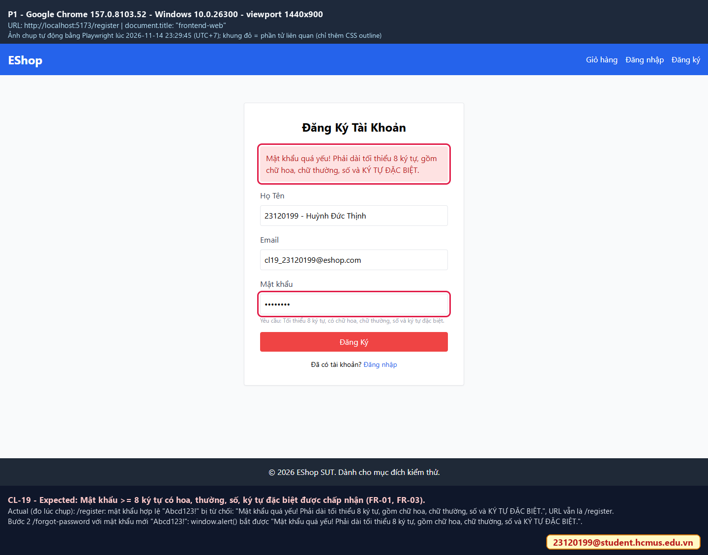
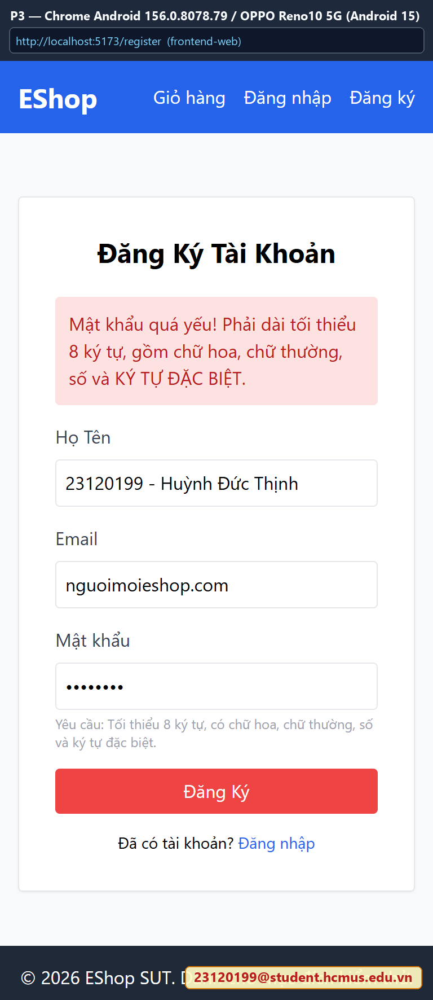

# [IA-02] [Register, ForgotPassword] Biểu thức chính quy mật khẩu bắt buộc khoảng trắng và từ chối toàn bộ ký tự đặc biệt hợp lệ (@ $ ! % * ? &)

## Summary
Biểu mẫu Đăng ký (`/register`) và Đặt lại mật khẩu Bước 2 (`/forgot-password`) sử dụng biểu thức chính quy mật khẩu bị lỗi logic (yêu cầu ký tự khoảng trắng `\s` và không cho phép các ký tự đặc biệt `@ $ ! % * ? &`), khiến mọi mật khẩu mạnh hợp lệ theo đặc tả `FR-01` và `FR-03` đều bị từ chối.

- **Bug ID:** `BUG-01`
- **Checklist item:** `CL-19`, `SV-08`, `SV-09`
- **Interface aspect:** `IA-02` — Forms
- **Màn hình:** Register (`/register`), ForgotPassword (`/forgot-password` — Bước 2)
- **Requirement:** FR-01 (eshop-sut/README.md:34); FR-03 (eshop-sut/README.md:58); Slide 10 #5 Field Limits
- **Loại lỗi:** `State`
- **Severity:** **Critical**
- **Priority:** **High**

## Environment
- **SUT:** `eshop-sut @ 1a9304a (repo HEAD 6b6a7a9)` (Web `http://localhost:5173`, Backend API `http://localhost:3000`)
- **P1:** Google Chrome 157.0.8103.50 trên Windows 11
- **P2:** Mozilla Firefox 137.0.1 trên Windows 11
- **P3:** Chrome Android 156.0.8078.79 trên OPPO Reno10 5G (Android 15, adb reverse)
- **URL kiểm thử:** `http://localhost:5173/register, http://localhost:5173/forgot-password`
- **Viewport:** Desktop `1440x900` (`P1`, `P2`); Mobile `360x801` / `1080x2412` (`P3`)

## Preconditions
Hệ thống Backend (port 3000) và Frontend Web (port 5173) đang hoạt động từ dữ liệu seed sạch. Ở ForgotPassword Bước 2, đã lấy mã OTP hợp lệ cho tài khoản `test@eshop.com`.

## Steps to reproduce
1. Truy cập trang Đăng ký tại `http://localhost:5173/register`.
2. Nhập Họ Tên hợp lệ (`23120199 - Huỳnh Đức Thịnh`) và Email mới chưa tồn tại (`sv08_23120199@eshop.com`).
3. Lần lượt thử nhập mật khẩu 8 ký tự hợp lệ theo đặc tả `Abcdef1!` và thử với từng ký tự trong tập (`@ $ ! % * ? &`): `Abcd123@`, `Abcd123$`, `Abcd123!`, `Abcd123%`, `Abcd123*`, `Abcd123?`, `Abcd123&`, sau đó bấm nút `Đăng Ký`.
4. Truy cập `http://localhost:5173/forgot-password`, nhập `test@eshop.com` bấm `Lấy mã OTP`, sang Bước 2 nhập mã OTP vừa nhận kèm mật khẩu mới `Abcd123!` rồi bấm `Đặt lại mật khẩu`.

## Expected result
Theo `FR-01` (`eshop-sut/README.md:34`) và `FR-03` (`eshop-sut/README.md:58`), mật khẩu từ 8 ký tự trở lên có ít nhất 1 chữ hoa, 1 chữ thường, 1 chữ số và 1 ký tự đặc biệt thuộc tập (`@ $ ! % * ? &`) phải được chấp nhận để tạo tài khoản và đặt lại mật khẩu thành công; mật khẩu 7 ký tự (`Abc12!x`) phải bị từ chối.

- **`CL-19`** (*Kiểm tra quy tắc mật khẩu mạnh theo đặc tả trên trang Đăng ký và Đặt lại mật khẩu* — căn cứ: `FR-01 (eshop-sut/README.md:34); FR-03 (eshop-sut/README.md:58)`): Khi nhập mật khẩu hợp lệ theo đặc tả (ví dụ `Abcd123!` gồm tối thiểu 8 ký tự, chữ hoa, chữ thường, số và ký tự đặc biệt thuộc `@ $ ! % * ? &`) trên /register và Bước 2 /forgot-password, form chấp nhận hợp lệ; khi thiếu một trong các nhóm ký tự trên thì từ chối. Fail nếu mật khẩu đúng chuẩn `Abcd123!` bị báo lỗi từ chối hoặc mật khẩu thiếu điều kiện vẫn vượt qua kiểm tra.
- **`SV-08`** (*Giá trị biên độ dài tối thiểu 8 ký tự của mật khẩu trên trang Đăng ký* — căn cứ: `FR-01 (eshop-sut/README.md:34); Slide 10 #5 Field Limits`): Mật khẩu `Abc12!x` (7 ký tự, đủ các nhóm) bị từ chối kèm thông báo lỗi; mật khẩu `Abc123!x` (8 ký tự, đủ các nhóm chữ hoa, chữ thường, số, ký tự đặc biệt) được chấp nhận và chuyển tới /login. Fail nếu mật khẩu 7 ký tự được chấp nhận hoặc mật khẩu 8 ký tự đạt đủ nhóm bị từ chối.
- **`SV-09`** (*Từng ký tự đặc biệt trong tập cho phép (@ $ ! % * ? &) được chấp nhận trong mật khẩu* — căn cứ: `FR-01 (eshop-sut/README.md:34)`): Cả 7 mật khẩu đều được chấp nhận (mỗi mật khẩu chứa đúng một ký tự đặc biệt thuộc tập `@ $ ! % * ? &`) và đăng ký thành công chuyển tới /login. Fail nếu bất kỳ mật khẩu nào trong 7 mật khẩu trên bị báo "quá yếu" hoặc bị từ chối dù thoả đủ điều kiện của đặc tả.

## Actual result
Tất cả các mật khẩu hợp lệ 8 ký tự chứa bất kỳ ký tự đặc biệt nào trong tập (`@ $ ! % * ? &`) như `Abcd123!` hoặc `Abcd123@` đều bị từ chối với thông báo lỗi mật khẩu yếu trên `/register` và hộp thoại `window.alert(...)` ở Bước 2 `/forgot-password` (do `Register.jsx:15` và `ForgotPassword.jsx:26` dùng regex `/^(?=.*[a-z])(?=.*[A-Z])(?=.*\d)(?=.*\s)[A-Za-z\d\s]{8,}$/`).

**Dữ kiện `Actual` nguyên văn theo từng mục và nền tảng:**
- **`CL-19` trên `P1`:** Actual: Mật khẩu hợp lệ chuẩn đặc tả "Abcd123!" bị từ chối trên cả /register ("Mật khẩu quá yếu! Phải dài tối thiểu 8 ký tự, gồm chữ hoa, chữ thường, số và KÝ TỰ ĐẶC BIỆT.") lẫn Bước 2 /forgot-password (alert "Mật khẩu quá yếu! Phải dài tối thiểu 8 ký tự, gồm chữ hoa, chữ thường, số và KÝ TỰ ĐẶC BIỆT.") do biểu thức chính quy lỗi trên client.
- **`CL-19` trên `P2`:** Actual: Mật khẩu hợp lệ chuẩn đặc tả "Abcd123!" bị từ chối trên cả /register ("Mật khẩu quá yếu! Phải dài tối thiểu 8 ký tự, gồm chữ hoa, chữ thường, số và KÝ TỰ ĐẶC BIỆT.") lẫn Bước 2 /forgot-password (alert "Mật khẩu quá yếu! Phải dài tối thiểu 8 ký tự, gồm chữ hoa, chữ thường, số và KÝ TỰ ĐẶC BIỆT.") do biểu thức chính quy lỗi trên client.
- **`CL-19` trên `P3`:** Actual: Mật khẩu hợp lệ chuẩn đặc tả "Abcd123!" bị từ chối trên cả /register ("Mật khẩu quá yếu! Phải dài tối thiểu 8 ký tự, gồm chữ hoa, chữ thường, số và KÝ TỰ ĐẶC BIỆT.") lẫn Bước 2 /forgot-password (alert "Mật khẩu quá yếu! Phải dài tối thiểu 8 ký tự, gồm chữ hoa, chữ thường, số và KÝ TỰ ĐẶC BIỆT.") do biểu thức chính quy lỗi trên client.
- **`SV-08` trên `P1`:** Actual: Mật khẩu 7 ký tự "Abc12!x" bị từ chối=true, nhưng mật khẩu biên hợp lệ 8 ký tự "Abc123!x" cũng bị từ chối kèm lỗi "Mật khẩu quá yếu! Phải dài tối thiểu 8 ký tự, gồm chữ hoa, chữ thường, số và KÝ TỰ ĐẶC BIỆT." (không chuyển tới /login).
- **`SV-08` trên `P2`:** Actual: Mật khẩu 7 ký tự "Abc12!x" bị từ chối=true, nhưng mật khẩu biên hợp lệ 8 ký tự "Abc123!x" cũng bị từ chối kèm lỗi "Mật khẩu quá yếu! Phải dài tối thiểu 8 ký tự, gồm chữ hoa, chữ thường, số và KÝ TỰ ĐẶC BIỆT." (không chuyển tới /login).
- **`SV-08` trên `P3`:** Actual: Mật khẩu 7 ký tự "Abc12!x" bị từ chối=true, nhưng mật khẩu biên hợp lệ 8 ký tự "Abc123!x" cũng bị từ chối kèm lỗi "Mật khẩu quá yếu! Phải dài tối thiểu 8 ký tự, gồm chữ hoa, chữ thường, số và KÝ TỰ ĐẶC BIỆT." (không chuyển tới /login).
- **`SV-09` trên `P1`:** Actual: Cả 7/7 mật khẩu chứa ký tự đặc biệt hợp lệ (Abcd123@, Abcd123$, Abcd123!, Abcd123%, Abcd123*, Abcd123?, Abcd123&) đều bị form /register từ chối với lỗi "Mật khẩu quá yếu!".
- **`SV-09` trên `P2`:** Actual: Cả 7/7 mật khẩu chứa ký tự đặc biệt hợp lệ (Abcd123@, Abcd123$, Abcd123!, Abcd123%, Abcd123*, Abcd123?, Abcd123&) đều bị form /register từ chối với lỗi "Mật khẩu quá yếu!".
- **`SV-09` trên `P3`:** Actual: Cả 7/7 mật khẩu chứa ký tự đặc biệt hợp lệ (Abcd123@, Abcd123$, Abcd123!, Abcd123%, Abcd123*, Abcd123?, Abcd123&) đều bị form /register từ chối với lỗi "Mật khẩu quá yếu!".

## Impact
Chặn đứng hoàn toàn luồng Đăng ký tài khoản mới (`FR-01`) và luồng Khôi phục mật khẩu (`FR-03`) đối với người dùng nhập mật khẩu đúng chuẩn đặc tả; người dùng không thể tự đoán rằng hệ thống đang đòi khoảng trắng thay vì ký tự đặc biệt.

## Reproducibility
Luôn luôn (100%) trên các nền tảng áp dụng: `P1`, `P2`, `P3`.

## Evidence

**Danh sách đầy đủ ảnh minh chứng theo nền tảng:**
- `CL-19` (`P1`): [`screenshots/task1_failed/P1_CL-19.png`](../screenshots/task1_failed/P1_CL-19.png)
- `CL-19` (`P2`): [`screenshots/task1_failed/P2_CL-19.png`](../screenshots/task1_failed/P2_CL-19.png)
- `CL-19` (`P3`): [`screenshots/task1_failed/P3_CL-19.png`](../screenshots/task1_failed/P3_CL-19.png)
- `SV-08` (`P1`): [`screenshots/task1_failed/P1_SV-08.png`](../screenshots/task1_failed/P1_SV-08.png)
- `SV-08` (`P2`): [`screenshots/task1_failed/P2_SV-08.png`](../screenshots/task1_failed/P2_SV-08.png)
- `SV-08` (`P3`): [`screenshots/task1_failed/P3_SV-08.png`](../screenshots/task1_failed/P3_SV-08.png)
- `SV-09` (`P1`): [`screenshots/task1_failed/P1_SV-09.png`](../screenshots/task1_failed/P1_SV-09.png)
- `SV-09` (`P2`): [`screenshots/task1_failed/P2_SV-09.png`](../screenshots/task1_failed/P2_SV-09.png)
- `SV-09` (`P3`): [`screenshots/task1_failed/P3_SV-09.png`](../screenshots/task1_failed/P3_SV-09.png)

## GitHub Issue
- **Issue:** [#1 — [HW03-M1] [BUG-01] [IA-02] [Register, ForgotPassword] Biểu thức chính quy mật khẩu bắt buộc khoảng trắng và từ chối toàn bộ ký tự đặc biệt hợp lệ (@ $ ! % * ? &)](https://github.com/HuynhDucThinh/Software-Testing-HW03/issues/1)
- **Ảnh chụp trang GitHub Issue:** [`screenshots/github_issues/ISSUE-01_BUG-01.png`](../screenshots/github_issues/ISSUE-01_BUG-01.png)
