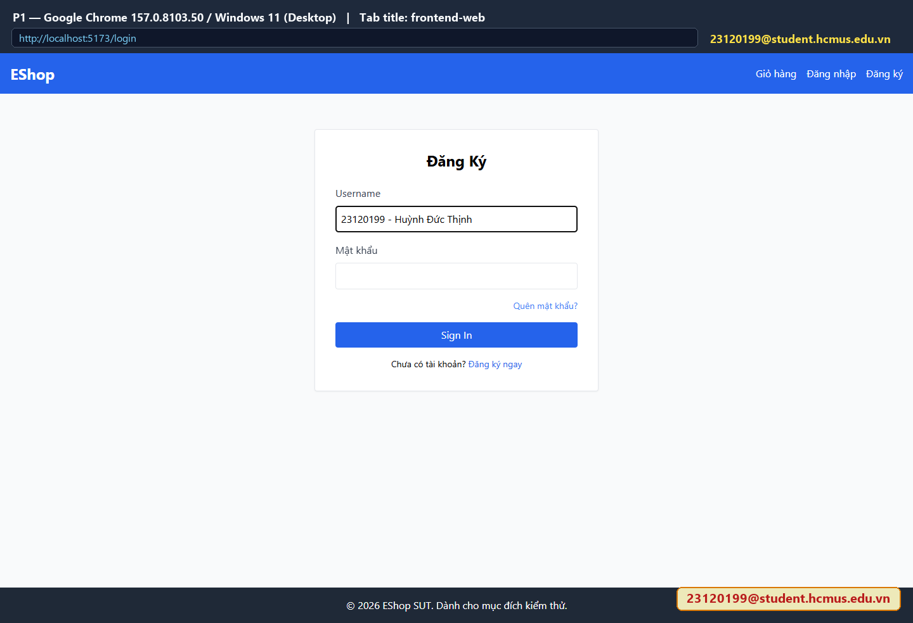

# [IA-04] [Register] Cho phép đăng ký trùng lặp địa chỉ Email đã tồn tại mà không kiểm tra duy nhất hay hiển thị thông báo lỗi

## Summary
Khi người dùng đăng ký tài khoản mới bằng địa chỉ email đã tồn tại trong hệ thống (`test@eshop.com`), hệ thống không từ chối và không hiển thị thông báo lỗi tiếng Việt mà vẫn trả về HTTP 200 tạo bản ghi trùng lặp và chuyển sang trang Đăng nhập.

- **Bug ID:** `BUG-02`
- **Checklist item:** `CL-32`
- **Interface aspect:** `IA-04` — Feedback / state
- **Màn hình:** Register (`/register`)
- **Requirement:** FR-01 (eshop-sut/README.md:33); FR-21 (eshop-sut/README.md:244); Slide 10 #15 Error Messages
- **Loại lỗi:** `State`
- **Severity:** **Critical**
- **Priority:** **High**

## Environment
- **SUT:** `eshop-sut @ 1a9304a (repo HEAD 6b6a7a9)` (Web `http://localhost:5173`, Backend API `http://localhost:3000`)
- **P1:** Google Chrome 157.0.8103.50 trên Windows 11
- **P2:** Mozilla Firefox 137.0.1 trên Windows 11
- **P3:** Chrome Android 156.0.8078.79 trên OPPO Reno10 5G (Android 15, adb reverse)
- **URL kiểm thử:** `http://localhost:5173/register`
- **Viewport:** Desktop `1440x900` (`P1`, `P2`); Mobile `360x801` / `1080x2412` (`P3`)

## Preconditions
CSDL đã có sẵn tài khoản seed mặc định với email `test@eshop.com`. Trạng thái chưa đăng nhập.

## Steps to reproduce
1. Mở trình duyệt truy cập `http://localhost:5173/register`.
2. Nhập Họ Tên: `23120199 - Huỳnh Đức Thịnh`, Email: `test@eshop.com` (email đã tồn tại), và Mật khẩu vượt qua bộ lọc hiện tại của form (`Abcd123 `).
3. Bấm nút `Đăng Ký` và quan sát phản hồi trên giao diện cùng tab Network.

## Expected result
Theo `FR-01` (`eshop-sut/README.md:33`) và `FR-21` (`eshop-sut/README.md:244`), mỗi địa chỉ email là duy nhất; khi đăng ký trùng email đã tồn tại, hệ thống phải giữ người dùng ở lại trang `/register` và hiển thị thông báo lỗi tiếng Việt rõ ràng (ví dụ: `Email đã được sử dụng`).

- **`CL-32`** (*Thông báo lỗi tiếng Việt thân thiện khi đăng ký bằng địa chỉ Email đã tồn tại* — căn cứ: `FR-01 (eshop-sut/README.md:33); FR-21 (eshop-sut/README.md:244); Slide 10 #15 Error Messages`): Khi gửi form đăng ký với Email trùng tài khoản đã tồn tại, giao diện từ chối đăng ký và hiển thị thông báo lỗi bằng tiếng Việt rõ ràng, thân thiện với người dùng cuối (ví dụ `Email này đã được đăng ký`). Fail nếu không hiển thị lỗi hoặc hiển thị nguyên văn mã lỗi kỹ thuật/CSDL bằng tiếng Anh (ví dụ `SQLITE_CONSTRAINT: UNIQUE constraint failed: users.email`).

## Actual result
API `POST /api/register` trả về HTTP 200 OK (do bảng `users` trong `database.js:53` thiếu ràng buộc `UNIQUE` cho cột `email` và `server.js:20` thực hiện `INSERT` trực tiếp không kiểm tra tồn tại), không hiển thị bất kỳ thông báo lỗi nào và chuyển hướng thẳng sang `/login`, gây trùng lặp bản ghi người dùng cùng email trong CSDL.

**Dữ kiện `Actual` nguyên văn theo từng mục và nền tảng:**
- **`CL-32` trên `P1`:** Actual: Khi gửi đăng ký với email đã tồn tại "test@eshop.com", hệ thống KHÔNG từ chối và KHÔNG hiện thông báo lỗi nào mà vẫn tạo trùng bản ghi trong CSDL rồi chuyển thẳng sang http://localhost:5173/login.
- **`CL-32` trên `P2`:** Actual: Khi gửi đăng ký với email đã tồn tại "test@eshop.com", hệ thống KHÔNG từ chối và KHÔNG hiện thông báo lỗi nào mà vẫn tạo trùng bản ghi trong CSDL rồi chuyển thẳng sang http://localhost:5173/login.
- **`CL-32` trên `P3`:** Actual: Khi gửi đăng ký với email đã tồn tại "test@eshop.com", hệ thống KHÔNG từ chối và KHÔNG hiện thông báo lỗi nào mà vẫn tạo trùng bản ghi trong CSDL rồi chuyển thẳng sang http://localhost:5173/login.

## Impact
Làm hỏng tính toàn vẹn định danh tài khoản người dùng (nhiều bản ghi trùng email trong bảng `users`), gây xung đột khi đăng nhập hoặc khôi phục mật khẩu bằng email đó.

## Reproducibility
Luôn luôn (100%) trên các nền tảng áp dụng: `P1`, `P2`, `P3`.

## Evidence

**Danh sách đầy đủ ảnh minh chứng theo nền tảng:**
- `CL-32` (`P1`): [`screenshots/task1_failed/P1_CL-32.png`](../screenshots/task1_failed/P1_CL-32.png)
- `CL-32` (`P2`): [`screenshots/task1_failed/P2_CL-32.png`](../screenshots/task1_failed/P2_CL-32.png)
- `CL-32` (`P3`): [`screenshots/task1_failed/P3_CL-32.png`](../screenshots/task1_failed/P3_CL-32.png)

## GitHub Issue
- **Issue:** [#2 — [HW03-M1] [BUG-02] [IA-04] [Register] Cho phép đăng ký trùng lặp địa chỉ Email đã tồn tại mà không kiểm tra duy nhất hay hiển thị thông báo lỗi](https://github.com/HuynhDucThinh/Software-Testing-HW03/issues/2)
- **Ảnh chụp trang GitHub Issue:** [`screenshots/github_issues/ISSUE-02_BUG-02.png`](../screenshots/github_issues/ISSUE-02_BUG-02.png)
