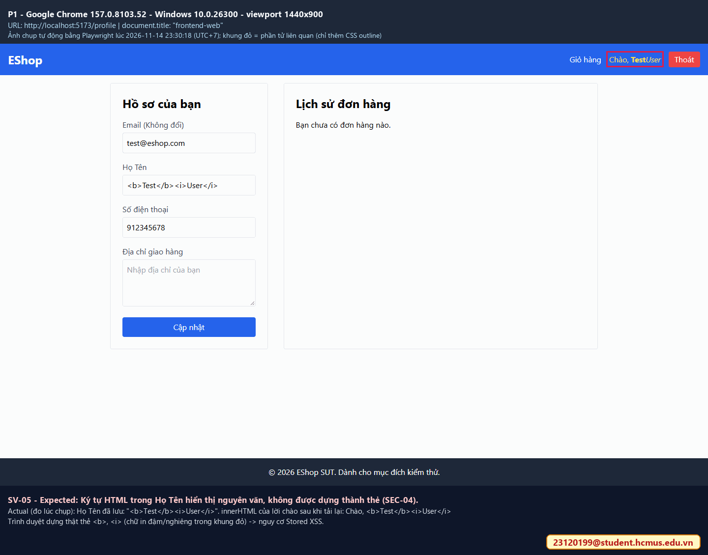

# [IA-04] [Header, Profile] Lỗ hổng Stored XSS ở lời chào trên Header do hiển thị Họ Tên qua dangerouslySetInnerHTML

## Summary
Thanh Header/Navbar render lời chào người dùng bằng thuộc tính `dangerouslySetInnerHTML` mà không escape ký tự đặc biệt HTML, khiến các thẻ HTML lưu trong trường Họ Tên được trình duyệt phân tích cú pháp và thực thi trực tiếp trên mọi trang.

- **Bug ID:** `BUG-03`
- **Checklist item:** `SV-05`
- **Interface aspect:** `IA-04` — Feedback / state
- **Màn hình:** Header/Navbar, Profile (`/profile`)
- **Requirement:** SEC-04 (eshop-sut/README.md:281)
- **Loại lỗi:** `State`
- **Severity:** **Critical**
- **Priority:** **High**

## Environment
- **SUT:** `eshop-sut @ 1a9304a (repo HEAD 6b6a7a9)` (Web `http://localhost:5173`, Backend API `http://localhost:3000`)
- **P1:** Google Chrome 157.0.8103.50 trên Windows 11
- **P2:** Mozilla Firefox 137.0.1 trên Windows 11
- **P3:** Chrome Android 156.0.8078.79 trên OPPO Reno10 5G (Android 15, adb reverse)
- **URL kiểm thử:** `http://localhost:5173/profile`
- **Viewport:** Desktop `1440x900` (`P1`, `P2`); Mobile `360x801` / `1080x2412` (`P3`)

## Preconditions
Đã đăng nhập bằng tài khoản người dùng hợp lệ hoặc đăng ký tài khoản có chứa thẻ HTML trong trường Họ Tên.

## Steps to reproduce
1. Đăng nhập vào hệ thống và truy cập `http://localhost:5173/profile` (hoặc đăng ký tài khoản mới tại `/register`).
2. Cập nhật trường Họ Tên thành chuỗi chứa thẻ HTML như `<b>Test</b><i>User</i>` (kèm SĐT hợp lệ theo bộ lọc hiện tại hoặc đăng nhập lại để đồng bộ state).
3. Tải lại trang hoặc đăng nhập lại và quan sát vùng lời chào `Chào, ...` ở góc phải thanh Header cùng cấu trúc DOM trong DevTools.

## Expected result
Theo `SEC-04` (`eshop-sut/README.md:281`), mọi dữ liệu do người dùng nhập khi hiển thị lại trên giao diện phải được mã hóa an toàn (escape HTML) dưới dạng văn bản thuần, không được sinh ra phần tử DOM con hay thực thi mã kịch bản.

- **`SV-05`** (*Hiển thị an toàn ký tự HTML trong Họ Tên ở lời chào trên Header* — căn cứ: `SEC-04 (eshop-sut/README.md:281)`): Lời chào trên Header hiển thị nguyên văn chuỗi `Chào, <b>Test</b><i>User</i>` dưới dạng văn bản thường (nhìn thấy cả các ký tự `<b>`), không in đậm hoặc in nghiêng phần tên. Fail nếu phần tên được trình duyệt dựng thành định dạng (in đậm, in nghiêng) hoặc thẻ HTML nhập vào bị thực thi.

## Actual result
Thanh Header (`App.jsx:27` dùng `dangerouslySetInnerHTML={{ __html: 'Chào, ' + user.name }}`) phân tích trực tiếp chuỗi HTML và tạo ra các thẻ phần tử thật `<b>Test</b>` và `<i>User</i>` bên trong thẻ chào mừng trên cả `P1`, `P2` và `P3`, mở ra lỗ hổng Stored XSS (ví dụ với payload ``).

**Dữ kiện `Actual` nguyên văn theo từng mục và nền tảng:**
- **`SV-05` trên `P1`:** Actual: Lời chào trên Header dùng dangerouslySetInnerHTML nên dựng trực tiếp 1 thẻ `<b>` (in đậm) và 1 thẻ `<i>` (in nghiêng) thành "Chào, TestUser" thay vì hiển thị văn bản thường (HTML thực tế: ``Chào, `<b>`Test`</b>``<i>`User`</i>```).
- **`SV-05` trên `P2`:** Actual: Lời chào trên Header dùng dangerouslySetInnerHTML nên dựng trực tiếp 1 thẻ `<b>` (in đậm) và 1 thẻ `<i>` (in nghiêng) thành "Chào, TestUser" thay vì hiển thị văn bản thường (HTML thực tế: ``Chào, `<b>`Test`</b>``<i>`User`</i>```).
- **`SV-05` trên `P3`:** Actual: Lời chào trên Header dùng dangerouslySetInnerHTML nên dựng trực tiếp 1 thẻ `<b>` (in đậm) và 1 thẻ `<i>` (in nghiêng) thành "Chào, TestUser" thay vì hiển thị văn bản thường (HTML thực tế: ``Chào, `<b>`Test`</b>``<i>`User`</i>```).

## Impact
Lỗ hổng bảo mật nghiêm trọng (Stored XSS) cho phép kẻ tấn công chèn mã độc JavaScript vào trường Họ Tên để đánh cắp token JWT lưu trong `localStorage` khi hiển thị trên trình duyệt.

## Reproducibility
Luôn luôn (100%) trên các nền tảng áp dụng: `P1`, `P2`, `P3`.

## Evidence

**Danh sách đầy đủ ảnh minh chứng theo nền tảng:**
- `SV-05` (`P1`): [`screenshots/task1_failed/P1_SV-05.png`](../screenshots/task1_failed/P1_SV-05.png)
- `SV-05` (`P2`): [`screenshots/task1_failed/P2_SV-05.png`](../screenshots/task1_failed/P2_SV-05.png)
- `SV-05` (`P3`): [`screenshots/task1_failed/P3_SV-05.png`](../screenshots/task1_failed/P3_SV-05.png)

## GitHub Issue
- **Issue:** [#3 — [HW03-M1] [BUG-03] [IA-04] [Header, Profile] Lỗ hổng Stored XSS ở lời chào trên Header do hiển thị Họ Tên qua dangerouslySetInnerHTML](https://github.com/HuynhDucThinh/Software-Testing-HW03/issues/3)
- **Ảnh chụp trang GitHub Issue:** [`screenshots/github_issues/ISSUE-03_BUG-03.png`](../screenshots/github_issues/ISSUE-03_BUG-03.png)
