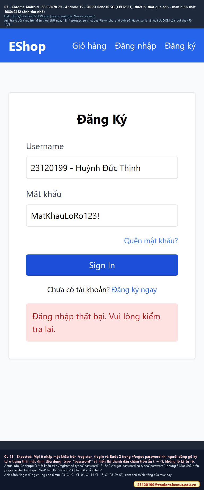

# [IA-02] [Login] Ô nhập Mật khẩu trên trang Đăng nhập dùng type='text' làm lộ toàn bộ ký tự mật khẩu trên màn hình

## Summary
Ô nhập `Mật khẩu` trên trang Đăng nhập (`/login`) được khai báo là `<input type="text">` thay vì `type="password"`, làm hiển thị công khai toàn bộ chuỗi mật khẩu người dùng đang gõ dưới dạng văn bản rõ.

- **Bug ID:** `BUG-04`
- **Checklist item:** `CL-15`
- **Interface aspect:** `IA-02` — Forms
- **Màn hình:** Login (`/login`)
- **Requirement:** FR-22 (eshop-sut/README.md:254)
- **Loại lỗi:** `Visual-Layout`
- **Severity:** **Critical**
- **Priority:** **High**

## Environment
- **SUT:** `eshop-sut @ 1a9304a (repo HEAD 6b6a7a9)` (Web `http://localhost:5173`, Backend API `http://localhost:3000`)
- **P1:** Google Chrome 157.0.8103.50 trên Windows 11
- **P2:** Mozilla Firefox trên Windows 11 (bản cài đặt `137.0.1` dùng để quan sát trực tiếp; nhân Gecko `159.0` bản Playwright dùng để đo DOM và chụp ảnh minh chứng)
- **P3:** Chrome Android 156.0.8078.79 trên OPPO Reno10 5G (Android 15, adb reverse)
- **URL kiểm thử:** `http://localhost:5173/login`
- **Viewport:** Desktop `1440x900` (`P1`, `P2`); Mobile `360x801` / `1080x2412` (`P3`)

## Preconditions
Người dùng chưa đăng nhập, mở trang Đăng nhập `http://localhost:5173/login`.

## Steps to reproduce
1. Truy cập trang Đăng nhập tại `http://localhost:5173/login`.
2. Nhấp vào ô nhập thứ hai có nhãn `Mật khẩu` và gõ chuỗi `Test1234!`.
3. Quan sát ký tự hiển thị trực tiếp trong ô nhập và kiểm tra thuộc tính `type` của thẻ `<input>` trong DevTools.

## Expected result
Theo `FR-22` (`eshop-sut/README.md:254`), tất cả các ô nhập mật khẩu bắt buộc sử dụng `type="password"` để che giấu ký tự nhập thành dấu chấm tròn hoặc dấu hoa thị.

- **`CL-15`** (*Che giấu ký tự nhập bằng type="password" ở tất cả các ô mật khẩu* — căn cứ: `FR-22 (eshop-sut/README.md:254)`): Mọi ô nhập mật khẩu trên /register, /login và Bước 2 trang /forgot-password khi người dùng gõ ký tự ở trạng thái mặc định đều dùng `type="password"` và hiển thị thành dấu chấm tròn ẩn (`••••`), không lộ ký tự rõ. Fail nếu bất kỳ ô mật khẩu nào dùng `type="text"` hoặc để lộ chuỗi mật khẩu đang gõ.

## Actual result
Trên `/login` (`Login.jsx:49`), ô `Mật khẩu` có thuộc tính `type="text"`, hiển thị nguyên văn chuỗi `Test1234!` không che giấu trên cả 3 nền tảng `P1`, `P2` và `P3` (trong khi `/register` và Bước 2 `/forgot-password` có dùng `type="password"`).

**Dữ kiện `Actual` nguyên văn theo từng mục và nền tảng:**
- **`CL-15` trên `P1`:** Actual: Ô Mật khẩu trên /register có type="password", Bước 2 /forgot-password có type="password", nhưng ô Mật khẩu trên /login lại khai báo type="text" làm lộ rõ toàn bộ ký tự mật khẩu khi gõ.
- **`CL-15` trên `P2`:** Actual: Ô Mật khẩu trên /register có type="password", Bước 2 /forgot-password có type="password", nhưng ô Mật khẩu trên /login lại khai báo type="text" làm lộ rõ toàn bộ ký tự mật khẩu khi gõ.
- **`CL-15` trên `P3`:** Actual: Ô Mật khẩu trên /register có type="password", Bước 2 /forgot-password có type="password", nhưng ô Mật khẩu trên /login lại khai báo type="text" làm lộ rõ toàn bộ ký tự mật khẩu khi gõ.

## Impact
Lộ trực tiếp mật khẩu của người dùng trên màn hình (nguy cơ nhìn trộm qua vai hoặc lộ khi chia sẻ màn hình) và làm giảm nghiêm trọng mức độ tin cậy của trang Đăng nhập.

## Reproducibility
Luôn luôn (100%) trên các nền tảng áp dụng: `P1`, `P2`, `P3`.

## Evidence

**Danh sách đầy đủ ảnh minh chứng theo nền tảng:**
- `CL-15` (`P1`): [`screenshots/task1_failed/P1_CL-15.png`](../screenshots/task1_failed/P1_CL-15.png)
- `CL-15` (`P2`): [`screenshots/task1_failed/P2_CL-15.png`](../screenshots/task1_failed/P2_CL-15.png)
- `CL-15` (`P3`): [`screenshots/task1_failed/P3_CL-15.png`](../screenshots/task1_failed/P3_CL-15.png)

## GitHub Issue
- **Issue:** [#4 — [HW03-M1] [BUG-04] [IA-02] [Login] Ô nhập Mật khẩu trên trang Đăng nhập dùng type='text' làm lộ toàn bộ ký tự mật khẩu trên màn hình](https://github.com/HuynhDucThinh/Software-Testing-HW03/issues/4)
- **Ảnh chụp trang GitHub Issue:** [`screenshots/github_issues/ISSUE-04_BUG-04.png`](../screenshots/github_issues/ISSUE-04_BUG-04.png)
