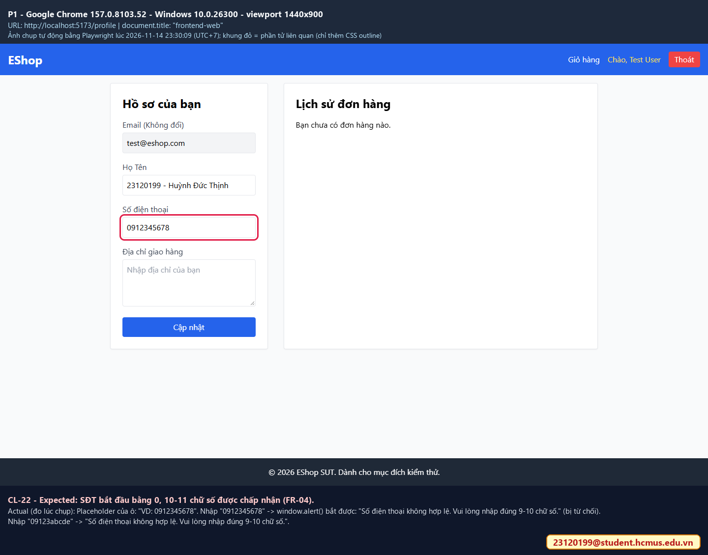
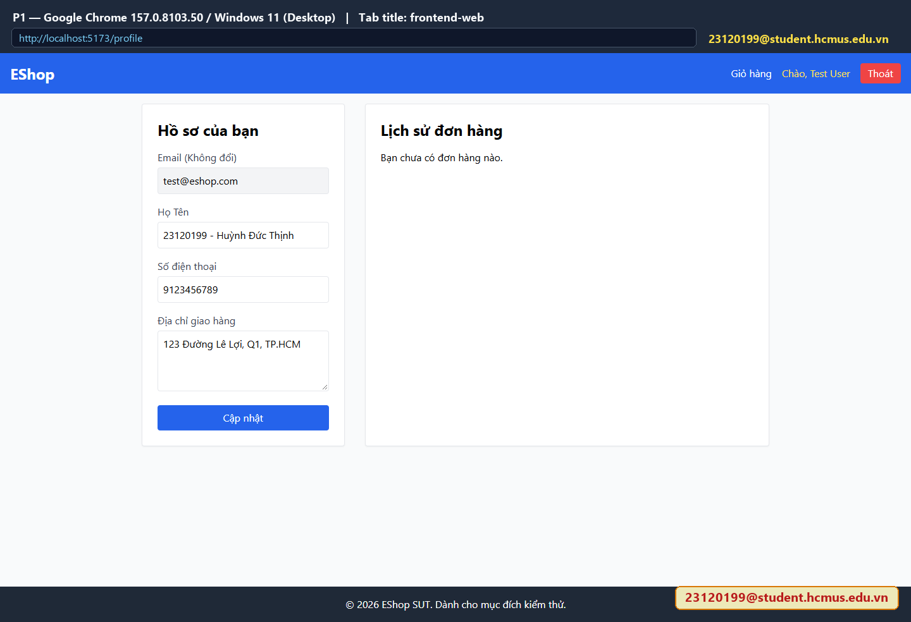

# [IA-02] [Profile] Kiểm tra Số điện thoại sai biểu thức chính quy: từ chối số hợp lệ bắt đầu bằng 0 nhưng chấp nhận số không có 0 đầu

## Summary
Biểu mẫu Hồ sơ cá nhân (`/profile`) kiểm tra Số điện thoại bằng regex `/^[1-9][0-9]{8,9}$/`, dẫn tới từ chối mọi số điện thoại Việt Nam hợp lệ bắt đầu bằng chữ số `0` (như `0912345678`) nhưng lại cho phép lưu số sai định dạng bắt đầu bằng `1-9` (như `9123456789`).

- **Bug ID:** `BUG-05`
- **Checklist item:** `CL-22`, `SV-10`
- **Interface aspect:** `IA-02` — Forms
- **Màn hình:** Profile (`/profile`)
- **Requirement:** FR-04 (eshop-sut/README.md:65); Slide 10 #5 Field Limits
- **Loại lỗi:** `State`
- **Severity:** **Critical**
- **Priority:** **High**

## Environment
- **SUT:** `eshop-sut @ 1a9304a (repo HEAD 6b6a7a9)` (Web `http://localhost:5173`, Backend API `http://localhost:3000`)
- **P1:** Google Chrome 157.0.8103.50 trên Windows 11
- **P2:** Mozilla Firefox 137.0.1 trên Windows 11
- **P3:** Chrome Android 156.0.8078.79 trên OPPO Reno10 5G (Android 15, adb reverse)
- **URL kiểm thử:** `http://localhost:5173/profile`
- **Viewport:** Desktop `1440x900` (`P1`, `P2`); Mobile `360x801` / `1080x2412` (`P3`)

## Preconditions
Đã đăng nhập bằng tài khoản `test@eshop.com` / `Test@1234` và đang ở trang `http://localhost:5173/profile`.

## Steps to reproduce
1. Tại khối `Hồ sơ của bạn` trên `http://localhost:5173/profile`, nhập Số điện thoại hợp lệ 10 chữ số bắt đầu bằng `0` là `0912345678` và bấm `Cập nhật`.
2. Đóng hộp thoại cảnh báo, tiếp tục thử nhập `09123456789` (11 chữ số bắt đầu bằng `0`) và bấm `Cập nhật`.
3. Thử nhập số sai chuẩn Việt Nam không bắt đầu bằng `0` là `9123456789` rồi bấm `Cập nhật`.

## Expected result
Theo `FR-04` (`eshop-sut/README.md:65`), Số điện thoại hợp lệ tại Việt Nam phải gồm 10-11 chữ số bắt đầu bằng chữ số `0` (`/^0\d{9,10}$/`): `0912345678` và `09123456789` phải được chấp nhận lưu thành công; `9123456789` (không bắt đầu bằng `0`) và biên 9 chữ số (`091234567`) / 12 chữ số (`091234567890`) phải bị từ chối.

- **`CL-22`** (*Kiểm tra định dạng Số điện thoại hợp lệ bắt đầu bằng số 0 trên trang Hồ sơ* — căn cứ: `FR-04 (eshop-sut/README.md:65)`): Khi nhập Số điện thoại bắt đầu bằng `0` có từ 10 đến 11 chữ số (ví dụ `0912345678` khớp với chính placeholder gợi ý trên form) và bấm `Cập nhật`, hệ thống chấp nhận lưu thành công; khi nhập chuỗi chứa chữ cái thì từ chối. Fail nếu số điện thoại hợp lệ bắt đầu bằng `0` (10 hoặc 11 chữ số) bị báo lỗi không hợp lệ hoặc chuỗi chứa chữ cái vẫn lưu thành công.
- **`SV-10`** (*Giá trị biên độ dài và chữ số đầu của Số điện thoại trên trang Hồ sơ* — căn cứ: `FR-04 (eshop-sut/README.md:65); Slide 10 #5 Field Limits`): SĐT `091234567` (9 chữ số), `091234567890` (12 chữ số) và `9123456789` (10 chữ số nhưng không bắt đầu bằng 0) bị từ chối kèm thông báo lỗi; hệ thống chỉ chấp nhận SĐT bắt đầu bằng `0` và có 10 hoặc 11 chữ số. Fail nếu bất kỳ giá trị nào trong ba giá trị trên được lưu thành công.

## Actual result
Các số điện thoại hợp lệ bắt đầu bằng `0` (`0912345678` và `09123456789`) đều bị chặn bởi `window.alert('Số điện thoại không hợp lệ!')` và không gửi `PUT` request; ngược lại, số sai chuẩn không bắt đầu bằng `0` (`9123456789`) lại vượt qua kiểm tra (`Profile.jsx:43` dùng `/^[1-9][0-9]{8,9}$/`) và báo `Cập nhật thành công!`.

**Dữ kiện `Actual` nguyên văn theo từng mục và nền tảng:**
- **`CL-22` trên `P1`:** Actual: Nhập SĐT hợp lệ chuẩn Việt Nam "0912345678" (khớp chính placeholder form) bị từ chối với hộp thoại alert "Số điện thoại không hợp lệ. Vui lòng nhập đúng 9-10 chữ số."; chuỗi chữ cái "09123abcde" báo "Số điện thoại không hợp lệ. Vui lòng nhập đúng 9-10 chữ số.".
- **`CL-22` trên `P2`:** Actual: Nhập SĐT hợp lệ chuẩn Việt Nam "0912345678" (khớp chính placeholder form) bị từ chối với hộp thoại alert "Số điện thoại không hợp lệ. Vui lòng nhập đúng 9-10 chữ số."; chuỗi chữ cái "09123abcde" báo "Số điện thoại không hợp lệ. Vui lòng nhập đúng 9-10 chữ số.".
- **`CL-22` trên `P3`:** Actual: Nhập SĐT hợp lệ chuẩn Việt Nam "0912345678" (khớp chính placeholder form) bị từ chối với hộp thoại alert "Số điện thoại không hợp lệ. Vui lòng nhập đúng 9-10 chữ số."; chuỗi chữ cái "09123abcde" báo "Số điện thoại không hợp lệ. Vui lòng nhập đúng 9-10 chữ số.".
- **`SV-10` trên `P1`:** Actual: Thử 3 giá trị biên SĐT không hợp lệ trên /profile: "091234567" -> "Số điện thoại không hợp lệ. Vui lòng nhập đúng 9-10 chữ số."; "091234567890" -> "Số điện thoại không hợp lệ. Vui lòng nhập đúng 9-10 chữ số."; riêng "9123456789" (không bắt đầu bằng số 0) lại được lưu thành công ("Cập nhật thành công!").
- **`SV-10` trên `P2`:** Actual: Thử 3 giá trị biên SĐT không hợp lệ trên /profile: "091234567" -> "Số điện thoại không hợp lệ. Vui lòng nhập đúng 9-10 chữ số."; "091234567890" -> "Số điện thoại không hợp lệ. Vui lòng nhập đúng 9-10 chữ số."; riêng "9123456789" (không bắt đầu bằng số 0) lại được lưu thành công ("Cập nhật thành công!").
- **`SV-10` trên `P3`:** Actual: Thử 3 giá trị biên SĐT không hợp lệ trên /profile: "091234567" -> "Số điện thoại không hợp lệ. Vui lòng nhập đúng 9-10 chữ số."; "091234567890" -> "Số điện thoại không hợp lệ. Vui lòng nhập đúng 9-10 chữ số."; riêng "9123456789" (không bắt đầu bằng số 0) lại được lưu thành công ("Cập nhật thành công!").

## Impact
Chặn hoàn toàn người dùng thật cập nhật số điện thoại liên lạc hợp lệ của Việt Nam trong luồng Hồ sơ cá nhân (`FR-04` / luồng `F1`), buộc người dùng phải bỏ số `0` đầu mới lưu được.

## Reproducibility
Luôn luôn (100%) trên các nền tảng áp dụng: `P1`, `P2`, `P3`.

## Evidence

**Danh sách đầy đủ ảnh minh chứng theo nền tảng:**
- `CL-22` (`P1`): [`screenshots/task1_failed/P1_CL-22.png`](../screenshots/task1_failed/P1_CL-22.png)
- `CL-22` (`P2`): [`screenshots/task1_failed/P2_CL-22.png`](../screenshots/task1_failed/P2_CL-22.png)
- `CL-22` (`P3`): [`screenshots/task1_failed/P3_CL-22.png`](../screenshots/task1_failed/P3_CL-22.png)
- `SV-10` (`P1`): [`screenshots/task1_failed/P1_SV-10.png`](../screenshots/task1_failed/P1_SV-10.png)
- `SV-10` (`P2`): [`screenshots/task1_failed/P2_SV-10.png`](../screenshots/task1_failed/P2_SV-10.png)
- `SV-10` (`P3`): [`screenshots/task1_failed/P3_SV-10.png`](../screenshots/task1_failed/P3_SV-10.png)

## GitHub Issue
- **Issue:** [#5 — [HW03-M1] [BUG-05] [IA-02] [Profile] Kiểm tra Số điện thoại sai biểu thức chính quy: từ chối số hợp lệ bắt đầu bằng 0 nhưng chấp nhận số không có 0 đầu](https://github.com/HuynhDucThinh/Software-Testing-HW03/issues/5)
- **Ảnh chụp trang GitHub Issue:** [`screenshots/github_issues/ISSUE-05_BUG-05.png`](../screenshots/github_issues/ISSUE-05_BUG-05.png)
