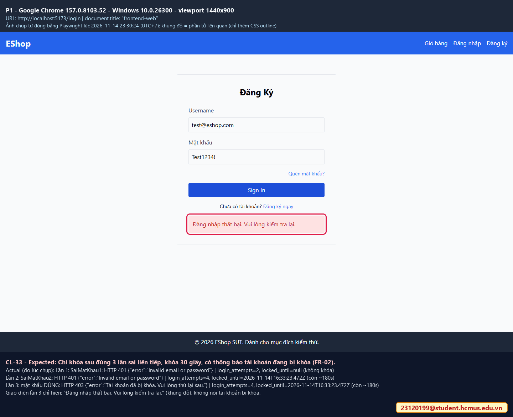

# [IA-04] [Login] Khóa tài khoản sớm ngay sau 2 lần nhập sai mật khẩu trong 180 giây và không hiển thị thông báo tài khoản đang bị khóa

## Summary
Hệ thống khóa tài khoản ngay sau 2 lần đăng nhập sai liên tiếp (thay vì 3 lần) với thời gian khóa 180 giây (thay vì 30 giây), đồng thời giao diện `/login` chỉ báo chung chung `Đăng nhập thất bại...` chứ không cho người dùng biết tài khoản đã bị khóa tạm thời.

- **Bug ID:** `BUG-06`
- **Checklist item:** `CL-33`
- **Interface aspect:** `IA-04` — Feedback / state
- **Màn hình:** Login (`/login`)
- **Requirement:** FR-02 (eshop-sut/README.md:41-42)
- **Loại lỗi:** `State`
- **Severity:** **Major**
- **Priority:** **High**

## Environment
- **SUT:** `eshop-sut @ 1a9304a (repo HEAD 6b6a7a9)` (Web `http://localhost:5173`, Backend API `http://localhost:3000`)
- **P1:** Google Chrome 157.0.8103.50 trên Windows 11
- **P2:** Mozilla Firefox 137.0.1 trên Windows 11
- **P3:** Chrome Android 156.0.8078.79 trên OPPO Reno10 5G (Android 15, adb reverse)
- **URL kiểm thử:** `http://localhost:5173/login`
- **Viewport:** Desktop `1440x900` (`P1`, `P2`); Mobile `360x801` / `1080x2412` (`P3`)

## Preconditions
CSDL vừa khởi tạo sạch, tài khoản `test@eshop.com` có `login_attempts = 0`.

## Steps to reproduce
1. Truy cập `http://localhost:5173/login`, nhập Username `test@eshop.com` và mật khẩu sai `WrongPass1`, bấm `Sign In` (lần sai 1).
2. Tiếp tục bấm `Sign In` với mật khẩu sai `WrongPass2` (lần sai 2).
3. Ở lần thứ 3, nhập đúng mật khẩu hợp lệ `Test@1234` và bấm `Sign In`, đồng thời quan sát mã phản hồi HTTP trong tab Network và nội dung thông báo lỗi trên giao diện.

## Expected result
Theo `FR-02` (`eshop-sut/README.md:41-42`), tài khoản chỉ bị khóa tạm thời sau đúng 3 lần đăng nhập thất bại liên tiếp (tức lần thứ 3 nhập đúng vẫn phải đăng nhập thành công), thời gian khóa là 30 giây, và khi bị khóa giao diện phải hiển thị thông báo nêu rõ trạng thái khóa tạm thời.

- **`CL-33`** (*Khóa tạm thời tài khoản 30 giây kèm thông báo phù hợp sau đúng 3 lần đăng nhập sai liên tiếp* — căn cứ: `FR-02 (eshop-sut/README.md:41-42)`): Ở lần nhập sai thứ 1 và thứ 2 trên `/login`, tài khoản chưa bị khóa (nếu nhập đúng mật khẩu ở lần kế sẽ vào được); từ lần nhập sai thứ 3 liên tiếp, tài khoản bị tạm khóa trong đúng 30 giây, giao diện hiển thị thông báo cho biết tài khoản đang bị tạm khóa, và cho phép đăng nhập lại sau khi hết 30 giây. Fail nếu tài khoản bị khóa sớm hơn 3 lần sai (ví dụ khóa ngay sau lần sai thứ 2), không hiển thị thông báo bị khóa trên giao diện, hoặc thời gian khóa thực tế lệch quá 5 giây so với 30 giây.

## Actual result
Ngay ở lần thử thứ 3 dù nhập đúng `Test@1234`, API `POST /api/login` đã trả về HTTP 403 `Account locked. Try again later.` (do `server.js:54` cộng `login_attempts + 2` mỗi lần sai và đặt `lock_until = Date.now() + 180000` ms = 180 giây). Giao diện `Login.jsx:27` bắt chung khối `catch` nên vẫn chỉ hiện `Đăng nhập thất bại. Vui lòng kiểm tra lại thông tin.`, không hề báo tài khoản đang bị khóa.

**Dữ kiện `Actual` nguyên văn theo từng mục và nền tảng:**
- **`CL-33` trên `P1`:** Actual: Tài khoản bị khoá ngay sau lần nhập sai thứ 2 (login_attempts tăng +2 mỗi lần: lần 1=2, lần 2=4), thời gian khoá thực tế ~180 giây (thay vì 30 giây), và khi bị khoá (HTTP 403: "Tài khoản đã bị khóa. Vui lòng thử lại sau.") giao diện /login vẫn chỉ hiện "Đăng nhập thất bại. Vui lòng kiểm tra lại." chứ không báo tài khoản đang bị tạm khoá.
- **`CL-33` trên `P2`:** Actual: Tài khoản bị khoá ngay sau lần nhập sai thứ 2 (login_attempts tăng +2 mỗi lần: lần 1=2, lần 2=4), thời gian khoá thực tế ~180 giây (thay vì 30 giây), và khi bị khoá (HTTP 403: "Tài khoản đã bị khóa. Vui lòng thử lại sau.") giao diện /login vẫn chỉ hiện "Đăng nhập thất bại. Vui lòng kiểm tra lại." chứ không báo tài khoản đang bị tạm khoá.
- **`CL-33` trên `P3`:** Actual: Tài khoản bị khoá ngay sau lần nhập sai thứ 2 (login_attempts tăng +2 mỗi lần: lần 1=2, lần 2=4), thời gian khoá thực tế ~180 giây (thay vì 30 giây), và khi bị khoá (HTTP 403: "Tài khoản đã bị khóa. Vui lòng thử lại sau.") giao diện /login vẫn chỉ hiện "Đăng nhập thất bại. Vui lòng kiểm tra lại." chứ không báo tài khoản đang bị tạm khoá.

## Impact
Người dùng chỉ gõ nhầm mật khẩu 2 lần đã bị khóa cứng suốt 3 phút và khi gõ lại mật khẩu đúng vẫn thấy báo sai thông tin, dẫn đến hoang mang tưởng mất mật khẩu.

## Reproducibility
Luôn luôn (100%) trên các nền tảng áp dụng: `P1`, `P2`, `P3`.

## Evidence

**Danh sách đầy đủ ảnh minh chứng theo nền tảng:**
- `CL-33` (`P1`): [`screenshots/task1_failed/P1_CL-33.png`](../screenshots/task1_failed/P1_CL-33.png)
- `CL-33` (`P2`): [`screenshots/task1_failed/P2_CL-33.png`](../screenshots/task1_failed/P2_CL-33.png)
- `CL-33` (`P3`): [`screenshots/task1_failed/P3_CL-33.png`](../screenshots/task1_failed/P3_CL-33.png)

## GitHub Issue
- **Issue:** [#6 — [HW03-M1] [BUG-06] [IA-04] [Login] Khóa tài khoản sớm ngay sau 2 lần nhập sai mật khẩu trong 180 giây và không hiển thị thông báo tài khoản đang bị khóa](https://github.com/HuynhDucThinh/Software-Testing-HW03/issues/6)
- **Ảnh chụp trang GitHub Issue:** [`screenshots/github_issues/ISSUE-06_BUG-06.png`](../screenshots/github_issues/ISSUE-06_BUG-06.png)
