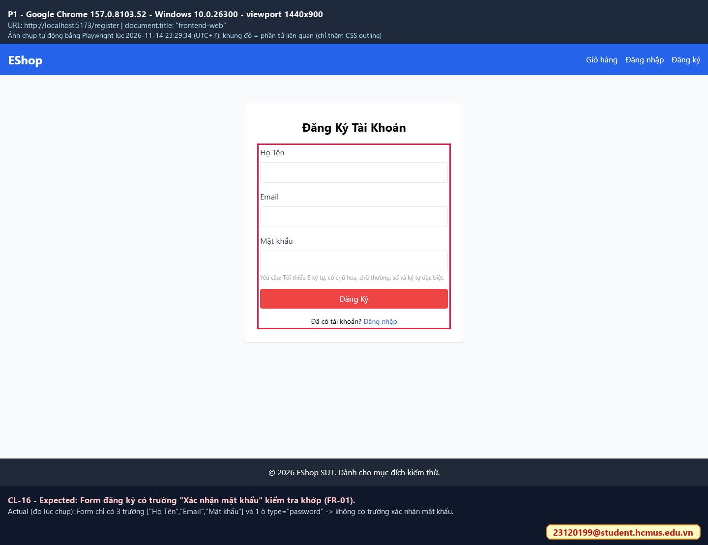
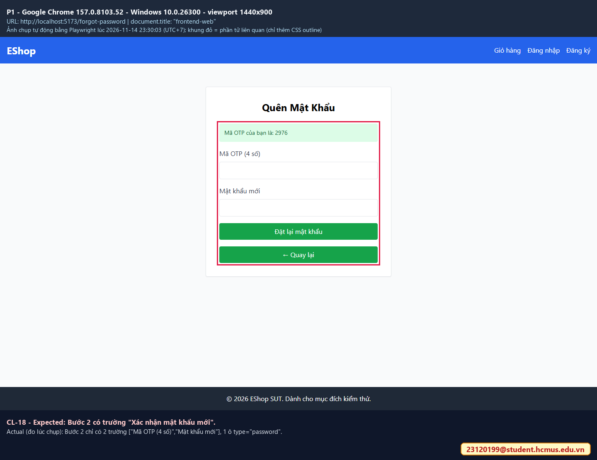

# [IA-02] [Register, ForgotPassword] Biểu mẫu Đăng ký và Đặt lại mật khẩu (Bước 2) thiếu hoàn toàn trường Xác nhận mật khẩu

## Summary
Cả trang Đăng ký (`/register`) lẫn Bước 2 trang Quên mật khẩu (`/forgot-password`) đều không có ô nhập `Xác nhận mật khẩu` / `Xác nhận mật khẩu mới`, trái với đặc tả `FR-01` và `FR-03`.

- **Bug ID:** `BUG-07`
- **Checklist item:** `CL-16`, `CL-18`
- **Interface aspect:** `IA-02` — Forms
- **Màn hình:** Register (`/register`), ForgotPassword (`/forgot-password` — Bước 2)
- **Requirement:** FR-01 (eshop-sut/README.md:35); FR-03 (eshop-sut/README.md:57-59)
- **Loại lỗi:** `State`
- **Severity:** **Major**
- **Priority:** **High**

## Environment
- **SUT:** `eshop-sut @ 1a9304a (repo HEAD 6b6a7a9)` (Web `http://localhost:5173`, Backend API `http://localhost:3000`)
- **P1:** Google Chrome 157.0.8103.50 trên Windows 11
- **P2:** Mozilla Firefox trên Windows 11 (bản cài đặt `137.0.1` dùng để quan sát trực tiếp; nhân Gecko `159.0` bản Playwright dùng để đo DOM và chụp ảnh minh chứng)
- **P3:** Chrome Android 156.0.8078.79 trên OPPO Reno10 5G (Android 15, adb reverse)
- **URL kiểm thử:** `http://localhost:5173/register, http://localhost:5173/forgot-password`
- **Viewport:** Desktop `1440x900` (`P1`, `P2`); Mobile `360x801` / `1080x2412` (`P3`)

## Preconditions
Truy cập trang `/register` và Bước 2 trang `/forgot-password` (sau khi lấy OTP cho `test@eshop.com`).

## Steps to reproduce
1. Mở `http://localhost:5173/register` và kiểm tra toàn bộ các trường nhập liệu hiện có trong form.
2. Mở `http://localhost:5173/forgot-password`, nhập `test@eshop.com` bấm `Lấy mã OTP` để chuyển sang Bước 2 và kiểm tra toàn bộ các trường nhập liệu.

## Expected result
Theo `FR-01` (`eshop-sut/README.md:35`), biểu mẫu Đăng ký phải có trường `Xác nhận mật khẩu` kiểm tra khớp với `Mật khẩu`. Theo `FR-03` (`eshop-sut/README.md:57-59`), Bước 2 Quên mật khẩu phải có 3 trường gồm `Mã OTP`, `Mật khẩu mới` và `Xác nhận mật khẩu mới`.

- **`CL-16`** (*Sự tồn tại và kiểm tra khớp của trường Xác nhận mật khẩu trên trang Đăng ký* — căn cứ: `FR-01 (eshop-sut/README.md:35)`): Form /register hiển thị trường `Xác nhận mật khẩu` (`type="password"`) nằm dưới trường `Mật khẩu`; khi nhập hai giá trị khác nhau và bấm `Đăng Ký`, hệ thống chặn gửi và hiển thị thông báo lỗi không khớp. Fail nếu form không có trường `Xác nhận mật khẩu` hoặc vẫn cho phép đăng ký khi hai trường khác giá trị.
- **`CL-18`** (*Sự tồn tại và kiểm tra khớp của trường Xác nhận mật khẩu mới ở Bước 2 Quên mật khẩu* — căn cứ: `FR-03 (eshop-sut/README.md:57-59)`): Form Bước 2 trên /forgot-password hiển thị đầy đủ 3 trường: `OTP`, `Mật khẩu mới` và `Xác nhận mật khẩu mới`; khi nhập `Xác nhận mật khẩu mới` khác với `Mật khẩu mới` và bấm `Đặt lại mật khẩu`, hệ thống từ chối và báo lỗi. Fail nếu thiếu trường `Xác nhận mật khẩu mới` hoặc hệ thống chấp nhận đặt lại khi hai mật khẩu không khớp.

## Actual result
Trang `/register` chỉ có 3 ô nhập (`Họ Tên`, `Email`, `Mật khẩu` — chỉ có 1 ô `type="password"`). Bước 2 trang `/forgot-password` chỉ có 2 ô nhập (`Mã OTP`, `Mật khẩu mới` — chỉ có 1 ô `type="password"`). Hoàn toàn thiếu trường xác nhận mật khẩu ở cả hai luồng.

**Dữ kiện `Actual` nguyên văn theo từng mục và nền tảng:**
- **`CL-16` trên `P1`:** Actual: Form /register chỉ có 3 trường ["Họ Tên","Email","Mật khẩu"] (1 ô type="password"), hoàn toàn không có trường "Xác nhận mật khẩu".
- **`CL-16` trên `P2`:** Actual: Form /register chỉ có 3 trường ["Họ Tên","Email","Mật khẩu"] (1 ô type="password"), hoàn toàn không có trường "Xác nhận mật khẩu".
- **`CL-16` trên `P3`:** Actual: Form /register chỉ có 3 trường ["Họ Tên","Email","Mật khẩu"] (1 ô type="password"), hoàn toàn không có trường "Xác nhận mật khẩu".
- **`CL-18` trên `P1`:** Actual: Bước 2 trang /forgot-password chỉ có 2 trường ["Mã OTP (4 số)","Mật khẩu mới"], thiếu trường "Xác nhận mật khẩu mới".
- **`CL-18` trên `P2`:** Actual: Bước 2 trang /forgot-password chỉ có 2 trường ["Mã OTP (4 số)","Mật khẩu mới"], thiếu trường "Xác nhận mật khẩu mới".
- **`CL-18` trên `P3`:** Actual: Bước 2 trang /forgot-password chỉ có 2 trường ["Mã OTP (4 số)","Mật khẩu mới"], thiếu trường "Xác nhận mật khẩu mới".

## Impact
Người dùng gõ nhầm ký tự trong ô mật khẩu bị che (`type="password"`) sẽ không được cảnh báo lệch mật khẩu, dẫn tới tạo tài khoản hoặc đặt lại mật khẩu bằng chuỗi không như ý và không đăng nhập lại được.

## Reproducibility
Luôn luôn (100%) trên các nền tảng áp dụng: `P1`, `P2`, `P3`.

## Evidence

**Danh sách đầy đủ ảnh minh chứng theo nền tảng:**
- `CL-16` (`P1`): [`screenshots/task1_failed/P1_CL-16.png`](../screenshots/task1_failed/P1_CL-16.png)
- `CL-16` (`P2`): [`screenshots/task1_failed/P2_CL-16.png`](../screenshots/task1_failed/P2_CL-16.png)
- `CL-16` (`P3`): [`screenshots/task1_failed/P3_CL-16.png`](../screenshots/task1_failed/P3_CL-16.png)
- `CL-18` (`P1`): [`screenshots/task1_failed/P1_CL-18.png`](../screenshots/task1_failed/P1_CL-18.png)
- `CL-18` (`P2`): [`screenshots/task1_failed/P2_CL-18.png`](../screenshots/task1_failed/P2_CL-18.png)
- `CL-18` (`P3`): [`screenshots/task1_failed/P3_CL-18.png`](../screenshots/task1_failed/P3_CL-18.png)

## GitHub Issue
- **Issue:** [#7 — [HW03-M1] [BUG-07] [IA-02] [Register, ForgotPassword] Biểu mẫu Đăng ký và Đặt lại mật khẩu (Bước 2) thiếu hoàn toàn trường Xác nhận mật khẩu](https://github.com/HuynhDucThinh/Software-Testing-HW03/issues/7)
- **Ảnh chụp trang GitHub Issue:** [`screenshots/github_issues/ISSUE-07_BUG-07.png`](../screenshots/github_issues/ISSUE-07_BUG-07.png)
