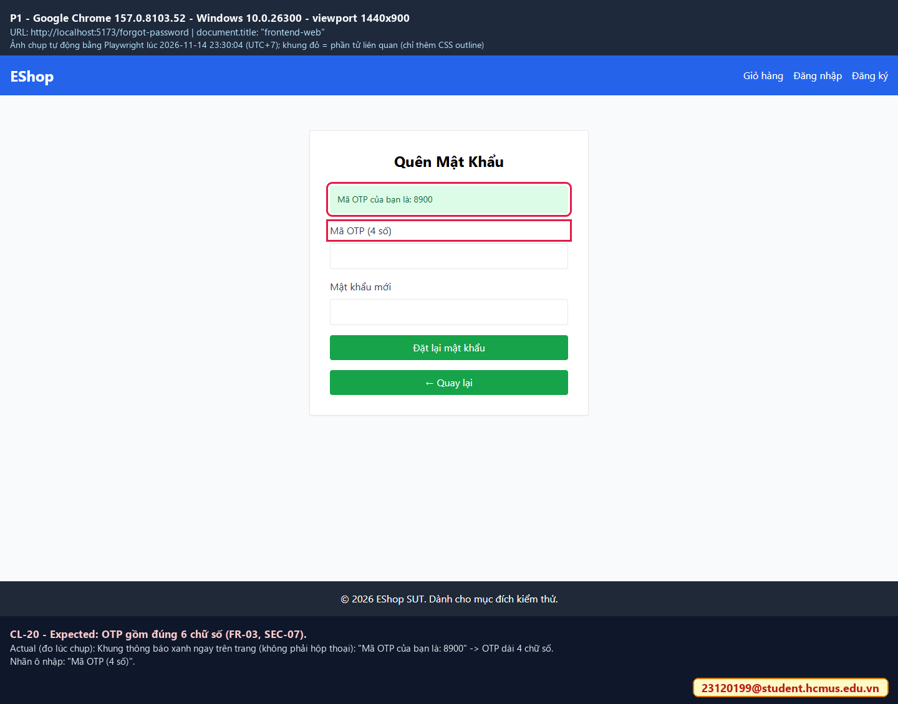

# [IA-02] [ForgotPassword] Mã OTP khôi phục mật khẩu chỉ sinh 4 chữ số thay vì 6 chữ số theo đặc tả FR-03 và SEC-07

## Summary
Khi yêu cầu mã OTP khôi phục mật khẩu, Backend và hộp thoại thông báo trên Frontend chỉ sinh mã OTP gồm 4 chữ số (`1000-9999`) và ô nhập OTP ở Bước 2 không giới hạn độ dài 6 chữ số theo đặc tả `FR-03` và `SEC-07`.

- **Bug ID:** `BUG-08`
- **Checklist item:** `CL-20`
- **Interface aspect:** `IA-02` — Forms
- **Màn hình:** ForgotPassword (`/forgot-password`)
- **Requirement:** FR-03 (eshop-sut/README.md:51); SEC-07 (eshop-sut/README.md:284); Slide 10 #5 Field Limits
- **Loại lỗi:** `State`
- **Severity:** **Major**
- **Priority:** **High**

## Environment
- **SUT:** `eshop-sut @ 1a9304a (repo HEAD 6b6a7a9)` (Web `http://localhost:5173`, Backend API `http://localhost:3000`)
- **P1:** Google Chrome 157.0.8103.50 trên Windows 11
- **P2:** Mozilla Firefox 137.0.1 trên Windows 11
- **P3:** Chrome Android 156.0.8078.79 trên OPPO Reno10 5G (Android 15, adb reverse)
- **URL kiểm thử:** `http://localhost:5173/forgot-password`
- **Viewport:** Desktop `1440x900` (`P1`, `P2`); Mobile `360x801` / `1080x2412` (`P3`)

## Preconditions
Tài khoản `test@eshop.com` tồn tại trong CSDL.

## Steps to reproduce
1. Truy cập `http://localhost:5173/forgot-password`.
2. Nhập `test@eshop.com` vào ô Email và bấm `Lấy mã OTP`.
3. Quan sát mã OTP hiển thị trên hộp thoại thông báo và kiểm tra các thuộc tính `maxLength`/`pattern` của ô `Mã OTP` ở Bước 2.

## Expected result
Theo `FR-03` (`eshop-sut/README.md:51`) và `SEC-07` (`eshop-sut/README.md:284`), mã OTP dùng một lần phải gồm đúng 6 chữ số ngẫu nhiên (ví dụ `482910`), và trường nhập OTP cần gợi ý/kiểm tra độ dài 6 chữ số.

- **`CL-20`** (*Độ dài 6 chữ số của mã OTP và nhãn trường OTP ở Bước 2 Quên mật khẩu* — căn cứ: `FR-03 (eshop-sut/README.md:51); SEC-07 (eshop-sut/README.md:284); Slide 10 #5 Field Limits`): Mã OTP demo hiển thị ở Bước 2 gồm đúng 6 chữ số ngẫu nhiên và nhãn/gợi ý của ô nhập OTP mô tả đúng mã 6 chữ số. Fail nếu mã OTP sinh ra có ít hơn 6 chữ số (ví dụ chỉ có 4 chữ số) hoặc nhãn ô nhập ghi sai độ dài mã OTP.

## Actual result
Hộp thoại `alert` hiển thị mã OTP chỉ có 4 chữ số (ví dụ `Mã OTP của bạn là: 4823` do `server.js:72` tính `Math.floor(1000 + Math.random() * 9000)`), đồng thời ô `Mã OTP` ở Bước 2 có `maxLength = -1`, `pattern = ''` không kiểm tra định dạng 6 chữ số.

**Dữ kiện `Actual` nguyên văn theo từng mục và nền tảng:**
- **`CL-20` trên `P1`:** Actual: Hệ thống chỉ sinh mã OTP gồm 4 chữ số ("Mã OTP của bạn là: 5017") và nhãn ô nhập ghi "Mã OTP (4 số)" thay vì 6 chữ số.
- **`CL-20` trên `P2`:** Actual: Hệ thống chỉ sinh mã OTP gồm 4 chữ số ("Mã OTP của bạn là: 2354") và nhãn ô nhập ghi "Mã OTP (4 số)" thay vì 6 chữ số.
- **`CL-20` trên `P3`:** Actual: Hệ thống chỉ sinh mã OTP gồm 4 chữ số ("Mã OTP của bạn là: 3074") và nhãn ô nhập ghi "Mã OTP (4 số)" thay vì 6 chữ số.

## Impact
Giảm không gian khóa OTP đi 100 lần (từ 1.000.000 xuống 9.000 khả năng, vi phạm yêu cầu bảo mật `SEC-07`) và gây nhầm lẫn cho người dùng mong đợi mã chuẩn 6 chữ số.

## Reproducibility
Luôn luôn (100%) trên các nền tảng áp dụng: `P1`, `P2`, `P3`.

## Evidence

**Danh sách đầy đủ ảnh minh chứng theo nền tảng:**
- `CL-20` (`P1`): [`screenshots/task1_failed/P1_CL-20.png`](../screenshots/task1_failed/P1_CL-20.png)
- `CL-20` (`P2`): [`screenshots/task1_failed/P2_CL-20.png`](../screenshots/task1_failed/P2_CL-20.png)
- `CL-20` (`P3`): [`screenshots/task1_failed/P3_CL-20.png`](../screenshots/task1_failed/P3_CL-20.png)

## GitHub Issue
- **Issue:** [#8 — [HW03-M1] [BUG-08] [IA-02] [ForgotPassword] Mã OTP khôi phục mật khẩu chỉ sinh 4 chữ số thay vì 6 chữ số theo đặc tả FR-03 và SEC-07](https://github.com/HuynhDucThinh/Software-Testing-HW03/issues/8)
- **Ảnh chụp trang GitHub Issue:** [`screenshots/github_issues/ISSUE-08_BUG-08.png`](../screenshots/github_issues/ISSUE-08_BUG-08.png)
