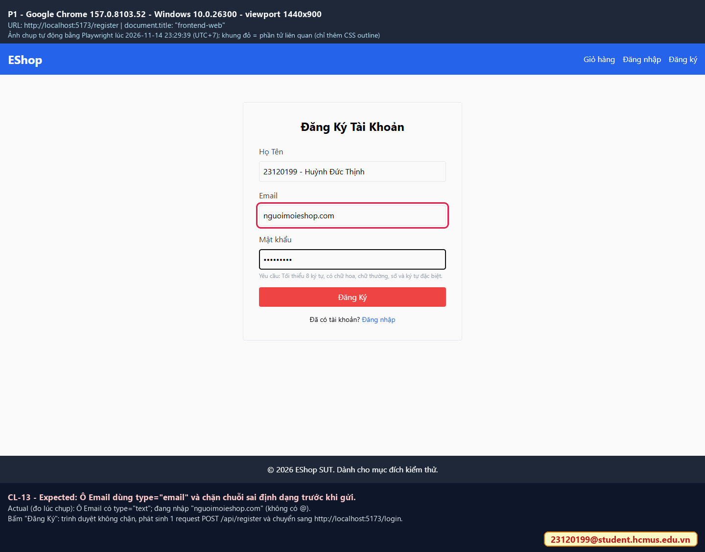

# [IA-02] [Register, Login, ForgotPassword] Tất cả ô nhập Email khai báo type='text' khiến chuỗi sai định dạng email vẫn gửi request lên API

## Summary
Cả 3 biểu mẫu Đăng ký (`/register`), Đăng nhập (`/login`) và Quên mật khẩu Bước 1 (`/forgot-password`) đều khai báo ô nhập Email là `<input type="text">` và không kiểm tra định dạng email ở phía client lẫn server, cho phép tạo tài khoản với email sai khuôn dạng như `abc-khong-phai-email`.

- **Bug ID:** `BUG-09`
- **Checklist item:** `CL-13`, `CL-14`
- **Interface aspect:** `IA-02` — Forms
- **Màn hình:** Register (`/register`), Login (`/login`), ForgotPassword (`/forgot-password` — Bước 1)
- **Requirement:** FR-01 (eshop-sut/README.md:33); FR-22 (eshop-sut/README.md:253); FR-02 (eshop-sut/README.md:44)
- **Loại lỗi:** `State`
- **Severity:** **Major**
- **Priority:** **High**

## Environment
- **SUT:** `eshop-sut @ 1a9304a (repo HEAD 6b6a7a9)` (Web `http://localhost:5173`, Backend API `http://localhost:3000`)
- **P1:** Google Chrome 157.0.8103.50 trên Windows 11
- **P2:** Mozilla Firefox 137.0.1 trên Windows 11
- **P3:** Chrome Android 156.0.8078.79 trên OPPO Reno10 5G (Android 15, adb reverse)
- **URL kiểm thử:** `http://localhost:5173/register, http://localhost:5173/login, http://localhost:5173/forgot-password`
- **Viewport:** Desktop `1440x900` (`P1`, `P2`); Mobile `360x801` / `1080x2412` (`P3`)

## Preconditions
Trạng thái chưa đăng nhập; Backend và Frontend đang hoạt động.

## Steps to reproduce
1. Truy cập `http://localhost:5173/register`, nhập Họ Tên `23120199 - Huỳnh Đức Thịnh`, nhập Email sai định dạng `abc-khong-phai-email`, mật khẩu `Abcd123 ` rồi bấm `Đăng Ký`.
2. Truy cập `http://localhost:5173/login`, nhập `abc` vào ô Username, `123` vào ô Mật khẩu rồi bấm `Sign In` và kiểm tra tab Network.
3. Truy cập `http://localhost:5173/forgot-password`, nhập `abc` vào ô Email rồi bấm `Lấy mã OTP` và kiểm tra tab Network.

## Expected result
Theo `FR-01` (`eshop-sut/README.md:33`), `FR-02` (`eshop-sut/README.md:44`) và `FR-22` (`eshop-sut/README.md:253`), tất cả ô nhập địa chỉ email phải sử dụng `type="email"` và chặn gửi biểu mẫu kèm thông báo lỗi khi chuỗi nhập không đúng định dạng email hợp lệ.

- **`CL-13`** (*Thuộc tính type="email" và kiểm tra định dạng email hợp lệ trên trang Đăng ký* — căn cứ: `FR-01 (eshop-sut/README.md:33); FR-22 (eshop-sut/README.md:253)`): Ô nhập Email trên /register có thuộc tính `type="email"` và chặn gửi form khi nhập chuỗi không đúng định dạng `user@domain.com` (kích hoạt bàn phím email trên di động hoặc thông báo lỗi định dạng trước khi gọi API). Fail nếu ô Email có `type` khác `email` hoặc cho phép gửi chuỗi sai định dạng (ví dụ `nguoimoieshop.com`) lên server.
- **`CL-14`** (*Thuộc tính type="email" của ô nhập Email trên trang Đăng nhập và Quên mật khẩu* — căn cứ: `FR-02 (eshop-sut/README.md:44); FR-22 (eshop-sut/README.md:253)`): Ô nhập Email trên trang /login và ở Bước 1 trang /forgot-password đều khai báo `type="email"` và kích hoạt kiểm tra định dạng email chuẩn HTML5 khi bấm gửi với chuỗi thiếu ký tự `@`. Fail nếu bất kỳ ô nào dùng `type="text"` hoặc không chặn định dạng email sai ngay trên form.

## Actual result
Cả 3 trang đều khai báo `<input type="text">` cho ô Email/Username. Đặc biệt trên `/register`, chuỗi `abc-khong-phai-email` vẫn gửi `POST /api/register` trả về HTTP 200 OK và tạo tài khoản rác trong CSDL; trên `/login` và `/forgot-password`, chuỗi `abc` vẫn phát sinh request `POST` lên Backend.

**Dữ kiện `Actual` nguyên văn theo từng mục và nền tảng:**
- **`CL-13` trên `P1`:** Actual: Ô Email trên /register khai báo type="text" (khác "email") và khi nhập "nguoimoieshop.com" vẫn gửi 1 request POST /api/register lên server mà không chặn định dạng email.
- **`CL-13` trên `P2`:** Actual: Ô Email trên /register khai báo type="text" (khác "email") và khi nhập "nguoimoieshop.com" vẫn gửi 1 request POST /api/register lên server mà không chặn định dạng email.
- **`CL-13` trên `P3`:** Actual: Ô Email trên /register khai báo type="text" (khác "email") và khi nhập "nguoimoieshop.com" vẫn gửi 1 request POST /api/register lên server mà không chặn định dạng email.
- **`CL-14` trên `P1`:** Actual: Ô Email trên /login có type="text" (gửi 1 request với "khongcoacong.com") và ở Bước 1 /forgot-password có type="text" (gửi 1 request tới server, bật alert "Lỗi: User not found"), không chặn định dạng bằng HTML5.
- **`CL-14` trên `P2`:** Actual: Ô Email trên /login có type="text" (gửi 1 request với "khongcoacong.com") và ở Bước 1 /forgot-password có type="text" (gửi 1 request tới server, bật alert "Lỗi: User not found"), không chặn định dạng bằng HTML5.
- **`CL-14` trên `P3`:** Actual: Ô Email trên /login có type="text" (gửi 1 request với "khongcoacong.com") và ở Bước 1 /forgot-password có type="text" (gửi 1 request tới server, bật alert "Lỗi: User not found"), không chặn định dạng bằng HTML5.

## Impact
Cho phép dữ liệu email hỏng đi vào CSDL, không kích hoạt bàn phím `@` chuyên dụng trên di động và mất lớp kiểm tra định dạng tức thì trước khi gọi mạng.

## Reproducibility
Luôn luôn (100%) trên các nền tảng áp dụng: `P1`, `P2`, `P3`.

## Evidence

**Danh sách đầy đủ ảnh minh chứng theo nền tảng:**
- `CL-13` (`P1`): [`screenshots/task1_failed/P1_CL-13.png`](../screenshots/task1_failed/P1_CL-13.png)
- `CL-13` (`P2`): [`screenshots/task1_failed/P2_CL-13.png`](../screenshots/task1_failed/P2_CL-13.png)
- `CL-13` (`P3`): [`screenshots/task1_failed/P3_CL-13.png`](../screenshots/task1_failed/P3_CL-13.png)
- `CL-14` (`P1`): [`screenshots/task1_failed/P1_CL-14.png`](../screenshots/task1_failed/P1_CL-14.png)
- `CL-14` (`P2`): [`screenshots/task1_failed/P2_CL-14.png`](../screenshots/task1_failed/P2_CL-14.png)
- `CL-14` (`P3`): [`screenshots/task1_failed/P3_CL-14.png`](../screenshots/task1_failed/P3_CL-14.png)

## GitHub Issue
- **Issue:** [#9 — [HW03-M1] [BUG-09] [IA-02] [Register, Login, ForgotPassword] Tất cả ô nhập Email khai báo type='text' khiến chuỗi sai định dạng email vẫn gửi request lên API](https://github.com/HuynhDucThinh/Software-Testing-HW03/issues/9)
- **Ảnh chụp trang GitHub Issue:** [`screenshots/github_issues/ISSUE-09_BUG-09.png`](../screenshots/github_issues/ISSUE-09_BUG-09.png)
