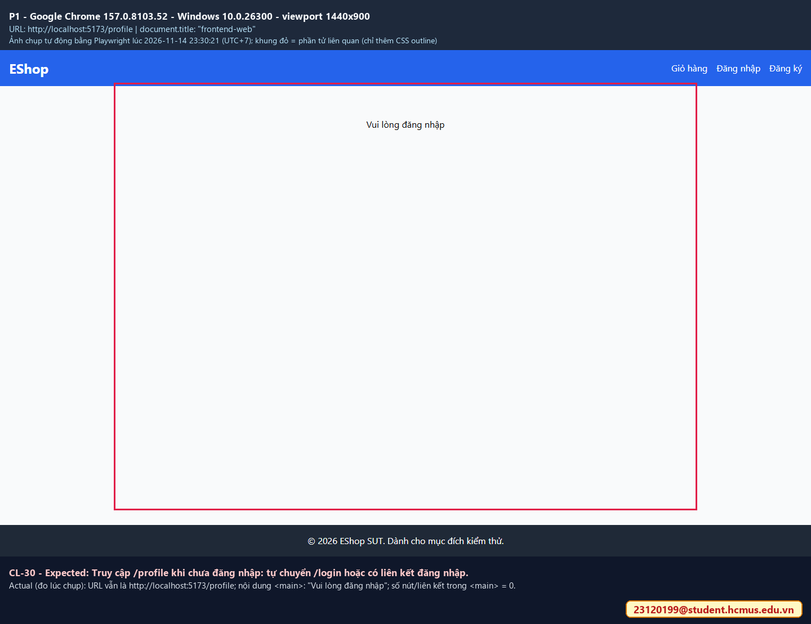

# [IA-03] [Profile] Truy cập trực tiếp /profile khi chưa đăng nhập không tự chuyển hướng về /login và không có liên kết đăng nhập trong vùng nội dung

## Summary
Khi khách chưa đăng nhập truy cập trực tiếp đường dẫn được bảo vệ `http://localhost:5173/profile`, ứng dụng không tự động chuyển hướng sang `/login` mà giữ nguyên URL `/profile` và chỉ hiển thị dòng chữ tĩnh `Vui lòng đăng nhập` không kèm bất kỳ nút hoặc liên kết nào.

- **Bug ID:** `BUG-10`
- **Checklist item:** `CL-30`
- **Interface aspect:** `IA-03` — Navigation
- **Màn hình:** Profile (`/profile`)
- **Requirement:** FR-04 (eshop-sut/README.md:64); Nielsen #3 User control and freedom
- **Loại lỗi:** `State`
- **Severity:** **Major**
- **Priority:** **Medium**

## Environment
- **SUT:** `eshop-sut @ 1a9304a (repo HEAD 6b6a7a9)` (Web `http://localhost:5173`, Backend API `http://localhost:3000`)
- **P1:** Google Chrome 157.0.8103.50 trên Windows 11
- **P2:** Mozilla Firefox trên Windows 11 (bản cài đặt `137.0.1` dùng để quan sát trực tiếp; nhân Gecko `159.0` bản Playwright dùng để đo DOM và chụp ảnh minh chứng)
- **P3:** Chrome Android 156.0.8078.79 trên OPPO Reno10 5G (Android 15, adb reverse)
- **URL kiểm thử:** `http://localhost:5173/profile`
- **Viewport:** Desktop `1440x900` (`P1`, `P2`); Mobile `360x801` / `1080x2412` (`P3`)

## Preconditions
Trạng thái khách chưa đăng nhập (`localStorage` không có token/user).

## Steps to reproduce
1. Đảm bảo chưa đăng nhập (hoặc bấm `Thoát` nếu đang đăng nhập).
2. Nhập trực tiếp địa chỉ `http://localhost:5173/profile` lên thanh URL trình duyệt và nhấn `Enter`.
3. Quan sát URL hiện hành và các phần tử tương tác bên trong vùng `<main>`.

## Expected result
Theo `FR-04` (`eshop-sut/README.md:64`) và nguyên tắc Nielsen #3 (User control and freedom), trang bảo vệ `/profile` khi chưa xác thực cần tự động điều hướng về `/login` hoặc hiển thị nút/liên kết trực tiếp dẫn người dùng tới trang Đăng nhập.

- **`CL-30`** (*Xử lý điều hướng khi người dùng chưa đăng nhập truy cập trực tiếp đường dẫn /profile* — căn cứ: `FR-04 (eshop-sut/README.md:64); Nielsen #3 User control and freedom`): Khi truy cập `/profile` lúc chưa đăng nhập, ứng dụng tự động chuyển hướng về `/login` hoặc hiển thị thông báo yêu cầu đăng nhập kèm nút/liên kết điều hướng trực tiếp sang `/login` ngay trong vùng nội dung chính. Fail nếu trang hiển thị form rỗng lỗi hoặc chỉ hiện dòng chữ tĩnh `Vui lòng đăng nhập` cụt đường mà không tự chuyển hướng hay có nút/liên kết đi tới `/login` trong vùng thông báo.

## Actual result
URL vẫn đứng yên tại `http://localhost:5173/profile`, vùng `<main>` chỉ render thẻ tĩnh `
Vui lòng đăng nhập
` với 0 nút bấm và 0 liên kết điều hướng (`Profile.jsx:57`).

**Dữ kiện `Actual` nguyên văn theo từng mục và nền tảng:**
- **`CL-30` trên `P1`:** Actual: Truy cập /profile khi chưa đăng nhập vẫn đứng tại URL "/profile", vùng nội dung chính chỉ hiện chữ tĩnh "Vui lòng đăng nhập" và có 0 nút/liên kết điều hướng sang /login.
- **`CL-30` trên `P2`:** Actual: Truy cập /profile khi chưa đăng nhập vẫn đứng tại URL "/profile", vùng nội dung chính chỉ hiện chữ tĩnh "Vui lòng đăng nhập" và có 0 nút/liên kết điều hướng sang /login.
- **`CL-30` trên `P3`:** Actual: Truy cập /profile khi chưa đăng nhập vẫn đứng tại URL "/profile", vùng nội dung chính chỉ hiện chữ tĩnh "Vui lòng đăng nhập" và có 0 nút/liên kết điều hướng sang /login.

## Impact
Tạo điểm cụt điều hướng (dead-end) trong vùng nội dung chính, buộc người dùng phải tự tìm liên kết nhỏ trên thanh Header để đi đăng nhập.

## Reproducibility
Luôn luôn (100%) trên các nền tảng áp dụng: `P1`, `P2`, `P3`.

## Evidence

**Danh sách đầy đủ ảnh minh chứng theo nền tảng:**
- `CL-30` (`P1`): [`screenshots/task1_failed/P1_CL-30.png`](../screenshots/task1_failed/P1_CL-30.png)
- `CL-30` (`P2`): [`screenshots/task1_failed/P2_CL-30.png`](../screenshots/task1_failed/P2_CL-30.png)
- `CL-30` (`P3`): [`screenshots/task1_failed/P3_CL-30.png`](../screenshots/task1_failed/P3_CL-30.png)

## GitHub Issue
- **Issue:** [#10 — [HW03-M1] [BUG-10] [IA-03] [Profile] Truy cập trực tiếp /profile khi chưa đăng nhập không tự chuyển hướng về /login và không có liên kết đăng nhập trong vùng nội dung](https://github.com/HuynhDucThinh/Software-Testing-HW03/issues/10)
- **Ảnh chụp trang GitHub Issue:** [`screenshots/github_issues/ISSUE-10_BUG-10.png`](../screenshots/github_issues/ISSUE-10_BUG-10.png)
