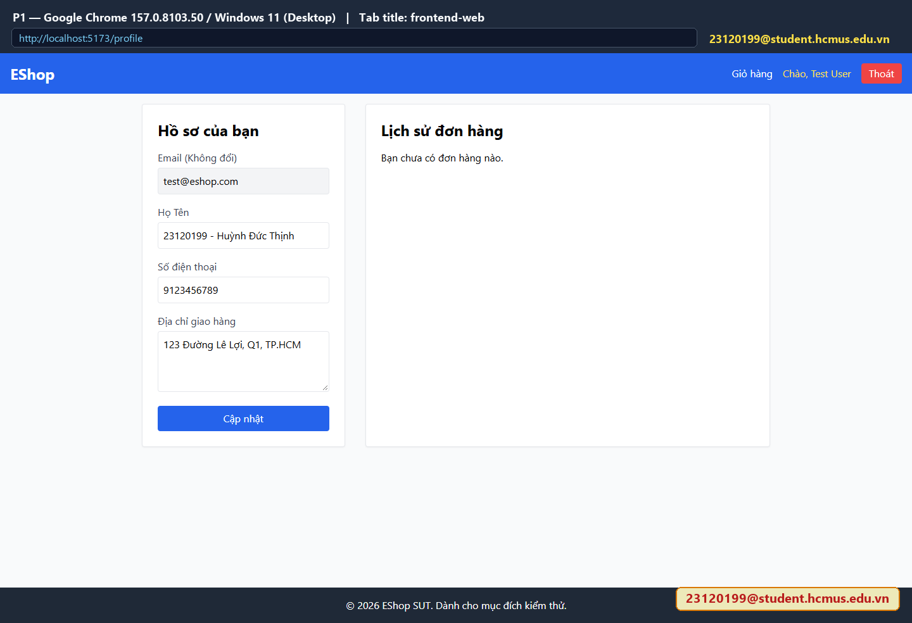

# [IA-04] [Profile, Header] Lời chào trên thanh Header không cập nhật theo Họ Tên mới sau khi lưu Hồ sơ thành công

## Summary
Sau khi người dùng đổi Họ Tên tại trang Hồ sơ (`/profile`) và nhận thông báo `Cập nhật thành công!`, thanh Header ở đầu trang vẫn tiếp tục hiển thị tên cũ do trạng thái người dùng trong `AuthContext`/`localStorage` không được đồng bộ.

- **Bug ID:** `BUG-11`
- **Checklist item:** `CL-36`
- **Interface aspect:** `IA-04` — Feedback / state
- **Màn hình:** Profile (`/profile`), Header/Navbar
- **Requirement:** FR-04 (eshop-sut/README.md:64); Nielsen #1 Visibility of system status
- **Loại lỗi:** `State`
- **Severity:** **Major**
- **Priority:** **Medium**

## Environment
- **SUT:** `eshop-sut @ 1a9304a (repo HEAD 6b6a7a9)` (Web `http://localhost:5173`, Backend API `http://localhost:3000`)
- **P1:** Google Chrome 157.0.8103.50 trên Windows 11
- **P2:** Mozilla Firefox 137.0.1 trên Windows 11
- **P3:** Chrome Android 156.0.8078.79 trên OPPO Reno10 5G (Android 15, adb reverse)
- **URL kiểm thử:** `http://localhost:5173/profile`
- **Viewport:** Desktop `1440x900` (`P1`, `P2`); Mobile `360x801` / `1080x2412` (`P3`)

## Preconditions
Đã đăng nhập bằng tài khoản `test@eshop.com` (tên mặc định `Test User`).

## Steps to reproduce
1. Đăng nhập bằng `test@eshop.com` / `Test@1234`, quan sát lời chào trên Header đang là `Chào, Test User`.
2. Truy cập `http://localhost:5173/profile`, sửa ô Họ Tên thành `23120199 - Huỳnh Đức Thịnh`, nhập SĐT `9123456789` (để vượt qua bộ lọc SĐT hiện tại) rồi bấm `Cập nhật`.
3. Đóng hộp thoại `Cập nhật thành công!` và quan sát lời chào trên thanh Header trước khi tải lại trang.

## Expected result
Theo `FR-04` (`eshop-sut/README.md:64`) và nguyên tắc Nielsen #1 (Visibility of system status), ngay khi cập nhật hồ sơ thành công, lời chào trên thanh Header phải đồng bộ tức thì sang tên mới (`Chào, 23120199 - Huỳnh Đức Thịnh`) và giữ nguyên bền vững khi chuyển trang.

- **`CL-36`** (*Đồng bộ tên người dùng trên Header và bền vững dữ liệu sau khi cập nhật Hồ sơ thành công* — căn cứ: `FR-04 (eshop-sut/README.md:64); Nielsen #1 Visibility of system status`): Trong vòng 1 giây sau khi cập nhật hồ sơ thành công tại `/profile`, lời chào `Chào, <tên>` trên thanh Header tự động cập nhật sang `Họ Tên` mới mà không cần đăng xuất, đồng thời khi tải lại trang `/profile` các trường `Họ Tên`, `Số điện thoại`, `Địa chỉ giao hàng` vẫn hiển thị đúng giá trị vừa lưu. Fail nếu lời chào trên Header vẫn giữ tên cũ sau khi cập nhật hoặc khi tải lại trang `/profile` dữ liệu quay về giá trị cũ.

## Actual result
Dù API `PUT /api/users/:id` đã lưu thành công vào SQLite và trang `/profile` nạp lại tên mới khi `F5`, thanh Header vẫn hiển thị tên cũ `Chào, Test User` (do `Profile.jsx:49` không cập nhật lại state `user` trong `AuthContext` và `localStorage`).

**Dữ kiện `Actual` nguyên văn theo từng mục và nền tảng:**
- **`CL-36` trên `P1`:** Actual: Sau 1 giây bấm Cập nhật hồ sơ, lời chào trên Header vẫn giữ nguyên tên cũ "Chào, Test User" (không đồng bộ sang "Chào, Nguyễn Văn Ánh" nếu chưa tải lại trang); sau khi F5 dữ liệu lưu bền=true.
- **`CL-36` trên `P2`:** Actual: Sau 1 giây bấm Cập nhật hồ sơ, lời chào trên Header vẫn giữ nguyên tên cũ "Chào, Test User" (không đồng bộ sang "Chào, Nguyễn Văn Ánh" nếu chưa tải lại trang); sau khi F5 dữ liệu lưu bền=true.
- **`CL-36` trên `P3`:** Actual: Sau 1 giây bấm Cập nhật hồ sơ, lời chào trên Header vẫn giữ nguyên tên cũ "Chào, Test User" (không đồng bộ sang "Chào, Nguyễn Văn Ánh" nếu chưa tải lại trang); sau khi F5 dữ liệu lưu bền=true.

## Impact
Gây mâu thuẫn trạng thái hiển thị ngay trên cùng một màn hình khiến người dùng nghi ngờ thao tác cập nhật hồ sơ chưa có hiệu lực.

## Reproducibility
Luôn luôn (100%) trên các nền tảng áp dụng: `P1`, `P2`, `P3`.

## Evidence

**Danh sách đầy đủ ảnh minh chứng theo nền tảng:**
- `CL-36` (`P1`): [`screenshots/task1_failed/P1_CL-36.png`](../screenshots/task1_failed/P1_CL-36.png)
- `CL-36` (`P2`): [`screenshots/task1_failed/P2_CL-36.png`](../screenshots/task1_failed/P2_CL-36.png)
- `CL-36` (`P3`): [`screenshots/task1_failed/P3_CL-36.png`](../screenshots/task1_failed/P3_CL-36.png)

## GitHub Issue
- **Issue:** [#11 — [HW03-M1] [BUG-11] [IA-04] [Profile, Header] Lời chào trên thanh Header không cập nhật theo Họ Tên mới sau khi lưu Hồ sơ thành công](https://github.com/HuynhDucThinh/Software-Testing-HW03/issues/11)
- **Ảnh chụp trang GitHub Issue:** [`screenshots/github_issues/ISSUE-11_BUG-11.png`](../screenshots/github_issues/ISSUE-11_BUG-11.png)
