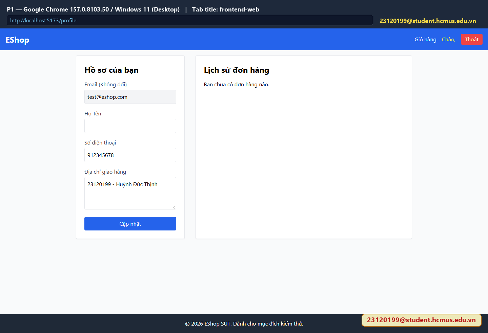

# [IA-02] [Register, Profile] Chấp nhận trường Họ Tên chỉ gồm toàn ký tự khoảng trắng khiến lời chào Header hiển thị cụt 'Chào,'

## Summary
Biểu mẫu Đăng ký (`/register`) và Hồ sơ cá nhân (`/profile`) không cắt khoảng trắng đầu/cuối (`.trim()`) trước khi kiểm tra bắt buộc, cho phép lưu Họ Tên chỉ chứa toàn dấu cách (`'   '`) và làm lời chào trên Header hiển thị cụt lủn `Chào,`.

- **Bug ID:** `BUG-12`
- **Checklist item:** `SV-11`
- **Interface aspect:** `IA-02` — Forms
- **Màn hình:** Register (`/register`), Profile (`/profile`)
- **Requirement:** Nielsen #5 Error prevention; FR-01 (eshop-sut/README.md:32); Giả định GA7
- **Loại lỗi:** `State`
- **Severity:** **Major**
- **Priority:** **Medium**

## Environment
- **SUT:** `eshop-sut @ 1a9304a (repo HEAD 6b6a7a9)` (Web `http://localhost:5173`, Backend API `http://localhost:3000`)
- **P1:** Google Chrome 157.0.8103.50 trên Windows 11
- **P2:** Mozilla Firefox 137.0.1 trên Windows 11
- **P3:** Chrome Android 156.0.8078.79 trên OPPO Reno10 5G (Android 15, adb reverse)
- **URL kiểm thử:** `http://localhost:5173/register, http://localhost:5173/profile`
- **Viewport:** Desktop `1440x900` (`P1`, `P2`); Mobile `360x801` / `1080x2412` (`P3`)

## Preconditions
Backend và Frontend đang hoạt động.

## Steps to reproduce
1. Truy cập `http://localhost:5173/register`, nhập 3 dấu cách `'   '` vào ô Họ Tên, nhập Email mới hợp lệ và mật khẩu `Abcd123 `, sau đó bấm `Đăng Ký`.
2. Đăng nhập vào tài khoản vừa tạo (hoặc vào `/profile` của tài khoản đang đăng nhập, đổi Họ Tên thành `'   '` và lưu) rồi quan sát thanh Header.

## Expected result
Theo `FR-01` (`eshop-sut/README.md:32`), giả định `GA7` và nguyên tắc Nielsen #5 (Error prevention), trường bắt buộc Họ Tên phải loại bỏ khoảng trắng thừa hai đầu và từ chối giá trị rỗng sau khi `trim`.

- **`SV-11`** (*Từ chối Họ Tên chỉ chứa khoảng trắng* — căn cứ: `Nielsen #5 Error prevention; FR-01 (eshop-sut/README.md:32); Giả định GA7`): Cả /register và /profile đều từ chối Họ Tên chỉ gồm khoảng trắng và hiển thị thông báo yêu cầu nhập Họ Tên, không lưu giá trị rỗng về nội dung. Fail nếu hệ thống chấp nhận đăng ký hoặc cập nhật với Họ Tên chỉ gồm khoảng trắng, khiến lời chào trên Header chỉ còn `Chào,`.

## Actual result
Thuộc tính HTML `required` cho qua chuỗi `'   '`, cả `/register` và `/profile` đều gửi lưu thành công lên Backend (HTTP 200), và khi đăng nhập thanh Header hiển thị lời chào bị rỗng tên là `Chào,` trên cả `P1`, `P2` và `P3`.

**Dữ kiện `Actual` nguyên văn theo từng mục và nền tảng:**
- **`SV-11` trên `P1`:** Actual: Cả /register (chuyển sang /login=true) lẫn /profile (alert "Cập nhật thành công!") đều chấp nhận lưu Họ Tên chỉ gồm 3 khoảng trắng "   ", khiến lời chào trên Header chỉ còn "Chào,".
- **`SV-11` trên `P2`:** Actual: Cả /register (chuyển sang /login=true) lẫn /profile (alert "Cập nhật thành công!") đều chấp nhận lưu Họ Tên chỉ gồm 3 khoảng trắng "   ", khiến lời chào trên Header chỉ còn "Chào,".
- **`SV-11` trên `P3`:** Actual: Cả /register (chuyển sang /login=true) lẫn /profile (alert "Cập nhật thành công!") đều chấp nhận lưu Họ Tên chỉ gồm 3 khoảng trắng "   ", khiến lời chào trên Header chỉ còn "Chào,".

## Impact
Tạo hồ sơ người dùng không có tên hiển thị hợp lệ trong hệ thống và làm hỏng giao diện lời chào cũng như thông tin người nhận đơn hàng.

## Reproducibility
Luôn luôn (100%) trên các nền tảng áp dụng: `P1`, `P2`, `P3`.

## Evidence

**Danh sách đầy đủ ảnh minh chứng theo nền tảng:**
- `SV-11` (`P1`): [`screenshots/task1_failed/P1_SV-11.png`](../screenshots/task1_failed/P1_SV-11.png)
- `SV-11` (`P2`): [`screenshots/task1_failed/P2_SV-11.png`](../screenshots/task1_failed/P2_SV-11.png)
- `SV-11` (`P3`): [`screenshots/task1_failed/P3_SV-11.png`](../screenshots/task1_failed/P3_SV-11.png)

## GitHub Issue
- **Issue:** [#12 — [HW03-M1] [BUG-12] [IA-02] [Register, Profile] Chấp nhận trường Họ Tên chỉ gồm toàn ký tự khoảng trắng khiến lời chào Header hiển thị cụt 'Chào,'](https://github.com/HuynhDucThinh/Software-Testing-HW03/issues/12)
- **Ảnh chụp trang GitHub Issue:** [`screenshots/github_issues/ISSUE-12_BUG-12.png`](../screenshots/github_issues/ISSUE-12_BUG-12.png)
