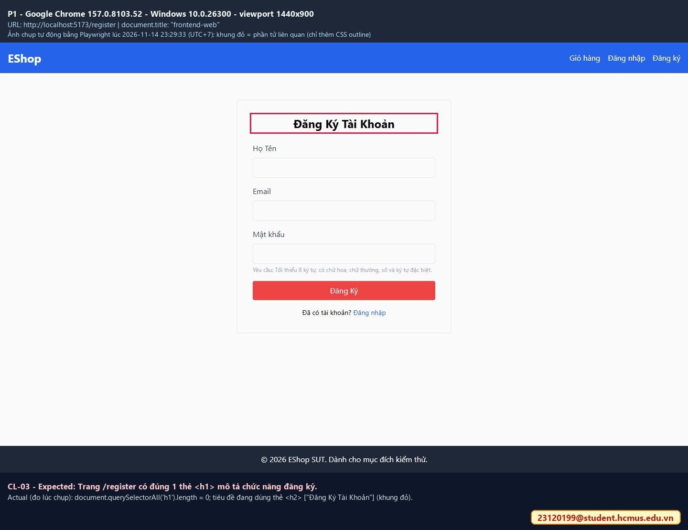

# [IA-01] [Register, Login, ForgotPassword, Profile] Cả 4 trang thiếu thẻ tiêu đề cấp trang h1 và trang Đăng nhập hiển thị sai tiêu đề thành 'Đăng Ký'

## Summary
Tất cả 4 màn hình thuộc phạm vi xác thực & hồ sơ (`/register`, `/login`, `/forgot-password`, `/profile`) đều không có thẻ tiêu đề chính `<h1>` nào (chỉ dùng `<h2>`), nghiêm trọng nhất là trang Đăng nhập (`/login`) lại hiển thị tiêu đề sai chức năng là `Đăng Ký`.

- **Bug ID:** `BUG-13`
- **Checklist item:** `CL-03`, `CL-04`, `CL-05`, `CL-06`
- **Interface aspect:** `IA-01` — General UI standards
- **Màn hình:** Register (`/register`), Login (`/login`), ForgotPassword (`/forgot-password`), Profile (`/profile`)
- **Requirement:** FR-21 (eshop-sut/README.md:247); FR-05 (eshop-sut/README.md:81)
- **Loại lỗi:** `Visual-Layout`
- **Severity:** **Major**
- **Priority:** **Medium**

## Environment
- **SUT:** `eshop-sut @ 1a9304a (repo HEAD 6b6a7a9)` (Web `http://localhost:5173`, Backend API `http://localhost:3000`)
- **P1:** Google Chrome 157.0.8103.50 trên Windows 11
- **P2:** Mozilla Firefox 137.0.1 trên Windows 11
- **P3:** Chrome Android 156.0.8078.79 trên OPPO Reno10 5G (Android 15, adb reverse)
- **URL kiểm thử:** `http://localhost:5173/login`
- **Viewport:** Desktop `1440x900` (`P1`, `P2`); Mobile `360x801` / `1080x2412` (`P3`)

## Preconditions
Mở lần lượt 4 trang `/register`, `/login`, `/forgot-password` (Bước 1 & Bước 2) và `/profile` (khi đã đăng nhập).

## Steps to reproduce
1. Truy cập `http://localhost:5173/login`, quan sát dòng tiêu đề lớn nhất phía trên biểu mẫu và kiểm tra `document.querySelectorAll('h1').length` trong DevTools.
2. Lần lượt truy cập `/register`, `/forgot-password` (cả Bước 1 và Bước 2) và `/profile` (sau khi đăng nhập), kiểm tra số lượng thẻ `<h1>` và thẻ tiêu đề hiện có.

## Expected result
Theo `FR-21` (`eshop-sut/README.md:247`), mỗi trang phải có đúng một thẻ tiêu đề chính `<h1>` phản ánh chính xác chức năng của trang đó (`Đăng ký tài khoản`, `Đăng nhập`, `Quên mật khẩu`, `Hồ sơ cá nhân`).

- **`CL-03`** (*Số lượng và nội dung thẻ tiêu đề chính h1 trên trang Đăng ký* — căn cứ: `FR-21 (eshop-sut/README.md:247); FR-05 (eshop-sut/README.md:81)`): Tiêu đề chính của trang /register khi kiểm tra DOM (`document.querySelectorAll('h1')`) có đúng 1 thẻ `<h1>` đang hiển thị và văn bản mô tả đúng chức năng đăng ký tài khoản. Fail nếu số lượng thẻ `<h1>` hiển thị bằng 0, lớn hơn 1, hoặc nội dung `<h1>` không phản ánh chức năng đăng ký.
- **`CL-04`** (*Số lượng thẻ h1 và tính chính xác của tiêu đề trang Đăng nhập* — căn cứ: `FR-21 (eshop-sut/README.md:247); FR-05 (eshop-sut/README.md:81)`): Tiêu đề chính trên trang /login khi mở trang và kiểm tra DOM có đúng 1 thẻ `<h1>` hiển thị với văn bản mô tả đúng chức năng 'Đăng nhập'. Fail nếu số lượng thẻ `<h1>` khác 1 hoặc văn bản tiêu đề hiển thị sai tên chức năng (ví dụ hiển thị 'Đăng Ký').
- **`CL-05`** (*Số lượng và nội dung thẻ tiêu đề chính h1 trên trang Quên mật khẩu ở cả 2 bước* — căn cứ: `FR-21 (eshop-sut/README.md:247); FR-05 (eshop-sut/README.md:81)`): Tiêu đề chính trên trang /forgot-password khi quan sát và kiểm tra DOM ở cả Bước 1 lẫn Bước 2 luôn có đúng 1 thẻ `<h1>` hiển thị mô tả chức năng quên/đặt lại mật khẩu. Fail nếu ở bất kỳ bước nào số lượng thẻ `<h1>` khác 1 hoặc nội dung tiêu đề sai lệch chức năng.
- **`CL-06`** (*Số lượng thẻ tiêu đề cấp trang h1 trên trang Hồ sơ cá nhân* — căn cứ: `FR-21 (eshop-sut/README.md:247); FR-05 (eshop-sut/README.md:81)`): Trang /profile khi đã đăng nhập và kiểm tra DOM có đúng 1 thẻ `<h1>` duy nhất làm tiêu đề cấp trang, các tiêu đề vùng con dùng từ `<h2>` trở xuống. Fail nếu `document.querySelectorAll('h1').length` bằng 0 hoặc lớn hơn 1.

## Actual result
Cả 4 trang đều có 0 thẻ `<h1>` (đang dùng `<h2>`). Đặc biệt trên trang `/login` (`Login.jsx:33`), thẻ `<h2>` hiển thị nội dung sai hẳn chức năng là `Đăng Ký` thay vì `Đăng Nhập`.

**Dữ kiện `Actual` nguyên văn theo từng mục và nền tảng:**
- **`CL-03` trên `P1`:** Actual: Trên /register có 0 thẻ `<h1>` hiển thị ([]); tiêu đề chính đang dùng thẻ `<h2>` (["Đăng Ký Tài Khoản"]).
- **`CL-03` trên `P2`:** Actual: Trên /register có 0 thẻ `<h1>` hiển thị ([]); tiêu đề chính đang dùng thẻ `<h2>` (["Đăng Ký Tài Khoản"]).
- **`CL-03` trên `P3`:** Actual: Trên /register có 0 thẻ `<h1>` hiển thị ([]); tiêu đề chính đang dùng thẻ `<h2>` (["Đăng Ký Tài Khoản"]).
- **`CL-04` trên `P1`:** Actual: Trên /login có 0 thẻ `<h1>` hiển thị ([]); tiêu đề thực tế đang dùng thẻ `<h2>` với nội dung sai chức năng là ["Đăng Ký"].
- **`CL-04` trên `P2`:** Actual: Trên /login có 0 thẻ `<h1>` hiển thị ([]); tiêu đề thực tế đang dùng thẻ `<h2>` với nội dung sai chức năng là ["Đăng Ký"].
- **`CL-04` trên `P3`:** Actual: Trên /login có 0 thẻ `<h1>` hiển thị ([]); tiêu đề thực tế đang dùng thẻ `<h2>` với nội dung sai chức năng là ["Đăng Ký"].
- **`CL-05` trên `P1`:** Actual: Trang /forgot-password có 0 thẻ `<h1>` ở Bước 1 và 0 thẻ `<h1>` ở Bước 2 (đang dùng thẻ `<h2>`: ["Quên Mật Khẩu"]).
- **`CL-05` trên `P2`:** Actual: Trang /forgot-password có 0 thẻ `<h1>` ở Bước 1 và 0 thẻ `<h1>` ở Bước 2 (đang dùng thẻ `<h2>`: ["Quên Mật Khẩu"]).
- **`CL-05` trên `P3`:** Actual: Trang /forgot-password có 0 thẻ `<h1>` ở Bước 1 và 0 thẻ `<h1>` ở Bước 2 (đang dùng thẻ `<h2>`: ["Quên Mật Khẩu"]).
- **`CL-06` trên `P1`:** Actual: Trang /profile khi đã đăng nhập có 0 thẻ `<h1>` hiển thị; đang dùng 2 thẻ `<h2>` (["Hồ sơ của bạn","Lịch sử đơn hàng"]).
- **`CL-06` trên `P2`:** Actual: Trang /profile khi đã đăng nhập có 0 thẻ `<h1>` hiển thị; đang dùng 2 thẻ `<h2>` (["Hồ sơ của bạn","Lịch sử đơn hàng"]).
- **`CL-06` trên `P3`:** Actual: Trang /profile khi đã đăng nhập có 0 thẻ `<h1>` hiển thị; đang dùng 2 thẻ `<h2>` (["Hồ sơ của bạn","Lịch sử đơn hàng"]).

## Impact
Tiêu đề `Đăng Ký` ngay trên trang `/login` gây nhầm lẫn nghiêm trọng cho người dùng (nhất là sau khi vừa đăng ký xong chuyển sang `/login` lại thấy tiêu đề `Đăng Ký` lần nữa), đồng thời thiếu `<h1>` làm giảm khả năng định vị trang của trình đọc màn hình.

## Reproducibility
Luôn luôn (100%) trên các nền tảng áp dụng: `P1`, `P2`, `P3`.

## Evidence

**Danh sách đầy đủ ảnh minh chứng theo nền tảng:**
- `CL-03` (`P1`): [`screenshots/task1_failed/P1_CL-03.png`](../screenshots/task1_failed/P1_CL-03.png)
- `CL-03` (`P2`): [`screenshots/task1_failed/P2_CL-03.png`](../screenshots/task1_failed/P2_CL-03.png)
- `CL-03` (`P3`): [`screenshots/task1_failed/P3_CL-03.png`](../screenshots/task1_failed/P3_CL-03.png)
- `CL-04` (`P1`): [`screenshots/task1_failed/P1_CL-04.png`](../screenshots/task1_failed/P1_CL-04.png)
- `CL-04` (`P2`): [`screenshots/task1_failed/P2_CL-04.png`](../screenshots/task1_failed/P2_CL-04.png)
- `CL-04` (`P3`): [`screenshots/task1_failed/P3_CL-04.png`](../screenshots/task1_failed/P3_CL-04.png)
- `CL-05` (`P1`): [`screenshots/task1_failed/P1_CL-05.png`](../screenshots/task1_failed/P1_CL-05.png)
- `CL-05` (`P2`): [`screenshots/task1_failed/P2_CL-05.png`](../screenshots/task1_failed/P2_CL-05.png)
- `CL-05` (`P3`): [`screenshots/task1_failed/P3_CL-05.png`](../screenshots/task1_failed/P3_CL-05.png)
- `CL-06` (`P1`): [`screenshots/task1_failed/P1_CL-06.png`](../screenshots/task1_failed/P1_CL-06.png)
- `CL-06` (`P2`): [`screenshots/task1_failed/P2_CL-06.png`](../screenshots/task1_failed/P2_CL-06.png)
- `CL-06` (`P3`): [`screenshots/task1_failed/P3_CL-06.png`](../screenshots/task1_failed/P3_CL-06.png)

## GitHub Issue
- **Issue:** [#13 — [HW03-M1] [BUG-13] [IA-01] [Register, Login, ForgotPassword, Profile] Cả 4 trang thiếu thẻ tiêu đề cấp trang h1 và trang Đăng nhập hiển thị sai tiêu đề thành 'Đăng Ký'](https://github.com/HuynhDucThinh/Software-Testing-HW03/issues/13)
- **Ảnh chụp trang GitHub Issue:** [`screenshots/github_issues/ISSUE-13_BUG-13.png`](../screenshots/github_issues/ISSUE-13_BUG-13.png)
