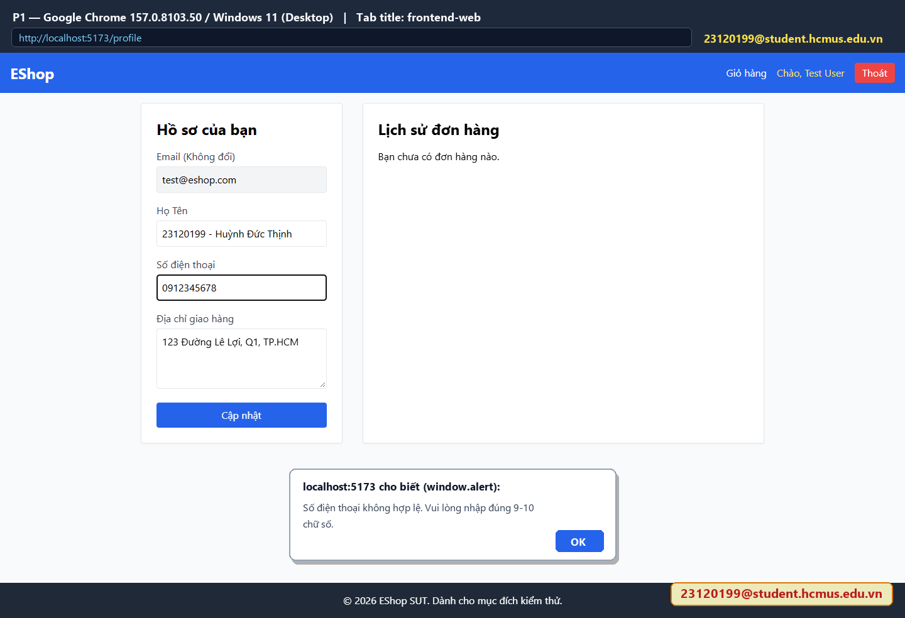

# [IA-01] [Login, Header] Giao diện không nhất quán tiếng Việt: trang Đăng nhập trộn nhãn tiếng Anh ('Username', 'Sign In') và Header dùng nhãn 'Thoát' thay vì 'Đăng xuất'

## Summary
Giao diện vi phạm quy chuẩn ngôn ngữ tiếng Việt nhất quán: trang `/login` pha trộn nhãn tiếng Anh `Username` và nút `Sign In` bên cạnh nhãn tiếng Việt `Mật khẩu`, còn thanh Header khi đã đăng nhập dùng chữ `Thoát` thay vì nhãn chuẩn `Đăng xuất`.

- **Bug ID:** `BUG-14`
- **Checklist item:** `CL-01`, `CL-25`
- **Interface aspect:** `IA-01` — General UI standards
- **Màn hình:** Login (`/login`), Header/Navbar
- **Requirement:** FR-21 (eshop-sut/README.md:244); FR-23 (eshop-sut/README.md:262)
- **Loại lỗi:** `Typo-Localization`
- **Severity:** **Minor**
- **Priority:** **Medium**

## Environment
- **SUT:** `eshop-sut @ 1a9304a (repo HEAD 6b6a7a9)` (Web `http://localhost:5173`, Backend API `http://localhost:3000`)
- **P1:** Google Chrome 157.0.8103.50 trên Windows 11
- **P2:** Mozilla Firefox 137.0.1 trên Windows 11
- **P3:** Chrome Android 156.0.8078.79 trên OPPO Reno10 5G (Android 15, adb reverse)
- **URL kiểm thử:** `http://localhost:5173/login`
- **Viewport:** Desktop `1440x900` (`P1`, `P2`); Mobile `360x801` / `1080x2412` (`P3`)

## Preconditions
Kiểm tra `/login` ở trạng thái khách và kiểm tra thanh Header sau khi đăng nhập.

## Steps to reproduce
1. Truy cập `http://localhost:5173/login` và quan sát nhãn các ô nhập liệu cùng nhãn nút gửi biểu mẫu.
2. Đăng nhập bằng tài khoản `test@eshop.com` / `Test@1234` và quan sát nút kết thúc phiên trên góc phải thanh Header.

## Expected result
Theo `FR-21` (`eshop-sut/README.md:244`), toàn bộ giao diện phải sử dụng tiếng Việt nhất quán, không pha trộn tiếng Anh cho nhãn trường và nút hành động. Theo `FR-23` (`eshop-sut/README.md:262`), nút kết thúc phiên trên Header phải mang nhãn chuẩn `Đăng xuất`.

- **`CL-01`** (*Nhất quán ngôn ngữ tiếng Việt của nhãn trường và nút gửi trên trang Đăng nhập* — căn cứ: `FR-21 (eshop-sut/README.md:244)`): Các nhãn trường nhập liệu, nút gửi form và liên kết trên trang /login khi mở màn hình Đăng nhập đều hiển thị bằng tiếng Việt tự nhiên, nhất quán (chỉ trừ thuật ngữ chuẩn 'Email'). Fail nếu xuất hiện bất kỳ nhãn hoặc chữ trên nút bằng tiếng Anh thông thường (ví dụ 'Username', 'Sign In', 'Login', 'Password').
- **`CL-25`** (*Nhãn chuẩn 'Đăng xuất' và điều hướng kết thúc phiên đăng nhập trên Header* — căn cứ: `FR-23 (eshop-sut/README.md:262)`): Nút kết thúc phiên trên thanh Header khi đã đăng nhập hiển thị nhãn chính xác là `Đăng xuất` (không dùng từ `Thoát`), và khi nhấp/chạm vào nút thì xóa trạng thái đăng nhập, chuyển Header về hiển thị hai liên kết `Đăng nhập` và `Đăng ký`. Fail nếu nhãn nút khác `Đăng xuất` (ví dụ hiển thị `Thoát`) hoặc sau khi bấm vẫn còn lời chào người dùng.

## Actual result
Trên `/login` (`Login.jsx:37,64`), nhãn ô đầu tiên là `Username` và nút gửi là `Sign In`. Trên Header (`App.jsx:28`), nút kết thúc phiên hiển thị nhãn `Thoát` thay vì `Đăng xuất` trên cả 3 nền tảng `P1`, `P2`, `P3`.

**Dữ kiện `Actual` nguyên văn theo từng mục và nền tảng:**
- **`CL-01` trên `P1`:** Actual: Trên /login nhãn trường = ["Username","Mật khẩu"], nút = ["Sign In"], liên kết = ["Quên mật khẩu?","Đăng ký ngay"]; xuất hiện từ tiếng Anh không đúng chuẩn tiếng Việt: ["Username","Sign In"].
- **`CL-01` trên `P2`:** Actual: Trên /login nhãn trường = ["Username","Mật khẩu"], nút = ["Sign In"], liên kết = ["Quên mật khẩu?","Đăng ký ngay"]; xuất hiện từ tiếng Anh không đúng chuẩn tiếng Việt: ["Username","Sign In"].
- **`CL-01` trên `P3`:** Actual: Trên /login nhãn trường = ["Username","Mật khẩu"], nút = ["Sign In"], liên kết = ["Quên mật khẩu?","Đăng ký ngay"]; xuất hiện từ tiếng Anh không đúng chuẩn tiếng Việt: ["Username","Sign In"].
- **`CL-25` trên `P1`:** Actual: Nút thoát phiên trên Header hiển thị nhãn là "Thoát" thay vì nhãn chuẩn "Đăng xuất" của FR-23 (chức năng xoá token và chuyển về ["Giỏ hàng","Đăng nhập","Đăng ký"] hoạt động=true).
- **`CL-25` trên `P2`:** Actual: Nút thoát phiên trên Header hiển thị nhãn là "Thoát" thay vì nhãn chuẩn "Đăng xuất" của FR-23 (chức năng xoá token và chuyển về ["Giỏ hàng","Đăng nhập","Đăng ký"] hoạt động=true).
- **`CL-25` trên `P3`:** Actual: Nút thoát phiên trên Header hiển thị nhãn là "Thoát" thay vì nhãn chuẩn "Đăng xuất" của FR-23 (chức năng xoá token và chuyển về ["Giỏ hàng","Đăng nhập","Đăng ký"] hoạt động=true).

## Impact
Làm mất tính chuyên nghiệp và tính nhất quán thuật ngữ tiếng Việt giữa các màn hình trong cùng luồng xác thực.

## Reproducibility
Luôn luôn (100%) trên các nền tảng áp dụng: `P1`, `P2`, `P3`.

## Evidence

**Danh sách đầy đủ ảnh minh chứng theo nền tảng:**
- `CL-01` (`P1`): [`screenshots/task1_failed/P1_CL-01.png`](../screenshots/task1_failed/P1_CL-01.png)
- `CL-01` (`P2`): [`screenshots/task1_failed/P2_CL-01.png`](../screenshots/task1_failed/P2_CL-01.png)
- `CL-01` (`P3`): [`screenshots/task1_failed/P3_CL-01.png`](../screenshots/task1_failed/P3_CL-01.png)
- `CL-25` (`P1`): [`screenshots/task1_failed/P1_CL-25.png`](../screenshots/task1_failed/P1_CL-25.png)
- `CL-25` (`P2`): [`screenshots/task1_failed/P2_CL-25.png`](../screenshots/task1_failed/P2_CL-25.png)
- `CL-25` (`P3`): [`screenshots/task1_failed/P3_CL-25.png`](../screenshots/task1_failed/P3_CL-25.png)

## GitHub Issue
- **Issue:** [#14 — [HW03-M1] [BUG-14] [IA-01] [Login, Header] Giao diện không nhất quán tiếng Việt: trang Đăng nhập trộn nhãn tiếng Anh ('Username', 'Sign In') và Header dùng nhãn 'Thoát' thay vì 'Đăng xuất'](https://github.com/HuynhDucThinh/Software-Testing-HW03/issues/14)
- **Ảnh chụp trang GitHub Issue:** [`screenshots/github_issues/ISSUE-14_BUG-14.png`](../screenshots/github_issues/ISSUE-14_BUG-14.png)
