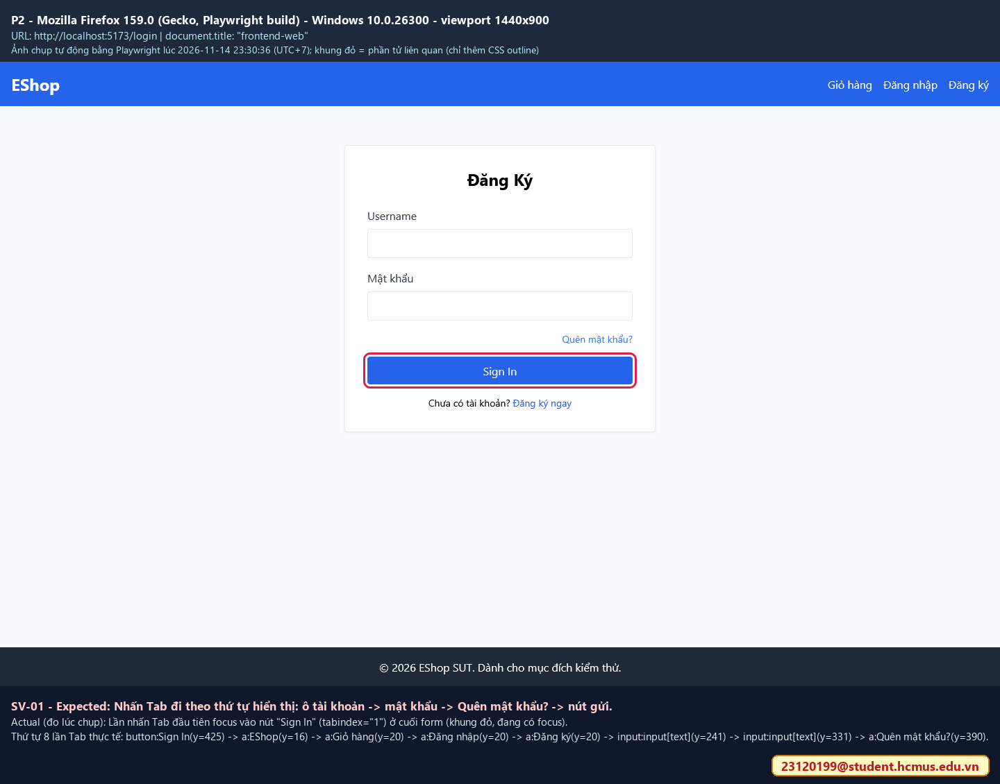

# [IA-03] [Login] Thứ tự di chuyển focus bằng phím Tab bị đảo ngược do nút 'Sign In' gắn cứng tabIndex={1}

## Summary
Trên trang Đăng nhập (`/login`), nút gửi biểu mẫu `Sign In` được gán cứng thuộc tính `tabIndex={1}`, khiến lần nhấn phím `Tab` đầu tiên nhảy cóc qua toàn bộ thanh Header và hai ô nhập liệu để rơi thẳng xuống nút `Sign In` ở cuối form rồi mới nhảy ngược lên đầu trang.

- **Bug ID:** `BUG-15`
- **Checklist item:** `SV-01`
- **Interface aspect:** `IA-03` — Navigation
- **Màn hình:** Login (`/login`)
- **Requirement:** FR-21 (eshop-sut/README.md:248); Slide 10 #9 Tab Order
- **Loại lỗi:** `State`
- **Severity:** **Major**
- **Priority:** **Medium**

## Environment
- **SUT:** `eshop-sut @ 1a9304a (repo HEAD 6b6a7a9)` (Web `http://localhost:5173`, Backend API `http://localhost:3000`)
- **P1:** Google Chrome 157.0.8103.50 trên Windows 11
- **P2:** Mozilla Firefox trên Windows 11 (bản cài đặt `137.0.1` dùng để quan sát trực tiếp; nhân Gecko `159.0` bản Playwright dùng để đo DOM và chụp ảnh minh chứng)
- **URL kiểm thử:** `http://localhost:5173/login`
- **Viewport:** Desktop `1440x900` (`P1`, `P2`)

## Preconditions
Mở trang `http://localhost:5173/login` trên trình duyệt máy tính để bàn (`P1` Chrome, `P2` Firefox).

## Steps to reproduce
1. Tải mới trang `http://localhost:5173/login` (chưa nhấp chuột vào ô nhập nào).
2. Nhấn phím `Tab` liên tiếp từng lần và ghi nhận phần tử nhận focus cùng tọa độ hiển thị trên màn hình.

## Expected result
Theo `FR-21` (`eshop-sut/README.md:248`) và Slide 10 #9 (Tab Order), thứ tự di chuyển focus bằng phím `Tab` phải tuân theo trật tự thị giác tự nhiên từ trên xuống dưới, từ trái sang phải (`Header` -> `Username` -> `Mật khẩu` -> `Quên mật khẩu?` -> `Sign In` -> `Đăng ký ngay`).

- **`SV-01`** (*Thứ tự di chuyển focus bằng phím Tab trên form Đăng nhập* — căn cứ: `FR-21 (eshop-sut/README.md:248); Slide 10 #9 Tab Order`): Khi nhấn Tab liên tiếp trên /login, focus đi lần lượt từ trên xuống dưới, trái sang phải qua các thành phần của form theo thứ tự hiển thị (ô tài khoản, ô mật khẩu, liên kết `Quên mật khẩu?`, nút gửi form, liên kết `Đăng ký ngay`) và không nhảy cóc. Fail nếu nút gửi form nhận focus trước ô tài khoản hoặc trước ô mật khẩu, hoặc thứ tự focus khác thứ tự hiển thị từ trên xuống dưới.

## Actual result
Lần nhấn `Tab` đầu tiên nhảy thẳng xuống nút `Sign In` ở cuối biểu mẫu (`y=425px`) do `Login.jsx:62` gán `tabIndex={1}`, nhấn `Tab` lần 2 mới nhảy ngược lên logo `EShop` trên Header (`y=16px`) rồi mới đi qua các liên kết điều hướng và hai ô nhập liệu.

**Dữ kiện `Actual` nguyên văn theo từng mục và nền tảng:**
- **`SV-01` trên `P1`:** Actual: Nhấn Tab lần đầu tiên trên /login nhảy cóc thẳng tới nút "Sign In" (tabIndex=1, y=425px) trước cả thanh Header và trước cả hai ô Username, Mật khẩu; thứ tự thực tế: ["button:Sign In(y=425)","a:EShop(y=16)","a:Giỏ hàng(y=20)","a:Đăng nhập(y=20)","a:Đăng ký(y=20)","input:text(y=241)","input:text(y=331)","a:Quên mật khẩu?(y=389)"].
- **`SV-01` trên `P2`:** Actual: Nhấn Tab lần đầu tiên trên /login nhảy cóc thẳng tới nút "Sign In" (tabIndex=1, y=425px) trước cả thanh Header và trước cả hai ô Username, Mật khẩu; thứ tự thực tế: ["button:Sign In(y=425)","a:EShop(y=16)","a:Giỏ hàng(y=20)","a:Đăng nhập(y=20)","a:Đăng ký(y=20)","input:text(y=241)","input:text(y=331)","a:Quên mật khẩu?(y=390)"].

## Impact
Gây rối loạn nghiêm trọng cho người dùng thao tác bằng bàn phím và người dùng công nghệ hỗ trợ khi muốn nhập nhanh tài khoản và mật khẩu.

## Reproducibility
Luôn luôn (100%) trên các nền tảng áp dụng: `P1`, `P2`.

## Evidence

**Danh sách đầy đủ ảnh minh chứng theo nền tảng:**
- `SV-01` (`P1`): [`screenshots/task1_failed/P1_SV-01.png`](../screenshots/task1_failed/P1_SV-01.png)
- `SV-01` (`P2`): [`screenshots/task1_failed/P2_SV-01.png`](../screenshots/task1_failed/P2_SV-01.png)

## GitHub Issue
- **Issue:** [#15 — [HW03-M1] [BUG-15] [IA-03] [Login] Thứ tự di chuyển focus bằng phím Tab bị đảo ngược do nút 'Sign In' gắn cứng tabIndex={1}](https://github.com/HuynhDucThinh/Software-Testing-HW03/issues/15)
- **Ảnh chụp trang GitHub Issue:** [`screenshots/github_issues/ISSUE-15_BUG-15.png`](../screenshots/github_issues/ISSUE-15_BUG-15.png)
