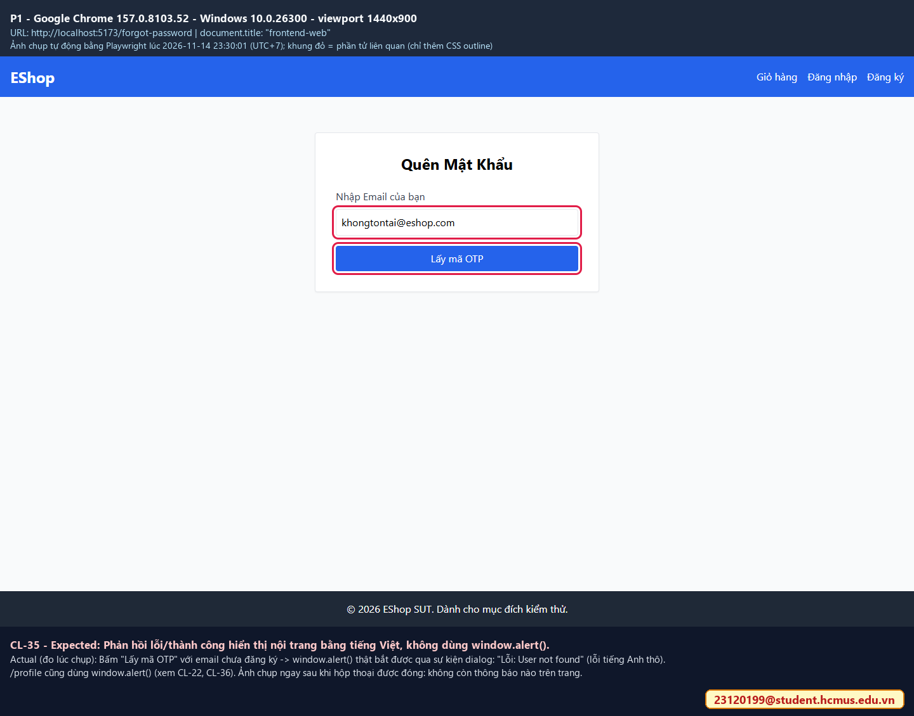

# [IA-04] [ForgotPassword, Profile] Sử dụng hộp thoại chặn window.alert() và hiển thị thông báo lỗi tiếng Anh thô 'Lỗi: User not found'

## Summary
Trang Quên mật khẩu (`/forgot-password`) và trang Hồ sơ (`/profile`) sử dụng hộp thoại hệ thống `window.alert()` gây chặn luồng tương tác thay vì thông báo nội trang/toast, đồng thời hiển thị nguyên văn chuỗi lỗi tiếng Anh từ server `Lỗi: User not found` khi nhập email không tồn tại.

- **Bug ID:** `BUG-16`
- **Checklist item:** `CL-35`
- **Interface aspect:** `IA-04` — Feedback / state
- **Màn hình:** ForgotPassword (`/forgot-password`), Profile (`/profile`)
- **Requirement:** Slide 10 #15 Error Messages, #16 Input Validation; Nielsen #4 Consistency and standards
- **Loại lỗi:** `Visual-Layout`
- **Severity:** **Major**
- **Priority:** **Medium**

## Environment
- **SUT:** `eshop-sut @ 1a9304a (repo HEAD 6b6a7a9)` (Web `http://localhost:5173`, Backend API `http://localhost:3000`)
- **P1:** Google Chrome 157.0.8103.50 trên Windows 11
- **P2:** Mozilla Firefox trên Windows 11 (bản cài đặt `137.0.1` dùng để quan sát trực tiếp; nhân Gecko `159.0` bản Playwright dùng để đo DOM và chụp ảnh minh chứng)
- **P3:** Chrome Android 156.0.8078.79 trên OPPO Reno10 5G (Android 15, adb reverse)
- **URL kiểm thử:** `http://localhost:5173/forgot-password, http://localhost:5173/profile`
- **Viewport:** Desktop `1440x900` (`P1`, `P2`); Mobile `360x801` / `1080x2412` (`P3`)

## Preconditions
Backend và Frontend đang hoạt động.

## Steps to reproduce
1. Mở `http://localhost:5173/forgot-password`, nhập email chưa đăng ký `khongtontai@eshop.com` rồi bấm `Lấy mã OTP`.
2. Tiếp tục nhập email hợp lệ `test@eshop.com` bấm `Lấy mã OTP`, sang Bước 2 nhập sai OTP rồi bấm `Đặt lại mật khẩu`.
3. Đăng nhập và vào `http://localhost:5173/profile`, nhập SĐT sai hoặc cập nhật thành công để quan sát cơ chế hiển thị thông báo.

## Expected result
Theo `FR-21` (`eshop-sut/README.md:244`), Slide 10 #15 (Error Messages) và Nielsen #4 (Consistency and standards), phản hồi lỗi/thành công phải hiển thị trực quan bằng tiếng Việt ngay trên giao diện (inline banner hoặc toast đồng bộ như Login/Register), không dùng hộp thoại `window.alert()` chặn luồng hay phơi bày thông điệp tiếng Anh thô của server.

- **`CL-35`** (*Phản hồi thành công và lỗi hiển thị trực quan nội trang thay vì hộp thoại window.alert()* — căn cứ: `Slide 10 #15 Error Messages, #16 Input Validation; Nielsen #4 Consistency and standards`): Mọi phản hồi thành công hoặc báo lỗi trên `/forgot-password` và `/profile` đều được render thành khối thông báo nội trang (inline banner) hoặc toast trực quan bằng tiếng Việt, nhất quán với kiểu thông báo của `/register` và `/login`. Fail nếu trình duyệt bật hộp thoại hệ thống `window.alert()` chặn thao tác người dùng hoặc hiển thị chuỗi lỗi tiếng Anh thô (ví dụ `Lỗi: User not found`).

## Actual result
Toàn bộ phản hồi trên `/forgot-password` và `/profile` đều bật hộp thoại modal hệ thống `window.alert()`, trong đó khi email không tồn tại ở Bước 1 Quên mật khẩu, hộp thoại hiển thị pha trộn Anh-Việt: `Lỗi: User not found`.

**Dữ kiện `Actual` nguyên văn theo từng mục và nền tảng:**
- **`CL-35` trên `P1`:** Actual: Cả /forgot-password lẫn /profile đều bật hộp thoại native window.alert() chặn luồng thao tác thay vì thông báo nội trang/toast, đồng thời lộ chuỗi tiếng Anh thô trên /forgot-password (alert: "Lỗi: User not found"; /profile alert: "Cập nhật thành công!").
- **`CL-35` trên `P2`:** Actual: Cả /forgot-password lẫn /profile đều bật hộp thoại native window.alert() chặn luồng thao tác thay vì thông báo nội trang/toast, đồng thời lộ chuỗi tiếng Anh thô trên /forgot-password (alert: "Lỗi: User not found"; /profile alert: "Cập nhật thành công!").
- **`CL-35` trên `P3`:** Actual: Cả /forgot-password lẫn /profile đều bật hộp thoại native window.alert() chặn luồng thao tác thay vì thông báo nội trang/toast, đồng thời lộ chuỗi tiếng Anh thô trên /forgot-password (alert: "Lỗi: User not found"; /profile alert: "Cập nhật thành công!").

## Impact
Ngắt quãng thao tác người dùng bởi hộp thoại hệ thống, không giữ lại nội dung thông báo trên màn hình sau khi bấm OK (đặc biệt bất lợi khi người dùng cần đọc lại mã OTP hoặc lý do lỗi).

## Reproducibility
Luôn luôn (100%) trên các nền tảng áp dụng: `P1`, `P2`, `P3`.

## Evidence

**Danh sách đầy đủ ảnh minh chứng theo nền tảng:**
- `CL-35` (`P1`): [`screenshots/task1_failed/P1_CL-35.png`](../screenshots/task1_failed/P1_CL-35.png)
- `CL-35` (`P2`): [`screenshots/task1_failed/P2_CL-35.png`](../screenshots/task1_failed/P2_CL-35.png)
- `CL-35` (`P3`): [`screenshots/task1_failed/P3_CL-35.png`](../screenshots/task1_failed/P3_CL-35.png)

## GitHub Issue
- **Issue:** [#16 — [HW03-M1] [BUG-16] [IA-04] [ForgotPassword, Profile] Sử dụng hộp thoại chặn window.alert() và hiển thị thông báo lỗi tiếng Anh thô 'Lỗi: User not found'](https://github.com/HuynhDucThinh/Software-Testing-HW03/issues/16)
- **Ảnh chụp trang GitHub Issue:** [`screenshots/github_issues/ISSUE-16_BUG-16.png`](../screenshots/github_issues/ISSUE-16_BUG-16.png)
