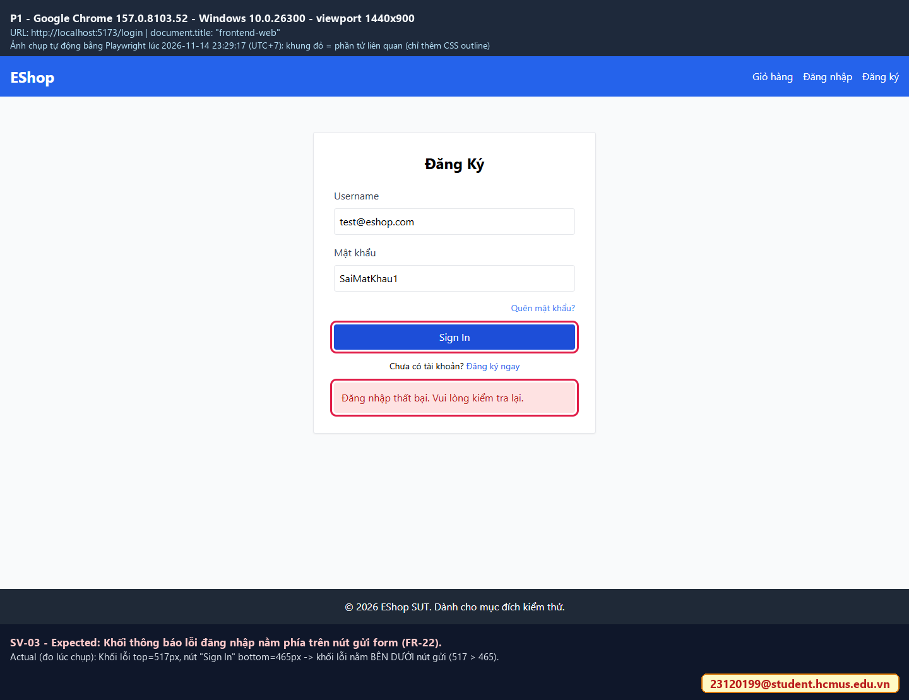
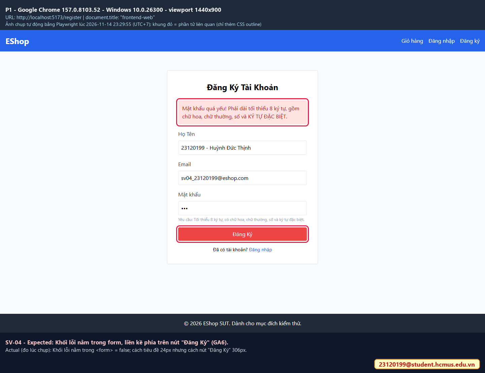

# [IA-02] [Login, Register] Vị trí khối thông báo lỗi đặt sai chuẩn: nằm bên dưới nút 'Sign In' ở Đăng nhập và cách xa nút 'Đăng Ký' 336px ở đầu form Đăng ký

## Summary
Vị trí hiển thị thông báo lỗi biểu mẫu không nhất quán và trái quy chuẩn `FR-22`: trên `/login` khối lỗi bị đẩy xuống bên dưới nút `Sign In` và dòng chuyển trang, còn trên `/register` khối lỗi chỉ hiện ở sát đỉnh form cách nút `Đăng Ký` `336px` mà không có lỗi cạnh trường hoặc ngay trên nút gửi.

- **Bug ID:** `BUG-17`
- **Checklist item:** `SV-03`, `SV-04`
- **Interface aspect:** `IA-02` — Forms
- **Màn hình:** Login (`/login`), Register (`/register`)
- **Requirement:** FR-22 (eshop-sut/README.md:255); Giả định GA6
- **Loại lỗi:** `Visual-Layout`
- **Severity:** **Minor**
- **Priority:** **Medium**

## Environment
- **SUT:** `eshop-sut @ 1a9304a (repo HEAD 6b6a7a9)` (Web `http://localhost:5173`, Backend API `http://localhost:3000`)
- **P1:** Google Chrome 157.0.8103.50 trên Windows 11
- **P2:** Mozilla Firefox trên Windows 11 (bản cài đặt `137.0.1` dùng để quan sát trực tiếp; nhân Gecko `159.0` bản Playwright dùng để đo DOM và chụp ảnh minh chứng)
- **P3:** Chrome Android 156.0.8078.79 trên OPPO Reno10 5G (Android 15, adb reverse)
- **URL kiểm thử:** `http://localhost:5173/login, http://localhost:5173/register`
- **Viewport:** Desktop `1440x900` (`P1`, `P2`); Mobile `360x801` / `1080x2412` (`P3`)

## Preconditions
Truy cập trang `/login` và `/register`.

## Steps to reproduce
1. Tại `http://localhost:5173/login`, nhập thông tin sai (`test@eshop.com` / `Wrong1`) rồi bấm `Sign In` và đo vị trí khối lỗi đỏ so với nút `Sign In`.
2. Tại `http://localhost:5173/register`, nhập mật khẩu yếu (`weak`) rồi bấm `Đăng Ký` và đo khoảng cách từ khối lỗi đỏ ở đầu form tới nút `Đăng Ký` và ô `Mật khẩu`.

## Expected result
Theo `FR-22` (`eshop-sut/README.md:255`) và giả định `GA6`, thông báo lỗi cần hiển thị ngay cạnh trường bị lỗi hoặc ngay phía trên nút gửi biểu mẫu để nằm trong vùng chú ý trực tiếp của mắt khi người dùng vừa bấm Submit.

- **`SV-03`** (*Vị trí khối thông báo lỗi so với nút gửi form trên trang Đăng nhập* — căn cứ: `FR-22 (eshop-sut/README.md:255)`): Khối thông báo lỗi đăng nhập hiển thị phía trên nút gửi form (toạ độ `bottom` của khối lỗi nhỏ hơn hoặc bằng toạ độ `top` của nút gửi, đo bằng `getBoundingClientRect()`). Fail nếu khối thông báo lỗi nằm bên dưới nút gửi form.
- **`SV-04`** (*Vị trí khối thông báo lỗi so với nút Đăng Ký trên trang Đăng ký* — căn cứ: `FR-22 (eshop-sut/README.md:255); Giả định GA6`): Khối thông báo lỗi hiển thị trong form, liền kề phía trên nút `Đăng Ký` (khoảng cách dọc giữa mép dưới khối lỗi và mép trên nút nhỏ hơn khoảng cách tới tiêu đề trang, đo bằng `getBoundingClientRect()`). Fail nếu khối lỗi nằm phía trên tiêu đề trang hoặc phía trên tất cả các ô nhập, xa nút `Đăng Ký` đến mức người dùng phải cuộn mới thấy khi form dài.

## Actual result
Trên `/login` (`Login.jsx:72`), khối lỗi nằm ở `y=514px`, thấp hơn đáy nút `Sign In` (`y=466px`) và thấp hơn cả dòng `Chưa có tài khoản? Đăng ký ngay`. Trên `/register` (`Register.jsx:43`), khối lỗi nằm ở đầu form (`y=209px`), cách đỉnh nút `Đăng Ký` tới `336px` (trên `P3` màn hình nhỏ dễ bị khuất phía trên khi cuộn xuống nút Submit).

**Dữ kiện `Actual` nguyên văn theo từng mục và nền tảng:**
- **`SV-03` trên `P1`:** Actual: Khối thông báo lỗi trên /login nằm BÊN DƯỚI nút gửi form (error.top=517px > submit.bottom=465px), vi phạm FR-22 yêu cầu nằm phía trên nút submit.
- **`SV-03` trên `P2`:** Actual: Khối thông báo lỗi trên /login nằm BÊN DƯỚI nút gửi form (error.top=517px > submit.bottom=465px), vi phạm FR-22 yêu cầu nằm phía trên nút submit.
- **`SV-03` trên `P3`:** Actual: Khối thông báo lỗi trên /login nằm BÊN DƯỚI nút gửi form (error.top=517px > submit.bottom=465px), vi phạm FR-22 yêu cầu nằm phía trên nút submit.
- **`SV-04` trên `P1`:** Actual: Khối lỗi trên /register nằm ngoài thẻ `<form>` (insideForm=false), phía trên tất cả các ô nhập (cách tiêu đề 24px nhưng cách nút "Đăng Ký" tới 306px), không nằm liền kề phía trên nút Submit theo GA6.
- **`SV-04` trên `P2`:** Actual: Khối lỗi trên /register nằm ngoài thẻ `<form>` (insideForm=false), phía trên tất cả các ô nhập (cách tiêu đề 24px nhưng cách nút "Đăng Ký" tới 306px), không nằm liền kề phía trên nút Submit theo GA6.
- **`SV-04` trên `P3`:** Actual: Khối lỗi trên /register nằm ngoài thẻ `<form>` (insideForm=false), phía trên tất cả các ô nhập (cách tiêu đề 24px nhưng cách nút "Đăng Ký" tới 322px), không nằm liền kề phía trên nút Submit theo GA6.

## Impact
Người dùng đang nhìn vào nút Submit ở cuối form dễ bỏ lỡ thông báo lỗi xuất hiện ở vị trí bất thường hoặc ngoài vùng nhìn thấy trên màn hình nhỏ.

## Reproducibility
Luôn luôn (100%) trên các nền tảng áp dụng: `P1`, `P2`, `P3`.

## Evidence

**Danh sách đầy đủ ảnh minh chứng theo nền tảng:**
- `SV-03` (`P1`): [`screenshots/task1_failed/P1_SV-03.png`](../screenshots/task1_failed/P1_SV-03.png)
- `SV-03` (`P2`): [`screenshots/task1_failed/P2_SV-03.png`](../screenshots/task1_failed/P2_SV-03.png)
- `SV-03` (`P3`): [`screenshots/task1_failed/P3_SV-03.png`](../screenshots/task1_failed/P3_SV-03.png)
- `SV-04` (`P1`): [`screenshots/task1_failed/P1_SV-04.png`](../screenshots/task1_failed/P1_SV-04.png)
- `SV-04` (`P2`): [`screenshots/task1_failed/P2_SV-04.png`](../screenshots/task1_failed/P2_SV-04.png)
- `SV-04` (`P3`): [`screenshots/task1_failed/P3_SV-04.png`](../screenshots/task1_failed/P3_SV-04.png)

## GitHub Issue
- **Issue:** [#17 — [HW03-M1] [BUG-17] [IA-02] [Login, Register] Vị trí khối thông báo lỗi đặt sai chuẩn: nằm bên dưới nút 'Sign In' ở Đăng nhập và cách xa nút 'Đăng Ký' 336px ở đầu form Đăng ký](https://github.com/HuynhDucThinh/Software-Testing-HW03/issues/17)
- **Ảnh chụp trang GitHub Issue:** [`screenshots/github_issues/ISSUE-17_BUG-17.png`](../screenshots/github_issues/ISSUE-17_BUG-17.png)
