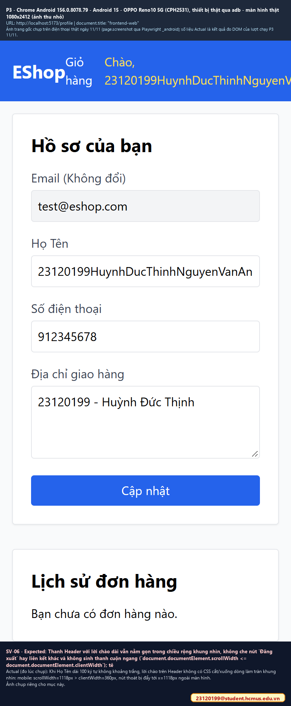
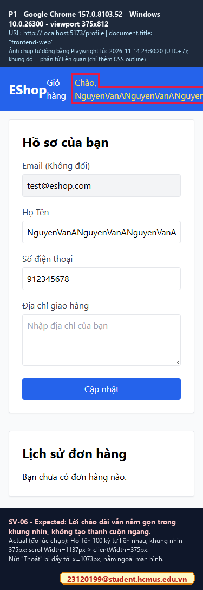

# [IA-01] [Header] Họ Tên dài 100 ký tự không khoảng trắng làm tràn ngang thanh Header và đẩy nút 'Thoát' ra khỏi khung nhìn

## Summary
Thanh Header không giới hạn chiều rộng tối đa (`max-width` / `text-overflow: ellipsis`) cho chuỗi tên người dùng trong lời chào `Chào, <tên>`, khiến tên dài 100 ký tự liền mạch đẩy tràn thanh điều hướng ngang và làm mất nút `Thoát` trên màn hình di động hoặc cửa sổ hẹp.

- **Bug ID:** `BUG-18`
- **Checklist item:** `SV-06`
- **Interface aspect:** `IA-01` — General UI standards
- **Màn hình:** Header/Navbar, Profile (`/profile`)
- **Requirement:** Slide 10 #5 Field Limits, #18 Element Overlap, #19 Scroll Boundaries
- **Loại lỗi:** `Responsive`
- **Severity:** **Minor**
- **Priority:** **Medium**

## Environment
- **SUT:** `eshop-sut @ 1a9304a (repo HEAD 6b6a7a9)` (Web `http://localhost:5173`, Backend API `http://localhost:3000`)
- **P1:** Google Chrome 157.0.8103.50 trên Windows 11
- **P2:** Mozilla Firefox trên Windows 11 (bản cài đặt `137.0.1` dùng để quan sát trực tiếp; nhân Gecko `159.0` bản Playwright dùng để đo DOM và chụp ảnh minh chứng)
- **P3:** Chrome Android 156.0.8078.79 trên OPPO Reno10 5G (Android 15, adb reverse)
- **URL kiểm thử:** `http://localhost:5173/profile`
- **Viewport:** Desktop `1440x900` (`P1`, `P2`); Mobile `360x801` / `1080x2412` (`P3`)

## Preconditions
Tài khoản người dùng có Họ Tên dài 100 ký tự không khoảng trắng (`NguyenVanA` lặp 10 lần).

## Steps to reproduce
1. Đăng ký hoặc cập nhật tài khoản với Họ Tên gồm 100 ký tự liền nhau (`NguyenVanA` x 10) rồi đăng nhập.
2. Quan sát thanh Header trên thiết bị di động `P3` (`360px`) và trên trình duyệt Desktop ở khung nhìn `375x667`.

## Expected result
Theo Slide 10 #5 (Field Limits), #18 (Element Overlap) và #19 (Scroll Boundaries), phần tử hiển thị tên trên Header phải cắt gọn bằng dấu `...` (`truncate`) hoặc xuống dòng an toàn sao cho `scrollWidth <= clientWidth` và nút đăng xuất luôn nằm trọn trong khung nhìn.

- **`SV-06`** (*Bố cục Header khi Họ Tên người dùng rất dài và không có khoảng trắng* — căn cứ: `Slide 10 #5 Field Limits, #18 Element Overlap, #19 Scroll Boundaries`): Thanh Header với lời chào dài vẫn nằm gọn trong chiều rộng khung nhìn, không che nút `Đăng xuất` hay liên kết khác và không sinh thanh cuộn ngang (`document.documentElement.scrollWidth <= document.documentElement.clientWidth`); tên dài được cắt bớt, xuống dòng hoặc rút gọn. Fail nếu lời chào đẩy nút `Đăng xuất` ra ngoài màn hình, chồng lên phần tử khác hoặc tạo thanh cuộn ngang.

## Actual result
Trên `P3` (`360px`), `document.documentElement.scrollWidth` bị kéo giãn lên tới `1118px` (`> clientWidth = 360px`); trên `P1`/`P2` ở khung nhìn `375px`, `scrollWidth = 1138px`, đẩy liên kết `Hồ sơ` và nút `Thoát` tràn hẳn ra ngoài cạnh phải màn hình.

**Dữ kiện `Actual` nguyên văn theo từng mục và nền tảng:**
- **`SV-06` trên `P1`:** Actual: Khi Họ Tên dài 100 ký tự không khoảng trắng, lời chào trên Header không có CSS cắt/xuống dòng làm tràn khung nhìn: 375px: scrollWidth=1146px > clientWidth=375px, nút thoát bị đẩy tới x=1146px ngoài màn hình.
- **`SV-06` trên `P2`:** Actual: Khi Họ Tên dài 100 ký tự không khoảng trắng, lời chào trên Header không có CSS cắt/xuống dòng làm tràn khung nhìn: 375px: scrollWidth=1146px > clientWidth=375px, nút thoát bị đẩy tới x=1146px ngoài màn hình.
- **`SV-06` trên `P3`:** Actual: Khi Họ Tên dài 100 ký tự không khoảng trắng, lời chào trên Header không có CSS cắt/xuống dòng làm tràn khung nhìn: mobile: scrollWidth=1118px > clientWidth=360px, nút thoát bị đẩy tới x=1118px ngoài màn hình.

## Impact
Phá vỡ bố cục responsive trên thiết bị di động và khiến người dùng có tên dài không thấy nút đăng xuất nếu không cuộn ngang toàn trang.

## Reproducibility
Luôn luôn (100%) trên các nền tảng áp dụng: `P1`, `P2`, `P3`.

## Evidence

**Danh sách đầy đủ ảnh minh chứng theo nền tảng:**
- `SV-06` (`P1`): [`screenshots/task1_failed/P1_SV-06.png`](../screenshots/task1_failed/P1_SV-06.png)
- `SV-06` (`P2`): [`screenshots/task1_failed/P2_SV-06.png`](../screenshots/task1_failed/P2_SV-06.png)
- `SV-06` (`P3`): [`screenshots/task1_failed/P3_SV-06.png`](../screenshots/task1_failed/P3_SV-06.png)

## GitHub Issue
- **Issue:** [#18 — [HW03-M1] [BUG-18] [IA-01] [Header] Họ Tên dài 100 ký tự không khoảng trắng làm tràn ngang thanh Header và đẩy nút 'Thoát' ra khỏi khung nhìn](https://github.com/HuynhDucThinh/Software-Testing-HW03/issues/18)
- **Ảnh chụp trang GitHub Issue:** [`screenshots/github_issues/ISSUE-18_BUG-18.png`](../screenshots/github_issues/ISSUE-18_BUG-18.png)
