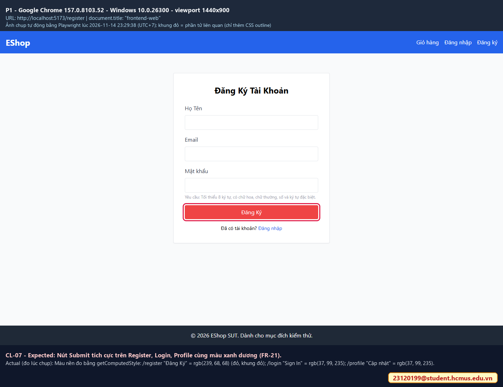
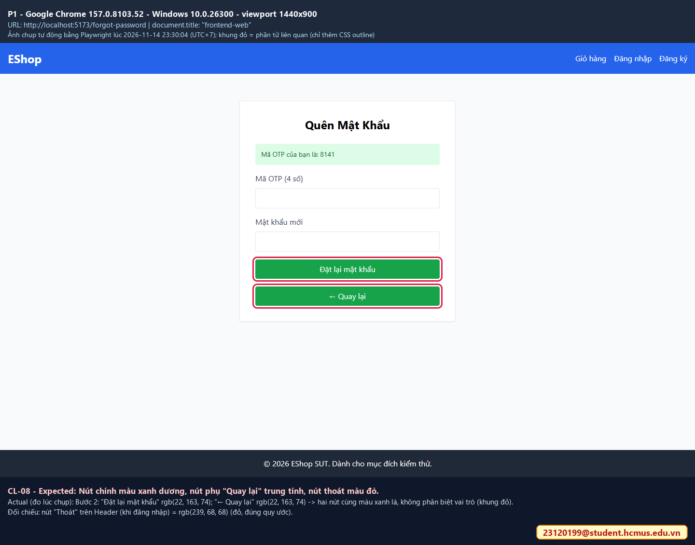

# [IA-01] [Register, ForgotPassword, Header] Màu sắc nút bấm vi phạm ngữ nghĩa: nút 'Đăng Ký' dùng màu đỏ nguy hiểm, hai nút Bước 2 Quên mật khẩu trùng màu xanh lá

## Summary
Hệ thống màu sắc các nút hành động trong phân hệ M1 thiếu nhất quán và sai ngữ nghĩa chuẩn `FR-21`: nút chính `Đăng Ký` lại tô màu đỏ (vốn dành cho hành động xóa/nguy hiểm), ở Bước 2 Quên mật khẩu cả nút chính `Đặt lại mật khẩu` và nút phụ `← Quay lại` đều tô cùng màu xanh lá cây giống hệt nhau.

- **Bug ID:** `BUG-19`
- **Checklist item:** `CL-07`, `CL-08`
- **Interface aspect:** `IA-01` — General UI standards
- **Màn hình:** Register (`/register`), ForgotPassword (`/forgot-password` — Bước 2), Header/Navbar
- **Requirement:** FR-21 (eshop-sut/README.md:245); Slide 10 #2 Color and Palette
- **Loại lỗi:** `Visual-Layout`
- **Severity:** **Minor**
- **Priority:** **Medium**

## Environment
- **SUT:** `eshop-sut @ 1a9304a (repo HEAD 6b6a7a9)` (Web `http://localhost:5173`, Backend API `http://localhost:3000`)
- **P1:** Google Chrome 157.0.8103.50 trên Windows 11
- **P2:** Mozilla Firefox trên Windows 11 (bản cài đặt `137.0.1` dùng để quan sát trực tiếp; nhân Gecko `159.0` bản Playwright dùng để đo DOM và chụp ảnh minh chứng)
- **P3:** Chrome Android 156.0.8078.79 trên OPPO Reno10 5G (Android 15, adb reverse)
- **URL kiểm thử:** `http://localhost:5173/register, http://localhost:5173/forgot-password`
- **Viewport:** Desktop `1440x900` (`P1`, `P2`); Mobile `360x801` / `1080x2412` (`P3`)

## Preconditions
Mở trang `/register`, Bước 2 `/forgot-password` và thanh Header khi đã đăng nhập.

## Steps to reproduce
1. So sánh màu nền nút Submit chính trên `/login` (`Sign In`), `/profile` (`Cập nhật`) với nút `Đăng Ký` trên `/register`.
2. Chuyển sang Bước 2 trang `/forgot-password`, quan sát màu nền của hai nút `Đặt lại mật khẩu` và `← Quay lại`.
3. (Đối chứng) Đăng nhập và quan sát nút `Thoát` trên thanh Header: nền đỏ `rgb(239, 68, 68)`, đúng quy ước.

## Expected result
Theo `FR-21` (`eshop-sut/README.md:245`) và Slide 10 #2 (Color and Palette), nút hành động tích cực chính dùng màu xanh dương nhất quán, màu đỏ chỉ dùng cho hành động xóa/hủy nguy hiểm, và nút điều hướng phụ (`← Quay lại`) phải có kiểu dáng thứ cấp tách biệt rõ với nút gửi chính.

- **`CL-07`** (*Nhất quán màu xanh dương của nút hành động tích cực Submit trên Register, Login và Profile* — căn cứ: `FR-21 (eshop-sut/README.md:245); Slide 10 #2 Color and Palette`): Nút Submit chính trên /register ('Đăng Ký'), /login và /profile ('Cập nhật') khi hiển thị ở trạng thái mặc định đều có màu nền xanh dương đồng nhất (kiểm tra mắt thường và `getComputedStyle(btn).backgroundColor` thuộc dải xanh dương). Fail nếu bất kỳ nút Submit tích cực nào dùng màu đỏ (nhầm với nút nguy hiểm/hủy) hoặc màu khác xanh dương.
- **`CL-08`** (*Phân biệt màu sắc nút hành động tích cực, nút điều hướng phụ và nút đăng xuất trên ForgotPassword và Header* — căn cứ: `FR-21 (eshop-sut/README.md:245); Slide 10 #2 Color and Palette`): Các nút hành động tích cực ('Lấy mã OTP', 'Đặt lại mật khẩu') có nền màu xanh dương, nút phụ ('Quay lại') có kiểu trung tính phân biệt rõ với nút chính, và nút thoát phiên đăng nhập trên Header dùng màu đỏ theo quy ước. Fail nếu nút tích cực dùng màu khác xanh dương (ví dụ xanh lá) hoặc nút 'Đặt lại mật khẩu' và nút 'Quay lại' dùng cùng một màu nền gây nhầm lẫn vai trò.

## Actual result
Nút `Đăng Ký` trên `/register` dùng nền đỏ `bg-red-500/600` (`rgb(239, 68, 68)`); ở Bước 2 `/forgot-password` cả hai nút `Đặt lại mật khẩu` và `← Quay lại` đều dùng nền xanh lá `bg-green-600` (`rgb(22, 163, 74)`) giống hệt nhau. (Nút `Thoát` trên Header có nền đỏ `rgb(239, 68, 68)` đúng quy ước nút nguy hiểm, nên không thuộc phạm vi lỗi này.)

**Dữ kiện `Actual` nguyên văn theo từng mục và nền tảng:**
- **`CL-07` trên `P1`:** Actual: Nút Submit trên Login ("Sign In": rgb(37, 99, 235)) và Profile ("Cập nhật": rgb(37, 99, 235)) dùng màu xanh dương, nhưng nút "Đăng Ký" trên /register lại dùng màu đỏ (rgb(239, 68, 68)).
- **`CL-07` trên `P2`:** Actual: Nút Submit trên Login ("Sign In": rgb(37, 99, 235)) và Profile ("Cập nhật": rgb(37, 99, 235)) dùng màu xanh dương, nhưng nút "Đăng Ký" trên /register lại dùng màu đỏ (rgb(220, 38, 38)).
- **`CL-07` trên `P3`:** Actual: Nút Submit trên Login ("Sign In": rgb(37, 99, 235)) và Profile ("Cập nhật": rgb(37, 99, 235)) dùng màu xanh dương, nhưng nút "Đăng Ký" trên /register lại dùng màu đỏ (rgb(239, 68, 68)).
- **`CL-08` trên `P1`:** Actual: Bước 1 nút "Lấy mã OTP" màu xanh dương (rgb(37, 99, 235)), nút "Thoát" trên Header màu đỏ (rgb(239, 68, 68)); tuy nhiên ở Bước 2 cả nút chính "Đặt lại mật khẩu" (rgb(22, 163, 74)) lẫn nút phụ "← Quay lại" (rgb(22, 163, 74)) đều dùng chung nền xanh lá cây, không dùng xanh dương cho nút chính và không phân biệt vai trò hai nút.
- **`CL-08` trên `P2`:** Actual: Bước 1 nút "Lấy mã OTP" màu xanh dương (rgb(37, 99, 235)), nút "Thoát" trên Header màu đỏ (rgb(239, 68, 68)); tuy nhiên ở Bước 2 cả nút chính "Đặt lại mật khẩu" (rgb(22, 163, 74)) lẫn nút phụ "← Quay lại" (rgb(22, 163, 74)) đều dùng chung nền xanh lá cây, không dùng xanh dương cho nút chính và không phân biệt vai trò hai nút.
- **`CL-08` trên `P3`:** Actual: Bước 1 nút "Lấy mã OTP" màu xanh dương (rgb(37, 99, 235)), nút "Thoát" trên Header màu đỏ (rgb(239, 68, 68)); tuy nhiên ở Bước 2 cả nút chính "Đặt lại mật khẩu" (rgb(22, 163, 74)) lẫn nút phụ "← Quay lại" (rgb(22, 163, 74)) đều dùng chung nền xanh lá cây, không dùng xanh dương cho nút chính và không phân biệt vai trò hai nút.

## Impact
Tín hiệu thị giác đảo ngược dễ làm người dùng chần chừ khi bấm nút đỏ `Đăng Ký` hoặc bấm nhầm nút `← Quay lại` thay vì `Đặt lại mật khẩu` ở Bước 2.

## Reproducibility
Luôn luôn (100%) trên các nền tảng áp dụng: `P1`, `P2`, `P3`.

## Evidence

**Danh sách đầy đủ ảnh minh chứng theo nền tảng:**
- `CL-07` (`P1`): [`screenshots/task1_failed/P1_CL-07.png`](../screenshots/task1_failed/P1_CL-07.png)
- `CL-07` (`P2`): [`screenshots/task1_failed/P2_CL-07.png`](../screenshots/task1_failed/P2_CL-07.png)
- `CL-07` (`P3`): [`screenshots/task1_failed/P3_CL-07.png`](../screenshots/task1_failed/P3_CL-07.png)
- `CL-08` (`P1`): [`screenshots/task1_failed/P1_CL-08.png`](../screenshots/task1_failed/P1_CL-08.png)
- `CL-08` (`P2`): [`screenshots/task1_failed/P2_CL-08.png`](../screenshots/task1_failed/P2_CL-08.png)
- `CL-08` (`P3`): [`screenshots/task1_failed/P3_CL-08.png`](../screenshots/task1_failed/P3_CL-08.png)

## GitHub Issue
- **Issue:** [#19 — [HW03-M1] [BUG-19] [IA-01] [Register, ForgotPassword, Header] Màu sắc nút bấm vi phạm ngữ nghĩa: nút 'Đăng Ký' dùng màu đỏ nguy hiểm, hai nút Bước 2 Quên mật khẩu trùng màu xanh lá](https://github.com/HuynhDucThinh/Software-Testing-HW03/issues/19)
- **Ảnh chụp trang GitHub Issue:** [`screenshots/github_issues/ISSUE-19_BUG-19.png`](../screenshots/github_issues/ISSUE-19_BUG-19.png)
