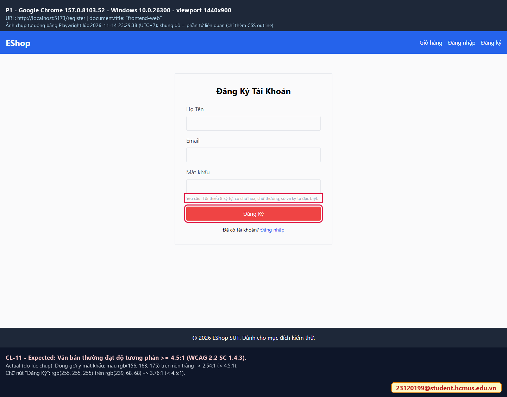

# [IA-01] [Register] Dòng hướng dẫn quy tắc mật khẩu màu xám nhạt (#9ca3af) chỉ đạt độ tương phản 2.54:1, thấp hơn chuẩn WCAG AA 4.5:1

## Summary
Dòng văn bản hướng dẫn quy tắc mật khẩu bên dưới ô Mật khẩu trên trang `/register` sử dụng màu chữ xám quá nhạt (`text-gray-400` — `rgb(156, 163, 175)`) trên nền trắng `rgb(255, 255, 255)`, cho tỷ lệ tương phản chỉ `2.54:1`, không đạt ngưỡng tối thiểu `4.5:1` của WCAG 2.2 SC 1.4.3.

- **Bug ID:** `BUG-20`
- **Checklist item:** `CL-11`
- **Interface aspect:** `IA-01` — General UI standards
- **Màn hình:** Register (`/register`)
- **Requirement:** WCAG 2.2 SC 1.4.3 Contrast (Minimum); Nielsen #8 Aesthetic and minimalist design
- **Loại lỗi:** `Visual-Layout`
- **Severity:** **Minor**
- **Priority:** **Low**

## Environment
- **SUT:** `eshop-sut @ 1a9304a (repo HEAD 6b6a7a9)` (Web `http://localhost:5173`, Backend API `http://localhost:3000`)
- **P1:** Google Chrome 157.0.8103.50 trên Windows 11
- **P2:** Mozilla Firefox 137.0.1 trên Windows 11
- **P3:** Chrome Android 156.0.8078.79 trên OPPO Reno10 5G (Android 15, adb reverse)
- **URL kiểm thử:** `http://localhost:5173/register`
- **Viewport:** Desktop `1440x900` (`P1`, `P2`); Mobile `360x801` / `1080x2412` (`P3`)

## Preconditions
Mở trang `http://localhost:5173/register`.

## Steps to reproduce
1. Truy cập `http://localhost:5173/register` và quan sát dòng chữ nhỏ `Yêu cầu: Tối thiểu 8 ký tự...` bên dưới ô Mật khẩu.
2. Dùng DevTools kiểm tra mã màu computed `color` và `background-color` để tính tỷ lệ độ tương phản theo công thức WCAG.

## Expected result
Theo WCAG 2.2 SC 1.4.3 (Contrast Minimum), văn bản cỡ thường (`< 18pt`, ở đây là `12px`) phải có tỷ lệ độ tương phản tối thiểu đạt `4.5:1` so với màu nền.

- **`CL-11`** (*Độ tương phản màu chữ và màu nền của nhãn, dòng hướng dẫn phụ và nút bấm* — căn cứ: `WCAG 2.2 SC 1.4.3 Contrast (Minimum); Nielsen #8 Aesthetic and minimalist design`): Toàn bộ văn bản hiển thị gồm tiêu đề, nhãn trường, dòng gợi ý yêu cầu mật khẩu dưới ô nhập, lời chào trên Header và chữ trên nút đều có độ tương phản rõ ràng với màu nền. Fail nếu bất kỳ văn bản thường nào (cỡ chữ < 18pt hoặc < 14pt in đậm) có tỷ lệ tương phản nhỏ hơn 4.5:1 hoặc văn bản lớn nhỏ hơn 3.0:1 (ví dụ chữ xám nhạt `text-gray-400` trên nền trắng).

## Actual result
Thẻ `
` (`Register.jsx:85`) có màu chữ `rgb(156, 163, 175)` trên nền `rgb(255, 255, 255)`, đạt độ tương phản chỉ `2.54:1` (`< 4.5:1`) trên cả `P1`, `P2` và `P3`.

**Dữ kiện `Actual` nguyên văn theo từng mục và nền tảng:**
- **`CL-11` trên `P1`:** Actual: Phát hiện văn bản không đạt ngưỡng tương phản WCAG 4.5:1: Register "Yêu cầu: Tối thiểu 8 ký tự, có chữ " (2.54:1 < 4.5:1, fg=rgb(156, 163, 175), bg=rgb(255,255,255)); Register "Đăng Ký" (3.76:1 < 4.5:1, fg=rgb(255, 255, 255), bg=rgb(239,68,68)); Login "Quên mật khẩu?" (3.68:1 < 4.5:1, fg=rgb(59, 130, 246), bg=rgb(255,255,255)); ForgotStep2 "Đặt lại mật khẩu" (3.3:1 < 4.5:1, fg=rgb(255, 255, 255), bg=rgb(22,163,74)); ForgotStep2 "← Quay lại" (3.3:1 < 4.5:1, fg=rgb(255, 255, 255), bg=rgb(22,163,74)); Profile+Header "Chào, Test User" (3.92:1 < 4.5:1, fg=rgb(253, 224, 71), bg=rgb(37,99,235)); Profile+Header "Thoát" (3.76:1 < 4.5:1, fg=rgb(255, 255, 255), bg=rgb(239,68,68)).
- **`CL-11` trên `P2`:** Actual: Phát hiện văn bản không đạt ngưỡng tương phản WCAG 4.5:1: Register "Yêu cầu: Tối thiểu 8 ký tự, có chữ " (2.54:1 < 4.5:1, fg=rgb(156, 163, 175), bg=rgb(255,255,255)); Register "Đăng Ký" (3.76:1 < 4.5:1, fg=rgb(255, 255, 255), bg=rgb(239,68,68)); Login "Quên mật khẩu?" (3.68:1 < 4.5:1, fg=rgb(59, 130, 246), bg=rgb(255,255,255)); ForgotStep2 "Đặt lại mật khẩu" (3.3:1 < 4.5:1, fg=rgb(255, 255, 255), bg=rgb(22,163,74)); ForgotStep2 "← Quay lại" (3.3:1 < 4.5:1, fg=rgb(255, 255, 255), bg=rgb(22,163,74)); Profile+Header "Chào, Test User" (3.92:1 < 4.5:1, fg=rgb(253, 224, 71), bg=rgb(37,99,235)); Profile+Header "Thoát" (3.76:1 < 4.5:1, fg=rgb(255, 255, 255), bg=rgb(239,68,68)).
- **`CL-11` trên `P3`:** Actual: Phát hiện văn bản không đạt ngưỡng tương phản WCAG 4.5:1: Register "Yêu cầu: Tối thiểu 8 ký tự, có chữ " (2.54:1 < 4.5:1, fg=rgb(156, 163, 175), bg=rgb(255,255,255)); Register "Đăng Ký" (3.76:1 < 4.5:1, fg=rgb(255, 255, 255), bg=rgb(239,68,68)); Login "Quên mật khẩu?" (3.68:1 < 4.5:1, fg=rgb(59, 130, 246), bg=rgb(255,255,255)); ForgotStep2 "Đặt lại mật khẩu" (3.3:1 < 4.5:1, fg=rgb(255, 255, 255), bg=rgb(22,163,74)); ForgotStep2 "← Quay lại" (3.3:1 < 4.5:1, fg=rgb(255, 255, 255), bg=rgb(22,163,74)); Profile+Header "Chào, Test User" (3.92:1 < 4.5:1, fg=rgb(253, 224, 71), bg=rgb(37,99,235)); Profile+Header "Thoát" (3.76:1 < 4.5:1, fg=rgb(255, 255, 255), bg=rgb(239,68,68)).

## Impact
Khó đọc đối với người dùng thị lực kém, màn hình độ sáng thấp hoặc khi sử dụng ngoài trời trên thiết bị di động.

## Reproducibility
Luôn luôn (100%) trên các nền tảng áp dụng: `P1`, `P2`, `P3`.

## Evidence

**Danh sách đầy đủ ảnh minh chứng theo nền tảng:**
- `CL-11` (`P1`): [`screenshots/task1_failed/P1_CL-11.png`](../screenshots/task1_failed/P1_CL-11.png)
- `CL-11` (`P2`): [`screenshots/task1_failed/P2_CL-11.png`](../screenshots/task1_failed/P2_CL-11.png)
- `CL-11` (`P3`): [`screenshots/task1_failed/P3_CL-11.png`](../screenshots/task1_failed/P3_CL-11.png)

## GitHub Issue
- **Issue:** [#20 — [HW03-M1] [BUG-20] [IA-01] [Register] Dòng hướng dẫn quy tắc mật khẩu màu xám nhạt (#9ca3af) chỉ đạt độ tương phản 2.54:1, thấp hơn chuẩn WCAG AA 4.5:1](https://github.com/HuynhDucThinh/Software-Testing-HW03/issues/20)
- **Ảnh chụp trang GitHub Issue:** [`screenshots/github_issues/ISSUE-20_BUG-20.png`](../screenshots/github_issues/ISSUE-20_BUG-20.png)
