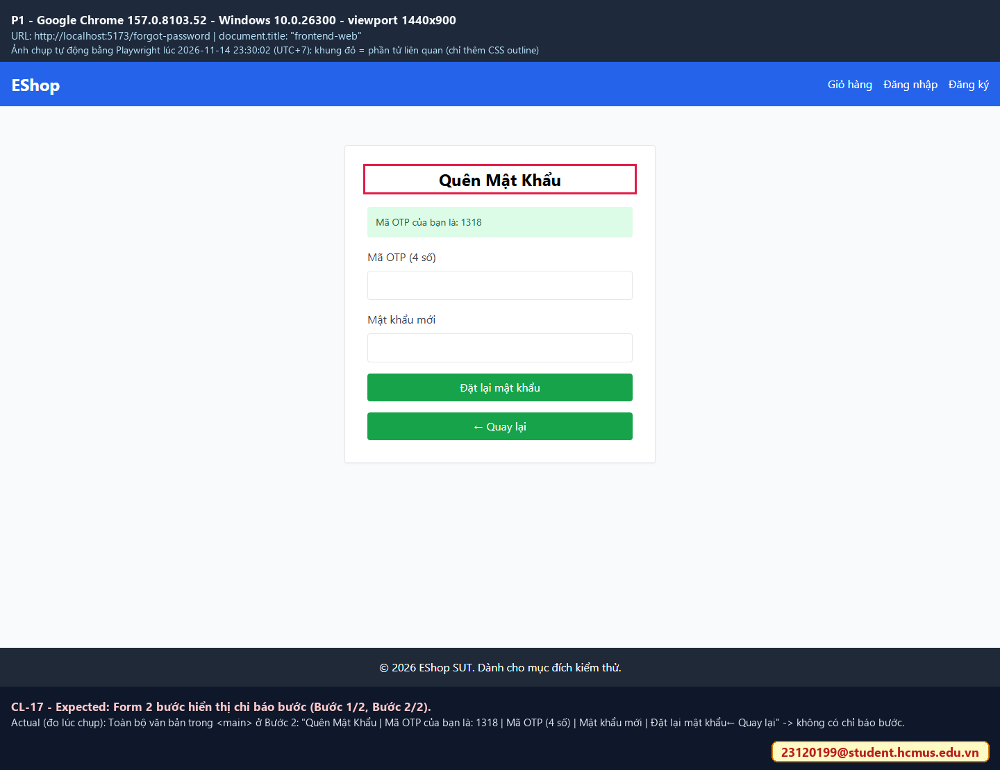
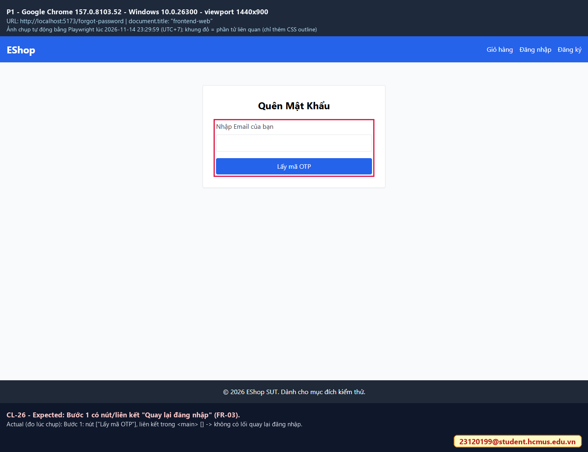

# [IA-03] [ForgotPassword] Luồng Quên mật khẩu 2 bước thiếu chỉ báo bước (Step Indicator) và Bước 1 thiếu liên kết 'Quay lại đăng nhập'

## Summary
Trang Quên mật khẩu (`/forgot-password`) được thiết kế gồm 2 bước nhưng không hiển thị chỉ báo bước (`Bước 1/2`, `Bước 2/2`) ở cả hai bước, đồng thời ở Bước 1 không có nút hoặc liên kết `Quay lại đăng nhập` như đặc tả `FR-03`.

- **Bug ID:** `BUG-21`
- **Checklist item:** `CL-17`, `CL-26`
- **Interface aspect:** `IA-03` — Navigation
- **Màn hình:** ForgotPassword (`/forgot-password`)
- **Requirement:** FR-03 (eshop-sut/README.md:52); FR-22 (eshop-sut/README.md:256); FR-03 (eshop-sut/README.md:53)
- **Loại lỗi:** `Visual-Layout`
- **Severity:** **Minor**
- **Priority:** **Medium**

## Environment
- **SUT:** `eshop-sut @ 1a9304a (repo HEAD 6b6a7a9)` (Web `http://localhost:5173`, Backend API `http://localhost:3000`)
- **P1:** Google Chrome 157.0.8103.50 trên Windows 11
- **P2:** Mozilla Firefox trên Windows 11 (bản cài đặt `137.0.1` dùng để quan sát trực tiếp; nhân Gecko `159.0` bản Playwright dùng để đo DOM và chụp ảnh minh chứng)
- **P3:** Chrome Android 156.0.8078.79 trên OPPO Reno10 5G (Android 15, adb reverse)
- **URL kiểm thử:** `http://localhost:5173/forgot-password`
- **Viewport:** Desktop `1440x900` (`P1`, `P2`); Mobile `360x801` / `1080x2412` (`P3`)

## Preconditions
Truy cập trang `http://localhost:5173/forgot-password`.

## Steps to reproduce
1. Mở `http://localhost:5173/forgot-password` (Bước 1), kiểm tra xem có chỉ báo tiến trình bước và nút/liên kết `Quay lại đăng nhập` trong vùng biểu mẫu hay không.
2. Nhập `test@eshop.com` bấm `Lấy mã OTP` để sang Bước 2 và tiếp tục kiểm tra chỉ báo bước hiện tại.

## Expected result
Theo `FR-03` (`eshop-sut/README.md:52-53`) và `FR-22` (`eshop-sut/README.md:256`), biểu mẫu nhiều bước phải hiển thị rõ chỉ báo bước hiện tại (`Bước 1/2`, `Bước 2/2`) và Bước 1 phải có nút/liên kết `Quay lại đăng nhập` dẫn về `/login`.

- **`CL-17`** (*Hiển thị chỉ báo bước (Step Indicator) rõ ràng trên form Quên mật khẩu 2 bước* — căn cứ: `FR-03 (eshop-sut/README.md:52); FR-22 (eshop-sut/README.md:256)`): Form /forgot-password hiển thị thành phần chỉ báo bước (Step Indicator, ví dụ `Bước 1 / 2` ở bước đầu và cập nhật sang `Bước 2 / 2` ở bước đặt lại mật khẩu) giúp người dùng nhận biết vị trí hiện tại trong quy trình. Fail nếu ở Bước 1 hoặc Bước 2 không có bất kỳ chỉ báo bước nào hiển thị trên giao diện.
- **`CL-26`** (*Sự tồn tại và điều hướng của nút 'Quay lại đăng nhập' ở Bước 1 trang Quên mật khẩu* — căn cứ: `FR-03 (eshop-sut/README.md:53)`): Màn hình Bước 1 tại /forgot-password hiển thị rõ nút hoặc liên kết `Quay lại đăng nhập`; khi người dùng nhấp/chạm vào thành phần này thì trình duyệt chuyển hướng ngay về trang `/login`. Fail nếu Bước 1 không có nút/liên kết `Quay lại đăng nhập` hoặc bấm vào không điều hướng về `/login`.

## Actual result
Cả Bước 1 và Bước 2 đều chỉ hiển thị tiêu đề chung `Quên Mật Khẩu` mà không có bất kỳ phần tử chỉ báo bước nào; tại Bước 1 cũng không có liên kết `Quay lại đăng nhập` nào trong vùng nội dung `<main>`.

**Dữ kiện `Actual` nguyên văn theo từng mục và nền tảng:**
- **`CL-17` trên `P1`:** Actual: Cả Bước 1 và Bước 2 trên /forgot-password đều không có thành phần chỉ báo bước (Step Indicator) nào hiển thị vị trí bước hiện tại (ví dụ Bước 1/2, Bước 2/2).
- **`CL-17` trên `P2`:** Actual: Cả Bước 1 và Bước 2 trên /forgot-password đều không có thành phần chỉ báo bước (Step Indicator) nào hiển thị vị trí bước hiện tại (ví dụ Bước 1/2, Bước 2/2).
- **`CL-17` trên `P3`:** Actual: Cả Bước 1 và Bước 2 trên /forgot-password đều không có thành phần chỉ báo bước (Step Indicator) nào hiển thị vị trí bước hiện tại (ví dụ Bước 1/2, Bước 2/2).
- **`CL-26` trên `P1`:** Actual: Màn hình Bước 1 tại /forgot-password chỉ có nút ["Lấy mã OTP"] và liên kết trong main = [], hoàn toàn thiếu nút/liên kết "Quay lại đăng nhập".
- **`CL-26` trên `P2`:** Actual: Màn hình Bước 1 tại /forgot-password chỉ có nút ["Lấy mã OTP"] và liên kết trong main = [], hoàn toàn thiếu nút/liên kết "Quay lại đăng nhập".
- **`CL-26` trên `P3`:** Actual: Màn hình Bước 1 tại /forgot-password chỉ có nút ["Lấy mã OTP"] và liên kết trong main = [], hoàn toàn thiếu nút/liên kết "Quay lại đăng nhập".

## Impact
Người dùng không nắm trước quy trình gồm mấy bước và khi bấm nhầm sang Quên mật khẩu không có lối thoát trực tiếp ngay trên biểu mẫu để quay về Đăng nhập.

## Reproducibility
Luôn luôn (100%) trên các nền tảng áp dụng: `P1`, `P2`, `P3`.

## Evidence

**Danh sách đầy đủ ảnh minh chứng theo nền tảng:**
- `CL-17` (`P1`): [`screenshots/task1_failed/P1_CL-17.png`](../screenshots/task1_failed/P1_CL-17.png)
- `CL-17` (`P2`): [`screenshots/task1_failed/P2_CL-17.png`](../screenshots/task1_failed/P2_CL-17.png)
- `CL-17` (`P3`): [`screenshots/task1_failed/P3_CL-17.png`](../screenshots/task1_failed/P3_CL-17.png)
- `CL-26` (`P1`): [`screenshots/task1_failed/P1_CL-26.png`](../screenshots/task1_failed/P1_CL-26.png)
- `CL-26` (`P2`): [`screenshots/task1_failed/P2_CL-26.png`](../screenshots/task1_failed/P2_CL-26.png)
- `CL-26` (`P3`): [`screenshots/task1_failed/P3_CL-26.png`](../screenshots/task1_failed/P3_CL-26.png)

## GitHub Issue
- **Issue:** [#21 — [HW03-M1] [BUG-21] [IA-03] [ForgotPassword] Luồng Quên mật khẩu 2 bước thiếu chỉ báo bước (Step Indicator) và Bước 1 thiếu liên kết 'Quay lại đăng nhập'](https://github.com/HuynhDucThinh/Software-Testing-HW03/issues/21)
- **Ảnh chụp trang GitHub Issue:** [`screenshots/github_issues/ISSUE-21_BUG-21.png`](../screenshots/github_issues/ISSUE-21_BUG-21.png)
