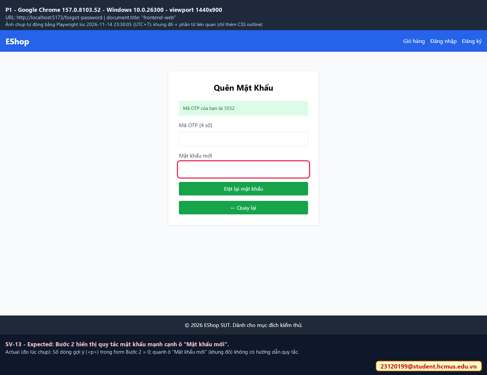
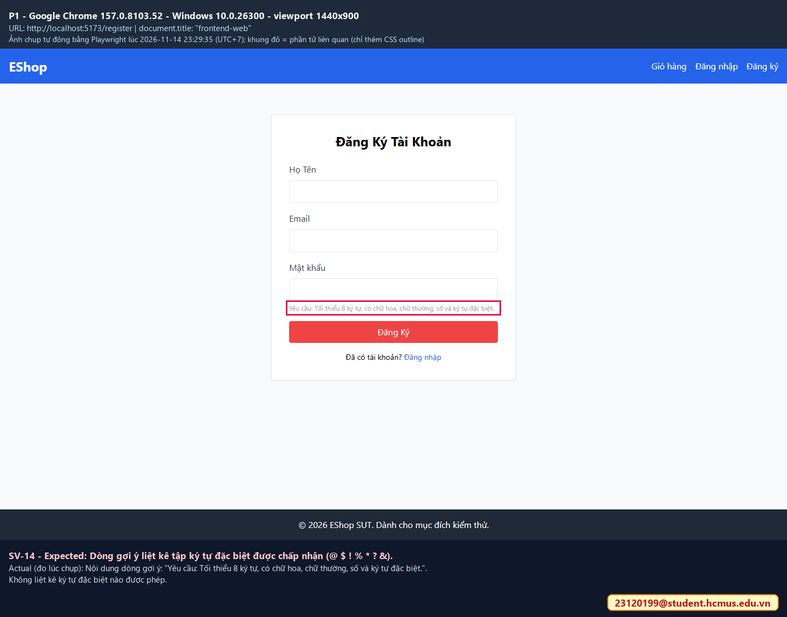

# [IA-02] [ForgotPassword, Register] Bước 2 Quên mật khẩu thiếu hẳn dòng gợi ý quy tắc mật khẩu và dòng gợi ý trên Đăng ký không liệt kê tập ký tự đặc biệt cho phép

## Summary
Ô `Mật khẩu mới` ở Bước 2 trang `/forgot-password` áp dụng kiểm tra độ mạnh mật khẩu nhưng không hiển thị bất kỳ dòng hướng dẫn quy tắc nào, còn trên trang `/register` dòng gợi ý chỉ ghi chung chung `ký tự đặc biệt` mà không liệt kê tập ký tự được phép (`@ $ ! % * ? &`).

- **Bug ID:** `BUG-22`
- **Checklist item:** `SV-13`, `SV-14`
- **Interface aspect:** `IA-02` — Forms
- **Màn hình:** ForgotPassword (`/forgot-password` — Bước 2), Register (`/register`)
- **Requirement:** FR-03 (eshop-sut/README.md:58); Nielsen #6 Recognition rather than recall; FR-01 (eshop-sut/README.md:34); Slide 10 #7 Assistive Hints
- **Loại lỗi:** `Visual-Layout`
- **Severity:** **Minor**
- **Priority:** **Low**

## Environment
- **SUT:** `eshop-sut @ 1a9304a (repo HEAD 6b6a7a9)` (Web `http://localhost:5173`, Backend API `http://localhost:3000`)
- **P1:** Google Chrome 157.0.8103.50 trên Windows 11
- **P2:** Mozilla Firefox trên Windows 11 (bản cài đặt `137.0.1` dùng để quan sát trực tiếp; nhân Gecko `159.0` bản Playwright dùng để đo DOM và chụp ảnh minh chứng)
- **P3:** Chrome Android 156.0.8078.79 trên OPPO Reno10 5G (Android 15, adb reverse)
- **URL kiểm thử:** `http://localhost:5173/forgot-password, http://localhost:5173/register`
- **Viewport:** Desktop `1440x900` (`P1`, `P2`); Mobile `360x801` / `1080x2412` (`P3`)

## Preconditions
Mở trang `/register` và Bước 2 trang `/forgot-password`.

## Steps to reproduce
1. Truy cập Bước 2 trang `http://localhost:5173/forgot-password` và quan sát xung quanh ô `Mật khẩu mới`.
2. Truy cập `http://localhost:5173/register` và đọc nội dung dòng gợi ý bên dưới ô `Mật khẩu`.

## Expected result
Theo `FR-01` (`eshop-sut/README.md:34`), `FR-03` (`eshop-sut/README.md:58`), Nielsen #6 (Recognition rather than recall) và Slide 10 #7 (Assistive Hints), cả hai màn hình đặt mật khẩu phải hiển thị trước quy tắc độ mạnh kèm tập ký tự đặc biệt được chấp nhận (`@ $ ! % * ? &`) để người dùng không phải đoán thử-sai.

- **`SV-13`** (*Hiển thị quy tắc mật khẩu mạnh cho ô Mật khẩu mới ở Bước 2* — căn cứ: `FR-03 (eshop-sut/README.md:58); Nielsen #6 Recognition rather than recall`): Ở Bước 2, gần ô `Mật khẩu mới` hiển thị dòng gợi ý nêu đủ quy tắc mật khẩu (tối thiểu 8 ký tự, chữ hoa, chữ thường, số, ký tự đặc biệt) giống gợi ý trên /register để người dùng không phải nhớ. Fail nếu Bước 2 không có bất kỳ dòng gợi ý quy tắc mật khẩu nào gần ô `Mật khẩu mới`.
- **`SV-14`** (*Dòng gợi ý mật khẩu liệt kê các ký tự đặc biệt được chấp nhận* — căn cứ: `FR-01 (eshop-sut/README.md:34); Slide 10 #7 Assistive Hints`): Dòng gợi ý dưới ô `Mật khẩu` nêu cụ thể các ký tự đặc biệt hợp lệ `@ $ ! % * ? &` để người dùng biết nên dùng ký tự nào. Fail nếu dòng gợi ý chỉ ghi chung chung "ký tự đặc biệt" mà không liệt kê tập ký tự được chấp nhận.

## Actual result
Ở Bước 2 `/forgot-password` hoàn toàn không có thẻ gợi ý quy tắc mật khẩu nào (0 thẻ hướng dẫn); trên `/register` dòng gợi ý chỉ ghi `Yêu cầu: Tối thiểu 8 ký tự, có chữ hoa, chữ thường, số và ký tự đặc biệt.`, bỏ sót danh sách ký tự hợp lệ.

**Dữ kiện `Actual` nguyên văn theo từng mục và nền tảng:**
- **`SV-13` trên `P1`:** Actual: Ở Bước 2 trang /forgot-password không có bất kỳ dòng gợi ý quy tắc mật khẩu nào gần ô "Mật khẩu mới" (số thẻ gợi ý = 0).
- **`SV-13` trên `P2`:** Actual: Ở Bước 2 trang /forgot-password không có bất kỳ dòng gợi ý quy tắc mật khẩu nào gần ô "Mật khẩu mới" (số thẻ gợi ý = 0).
- **`SV-13` trên `P3`:** Actual: Ở Bước 2 trang /forgot-password không có bất kỳ dòng gợi ý quy tắc mật khẩu nào gần ô "Mật khẩu mới" (số thẻ gợi ý = 0).
- **`SV-14` trên `P1`:** Actual: Dòng gợi ý dưới ô Mật khẩu trên /register chỉ ghi chung chung "Yêu cầu: Tối thiểu 8 ký tự, có chữ hoa, chữ thường, số và ký tự đặc biệt.", không liệt kê tập ký tự đặc biệt hợp lệ (@ $ ! % * ? &).
- **`SV-14` trên `P2`:** Actual: Dòng gợi ý dưới ô Mật khẩu trên /register chỉ ghi chung chung "Yêu cầu: Tối thiểu 8 ký tự, có chữ hoa, chữ thường, số và ký tự đặc biệt.", không liệt kê tập ký tự đặc biệt hợp lệ (@ $ ! % * ? &).
- **`SV-14` trên `P3`:** Actual: Dòng gợi ý dưới ô Mật khẩu trên /register chỉ ghi chung chung "Yêu cầu: Tối thiểu 8 ký tự, có chữ hoa, chữ thường, số và ký tự đặc biệt.", không liệt kê tập ký tự đặc biệt hợp lệ (@ $ ! % * ? &).

## Impact
Buộc người dùng phải nhớ hoặc nhập thử rồi mới nhận lỗi sau khi bấm Submit, làm tăng số lần nhập sai trên biểu mẫu.

## Reproducibility
Luôn luôn (100%) trên các nền tảng áp dụng: `P1`, `P2`, `P3`.

## Evidence

**Danh sách đầy đủ ảnh minh chứng theo nền tảng:**
- `SV-13` (`P1`): [`screenshots/task1_failed/P1_SV-13.png`](../screenshots/task1_failed/P1_SV-13.png)
- `SV-13` (`P2`): [`screenshots/task1_failed/P2_SV-13.png`](../screenshots/task1_failed/P2_SV-13.png)
- `SV-13` (`P3`): [`screenshots/task1_failed/P3_SV-13.png`](../screenshots/task1_failed/P3_SV-13.png)
- `SV-14` (`P1`): [`screenshots/task1_failed/P1_SV-14.png`](../screenshots/task1_failed/P1_SV-14.png)
- `SV-14` (`P2`): [`screenshots/task1_failed/P2_SV-14.png`](../screenshots/task1_failed/P2_SV-14.png)
- `SV-14` (`P3`): [`screenshots/task1_failed/P3_SV-14.png`](../screenshots/task1_failed/P3_SV-14.png)

## GitHub Issue
- **Issue:** [#22 — [HW03-M1] [BUG-22] [IA-02] [ForgotPassword, Register] Bước 2 Quên mật khẩu thiếu hẳn dòng gợi ý quy tắc mật khẩu và dòng gợi ý trên Đăng ký không liệt kê tập ký tự đặc biệt cho phép](https://github.com/HuynhDucThinh/Software-Testing-HW03/issues/22)
- **Ảnh chụp trang GitHub Issue:** [`screenshots/github_issues/ISSUE-22_BUG-22.png`](../screenshots/github_issues/ISSUE-22_BUG-22.png)
