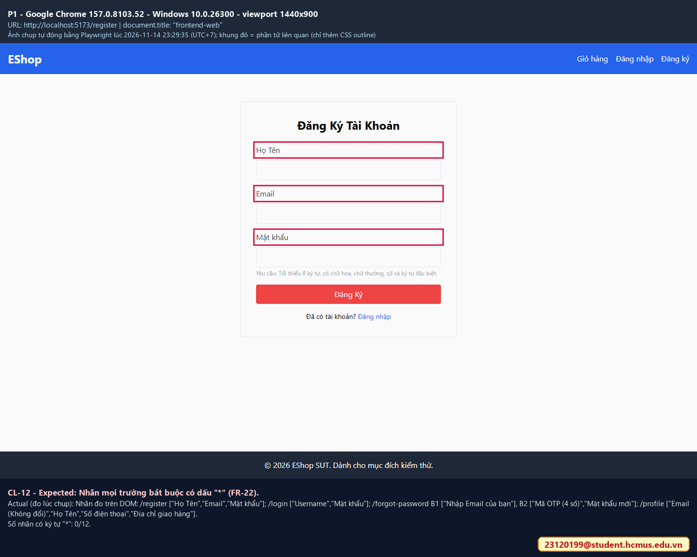
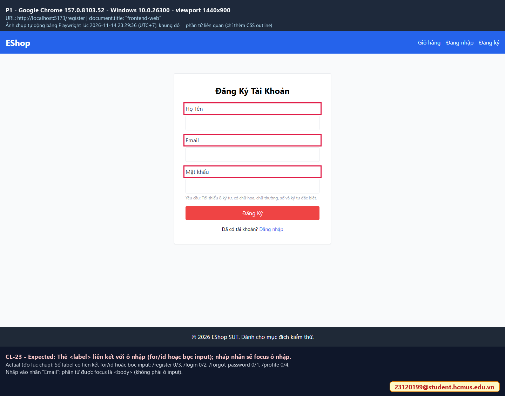

# [IA-02] [Register, Login, ForgotPassword, Profile] Tất cả nhãn trường bắt buộc thiếu dấu sao (*) và 10/10 thẻ label không liên kết htmlFor/id với ô nhập liệu

## Summary
Trên cả 4 biểu mẫu thuộc phạm vi M1, không có bất kỳ nhãn trường bắt buộc nào hiển thị ký hiệu dấu sao (`*`), đồng thời toàn bộ `10/10` thẻ `<label>` đều không khai báo `htmlFor`/`id` liên kết với thẻ `<input>` tương ứng và thiếu `placeholder` gợi ý định dạng.

- **Bug ID:** `BUG-23`
- **Checklist item:** `CL-12`, `CL-23`
- **Interface aspect:** `IA-02` — Forms
- **Màn hình:** Register (`/register`), Login (`/login`), ForgotPassword (`/forgot-password`), Profile (`/profile`)
- **Requirement:** FR-22 (eshop-sut/README.md:252); WCAG 2.2 SC 1.3.1 Info and Relationships, SC 3.3.2 Labels or Instructions; Slide 10 #7 Assistive Hints
- **Loại lỗi:** `Visual-Layout`
- **Severity:** **Minor**
- **Priority:** **Medium**

## Environment
- **SUT:** `eshop-sut @ 1a9304a (repo HEAD 6b6a7a9)` (Web `http://localhost:5173`, Backend API `http://localhost:3000`)
- **P1:** Google Chrome 157.0.8103.50 trên Windows 11
- **P2:** Mozilla Firefox 137.0.1 trên Windows 11
- **P3:** Chrome Android 156.0.8078.79 trên OPPO Reno10 5G (Android 15, adb reverse)
- **URL kiểm thử:** `http://localhost:5173/register`
- **Viewport:** Desktop `1440x900` (`P1`, `P2`); Mobile `360x801` / `1080x2412` (`P3`)

## Preconditions
Mở lần lượt các trang `/register`, `/login`, `/forgot-password` (Bước 1 & Bước 2) và `/profile`.

## Steps to reproduce
1. Quan sát tất cả nhãn của các ô có thuộc tính `required` trên `/register` (3 ô), `/login` (2 ô), `/forgot-password` Bước 1 (1 ô) & Bước 2 (2 ô), và `/profile` (1 ô Họ Tên).
2. Nhấp chuột trực tiếp vào chữ của từng thẻ `<label>` và kiểm tra xem con trỏ có tự động focus vào ô `<input>` bên dưới hay không.

## Expected result
Theo `FR-22` (`eshop-sut/README.md:252`), mọi trường bắt buộc phải có dấu sao (`*`) cạnh nhãn (đặc biệt trên `/profile` nơi cần phân biệt Họ Tên bắt buộc với Số điện thoại/Địa chỉ tùy chọn). Theo WCAG 2.2 SC 1.3.1 & SC 3.3.2, thẻ `<label>` phải liên kết ngữ nghĩa với `<input>` qua `for`/`id` để nhấp vào nhãn sẽ focus ô nhập và hỗ trợ trình đọc màn hình.

- **`CL-12`** (*Hiển thị ký hiệu dấu sao (*) bên cạnh nhãn tất cả các trường bắt buộc* — căn cứ: `FR-22 (eshop-sut/README.md:252)`): Tất cả các trường bắt buộc nhập trên /register (Họ Tên, Email, Mật khẩu, Xác nhận mật khẩu), /login (Email, Mật khẩu), /forgot-password (Email ở Bước 1; OTP, Mật khẩu mới, Xác nhận mật khẩu mới ở Bước 2) và /profile (Họ Tên) đều có ký hiệu `*` hiển thị rõ bên cạnh nhãn. Fail nếu bất kỳ trường bắt buộc nào thiếu ký hiệu `*` trên nhãn hiển thị.
- **`CL-23`** (*Liên kết ngữ nghĩa giữa thẻ label và ô nhập liệu kèm gợi ý định dạng rõ nghĩa* — căn cứ: `WCAG 2.2 SC 1.3.1 Info and Relationships, SC 3.3.2 Labels or Instructions; Slide 10 #7 Assistive Hints`): Mọi nhãn `<label>` trên các form /register, /login, /forgot-password và /profile được gắn kết với ô nhập tương ứng qua cặp `for`/`id` (hoặc bọc trực tiếp ô nhập) sao cho khi nhấp/chạm vào chữ trên nhãn thì con trỏ tự động focus vào ô nhập đó, đồng thời các trường có định dạng ràng buộc có gợi ý rõ nghĩa. Fail nếu nhấp vào nhãn `<label>` không làm focus ô nhập tương ứng (kiểm tra `label.htmlFor` rỗng và không bọc `input`).

## Actual result
`0/9` nhãn trường bắt buộc có ký hiệu `*`, và `0/10` thẻ `<label>` trên cả 4 trang có thuộc tính `for`/`id` hoặc bọc thẻ `<input>` (nhấp vào nhãn không chuyển focus vào ô nhập); các ô SĐT, Email, OTP cũng để `placeholder` rỗng.

**Dữ kiện `Actual` nguyên văn theo từng mục và nền tảng:**
- **`CL-12` trên `P1`:** Actual: Có 0/9 nhãn trường bắt buộc hiển thị dấu "*": Register=["Họ Tên","Email","Mật khẩu"], Login=["Username","Mật khẩu"], ForgotB1=["Nhập Email của bạn"], ForgotB2=["Mã OTP (4 số)","Mật khẩu mới"], Profile(Họ Tên)="Họ Tên".
- **`CL-12` trên `P2`:** Actual: Có 0/9 nhãn trường bắt buộc hiển thị dấu "*": Register=["Họ Tên","Email","Mật khẩu"], Login=["Username","Mật khẩu"], ForgotB1=["Nhập Email của bạn"], ForgotB2=["Mã OTP (4 số)","Mật khẩu mới"], Profile(Họ Tên)="Họ Tên".
- **`CL-12` trên `P3`:** Actual: Có 0/9 nhãn trường bắt buộc hiển thị dấu "*": Register=["Họ Tên","Email","Mật khẩu"], Login=["Username","Mật khẩu"], ForgotB1=["Nhập Email của bạn"], ForgotB2=["Mã OTP (4 số)","Mật khẩu mới"], Profile(Họ Tên)="Họ Tên".
- **`CL-23` trên `P1`:** Actual: Kiểm tra trên cả 4 form (/register, /login, /forgot-password, /profile) có 0/10 thẻ `<label>` có thuộc tính for/id hoặc bọc trực tiếp ô input; nhấp vào nhãn không làm focus ô nhập tương ứng.
- **`CL-23` trên `P2`:** Actual: Kiểm tra trên cả 4 form (/register, /login, /forgot-password, /profile) có 0/10 thẻ `<label>` có thuộc tính for/id hoặc bọc trực tiếp ô input; nhấp vào nhãn không làm focus ô nhập tương ứng.
- **`CL-23` trên `P3`:** Actual: Kiểm tra trên cả 4 form (/register, /login, /forgot-password, /profile) có 0/10 thẻ `<label>` có thuộc tính for/id hoặc bọc trực tiếp ô input; nhấp vào nhãn không làm focus ô nhập tương ứng.

## Impact
Người dùng không phân biệt trước được trường bắt buộc với trường không bắt buộc (nhất là trên trang Hồ sơ), giảm vùng nhấp chuột kích hoạt ô nhập và khiến trình đọc màn hình không đọc được nhãn của ô đang focus.

## Reproducibility
Luôn luôn (100%) trên các nền tảng áp dụng: `P1`, `P2`, `P3`.

## Evidence

**Danh sách đầy đủ ảnh minh chứng theo nền tảng:**
- `CL-12` (`P1`): [`screenshots/task1_failed/P1_CL-12.png`](../screenshots/task1_failed/P1_CL-12.png)
- `CL-12` (`P2`): [`screenshots/task1_failed/P2_CL-12.png`](../screenshots/task1_failed/P2_CL-12.png)
- `CL-12` (`P3`): [`screenshots/task1_failed/P3_CL-12.png`](../screenshots/task1_failed/P3_CL-12.png)
- `CL-23` (`P1`): [`screenshots/task1_failed/P1_CL-23.png`](../screenshots/task1_failed/P1_CL-23.png)
- `CL-23` (`P2`): [`screenshots/task1_failed/P2_CL-23.png`](../screenshots/task1_failed/P2_CL-23.png)
- `CL-23` (`P3`): [`screenshots/task1_failed/P3_CL-23.png`](../screenshots/task1_failed/P3_CL-23.png)

## GitHub Issue
- **Issue:** [#23 — [HW03-M1] [BUG-23] [IA-02] [Register, Login, ForgotPassword, Profile] Tất cả nhãn trường bắt buộc thiếu dấu sao (*) và 10/10 thẻ label không liên kết htmlFor/id với ô nhập liệu](https://github.com/HuynhDucThinh/Software-Testing-HW03/issues/23)
- **Ảnh chụp trang GitHub Issue:** [`screenshots/github_issues/ISSUE-23_BUG-23.png`](../screenshots/github_issues/ISSUE-23_BUG-23.png)
