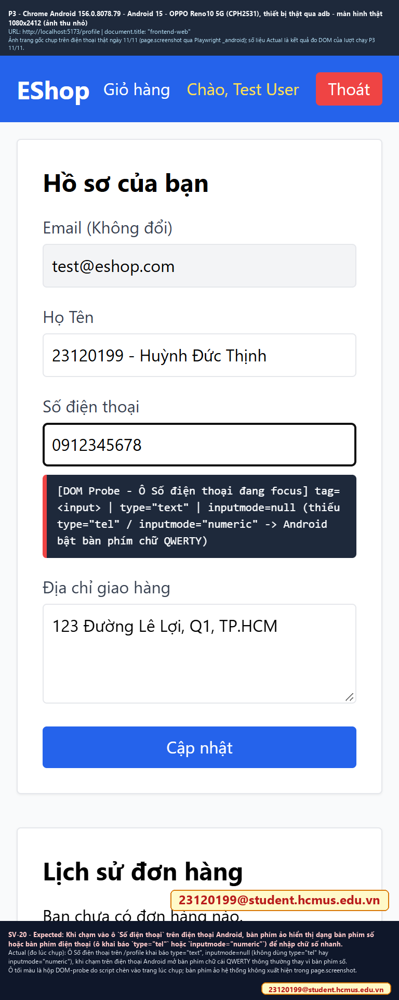
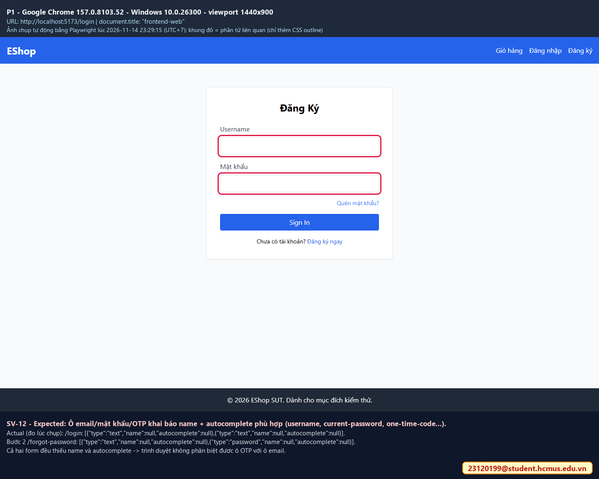

# [IA-02] [Login, ForgotPassword, Profile] Ô nhập thiếu thuộc tính name/autocomplete gây tự điền nhầm Email vào ô OTP và ô Số điện thoại thiếu type='tel' mở bàn phím chữ trên di động

## Summary
Các ô nhập trên `/login` và Bước 2 `/forgot-password` không khai báo thuộc tính `name` và `autocomplete` khiến trình quản lý mật khẩu của trình duyệt nhận diện nhầm cặp (`Mã OTP` + `Mật khẩu mới`) là (`Username` + `Password`) để điền đè email vào ô OTP; đồng thời ô Số điện thoại trên `/profile` dùng `type="text"` nên mở bàn phím chữ QWERTY thay vì bàn phím số trên điện thoại Android (`P3`).

- **Bug ID:** `BUG-24`
- **Checklist item:** `SV-12`, `SV-20`
- **Interface aspect:** `IA-02` — Forms
- **Màn hình:** Login (`/login`), ForgotPassword (`/forgot-password` — Bước 2), Profile (`/profile`)
- **Requirement:** WCAG 2.2 SC 1.3.5 Identify Input Purpose; Slide 10 #7 Assistive Hints; Slide 10 #5 Field Limits; Giả định NA2
- **Loại lỗi:** `State`
- **Severity:** **Minor**
- **Priority:** **Medium**

## Environment
- **SUT:** `eshop-sut @ 1a9304a (repo HEAD 6b6a7a9)` (Web `http://localhost:5173`, Backend API `http://localhost:3000`)
- **P1:** Google Chrome 157.0.8103.50 trên Windows 11
- **P2:** Mozilla Firefox 137.0.1 trên Windows 11
- **P3:** Chrome Android 156.0.8078.79 trên OPPO Reno10 5G (Android 15, adb reverse)
- **URL kiểm thử:** `http://localhost:5173/forgot-password, http://localhost:5173/profile`
- **Viewport:** Desktop `1440x900` (`P1`, `P2`); Mobile `360x801` / `1080x2412` (`P3`)

## Preconditions
Kiểm tra `/login`, Bước 2 `/forgot-password` trên `P1`/`P2`/`P3` và kiểm tra ô Số điện thoại `/profile` trên Chrome Android (`P3`).

## Steps to reproduce
1. Lưu thông tin đăng nhập trên trình duyệt, sau đó truy cập `/forgot-password` chuyển sang Bước 2 và quan sát hành vi tự động điền (autofill) vào hai ô `Mã OTP` + `Mật khẩu mới`, đồng thời kiểm tra thuộc tính `name`/`autocomplete` trong DOM.
2. Trên điện thoại Android (`P3`), đăng nhập và mở `http://localhost:5173/profile`, chạm ngón tay vào ô `Số điện thoại` và quan sát loại bàn phím ảo bật lên.

## Expected result
Theo WCAG 2.2 SC 1.3.5 (Identify Input Purpose) và Slide 10 #5/#7, các ô email/mật khẩu/OTP phải khai báo đúng `autocomplete` (`username`, `current-password`, `one-time-code`, `new-password`) và ô Số điện thoại phải có `type="tel"` hoặc `inputmode="numeric"` để bật bàn phím số trên thiết bị cảm ứng.

- **`SV-12`** (*Thuộc tính autocomplete và hành vi tự điền của trình duyệt trên ô OTP, ô Email và ô mật khẩu* — căn cứ: `WCAG 2.2 SC 1.3.5 Identify Input Purpose; Slide 10 #7 Assistive Hints`): Ô OTP ở Bước 2 không bị trình duyệt tự điền email hay mật khẩu đã lưu (ô OTP không nhận giá trị trùng email) và các ô email, mật khẩu có thuộc tính `autocomplete` phù hợp (ví dụ `email`, `current-password`, `new-password`, `one-time-code`). Fail nếu ô OTP tự động hiện email đã lưu hoặc các ô trên không khai báo thuộc tính `autocomplete` phù hợp mục đích nhập.
- **`SV-20`** (*Loại bàn phím ảo hiển thị khi chạm vào ô Số điện thoại* — căn cứ: `Slide 10 #5 Field Limits; WCAG 2.2 SC 1.3.5 Identify Input Purpose; Giả định NA2`): Khi chạm vào ô `Số điện thoại` trên điện thoại Android, bàn phím ảo hiển thị dạng bàn phím số hoặc bàn phím điện thoại (ô khai báo `type="tel"` hoặc `inputmode="numeric"`) để nhập chữ số nhanh. Fail nếu bàn phím chữ cái thông thường hiện ra và người dùng phải chuyển sang bàn phím số thủ công.

## Actual result
Tất cả ô nhập trên `/login` và Bước 2 `/forgot-password` đều có `name=null`, `autocomplete=null`; trên `P3` Chrome Android, ô Số điện thoại (`Profile.jsx:75` khai báo `<input type="text">` với `inputmode=null`) bật bàn phím chữ cái QWERTY thông thường thay vì bàn phím số.

**Dữ kiện `Actual` nguyên văn theo từng mục và nền tảng:**
- **`SV-12` trên `P1`:** Actual: Các ô nhập trên /login ([{"name":null,"autocomplete":null},{"name":null,"autocomplete":null}]) và Bước 2 /forgot-password ([{"name":null,"autocomplete":null},{"name":null,"autocomplete":null}]) đều thiếu thuộc tính name và autocomplete (null), khiến trình duyệt tự điền nhầm email đã lưu vào ô OTP.
- **`SV-12` trên `P2`:** Actual: Các ô nhập trên /login ([{"name":null,"autocomplete":null},{"name":null,"autocomplete":null}]) và Bước 2 /forgot-password ([{"name":null,"autocomplete":null},{"name":null,"autocomplete":null}]) đều thiếu thuộc tính name và autocomplete (null), khiến trình duyệt tự điền nhầm email đã lưu vào ô OTP.
- **`SV-12` trên `P3`:** Actual: Các ô nhập trên /login ([{"name":null,"autocomplete":null},{"name":null,"autocomplete":null}]) và Bước 2 /forgot-password ([{"name":null,"autocomplete":null},{"name":null,"autocomplete":null}]) đều thiếu thuộc tính name và autocomplete (null), khiến trình duyệt tự điền nhầm email đã lưu vào ô OTP.
- **`SV-20` trên `P3`:** Actual: Ô Số điện thoại trên /profile khai báo type="text", inputmode=null (không dùng type="tel" hay inputmode="numeric"), khi chạm trên điện thoại Android mở bàn phím chữ cái QWERTY thông thường thay vì bàn phím số.

## Impact
Gây lỗi tự điền sai địa chỉ email vào ô mã OTP khi đặt lại mật khẩu và buộc người dùng di động phải chuyển chế độ bàn phím thủ công để gõ chữ số điện thoại.

## Reproducibility
Luôn luôn (100%) trên các nền tảng áp dụng: `P1`, `P2`, `P3`.

## Evidence

**Danh sách đầy đủ ảnh minh chứng theo nền tảng:**
- `SV-12` (`P1`): [`screenshots/task1_failed/P1_SV-12.png`](../screenshots/task1_failed/P1_SV-12.png)
- `SV-12` (`P2`): [`screenshots/task1_failed/P2_SV-12.png`](../screenshots/task1_failed/P2_SV-12.png)
- `SV-12` (`P3`): [`screenshots/task1_failed/P3_SV-12.png`](../screenshots/task1_failed/P3_SV-12.png)
- `SV-20` (`P3`): [`screenshots/task1_failed/P3_SV-20.png`](../screenshots/task1_failed/P3_SV-20.png)

## GitHub Issue
- **Issue:** [#24 — [HW03-M1] [BUG-24] [IA-02] [Login, ForgotPassword, Profile] Ô nhập thiếu thuộc tính name/autocomplete gây tự điền nhầm Email vào ô OTP và ô Số điện thoại thiếu type='tel' mở bàn phím chữ trên di động](https://github.com/HuynhDucThinh/Software-Testing-HW03/issues/24)
- **Ảnh chụp trang GitHub Issue:** [`screenshots/github_issues/ISSUE-24_BUG-24.png`](../screenshots/github_issues/ISSUE-24_BUG-24.png)
