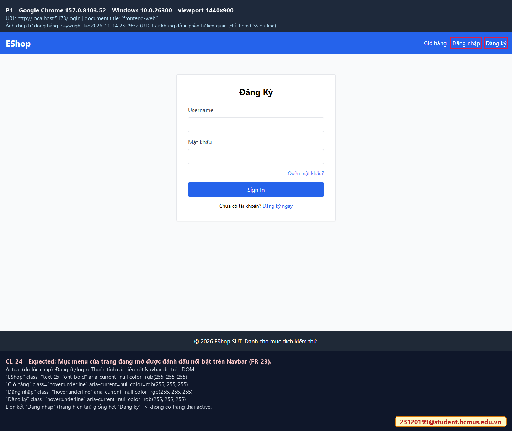
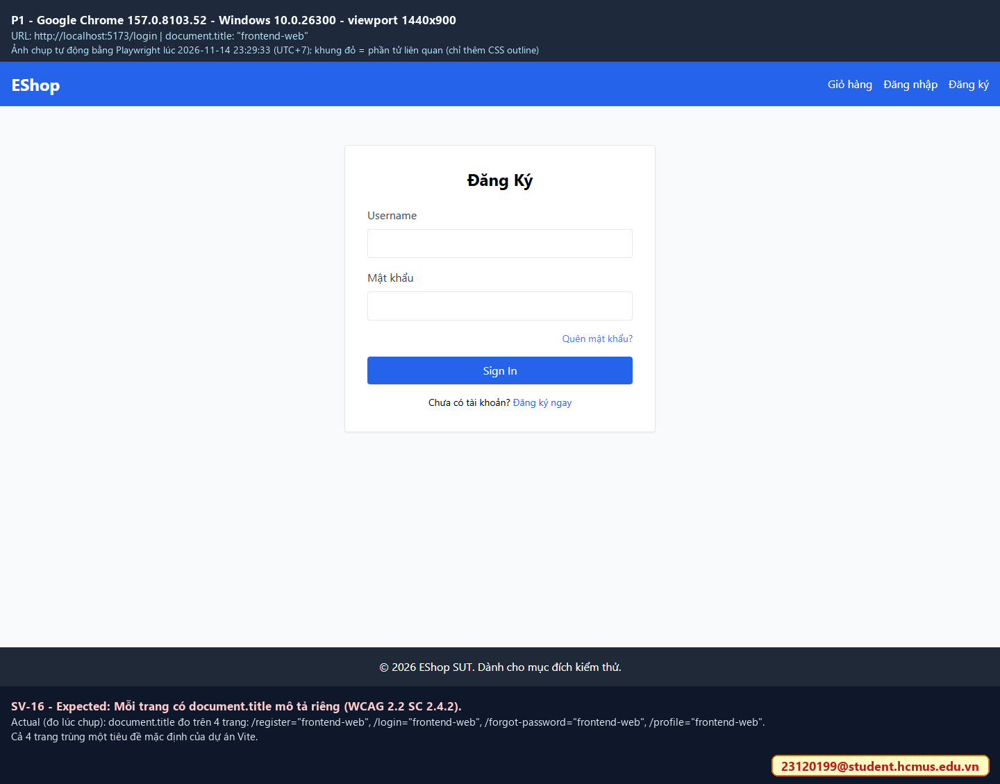

# [IA-03] [Header, Login] Thanh Navbar không đánh dấu mục trang đang mở, liên kết 'Quên mật khẩu?' gây tải lại toàn trang và tiêu đề tab trình duyệt giữ nguyên 'frontend-web' ở mọi route

## Summary
Hệ thống định hướng điều hướng gặp 3 lỗi liên quan: (1) thanh Navbar không làm nổi bật liên kết của trang hiện tại (active link), (2) liên kết `Quên mật khẩu?` trên `/login` dùng thẻ `<a href>` thường làm trình duyệt tải lại toàn trang thay vì điều hướng SPA, và (3) cả 4 route đều giữ nguyên tiêu đề tab mặc định của Vite là `frontend-web`.

- **Bug ID:** `BUG-25`
- **Checklist item:** `CL-24`, `CL-28`, `SV-16`
- **Interface aspect:** `IA-03` — Navigation
- **Màn hình:** Header/Navbar, Login (`/login`), Register (`/register`), ForgotPassword (`/forgot-password`), Profile (`/profile`)
- **Requirement:** FR-23 (eshop-sut/README.md:260); Slide 31 Link Checker; Nielsen #4 Consistency and standards; WCAG 2.2 SC 2.4.2 Page Titled; Giả định GA8
- **Loại lỗi:** `Visual-Layout`
- **Severity:** **Minor**
- **Priority:** **Low**

## Environment
- **SUT:** `eshop-sut @ 1a9304a (repo HEAD 6b6a7a9)` (Web `http://localhost:5173`, Backend API `http://localhost:3000`)
- **P1:** Google Chrome 157.0.8103.50 trên Windows 11
- **P2:** Mozilla Firefox trên Windows 11 (bản cài đặt `137.0.1` dùng để quan sát trực tiếp; nhân Gecko `159.0` bản Playwright dùng để đo DOM và chụp ảnh minh chứng)
- **P3:** Chrome Android 156.0.8078.79 trên OPPO Reno10 5G (Android 15, adb reverse)
- **URL kiểm thử:** `http://localhost:5173/login`
- **Viewport:** Desktop `1440x900` (`P1`, `P2`); Mobile `360x801` / `1080x2412` (`P3`)

## Preconditions
Truy cập các trang `/login`, `/register`, `/forgot-password` và `/profile`.

## Steps to reproduce
1. Truy cập `/login` và `/register` (khi chưa đăng nhập) và `/profile` (khi đã đăng nhập), so sánh kiểu chữ/màu sắc của liên kết đang mở với các liên kết còn lại trên thanh Navbar.
2. Tại trang `/login`, bấm vào liên kết `Quên mật khẩu?` và quan sát biểu tượng tải lại trang của trình duyệt / `PerformanceNavigationTiming`.
3. Quan sát tiêu đề trên thanh tab trình duyệt (`document.title`) khi chuyển qua lại giữa 4 trang.

## Expected result
Theo `FR-23` (`eshop-sut/README.md:260`), mục menu tương ứng trang đang mở trên Navbar phải được đánh dấu nổi bật (active state). Theo chuẩn SPA và WCAG 2.2 SC 2.4.2 (Page Titled), liên kết nội bộ cần dùng bộ định tuyến SPA (`<Link>`) không tải lại toàn trang và mỗi trang phải có `document.title` mô tả riêng (ví dụ: `Đăng nhập - EShop`).

- **`CL-24`** (*Đánh dấu nổi bật (highlight) liên kết của trang đang mở trên thanh Navbar* — căn cứ: `FR-23 (eshop-sut/README.md:260)`): Thanh điều hướng trên Header khi người dùng đang đứng tại /login, /register hoặc /profile làm nổi bật rõ liên kết tương ứng của trang đang chọn (bằng màu nền, đường gạch chân cố định, độ đậm hoặc `aria-current="page"`) so với các liên kết khác. Fail nếu liên kết của trang đang mở có kiểu hiển thị giống hệt các liên kết không được chọn.
- **`CL-28`** (*Điều hướng nội bộ SPA không tải lại toàn bộ trang của các liên kết trên Login và Header* — căn cứ: `Slide 31 Link Checker; Nielsen #4 Consistency and standards`): Các liên kết điều hướng trên /login (`Quên mật khẩu?`, `Đăng ký ngay`) và trên Header (`EShop`, `Đăng nhập`, `Đăng ký`, `Chào, <tên>`) đều chuyển đúng tới route đích bằng cơ chế SPA của React Router mà không gây tải lại toàn trang trình duyệt. Fail nếu bất kỳ liên kết nào dẫn sai route hoặc dùng thẻ `<a href>` thường làm tải lại toàn bộ trang (làm mất state bộ nhớ tạm của ứng dụng).
- **`SV-16`** (*Tiêu đề tab trình duyệt mô tả riêng cho từng trang* — căn cứ: `WCAG 2.2 SC 2.4.2 Page Titled; Giả định GA8`): Mỗi trang trong 4 trang trên có tiêu đề tab (`document.title`) mô tả đúng chức năng và khác nhau giữa các trang (ví dụ phân biệt được trang đăng ký và đăng nhập). Fail nếu hai trang bất kỳ có cùng `document.title` hoặc tiêu đề tab không liên quan chức năng trang.

## Actual result
`App.jsx` dùng `<Link>` tĩnh với cùng lớp `text-gray-600` cho mọi mục menu nên mục đang mở giống hệt mục khác; `Login.jsx:57` viết `<a href="/forgot-password">` gây full-page reload; `index.html` để cố định `<title>frontend-web</title>` không đổi trên cả 4 route.

**Dữ kiện `Actual` nguyên văn theo từng mục và nền tảng:**
- **`CL-24` trên `P1`:** Actual: Khi đang ở /login, liên kết "Đăng nhập" có cùng class "hover:underline", aria-current=null, màu rgb(255, 255, 255) giống hệt liên kết không chọn "Đăng ký" ("hover:underline"); trên /profile liên kết "Chào, `<tên>`" cũng giữ nguyên class "hover:underline text-yellow-300" như khi đứng ở trang chủ.
- **`CL-24` trên `P2`:** Actual: Khi đang ở /login, liên kết "Đăng nhập" có cùng class "hover:underline", aria-current=null, màu rgb(255, 255, 255) giống hệt liên kết không chọn "Đăng ký" ("hover:underline"); trên /profile liên kết "Chào, `<tên>`" cũng giữ nguyên class "hover:underline text-yellow-300" như khi đứng ở trang chủ.
- **`CL-24` trên `P3`:** Actual: Khi đang ở /login, liên kết "Đăng nhập" có cùng class "hover:underline", aria-current=null, màu rgb(255, 255, 255) giống hệt liên kết không chọn "Đăng ký" ("hover:underline"); trên /profile liên kết "Chào, `<tên>`" cũng giữ nguyên class "hover:underline text-yellow-300" như khi đứng ở trang chủ.
- **`CL-28` trên `P1`:** Actual: Phát hiện liên kết làm tải lại toàn bộ trang trình duyệt thay vì điều hướng SPA: Login -> "Quên mật khẩu?" (dùng `<a href="/forgot-password">` gây reload toàn trang).
- **`CL-28` trên `P2`:** Actual: Phát hiện liên kết làm tải lại toàn bộ trang trình duyệt thay vì điều hướng SPA: Login -> "Quên mật khẩu?" (dùng `<a href="/forgot-password">` gây reload toàn trang).
- **`CL-28` trên `P3`:** Actual: Phát hiện liên kết làm tải lại toàn bộ trang trình duyệt thay vì điều hướng SPA: Login -> "Quên mật khẩu?" (dùng `<a href="/forgot-password">` gây reload toàn trang).
- **`SV-16` trên `P1`:** Actual: Cả 4 trang đều có cùng document.title mặc định giống hệt nhau: {"/register":"frontend-web","/login":"frontend-web","/forgot-password":"frontend-web","/profile":"frontend-web"}, không mô tả chức năng từng trang.
- **`SV-16` trên `P2`:** Actual: Cả 4 trang đều có cùng document.title mặc định giống hệt nhau: {"/register":"frontend-web","/login":"frontend-web","/forgot-password":"frontend-web","/profile":"frontend-web"}, không mô tả chức năng từng trang.
- **`SV-16` trên `P3`:** Actual: Cả 4 trang đều có cùng document.title mặc định giống hệt nhau: {"/register":"frontend-web","/login":"frontend-web","/forgot-password":"frontend-web","/profile":"frontend-web"}, không mô tả chức năng từng trang.

## Impact
Giảm khả năng nhận biết vị trí hiện tại của người dùng trên thanh điều hướng cũng như khi mở nhiều tab trình duyệt cùng lúc, đồng thời gây nháy tải lại ứng dụng không cần thiết khi bấm `Quên mật khẩu?`.

## Reproducibility
Luôn luôn (100%) trên các nền tảng áp dụng: `P1`, `P2`, `P3`.

## Evidence

**Danh sách đầy đủ ảnh minh chứng theo nền tảng:**
- `CL-24` (`P1`): [`screenshots/task1_failed/P1_CL-24.png`](../screenshots/task1_failed/P1_CL-24.png)
- `CL-24` (`P2`): [`screenshots/task1_failed/P2_CL-24.png`](../screenshots/task1_failed/P2_CL-24.png)
- `CL-24` (`P3`): [`screenshots/task1_failed/P3_CL-24.png`](../screenshots/task1_failed/P3_CL-24.png)
- `CL-28` (`P1`): [`screenshots/task1_failed/P1_CL-28.png`](../screenshots/task1_failed/P1_CL-28.png)
- `CL-28` (`P2`): [`screenshots/task1_failed/P2_CL-28.png`](../screenshots/task1_failed/P2_CL-28.png)
- `CL-28` (`P3`): [`screenshots/task1_failed/P3_CL-28.png`](../screenshots/task1_failed/P3_CL-28.png)
- `SV-16` (`P1`): [`screenshots/task1_failed/P1_SV-16.png`](../screenshots/task1_failed/P1_SV-16.png)
- `SV-16` (`P2`): [`screenshots/task1_failed/P2_SV-16.png`](../screenshots/task1_failed/P2_SV-16.png)
- `SV-16` (`P3`): [`screenshots/task1_failed/P3_SV-16.png`](../screenshots/task1_failed/P3_SV-16.png)

## GitHub Issue
- **Issue:** [#25 — [HW03-M1] [BUG-25] [IA-03] [Header, Login] Thanh Navbar không đánh dấu mục trang đang mở, liên kết 'Quên mật khẩu?' gây tải lại toàn trang và tiêu đề tab trình duyệt giữ nguyên 'frontend-web' ở mọi route](https://github.com/HuynhDucThinh/Software-Testing-HW03/issues/25)
- **Ảnh chụp trang GitHub Issue:** [`screenshots/github_issues/ISSUE-25_BUG-25.png`](../screenshots/github_issues/ISSUE-25_BUG-25.png)
