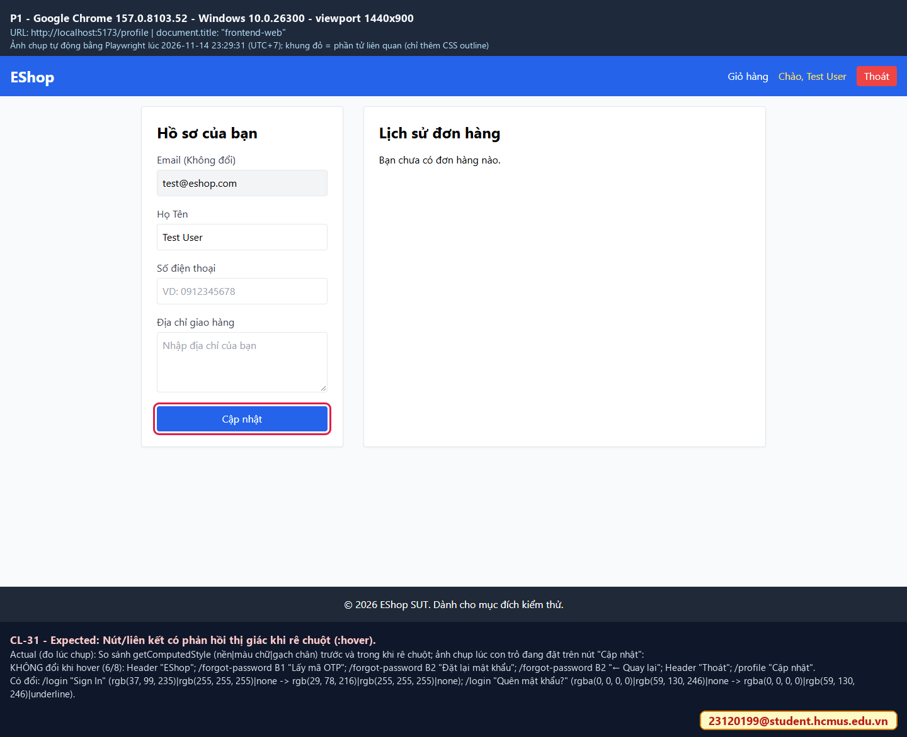
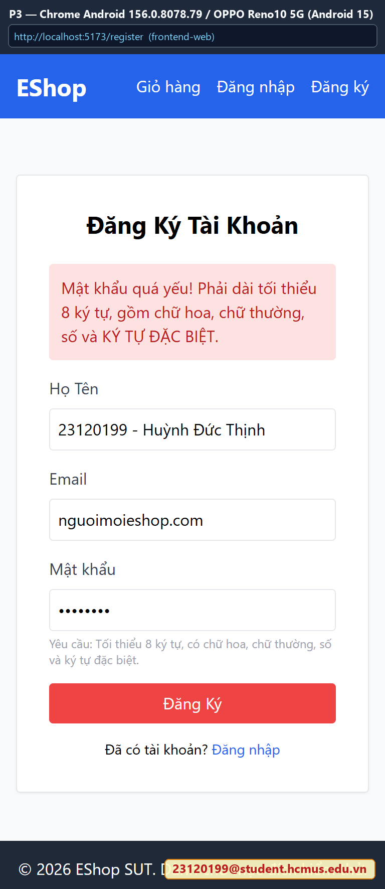

# [IA-03] [All M1 Screens] Nút bấm và liên kết điều hướng thiếu hiệu ứng phản hồi khi rê chuột (:hover) và chiều cao vùng chạm liên kết nhỏ hơn ngưỡng 24x24 CSS px

## Summary
Các nút hành động và liên kết trên thanh Header/biểu mẫu thiếu lớp CSS phản hồi màu sắc khi rê chuột (`:hover`), đồng thời các liên kết điều hướng nội dòng (`Đăng nhập`, `Quên mật khẩu?`, `Đăng ký ngay`) chỉ có chiều cao `16px-19px` không có đệm `padding`, thấp hơn ngưỡng vùng chạm tối thiểu `24x24 CSS px` của WCAG 2.2.

- **Bug ID:** `BUG-27`
- **Checklist item:** `CL-31`, `SV-19`
- **Interface aspect:** `IA-03` — Navigation
- **Màn hình:** Register (`/register`), Login (`/login`), ForgotPassword (`/forgot-password`), Profile (`/profile`), Header/Navbar
- **Requirement:** Slide 10 #10 Default Actions, #12 Hover and Focus; WCAG 2.2 SC 2.5.8 Target Size (Minimum); Slide 10 #18 Element Overlap
- **Loại lỗi:** `Visual-Layout`
- **Severity:** **Cosmetic**
- **Priority:** **Low**

## Environment
- **SUT:** `eshop-sut @ 1a9304a (repo HEAD 6b6a7a9)` (Web `http://localhost:5173`, Backend API `http://localhost:3000`)
- **P1:** Google Chrome 157.0.8103.50 trên Windows 11
- **P2:** Mozilla Firefox 137.0.1 trên Windows 11
- **P3:** Chrome Android 156.0.8078.79 trên OPPO Reno10 5G (Android 15, adb reverse)
- **URL kiểm thử:** `http://localhost:5173/login`
- **Viewport:** Desktop `1440x900` (`P1`, `P2`); Mobile `360x801` / `1080x2412` (`P3`)

## Preconditions
Kiểm tra `:hover` trên Desktop (`P1`, `P2`) và đo bounding box của các liên kết trên cả 3 nền tảng (`P1`, `P2`, `P3`).

## Steps to reproduce
1. Trên `P1`/`P2`, di chuyển con trỏ chuột lần lượt lên các liên kết trên Header (`Giỏ hàng`, `Đăng nhập`, `Đăng ký`, `Thoát`) và các nút Submit (`Sign In`, `Lấy mã OTP`, `Đặt lại mật khẩu`, `Cập nhật`) để quan sát thay đổi màu nền/màu chữ.
2. Dùng DevTools đo kích thước `getBoundingClientRect()` của các liên kết `Đăng nhập` (`/register`), `Quên mật khẩu?` và `Đăng ký ngay` (`/login`) trên `P1`, `P2` và `P3`.

## Expected result
Theo Slide 10 #12 (Hover and Focus), các nút và liên kết tương tác cần có phản hồi thị giác rõ ràng khi rê chuột (`:hover`). Theo WCAG 2.2 SC 2.5.8 (Target Size Minimum), vùng tương tác cần đạt tối thiểu `24x24 CSS px` (hoặc có khoảng đệm đủ tách biệt) để tránh chạm nhầm.

- **`CL-31`** (*Phản hồi thị giác khi hover chuột lên nút/liên kết và gửi form mặc định bằng phím Enter* — căn cứ: `Slide 10 #10 Default Actions, #12 Hover and Focus`): Trên các màn hình M1 và Header, khi di con trỏ chuột (`hover`) lên các nút bấm hoặc liên kết điều hướng thì con trỏ chuyển thành `pointer` kèm hiệu ứng đổi màu nền hoặc gạch chân rõ ràng; đồng thời khi đang đặt con trỏ tại ô `input` trong form và nhấn phím `Enter` thì kích hoạt gửi form tương ứng. Fail nếu nút/liên kết không có phản hồi thị giác khi hover, thiếu `cursor: pointer`, hoặc nhấn `Enter` trong ô `input` không gửi form.
- **`SV-19`** (*Kích thước vùng chạm của nút và liên kết* — căn cứ: `WCAG 2.2 SC 2.5.8 Target Size (Minimum); Slide 10 #18 Element Overlap`): Mọi nút và liên kết dạng chữ trên 5 vùng giao diện có vùng chạm tối thiểu 24 x 24 CSS px (đo bằng `getBoundingClientRect()`), và trên điện thoại Android chạm đúng một lần vào phần tử cần chọn mà không bấm nhầm phần tử kề bên. Fail nếu có nút hoặc liên kết có chiều cao hoặc chiều rộng nhỏ hơn 24 CSS px, hoặc chạm một lần trên điện thoại Android kích hoạt nhầm phần tử kề bên.

## Actual result
Hầu hết các nút Submit (trừ nút đỏ trên `/register` có `hover:bg-red-600`) và toàn bộ liên kết Header giữ nguyên màu sắc khi `:hover`; chiều cao thực tế các liên kết `Đăng nhập`, `Quên mật khẩu?`, `Đăng ký ngay` chỉ đạt `19px` trên `P1`/`P2` và `16px` trên `P3` (`< 24px`).

**Dữ kiện `Actual` nguyên văn theo từng mục và nền tảng:**
- **`CL-31` trên `P1`:** Actual: Nhấn phím Enter gửi form=true; tuy nhiên các nút thiếu hiệu ứng đổi màu khi hover hoặc thiếu cursor: pointer gồm: Register `<a>` "EShop" (cursor=pointer, đổi màu/gạch chân khi hover=false); Login `<a>` "EShop" (cursor=pointer, đổi màu/gạch chân khi hover=false); ForgotB1 `<a>` "EShop" (cursor=pointer, đổi màu/gạch chân khi hover=false); ForgotB1 `<button>` "Lấy mã OTP" (cursor=pointer, đổi màu/gạch chân khi hover=false); ForgotB2 `<a>` "EShop" (cursor=pointer, đổi màu/gạch chân khi hover=false); ForgotB2 `<button>` "Đặt lại mật khẩu" (cursor=pointer, đổi màu/gạch chân khi hover=false); ForgotB2 `<button>` "← Quay lại" (cursor=pointer, đổi màu/gạch chân khi hover=false); Profile+Header `<a>` "EShop" (cursor=pointer, đổi màu/gạch chân khi hover=false); Profile+Header `<button>` "Thoát" (cursor=pointer, đổi màu/gạch chân khi hover=false); Profile+Header `<button>` "Cập nhật" (cursor=pointer, đổi màu/gạch chân khi hover=false).
- **`CL-31` trên `P2`:** Actual: Nhấn phím Enter gửi form=true; tuy nhiên các nút thiếu hiệu ứng đổi màu khi hover hoặc thiếu cursor: pointer gồm: Register `<a>` "EShop" (cursor=pointer, đổi màu/gạch chân khi hover=false); Login `<a>` "EShop" (cursor=pointer, đổi màu/gạch chân khi hover=false); ForgotB1 `<a>` "EShop" (cursor=pointer, đổi màu/gạch chân khi hover=false); ForgotB1 `<button>` "Lấy mã OTP" (cursor=pointer, đổi màu/gạch chân khi hover=false); ForgotB2 `<a>` "EShop" (cursor=pointer, đổi màu/gạch chân khi hover=false); ForgotB2 `<button>` "Đặt lại mật khẩu" (cursor=pointer, đổi màu/gạch chân khi hover=false); ForgotB2 `<button>` "← Quay lại" (cursor=pointer, đổi màu/gạch chân khi hover=false); Profile+Header `<a>` "EShop" (cursor=pointer, đổi màu/gạch chân khi hover=false); Profile+Header `<button>` "Thoát" (cursor=pointer, đổi màu/gạch chân khi hover=false); Profile+Header `<button>` "Cập nhật" (cursor=pointer, đổi màu/gạch chân khi hover=false).
- **`SV-19` trên `P1`:** Actual: Các liên kết có chiều cao vùng chạm nhỏ hơn ngưỡng 24x24 CSS px: Register "Đăng nhập" (68x19px); Login "Quên mật khẩu?" (102x19px); Login "Đăng ký ngay" (85x19px).
- **`SV-19` trên `P2`:** Actual: Các liên kết có chiều cao vùng chạm nhỏ hơn ngưỡng 24x24 CSS px: Register "Đăng nhập" (68x19px); Login "Quên mật khẩu?" (102x19px); Login "Đăng ký ngay" (85x19px).
- **`SV-19` trên `P3`:** Actual: Các liên kết có chiều cao vùng chạm nhỏ hơn ngưỡng 24x24 CSS px: Register "Đăng nhập" (67x16px); Login "Quên mật khẩu?" (101x16px); Login "Đăng ký ngay" (83x16px).

## Impact
Giảm phản hồi cảm nhận tương tác khi dùng chuột trên máy tính và làm người dùng màn hình cảm ứng (`P3`) khó chạm chính xác vào các liên kết nhỏ như `Quên mật khẩu?`.

## Reproducibility
Luôn luôn (100%) trên các nền tảng áp dụng: `P1`, `P2`, `P3`.

## Evidence

**Danh sách đầy đủ ảnh minh chứng theo nền tảng:**
- `CL-31` (`P1`): [`screenshots/task1_failed/P1_CL-31.png`](../screenshots/task1_failed/P1_CL-31.png)
- `CL-31` (`P2`): [`screenshots/task1_failed/P2_CL-31.png`](../screenshots/task1_failed/P2_CL-31.png)
- `SV-19` (`P1`): [`screenshots/task1_failed/P1_SV-19.png`](../screenshots/task1_failed/P1_SV-19.png)
- `SV-19` (`P2`): [`screenshots/task1_failed/P2_SV-19.png`](../screenshots/task1_failed/P2_SV-19.png)
- `SV-19` (`P3`): [`screenshots/task1_failed/P3_SV-19.png`](../screenshots/task1_failed/P3_SV-19.png)

## GitHub Issue
- **Issue:** [#27 — [HW03-M1] [BUG-27] [IA-03] [All M1 Screens] Nút bấm và liên kết điều hướng thiếu hiệu ứng phản hồi khi rê chuột (:hover) và chiều cao vùng chạm liên kết nhỏ hơn ngưỡng 24x24 CSS px](https://github.com/HuynhDucThinh/Software-Testing-HW03/issues/27)
- **Ảnh chụp trang GitHub Issue:** [`screenshots/github_issues/ISSUE-27_BUG-27.png`](../screenshots/github_issues/ISSUE-27_BUG-27.png)
