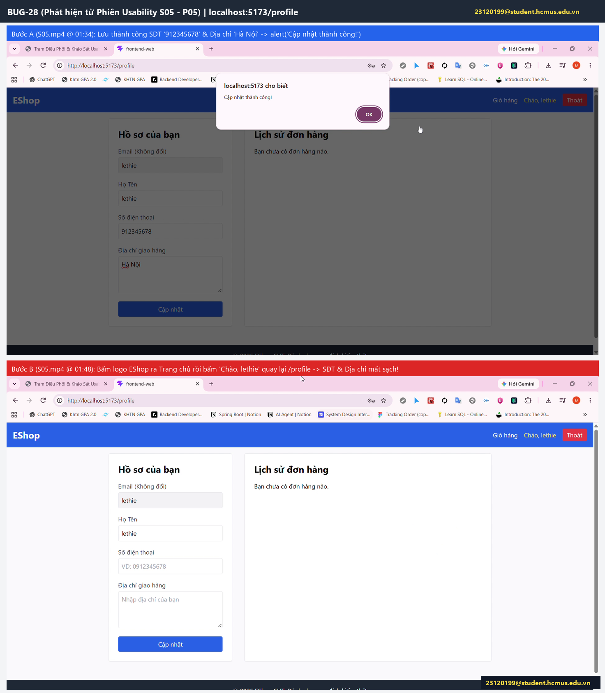

# [IA-04] [Profile] Dữ liệu Số điện thoại và Địa chỉ giao hàng vừa cập nhật biến mất sạch trên biểu mẫu khi điều hướng nội bộ SPA quay lại trang Hồ sơ

## Summary
Sau khi người dùng nhập Số điện thoại và Địa chỉ giao hàng tại trang Hồ sơ (`/profile`), bấm `Cập nhật` và nhận thông báo `Cập nhật thành công!`, nếu điều hướng nội bộ SPA sang màn hình khác (ví dụ bấm logo `EShop` ra Trang chủ) rồi bấm liên kết `Chào, <tên>` quay lại `/profile` mà không nhấn `F5`, toàn bộ Số điện thoại và Địa chỉ giao hàng vừa lưu biến mất sạch về ô trống do `Profile.jsx` khởi tạo lại state từ đối tượng `user` cũ trong `AuthContext`.

- **Bug ID:** `BUG-28`
- **Nguồn phát hiện:** **Task 2 — Usability Evaluation** (Phiên chính thức `S05` với người tham gia `P05` tại mốc `01:34 – 01:48`, đối chứng với `S07` tại `01:02 – 01:08`)
- **Interface aspect:** `IA-04` — Feedback / state
- **Màn hình:** Profile (`/profile`)
- **Requirement:** FR-04 (eshop-sut/README.md:64); Nielsen #1 Visibility of system status & #5 Error prevention
- **Loại lỗi:** `State`
- **Severity:** **Major**
- **Priority:** **High**

## Environment
- **SUT:** `eshop-sut @ 1a9304a` (Web `http://localhost:5173`, Backend API `http://localhost:3000`)
- **Nền tảng phát hiện & tái hiện:** `P1` Google Chrome 157 trên Windows 11 (tái hiện tương tự 100% trên `P2` Firefox 137 và `P3` Chrome Android 156)
- **URL kiểm thử:** `http://localhost:5173/profile`
- **Viewport:** Desktop `1440x900` / `1920x1080`

## Preconditions
Người dùng vừa đăng ký tài khoản mới và đăng nhập lần đầu (khi đăng nhập, đối tượng `user` lưu trong `AuthContext` có `phone: null`, `shipping_address: null`), hoặc đang đăng nhập tài khoản hiện có mà chưa tải lại toàn trang (`F5`).

## Steps to reproduce
1. Đăng ký tài khoản mới tại `/register` và đăng nhập tại `/login` (ví dụ tài khoản `lethie` trong phiên `S05`).
2. Bấm vào liên kết `Chào, lethie` trên thanh Header để mở `/profile`.
3. Nhập Số điện thoại `912345678` (vượt bộ lọc `BUG-05`) và Địa chỉ giao hàng `Hà Nội`, sau đó bấm nút `Cập nhật` và đóng hộp thoại `Cập nhật thành công!` (`S05.mp4 @ 01:34`).
4. Không nhấn `F5`, bấm vào logo `EShop` góc trái thanh Header để ra Trang chủ (`S05.mp4 @ 01:46`), sau đó bấm lại vào `Chào, lethie` trên thanh Header để mở lại trang `/profile` (`S05.mp4 @ 01:48`).

## Expected result
Theo `FR-04` (`eshop-sut/README.md:64`) và nguyên tắc nhất quán trạng thái phiên làm việc, sau khi API `PUT /api/users/me` báo cập nhật thành công, mọi lần mở lại trang `/profile` bằng điều hướng nội bộ SPA đều phải hiển thị đầy đủ giá trị `Họ Tên`, `Số điện thoại` (`912345678`) và `Địa chỉ giao hàng` (`Hà Nội`) vừa lưu mà không cần tải lại toàn bộ trình duyệt.

## Actual result
Khi quay lại `/profile` qua liên kết SPA ở Bước 4, cả hai ô `Số điện thoại` và `Địa chỉ giao hàng` đều bị xóa trắng quay về placeholder (`VD: 0912345678` và `Nhập địa chỉ của bạn`), và `Họ Tên` cũng quay về giá trị lúc mới đăng nhập.
- **Nguyên nhân gốc trong mã nguồn:** Trong `Profile.jsx:31-38`, `useEffect` khởi tạo `name`, `phone`, `shippingAddress` trực tiếp từ `AuthContext.user` mà không gọi `GET /api/users/me`, đồng thời hàm `handleUpdate` (`Profile.jsx:48-60`) chỉ gửi `PUT /api/users/me` mà không cập nhật lại `AuthContext.user`. Trong khi đó `AuthContext.jsx:10-24` chỉ gọi `GET /api/users/me` khi `token` thay đổi hoặc khi tải lại toàn trang (`F5`, như ở phiên `S07 @ 01:02`).

## Impact
1. Phá vỡ niềm tin của người dùng ngay lập tức vì hệ thống vừa báo `Cập nhật thành công!` nhưng quay lại kiểm tra thì thấy thông tin cá nhân biến mất sạch.
2. Nguy cơ mất dữ liệu thật trong CSDL: nếu người dùng thấy ô trống hoặc sửa lại `Họ Tên`/SĐT rồi bấm `Cập nhật` lần nữa mà quên gõ lại `Địa chỉ giao hàng`, request `PUT /api/users/me` tiếp theo sẽ ghi đè chuỗi rỗng `""` làm mất địa chỉ đã lưu trước đó trong SQLite.

## Reproducibility
Luôn luôn (100%) trên mọi trình duyệt (`P1`, `P2`, `P3`) khi điều hướng nội bộ SPA mà không nhấn `F5`.

## Evidence

- **Ảnh minh chứng trích xuất từ phiên thật `S05`:** [`screenshots/usability/BUG-28_S05_SPA_State_Loss.png`](../screenshots/usability/BUG-28_S05_SPA_State_Loss.png)
- **Video gốc phiên `S05` (`01:34 – 01:48`):** [Xem `S05.mp4` trên Google Drive](https://drive.google.com/file/d/1gWECeWQ6mcj3_2ohrK13QzmSIMHllwbd/view)

## GitHub Issue
- **Issue:** [#28 — [HW03-M1] [BUG-28] [IA-04] [Profile] Dữ liệu Số điện thoại và Địa chỉ giao hàng vừa cập nhật biến mất sạch trên biểu mẫu khi điều hướng nội bộ SPA quay lại trang Hồ sơ](https://github.com/HuynhDucThinh/Software-Testing-HW03/issues/28)
- **Ảnh chụp trang GitHub Issue:** [`screenshots/github_issues/ISSUE-28_BUG-28.png`](../screenshots/github_issues/ISSUE-28_BUG-28.png)

