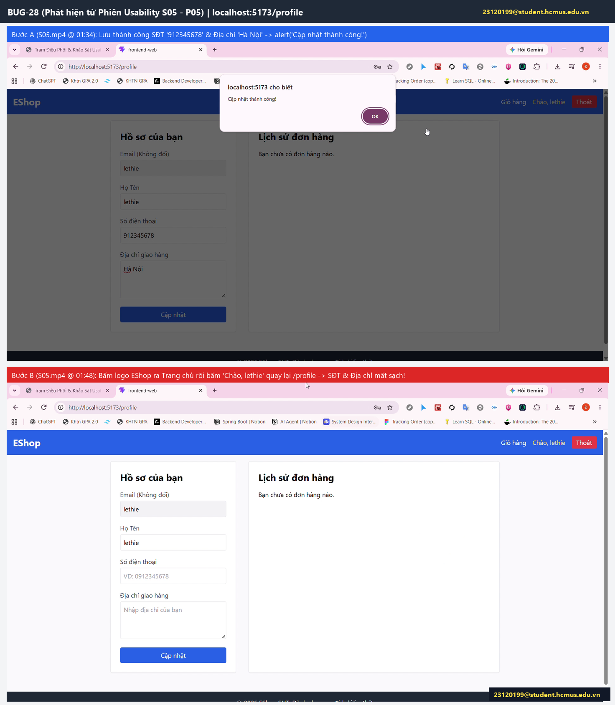
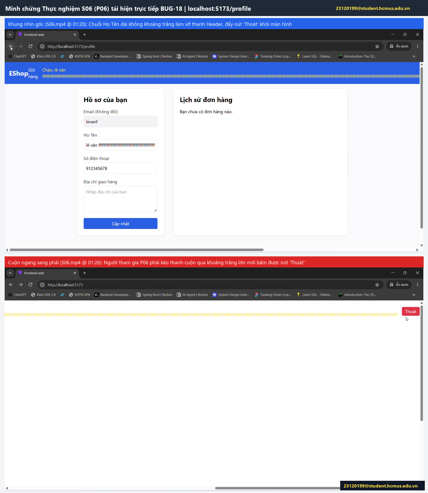

# Báo Cáo Tổng Hợp & Phân Tích Đánh Giá Khả Năng Sử Dụng (Usability Findings) — Luồng `F1`

Tài liệu phân tích Giai đoạn 3 (Bước 5 của skill `usability-evaluation`), tổng hợp trực tiếp từ dữ liệu thực nghiệm của 1 phiên chạy thử Pilot (`S00`) và **7 phiên chính thức với người dùng thật ngoài lớp học (`S01..S07`)** trên luồng **`F1: Đăng ký tài khoản mới -> Đăng nhập -> Cập nhật hồ sơ cá nhân` (`FR-01` -> `FR-02` -> `FR-04`)**, đối chiếu với báo cáo thống kê định lượng tại [`usability/sus_and_metrics_summary.md`](sus_and_metrics_summary.md) và kho dữ kiện lỗi [`Bug_Report.md`](../Bug_Report.md).

---

## 1. Tổng hợp Điểm nghẽn Trải nghiệm & Phân tách Bản chất Vấn đề (`Isolated Bugs` vs `Systemic Design Issues`)

Mỗi điểm nghẽn (`UF-01` .. `UF-11`) được định lượng theo tần suất xuất hiện trên 7 phiên chính thức (`k / 7`, không gộp Pilot `S00`) và trọng số mức độ nghiêm trọng (`Critical = 4`, `Major = 3`, `Minor = 2`, `Cosmetic = 1`), từ đó tính **Điểm ưu tiên (`Impact Score = Severity x k / 7`, thang `0.14 .. 4.00`)**:

| Mã Finding | Màn hình / Chặng | Mô tả điểm nghẽn trải nghiệm | Tần suất (`k / 7`) | Bằng chứng quan sát & trích dẫn thực tế từ video phiên | Bản chất vấn đề | Severity | Điểm ưu tiên | Tham chiếu Bug / GitHub Issue |
| :---: | :--- | :--- | :---: | :--- | :---: | :---: | :---: | :---: |
| **`UF-01`** | `Register`, `ForgotPassword` | Biểu thức chính quy mật khẩu bắt buộc khoảng trắng và từ chối ký tự đặc biệt chuẩn (`@ $ ! % * ? &`), chặn đứng người dùng đặt mật khẩu đúng hướng dẫn. | **`7 / 7`** (`100%`) | `S01` (`00:21, 01:09`), `S04` (`00:34`), `S05` (`00:44`) bị kẹt phải cứu hộ; `S03` (`00:09`), `S06` (`00:16`: nhận xét quy tắc mật khẩu kỳ lạ), `S07` (`00:18`). | `Isolated Bug` | **Critical** (`4`) | **`4.00`** | [`BUG-01`](../bugs/BUG-01.md) ([#1](https://github.com/HuynhDucThinh/Software-Testing-HW03/issues/1)) |
| **`UF-02`** | `Login` | Ô nhập `Mật khẩu` khai báo `type="text"` làm lộ toàn bộ ký tự mật khẩu dạng chữ thường trên màn hình và không có nút ẩn/hiện. | **`7 / 7`** (`100%`) | Xuất hiện trên mọi video `S01..S07`; `P01` (`00:48`), `P02` (`00:54`), `P06` (`00:24`: mật khẩu hiển thị lộ nguyên văn và thiếu nút ẩn/hiện). | `Isolated Bug` | **Critical** (`4`) | **`4.00`** | [`BUG-04`](../bugs/BUG-04.md) ([#4](https://github.com/HuynhDucThinh/Software-Testing-HW03/issues/4)) |
| **`UF-04`** | `Register` -> `Login` | Chuyển trang đột ngột sau khi đăng ký không có thông báo thành công, không giữ/điền tạm tài khoản vừa tạo, cộng hưởng với tiêu đề trang `/login` ghi sai thành `'Đăng Ký'`. | **`7 / 7`** (`100%`) | `P02` (`00:21`) tưởng đăng ký thất bại nên bấm `'Đăng ký ngay'` tạo lại lần 2; `P03` (`00:12`), `P04` (`00:14`), `P06` (`00:19`), `P07` (`00:32`). | `Systemic Design Issue` | **Major** (`3`) | **`3.00`** | Kiến trúc luồng + [`BUG-13`](../bugs/BUG-13.md) ([#13](https://github.com/HuynhDucThinh/Software-Testing-HW03/issues/13)) |
| **`UF-05`** | `Register` | Ô `Email` dùng `type="text"` không kiểm tra định dạng ở cả client và server, cho phép tạo tài khoản với chuỗi tùy ý không có `'@'`. | **`7 / 7`** (`100%`) | Cả 7 phiên đều lọt chuỗi không hợp lệ: `'lva@...   com'` (`S01`), `'nguyenvanc'` (`S02`), `'levanb'` (`S03`), `'d'` (`S04`), `'lethie'` (`S05`), `'levanf'` (`S06`), `'hhhhhh'` (`S07`). | `Isolated Bug` | **Major** (`3`) | **`3.00`** | [`BUG-09`](../bugs/BUG-09.md) ([#9](https://github.com/HuynhDucThinh/Software-Testing-HW03/issues/9)) |
| **`UF-06`** | Toàn luồng (`Register`, `Login`, `Forgot`, `Profile`) | Cơ chế phản hồi phân mảnh giữa các màn hình: lúc banner đầu form, lúc chữ đỏ dưới nút, lúc hộp thoại hệ thống `window.alert()` chặn cứng kèm lỗi tiếng Anh thô `'Lỗi: User not found'`. | **`7 / 7`** (`100%`) | `P02` (*"hiện alert rất cũ, trang web hiện tại ít dùng"*); `P04` (`00:38`) & `P07` (`00:47`) chê hộp thoại `alert` quá cũ kỹ, ngắt quãng; `P06` (`00:44`) bị `window.alert` chặn cứng. | `Systemic Design Issue` | **Major** (`3`) | **`3.00`** | Hệ thống phản hồi + [`BUG-16`](../bugs/BUG-16.md) ([#16](https://github.com/HuynhDucThinh/Software-Testing-HW03/issues/16)) |
| **`UF-03`** | `Profile` | Biểu thức chính quy Số điện thoại từ chối mọi SĐT Việt Nam bắt đầu bằng số `0` (trái ngược chính gợi ý `VD: 0912345678`) nhưng lại chấp nhận 9 chữ số không có `0` đầu. | **`4 / 7`** (`57.1%`) | `P01` (`01:57–02:18`) thử sai 5 lần liên tiếp (đầu `0`, dấu cách, `+84`); `P03` (`00:36`), `P05` (`01:18–01:26`) phải cứu hộ; `P06` (`00:52`) lọt số `912345678`. | `Isolated Bug` | **Critical** (`4`) | **`2.29`** | [`BUG-05`](../bugs/BUG-05.md) ([#5](https://github.com/HuynhDucThinh/Software-Testing-HW03/issues/5)) |
| **`UF-07`** | `Register`, `Login`, `Profile`, `Header` | Bất nhất thuật ngữ Anh–Việt (`'Email'` đổi thành `'Username'`/`'Sign In'`) và thiếu ký hiệu `*` phân biệt trường bắt buộc với trường tùy chọn trên Hồ sơ. | **`5 / 7`** (`71.4%`) | `P03` (`00:21`) gõ Họ tên `'lê văn b'` vào ô `'Username'` nên đăng nhập lỗi; `P01` (`00:34`), `P05` (`00:52`) ngập ngừng; `P02` (`01:13`) & `P06` (`00:44–00:52`) bối rối trường bắt buộc. | `Systemic Design Issue` | **Major** (`3`) | **`2.14`** | Quy ước nhãn + [`BUG-14`](../bugs/BUG-14.md) ([#14](https://github.com/HuynhDucThinh/Software-Testing-HW03/issues/14)), [`BUG-23`](../bugs/BUG-23.md) ([#23](https://github.com/HuynhDucThinh/Software-Testing-HW03/issues/23)) |
| **`UF-08`** | `Register`, `ForgotPassword`, `Login` | Mất cân đối cơ chế phòng ngừa lỗi mật khẩu: lúc tạo mới thiếu nút ẩn/hiện và thiếu ô `'Xác nhận mật khẩu'`, nhưng lúc đăng nhập gõ sai 2 lần đã khóa cứng 180 giây không báo. | **`4 / 7`** (`57.1%`) | `P01` (`00:27, 00:48`) và `P04` (`00:14`) gõ lệch mật khẩu lúc đăng ký phải tạo lại hoặc vòng sang `Quên mật khẩu?`; `P06` (`00:16`), `P07` (`00:18, 01:20`) góp ý trực tiếp. | `Systemic Design Issue` | **Major** (`3`) | **`1.71`** | Phòng ngừa lỗi + [`BUG-07`](../bugs/BUG-07.md) ([#7](https://github.com/HuynhDucThinh/Software-Testing-HW03/issues/7)), [`BUG-06`](../bugs/BUG-06.md) ([#6](https://github.com/HuynhDucThinh/Software-Testing-HW03/issues/6)) |
| **`UF-09`** | `Profile`, `Header` | **Mất đồng bộ `AuthContext.user` sau khi lưu Hồ sơ:** Header giữ tên cũ (`BUG-11`) và **khi chuyển trang SPA quay lại `/profile` không nhấn `F5` thì Số điện thoại & Địa chỉ vừa lưu biến mất sạch (`BUG-28` mới)**. | **`3 / 7`** (`42.9%`) | `P05` (`01:34–01:48`) lưu `'912345678'` + `'Hà Nội'`, ra Trang chủ quay lại thấy mất trắng cả hai ô (đối chứng `P07 @ 01:02` nhấn `F5` thì còn); `P01` (`02:42`) & `P02` (`01:46`) thấy Header giữ tên cũ. | `Isolated Bug` | **Major** (`3`) | **`1.29`** | **[`BUG-28`](../bugs/BUG-28.md) ([#28](https://github.com/HuynhDucThinh/Software-Testing-HW03/issues/28) — Mới)** & [`BUG-11`](../bugs/BUG-11.md) ([#11](https://github.com/HuynhDucThinh/Software-Testing-HW03/issues/11)) |
| **`UF-10`** | `Register`, `Profile`, `Header` | Thiếu giới hạn độ dài `maxLength`, thiếu `trim()` khoảng trắng trường `Họ Tên` và thiếu cắt gọn `truncate` trên Header khiến tên dài đẩy nút `'Thoát'` văng khỏi màn hình. | **`2 / 7`** (`28.6%`) | `P06` (`00:08, 00:56–01:26`) nhập chuỗi `'lê văn fff...'` làm vỡ ngang thanh Header, phải kéo thanh cuộn ngang qua khoảng trắng lớn mới bấm được `'Thoát'`; `P05` (`01:44`) lưu tên toàn dấu cách. | `Isolated Bug` | **Minor** (`2`) | **`0.57`** | [`BUG-18`](../bugs/BUG-18.md) ([#18](https://github.com/HuynhDucThinh/Software-Testing-HW03/issues/18)), [`BUG-12`](../bugs/BUG-12.md) ([#12](https://github.com/HuynhDucThinh/Software-Testing-HW03/issues/12)) |
| **`UF-11`** | `Register`, `Profile` | Điểm cụt điều hướng màn hình trắng `'Vui lòng đăng nhập'` khi bấm `'Thoát'` ngay tại `/profile` và thiếu `name`/`autocomplete` gây tự điền sai tài khoản. | **`3 / 7`** (`42.9%`) | `P02` (`01:51`) bấm `'Thoát'` tại `/profile` bị kẹt ở chữ tĩnh `'Vui lòng đăng nhập'`; `P05` (`00:36`) & `P07` (`00:09`) bị trình duyệt tự điền/bung danh sách che form. | `Isolated Bug` | **Minor** (`2`) | **`0.86`** | [`BUG-10`](../bugs/BUG-10.md) ([#10](https://github.com/HuynhDucThinh/Software-Testing-HW03/issues/10)), [`BUG-24`](../bugs/BUG-24.md) ([#24](https://github.com/HuynhDucThinh/Software-Testing-HW03/issues/24)) |

---

## 2. Phân tích Chuyên sâu hai Nhóm Vấn đề

### 2.1. Nhóm Lỗi phần mềm đơn lẻ (`Isolated Bugs`) — Phát hiện mới `BUG-28` & Kiểm chứng thực tế `BUG-01..BUG-27`

1. **Phát hiện lỗi mới nghiêm trọng chỉ lộ diện nhờ hành vi điều hướng tự nhiên của người dùng thật — [`BUG-28`](../bugs/BUG-28.md) ([GitHub Issue #28](https://github.com/HuynhDucThinh/Software-Testing-HW03/issues/28)):**
   - **Diễn biến thực nghiệm:** Trong phiên `S05` (`01:34`), người tham gia `P05` cập nhật thành công Số điện thoại `'912345678'` và Địa chỉ giao hàng `'Hà Nội'` (nhận `window.alert('Cập nhật thành công!')`). Tuy nhiên, thay vì nhấn `F5` như kịch bản kiểm thử tự động ở Task 1 (`CL-36`), ở `01:46` `P05` bấm vào logo `EShop` về Trang chủ rồi ở `01:48` bấm lại liên kết `'Chào, lethie'` trên Header để kiểm tra lại Hồ sơ: **cả hai ô Số điện thoại và Địa chỉ giao hàng đều bị xóa trắng hoàn toàn trên biểu mẫu**.
   - **Đối chứng thực nghiệm tự nhiên giữa `S05` và `S07`:** Ở phiên `S07` (`01:01`), `P07` lưu `'912345678'` và `'Không có.'`, sau đó vô tình **nhấn nút Reload (`F5`) của trình duyệt ở `01:02`** trước khi bấm logo `EShop` ra Trang chủ (`01:06`) và quay lại `/profile` (`01:08`) — kết quả dữ liệu vẫn hiển thị nguyên vẹn. Cặp đối chứng này chỉ đích danh nguyên nhân kỹ thuật trong mã nguồn: `AuthContext.jsx:10-24` chỉ gọi `GET /api/users/me` khi `token` đổi hoặc khi tải lại toàn trang (`F5`), còn `Profile.jsx:31-60` khởi tạo form từ `AuthContext.user` cũ mà không gọi API lấy hồ sơ mới cũng không cập nhật lại `AuthContext.user` sau lệnh `PUT /api/users/me`.

2. **Tái hiện sống động các lỗi đơn lẻ từ Task 1 dưới tác động của người dùng phổ thông (`non-IT`):**
   - **Hai điểm nghẽn chặn luồng (`BUG-01` & `BUG-05`):** Khiến `4/7` (`57.1%`) người tham gia chính thức không thể tự hoàn tất luồng nếu không có Giao thức cứu hộ kỹ thuật. Đáng chú ý, tại `S01` (`01:57–02:18`), `P01` kiên trì thử tới 5 biến thể số điện thoại hợp lệ đời thường (10 số đầu `0`, tách nhóm bằng dấu cách, đổi mã quốc gia `+84`) nhưng đều bị chặn bởi chính lỗi regex `/^[1-9][0-9]{8,9}$/`.
   - **Bằng chứng thực tế nâng tầm mức độ ảnh hưởng của `BUG-18` ở phiên `S06`:** Ở Task 1, lỗi tràn thanh Header khi tên dài (`SV-06` / `BUG-18`) chỉ được xếp mức `Minor` vì coi là trường hợp biên cực trị. Thế nhưng ở phiên `S06` (`00:08` & `00:56–01:26`), người tham gia `P06` chủ động thử nhập chuỗi dài không khoảng trắng để kiểm tra giới hạn ô nhập và trực tiếp làm vỡ ngang thanh điều hướng, đẩy nút `'Thoát'` văng tuốt ra ngoài khung nhìn bên phải khiến người dùng phải kéo thanh cuộn ngang qua cả một khoảng trắng mênh mông mới đăng xuất được.

### 2.2. Nhóm Vấn đề thiết kế hệ thống (`Systemic Design Issues`) xuyên suốt luồng `F1`

Ngay cả khi giả định đội phát triển đã sửa xong 2 biểu thức chính quy sai (`BUG-01`, `BUG-05`), điểm `SUS` trung bình của luồng `F1` vẫn bị kìm hãm ở mức kém (`48.6 / 100`) bởi **4 khiếm khuyết kiến trúc trải nghiệm mang tính hệ thống**:

1. **Đứt gãy trạng thái chuyển tiếp giữa Đăng ký và Đăng nhập (`UF-04`):** Sau khi tạo tài khoản tại `/register`, hệ thống đẩy người dùng sang `/login` hoàn toàn lạnh lùng — không tự động đăng nhập phiên mới, không điền sẵn `Email` vừa tạo, cũng không hiển thị bất kỳ thông báo xác nhận `"Đăng ký tài khoản thành công! Vui lòng đăng nhập"` nào. Khi kết hợp với tiêu đề trang `/login` ghi sai thành `'Đăng Ký'`, người dùng mất hoàn toàn dấu hiệu định vị mình đã qua bước 1 hay chưa (tiêu biểu `P02 @ 00:21` bấm quay lại đăng ký từ đầu).
2. **Phân mảnh mô hình phản hồi hệ thống (`UF-06`):** Bốn màn hình liền kề sử dụng ba cơ chế thông báo hoàn toàn khác nhau (`/register` đặt hộp hồng ở đỉnh form; `/login` đặt chữ đỏ ở đáy dưới nút bấm; `/forgot-password` và `/profile` dùng hộp thoại `window.alert()` cổ điển khóa cứng luồng sự kiện trình duyệt). Sự thiếu nhất quán này vi phạm trực tiếp quy tắc *Consistency and Standards* của Nielsen và tạo cảm giác sản phẩm chắp vá, thiếu chuyên nghiệp (`P04`, `P07`).
3. **Lệch chuẩn mô hình tâm lý ở nhãn định danh và trường bắt buộc (`UF-07`):** Cùng một trường định danh `email` trong CSDL nhưng `/register` gọi là `'Email'`, `/forgot-password` gọi là `'Nhập Email của bạn'`, còn `/login` lại gọi bằng tiếng Anh là `'Username'` kèm nút `'Sign In'`. Sự thay đổi thuật ngữ giữa chừng đã đánh lừa trực tiếp người dùng phổ thông (`P03 @ 00:21` nhập Họ tên vào `'Username'`). Tương tự, trên `/profile` không có dấu `*` hay chú thích `(Tùy chọn)` nên người dùng không biết `Số điện thoại` bị bắt buộc ngầm bằng JS trong khi `Địa chỉ giao hàng` lại cho phép bỏ trống (`P02`, `P06`).
4. **Cơ chế phòng ngừa lỗi mật khẩu ngược chiều (`UF-08`):** Hệ thống quá lỏng lẻo ở khâu dễ nhầm lẫn nhất (tạo mật khẩu mới không có nút con mắt ẩn/hiện, không có ô nhập lại xác nhận mật khẩu, không có checklist quy tắc sáng xanh theo thời gian thực khi gõ), nhưng lại trừng phạt quá gắt ở khâu đăng nhập (sai 2 lần khóa cứng 180 giây mà vẫn chỉ báo chung chung `'Đăng nhập thất bại'`).

---

## 3. Xếp hạng Ưu tiên & Khuyến nghị Cải tiến Thiết kế (`Prioritised Recommendations`)

1. **Ưu tiên 1 — Khắc phục ngay các điểm chặn & lỗ hổng niềm tin nghiêm trọng (`Critical / Blocker`, `Impact Score 2.29 – 4.00`):**
   - **Chuẩn hóa xác thực biểu mẫu (`UF-01`, `UF-03`, `UF-05`):** Sửa ngay biểu thức chính quy mật khẩu tại `Register.jsx` và `ForgotPassword.jsx` sang `/^(?=.*[a-z])(?=.*[A-Z])(?=.*\d)(?=.*[@$!%*?&])[A-Za-z\d@$!%*?&]{8,}$/`; sửa regex Số điện thoại tại `Profile.jsx` sang `/^0\d{9,10}$/` (tự động `.replace(/\s+/g, '')` trước khi kiểm tra để hỗ trợ thói quen gõ tách cụm số của người dùng như `P01`, `P05`); đổi toàn bộ ô Email sang `<input type="email" required>`.
   - **Bảo mật hiển thị mật khẩu (`UF-02`):** Đổi ngay ô `Mật khẩu` tại `Login.jsx:49` từ `type="text"` sang `type="password"`, đồng thời bổ sung nút biểu tượng ẩn/hiện mật khẩu (`Show/Hide toggle`) thống nhất trên cả `/register`, `/login` và `/forgot-password`.
2. **Ưu tiên 2 — Tái thiết kế tính liên tục trạng thái & cơ chế phản hồi toàn luồng (`Major`, `Impact Score 1.29 – 3.00`):**
   - **Đồng bộ hóa `AuthContext` sau cập nhật Hồ sơ (`UF-09` — xử lý dứt điểm `BUG-28` & `BUG-11`):** Tại `AuthContext.jsx`, cung cấp hàm `refreshUser()` hoặc `updateUser(newData)`; sau khi `axios.put('/api/users/me', ...)` thành công trong `Profile.jsx`, cập nhật ngay đối tượng `user` trong `AuthContext` để thanh Header đổi tên tức thì và không bao giờ làm mất dữ liệu khi chuyển trang SPA.
   - **Nối mạch chuyển tiếp `Register -> Login` (`UF-04`):** Sửa tiêu đề `/login` thành `<h1>Đăng Nhập</h1>`; sau khi đăng ký thành công, truyền `state={{ registeredEmail: email, justRegistered: true }}` qua `navigate('/login', ...)` để hiển thị banner xanh lá `"Đăng ký tài khoản thành công! Vui lòng nhập mật khẩu để đăng nhập"` và tự động điền sẵn ô `Email`.
   - **Loại bỏ hoàn toàn `window.alert()` & thống nhất thuật ngữ tiếng Việt (`UF-06`, `UF-07`, `UF-08`):** Thay thế mọi lệnh `alert()` trên `/profile` và `/forgot-password` bằng thành phần Toast / Inline Banner tiếng Việt đồng nhất; Việt hóa `'Username'` -> `'Email'`, `'Sign In'` -> `'Đăng nhập'`, `'Thoát'` -> `'Đăng xuất'`; bổ sung trường `'Xác nhận mật khẩu'`, dấu `*` cho trường bắt buộc và hiển thị rõ số giây đếm ngược khi tài khoản tạm khóa.
3. **Ưu tiên 3 — Gia cố giới hạn biên giao diện & điều hướng phụ (`Minor`, `Impact Score 0.57 – 0.86`):**
   - **Chống vỡ bố cục Header & dữ liệu rỗng (`UF-10`):** Thêm `.trim()` và `maxLength={60}` cho trường `Họ Tên`; áp lớp CSS `max-w-[180px] truncate inline-block align-bottom` cho nhãn `Chào, <tên>` trên Header để bảo vệ tuyệt đối vị trí nút `'Đăng xuất'`.
   - **Xóa điểm cụt sau đăng xuất & chuẩn hóa Autofill (`UF-11`):** Trong hàm `logout()` hoặc guard của `Profile.jsx`, dùng `<Navigate to="/login" replace />` thay vì trả về thẻ tĩnh `Vui lòng đăng nhập`; bổ sung đầy đủ `id`, `htmlFor`, `name`, `autocomplete` và `type="tel"`/`inputMode="numeric"`.

---

## 4. Tổng hợp Định tính từ 4 Câu hỏi Phỏng vấn Sâu (`Open-ended Probes`)

| Chiều đánh giá | Xu hướng nhận xét chính của 7 người tham gia (`P01..P07`) | Phiên tiêu biểu | Trích dẫn nguyên văn từ phiếu khảo sát (`S01..S07.json`) |
| :--- | :--- | :---: | :--- |
| **1. Độ rõ ràng (`Clarity`)** | `6/7` người tham gia (`P01..P06`) chỉ ra sự thiếu thống nhất về tiêu đề trang (`'Đăng Ký'` đặt nhầm ở `/login`), pha trộn nhãn tiếng Anh (`'Username'`, `'Sign In'`, `button`) và chuyển đổi trạng thái rời rạc giữa các màn hình; riêng `P07` đánh giá bố cục cơ bản dễ nhìn. | `S01`, `S03`, `S05` | `P01`: *"Có một số nội dung chưa thống nhất, tiếng Anh hay tiếng Việt, button..."* · `P03`: *"Có, vài tiêu đề chưa thống nhất."* · `P05`: *"Tạm ổn cần khắc phục thêm về ngôn ngữ, hiển thị, chuyển đổi giữa các màn hình"* · `P04`: *"Chưa tốt, còn vài chi tiết chưa thể hiện được tính năng cụ thể."* |
| **2. Phục hồi sau lỗi (`Error recovery`)** | Nhóm chạm trực tiếp thông báo lỗi nhận xét nội dung không hỗ trợ tự sửa (`P01`) và hộp thoại `window.alert` quá lạc hậu (`P02`); đáng chú ý, `4/7` người (`P03, P04, P05, P07`) trả lời chưa thấy/chưa kiểm chứng được cơ chế hướng dẫn sửa lỗi vì hộp thoại `alert` tắt mất ngay sau khi bấm `OK`. | `S01`, `S02`, `S04` | `P01`: *"Không có, mình tự tắt thông báo rồi chỉnh sửa"* · `P02`: *"Tôi thấy có lỗi thì hiện alert rất cũ, trang web hiện tại ít dùng."* · `P04`, `P07`: *"Chưa kiểm chứng được."* (Pilot `P00`: *"Không, nội dung chỉ mô tả chung chung không biết lỗi cụ thể phải giải quyết thế nào"*). |
| **3. Tốc độ thao tác (`Speed`)** | `6/7` người (`P02..P07`) đánh giá tốc độ phản hồi trang web nhanh gọn (nhờ chạy cục bộ `localhost` và ít trường nhập, trung bình `01:32`); riêng `P01` (`02:40`) xác nhận mất thời gian hơn kỳ vọng do phải đăng ký lại lần 2 và thử sai SĐT 5 lần liên tiếp. | `S01`, `S02`, `S07` | `P01`: *"Có"* (xác nhận bị chậm lại lâu ở khâu mật khẩu & SĐT, tổng `02:40`) · `P02..P06`: *"Tốt"* · `P07`: *"Ổn."* |
| **4. Độ tin cậy (`Trust`)** | Mức độ an tâm phân hóa theo mức độ va chạm lỗi bảo mật hiển thị: `P01` từ chối tin tưởng và `P02` dè dặt sau khi thấy mật khẩu lộ nguyên văn ở `/login` (`BUG-04`), email thiếu `'@'` vẫn tạo được (`BUG-09`) và Header giữ tên cũ (`BUG-11`); 5 người còn lại đánh giá tạm ổn cho mục đích mua sắm thử nghiệm. | `S01`, `S02`, `S05` | `P01`: *"Không nhé"* · `P02`: *"Tạm"* · `P03, P04, P05, P06, P07`: *"Ổn"* (Pilot `P00`: *"Chưa có thông tin xác thực"*). |

---

## 5. Giới hạn của Nghiên cứu (`Study Limitations`)

1. **Quy mô mẫu và cơ cấu nhân khẩu học (`n = 7`):** Cỡ mẫu 7 người tham gia chính thức (cùng 1 phiên Pilot `S00`) phù hợp chuẩn phát hiện `~80–85%` vấn đề khả dụng phổ biến theo đường cong Nielsen–Landauer, nhưng độ lệch chuẩn của `SUS` (`SD = 11.3`) vẫn chịu ảnh hưởng nhất định từ sự khác biệt kỹ năng máy tính giữa nhóm sinh viên/giáo viên trẻ (`S05: 67.5`) và người dùng ít quen biểu mẫu web (`S01: 30.0`). Toàn bộ 7 người đều thuộc nhóm `non-IT` đúng định hướng ưu tiên của đề bài, nên nghiên cứu chưa đo riêng hành vi của nhóm chuyên gia CNTT.
2. **Tác động của Giao thức cứu hộ kỹ thuật (`System-Bug Rescue Protocol`):** Do mã nguồn gốc của SUT chứa 2 lỗi biểu thức chính quy mức `Critical` (`BUG-01` đòi khoảng trắng trong mật khẩu và `BUG-05` cấm chữ số `0` đầu của SĐT Việt Nam), nếu không can thiệp sau khi người dùng đã bộc lộ trọn vẹn điểm nghẽn thì phiên thử nghiệm sẽ dừng gãy ngay ở màn hình đầu hoặc màn hình cuối. Việc áp dụng cứu hộ minh bạch ở `4/7` phiên giúp thu thập đầy đủ dữ liệu xuyên suốt cả 3 chặng của luồng `F1`, nhưng đồng thời có thể khiến điểm `SEQ` và thời gian hoàn thành (`01:32 ± 00:36`) khả quan hơn so với kịch bản người dùng tự xoay xở hoàn toàn ngoài đời thực (nơi tỷ lệ bỏ cuộc thực tế sẽ lên tới `>= 57.1%`).
3. **Môi trường thử nghiệm cục bộ (`localhost`):** Các phiên được tiến hành trực tiếp trên máy tính Windows 11 với Backend SQLite nội bộ nên độ trễ mạng gần như bằng `0 ms`; do đó người tham gia chưa cảm nhận rõ tác động của lỗi thiếu trạng thái `loading`/khóa nút chống bấm đúp khi mạng chậm (`BUG-26`).
